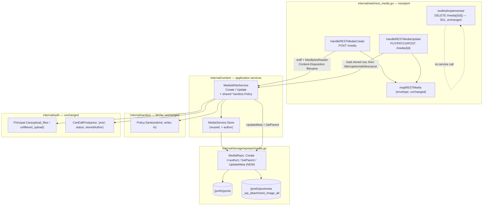

# M10.B — REST Media Write Parity: Design

## Overview

Four facts about the code as it stands set this milestone's shape.

**The media write surface is a wall of `501`s, by design.** `registerRESTMedia`
(`internal/web/rest_media.go:18`) wires `GET /media` and `GET /media/{id}` to
real handlers, then registers `restNotImplemented` for `POST /media`, every
other verb on `/media`, and *every* verb on `/media/{id}` — including
`POST /media/{id}`, which WordPress treats as an update. 10.B replaces exactly
two of those stub registrations (`POST /media`; `PUT`/`PATCH`/`POST /media/{id}`)
and leaves the four DELETE stubs untouched (Req 9).

**M10a already built the pattern this milestone copies.**
`content.PostWriteService` (`internal/content/writeservices.go`) loads the
authoritative stored row, authorizes against *that* row's `post_author` via
`auth.CanEditPost`, snapshots, then runs the caller's fields through the shared
`*sanitize.Policy` with a byte-identity skip (`sanitizeIncoming`, Finding 3 of
M10a), failing closed on any policy error. The policy defaults to
`sanitize.New()` when unwired — never nil — so an un-wired service sanitizes
rather than silently not sanitizing. 10.B adds `content.MediaWriteService` as
the media analogue, reusing every one of those postures.

**`MediaService.Store` already does the hard upload work, and already leaves a
seam for the author.** `Store` (`internal/content/media.go:72`) sanitizes the
filename, lays out the year/month directory, de-duplicates, derives the title
from the filename, sets the MIME type, inserts the row, and removes the file on a
failed insert (Req 11.4's rollback). It writes `m.AuthorID` into `post_author`
straight through — and today every caller leaves `AuthorID` zero. Threading the
uploader is therefore additive: one field on `MediaUpload`, no change to the
insert, no migration (`post_author` is an existing column, written as `0` since
M4).

**The MIME allow-list lives in the transport, not in `Store`.** `Store` takes a
`MimeType` and trusts it; the allow-list decision is `mimeAllowed`
(`internal/web/adminapi_media.go:174`) against `http.DetectContentType`'s sniff
of the actual bytes. 10.B must replicate that sniff-and-check on the REST create
path and add the `unfiltered_upload` bypass (Req 6) — it cannot delegate the
check to `Store`, which has no concept of it.

This design adds **one application service** (`content.MediaWriteService`), **one
method on `domain.MediaWriter`** (metadata update) plus **one additive field** on
its `Create` input, **two REST handlers** (`handleRESTMediaCreate`,
`handleRESTMediaUpdate`) replacing two stub groups, and extends **`domain.Media`
+ `RESTMapper.Media`** so an updated caption/description/alt is observable on a
subsequent `GET` (Req 10.3). No migration, no new capability name, no change to
any read response shape beyond the three fields WordPress's media GET already
carries and grimoire did not yet surface.

Three things found during design contradict the requirements as written. They
are collected in "Findings" rather than resolved silently; two of them change
what gets built (`domain.Media` and `RESTMapper.Media` grow fields the
requirements assume already exist).

## Architecture



Two edges carry the milestone's argument.

**`Create --> MWS` does not touch the Policy.** Create is binary-only (D1): the
body is bytes, the only caller-supplied *string* is the `Content-Disposition`
filename, and `Store` already sanitizes that into a slug and a title
(`sanitizeBase`/`titleFromFilename`). No caller-supplied markup enters, so the
Policy has nothing to sanitize on create (Req 1.3). This is the one asymmetry
with `PostWriteService`, whose create path *does* sanitize.

**`MWS --> CEP` reads the stored row, never the body.** Every update capability
decision is `auth.CanEditPost(actor, "post", stored.Status, stored.AuthorID)`
against the row loaded by ID — the same posture `PostWriteService.Update`
enforces, so a forged `author` or `post` field in the request cannot escalate
(Req 5.5, 11.2).

## Capability model (Requirement 5)

The capabilities already exist in `internal/auth/roles.go`; no new name is
introduced (D4). The ownership helper already exists too, and this is worth
stating because the brief asked whether a media-specific helper is needed:

**`auth.CanEditPost` is the correct helper, used as-is.** An attachment is a
`{prefix}posts` row with `post_type = "attachment"`; `CanEditPost`
(`internal/auth/policy.go:40`) keys entirely off `(postType, status, authorID)`
and the `edit_*`/`edit_others_*` families. Passing `postType = "post"` selects
the `*_posts` capability family (`capSuffix` returns `"posts"` for anything that
is not `"page"`), which is exactly what Req 5.3/5.4 ask for: own-attachment edit
needs `edit_posts`, other-user edit needs `edit_others_posts`. Attachments are
stored with `post_status = "inherit"` (see `MediaRepo.Create`), which is neither
`"publish"` nor `"private"`, so the `edit_published_*`/`edit_private_*` branches
never fire — the check reduces to precisely the two-way own-vs-others decision
Req 5.3/5.4 describe. **No new `CanEditMedia`/`CanUploadMedia` helper is
added**; create uses a direct `actor.Can("upload_files")` (Req 5.1/5.2) and the
`unfiltered_upload` bypass uses `actor.Can("unfiltered_upload")` (Req 6.2),
matching how `PostWriteService` calls `auth.CanCreatePost` and how the Policy
reads `unfiltered_html` — one capability, one mechanism (`Principal.Can`).

| Operation | Capability | Evaluated against |
|---|---|---|
| create (`POST /media`) | `upload_files` | the acting principal (Req 5.1, 5.2) |
| create MIME bypass | `unfiltered_upload` | the acting principal (Req 6.2) |
| update, own attachment | `edit_posts` | `stored.AuthorID == actor.UserID` (Req 5.3) |
| update, other's attachment | `edit_others_posts` | `stored.AuthorID != actor.UserID` (Req 5.4) |

An unauthenticated caller holds no capabilities, so both gates fail and the
handler returns `403` (`rest_cannot_create` for create, `rest_cannot_edit` for
update) — the forbidden-write convention `rest_posts.go` already uses, which
returns `http.StatusForbidden` for a capability failure rather than a distinct
`401` (Req 5.6).

## Components and Interfaces

This milestone adds one application service (`content.MediaWriteService`), one
method on the `domain.MediaWriter` port plus one additive `MediaUpload` field,
and two REST handlers, and extends the media read path so writes are observable.
Each is specified in the subsections below. The data types these components
exchange (`MediaCreateInput`, `MediaMetaUpdate`, `domain.MediaMeta`, the
`MediaUpload` delta, and the read-side `domain.Media` additions) are collected
in **Data Models**.

### `content.MediaWriteService` (Requirements 1, 4, 5, 6, 11)

The media analogue of `PostWriteService`: it owns the capability checks, the
Policy calls, the MIME/size guards, and the ownership evaluation against the
stored row. It lives in `internal/content` beside the other write services.

#### Struct, options, constructor

```go
// MediaWriteService performs capability-checked create and metadata-update of
// attachments. It wraps the existing MediaService (reused verbatim for the
// binary upload, Req 1.1) and the media writer/reader ports, and routes every
// caller-supplied metadata string through the shared sanitize.Policy before it
// reaches persistence (Req 11.1). The acting Principal is passed per call; the
// service enforces WordPress-style ownership and upload capabilities before
// touching the store (Req 5), exactly as PostWriteService does.
type MediaWriteService struct {
	media  *MediaService          // reused for Store (upload, rollback, Req 1.1/11.4)
	reader domain.MediaRepository // loads the stored row for authz + partial update (Req 2.1, 5.5)
	writer domain.MediaWriter     // Create (+author), SetParent, and the NEW UpdateMeta (Req 3)
	// policy is the write-boundary content policy applied to update metadata at
	// the actor's tier (Req 4). It defaults to sanitize.New() in the
	// constructor and is NEVER nil: an unwired service sanitizes rather than
	// silently passing input through, matching PostWriteService / CommentService
	// / the Server (fail closed, Req 11.1/11.3).
	policy *sanitize.Policy
}

// MediaWriteOption follows the PostWriteOption style so the shared process-wide
// policy is injected without a positional parameter.
type MediaWriteOption func(*MediaWriteService)

// WithMediaContentPolicy wires the shared *sanitize.Policy (in production the
// process-wide sanitize.New()) into MediaWriteService. When omitted, the
// constructor's sanitize.New() default still applies, so the service never
// silently skips sanitization (Req 11.1/11.3).
func WithMediaContentPolicy(p *sanitize.Policy) MediaWriteOption {
	return func(s *MediaWriteService) { s.policy = p }
}

// NewMediaWriteService constructs a MediaWriteService over an existing
// MediaService and the media reader/writer ports. The content policy defaults
// to sanitize.New() (never nil / fail closed); pass WithMediaContentPolicy to
// share the process-wide policy (Req 4, 11.1).
func NewMediaWriteService(media *MediaService, reader domain.MediaRepository, writer domain.MediaWriter, opts ...MediaWriteOption) *MediaWriteService {
	s := &MediaWriteService{media: media, reader: reader, writer: writer, policy: sanitize.New()}
	for _, opt := range opts {
		opt(s)
	}
	return s
}
```

#### Sentinels

Reusing `content.ErrForbidden` (already defined in `writeservices.go`) for the
capability failures keeps the transport's `errors.Is(err, content.ErrForbidden)`
branch identical to `rest_posts.go`. Two new sentinels distinguish the
upload-guard failures so the handler can map them to `415` / `413` rather than a
generic `400`/`500`:

```go
// ErrUnsupportedMediaType is returned by MediaWriteService.Create when the
// server-detected MIME type is not in MediaConfig.AllowedMIMEs and the actor
// does not hold unfiltered_upload (Req 6.1). The transport maps it to 415
// rest_upload_unsupported_media_type.
var ErrUnsupportedMediaType = errors.New("content: unsupported media type")

// ErrUploadTooLarge is returned when the upload body exceeds
// MediaConfig.MaxUploadSize (Req 7.1). The transport maps it to 413
// rest_upload_file_too_big. (See Finding 1 on where the size cap is actually
// enforced — the handler's MaxBytesReader is the primary gate; this sentinel
// covers the service-level belt-and-braces check.)
var ErrUploadTooLarge = errors.New("content: upload exceeds maximum size")
```

Policy errors reuse the fail-closed path, surfaced as the *real* sentinels —
there is no `content`-level policy-error wrapper, and none is invented here,
because `PostWriteService` has none either (verified against
`internal/content/writeservices.go` and `internal/web/rest_posts.go`).

`sanitizeIncoming` in `PostWriteService` returns exactly two things on the
sanitize path: `content.ErrTitleEmpty` when the title sanitizes to empty, and
**any policy error unchanged** otherwise (`return domain.Post{}, err`). The
transport (`rest_posts.go`) maps only `content.ErrForbidden` → `403` and
`content.ErrTitleEmpty` → `400 rest_invalid_param`; every other error (an
un-wrapped policy error included) falls to the `default` → `500`. There is no
generic "policy returned an error → 400" branch, and no `isPolicyError` /
`content.ErrSanitize` sentinel.

For media the only policy error that can actually arise is
`sanitize.ErrTitleNotConverging`, and only on the two fields mapped to
`sanitize.PostTitle` (title, alt_text). `Policy.Sanitize` with a *fixed*
`FieldKind`/`Tier` constant (as the write services always pass) can never return
`unrecognisedError` — that path only fires on an out-of-range kind/tier
(`internal/sanitize/policy.go`). The tier-B/tier-C fields (caption →
`PostExcerpt`, description → `PostContent`) cannot error at all: those kinds run
`p.tierB.Sanitize(in)` / `p.tierA.Sanitize(in)`, which return `(string, nil)`.
Only the `PostTitle` path can fail, via `titleText` →
`sanitize.ErrTitleNotConverging` (a pathologically nested-encoding title/alt,
`internal/sanitize/title.go`).

So `MediaWriteService.Update` returns the policy error **unchanged** (the
`PostWriteService` posture), and the handler maps `sanitize.ErrTitleNotConverging`
to `400 rest_invalid_param` — the same 400 a bad post title gets, not a 500.
This satisfies Req 4.7 ("policy returns a non-nil error → 400, no persist")
through the real sentinel rather than an invented wrapper.

Media title/alt that sanitizes to **empty** is acceptable and is NOT an error:
unlike a post title, an empty media title is fine (the filename-derived title
set by `Store` at create time already exists), so this design does not adopt an
`ErrTitleEmpty`-equivalent for media and invents no `ErrMediaTitleEmpty`. Only
non-convergence is an error, and it maps to `400`.

#### `Create`

Binary-only (D1). The handler has already enforced the body size via
`http.MaxBytesReader` and read the bytes; `Create` takes the sniffed MIME type
and the filename, applies the capability + MIME-allow-list decision, then
delegates to `MediaService.Store`, threading the author (D7).

```go
// MediaCreateInput carries the already-read, already-sniffed upload. The
// handler owns the MaxBytesReader size cap and the http.DetectContentType sniff
// (Req 6.4, 7.2) — the same split adminMediaUpload uses — and hands the result
// here. Filename is the raw Content-Disposition filename; Store sanitizes it
// (Req 1.3, and Security Considerations).
type MediaCreateInput struct {
	Data     []byte // the upload body (already capped by the handler's MaxBytesReader)
	Filename string // from Content-Disposition; sanitized by Store into slug + title
	MimeType string // server-sniffed via http.DetectContentType (Req 6.4)
}

// Create authorizes an upload and stores it. It requires upload_files (Req 5.1);
// enforces the MIME allow-list against the server-sniffed type unless the actor
// holds unfiltered_upload (Req 6); and streams the bytes through
// MediaService.Store, which performs the filename sanitization, directory
// layout, de-duplication, insert, and file-removal-on-failed-insert rollback
// (Req 1.1, 11.4). The new attachment's post_author is set to actor.UserID (D7,
// Req 1.4) so a later update by the same caller is the own-attachment branch of
// Req 5.3. Returns ErrForbidden (no write) when the actor lacks upload_files,
// ErrUnsupportedMediaType (no write) on a disallowed MIME, and the Store error
// otherwise.
func (s *MediaWriteService) Create(ctx context.Context, actor auth.Principal, in MediaCreateInput) (domain.Media, error) {
	if !actor.Can("upload_files") {
		return domain.Media{}, ErrForbidden
	}
	if !actor.Can("unfiltered_upload") {
		if !mimeAllowedForMedia(in.MimeType, s.media.Config().AllowedMIMEs) {
			return domain.Media{}, ErrUnsupportedMediaType
		}
	}
	return s.media.Store(ctx, bytes.NewReader(in.Data), MediaUpload{
		Filename: in.Filename,
		MimeType: in.MimeType,
		Author:   actor.UserID, // D7: thread the uploader (new MediaUpload field)
	})
}
```

`mimeAllowedForMedia` is `content`'s copy of the transport's existing
`mimeAllowed` logic (empty allow-list means unrestricted for every caller, Req
6.3; base-MIME comparison that strips a `; charset=…` suffix). Placing the
allow-list decision in the service rather than the handler keeps the whole
upload policy — capability, MIME, size — in one capability-checked place (Req
8.3, 11.3), and lets a service-level test assert the `unfiltered_upload` bypass
without a transport. The admin upload path keeps its own transport-level
`mimeAllowed` call unchanged; the two share the same tiny predicate.

#### `Update`

Loads the stored attachment, authorizes against its `post_author`, applies the
Policy per field with the byte-identity skip (mirroring
`PostWriteService.sanitizeIncoming`, Finding 3 of M10a), persists metadata via
the new `UpdateMeta` port method, and routes `post` (parent) through the
existing `SetParent` (D2, Req 2.2/3.5).

```go
// MediaMetaUpdate is the partial-update request. Every field is a pointer so
// Update can distinguish "omitted" (nil — leave the stored value untouched, Req
// 2.3) from "explicitly set to empty", exactly as restPostWriteRequest does for
// posts. Parent is the "post" field; a nil Parent leaves post_parent untouched.
type MediaMetaUpdate struct {
	Title       *string
	Caption     *string
	AltText     *string
	Description *string
	Parent      *int64
}

// Update authorizes and applies an attachment metadata edit. It loads the
// authoritative stored row by ID (Req 2.1) and evaluates the edit capability
// against THAT row's post_author (Req 5.3-5.5, 11.2) — never a body value. Each
// supplied metadata field is sanitized at the actor's tier at its mapped field
// kind (Req 4), with a field whose sanitized-input equals the stored value
// passed through unchanged and NOT re-sanitized (Req 2.4, byte-identity skip).
// Changed metadata is persisted via MediaWriter.UpdateMeta; a supplied parent
// goes through the existing SetParent (Req 2.2, 3.5). On any policy error,
// capability failure, or missing row the service writes nothing (fail closed,
// Req 11.3). Returns ErrForbidden on a capability failure and domain.ErrNotFound
// when {id} resolves to no attachment (Req 2.5).
func (s *MediaWriteService) Update(ctx context.Context, actor auth.Principal, id int64, upd MediaMetaUpdate) (domain.Media, error) {
	cur, err := s.reader.ByID(ctx, id)
	if err != nil {
		return domain.Media{}, err // domain.ErrNotFound bubbles up (Req 2.5)
	}
	if !auth.CanEditPost(actor, "post", "inherit", cur.AuthorID) {
		return domain.Media{}, ErrForbidden
	}

	writer := sanitize.For(actor)
	meta := domain.MediaMeta{ // the current stored metadata, mutated below
		Title:       cur.Title,
		Caption:     cur.Caption,
		AltText:     cur.AltText,
		Description: cur.Description,
	}

	// Per-field: sanitize at the mapped kind, skip the write-back when the
	// sanitized value is byte-identical to what is stored (Req 2.4 / Finding 3).
	if upd.Title != nil {
		v, err := s.policy.Sanitize(sanitize.PostTitle, writer, *upd.Title) // Req 4.1
		if err != nil {
			return domain.Media{}, err // fail closed, Req 4.7
		}
		meta.Title = v
	}
	if upd.Caption != nil {
		v, err := s.policy.Sanitize(sanitize.PostExcerpt, writer, *upd.Caption) // Req 4.2
		if err != nil {
			return domain.Media{}, err
		}
		meta.Caption = v
	}
	if upd.AltText != nil {
		v, err := s.policy.Sanitize(sanitize.PostTitle, writer, *upd.AltText) // Req 4.4 (plain-text strip)
		if err != nil {
			return domain.Media{}, err
		}
		meta.AltText = v
	}
	if upd.Description != nil {
		v, err := s.policy.Sanitize(sanitize.PostContent, writer, *upd.Description) // Req 4.3
		if err != nil {
			return domain.Media{}, err
		}
		meta.Description = v
	}

	// UpdateMeta writes title/caption/description to the posts row and alt_text
	// to the _wp_attachment_image_alt postmeta row. A field byte-identical to
	// the stored value is a no-op write (same bytes), so the "not re-sanitized /
	// not written back" guarantee of Req 2.4 holds at the value level; see the
	// repo note on the identity skip below.
	if err := s.writer.UpdateMeta(ctx, id, meta); err != nil {
		return domain.Media{}, err
	}
	if upd.Parent != nil {
		if err := s.writer.SetParent(ctx, id, *upd.Parent); err != nil { // Req 2.2, 3.5
			return domain.Media{}, err
		}
	}
	return s.reader.ByID(ctx, id) // re-read so the handler envelopes the stored values (Req 10.3)
}
```

Two notes on the byte-identity skip. The service passes the *stored* `cur.*`
value as the starting point of `meta`, and only overwrites a field when the
request supplied it. For a supplied field whose sanitized value equals the
stored value, `UpdateMeta` writes identical bytes — observationally a no-op, and
never a *re-sanitization of the stored value* because the policy ran on the
caller's supplied string, not on `cur`. This is the same reasoning as M10a
Finding 3, adapted: the hazard M10a guarded against (a sparse PATCH merging the
stored record as its base, so an untouched field arrives equal to the stored
value and gets rewritten) does not arise here because omitted fields are `nil`
and never reach the policy at all. The byte-identity acceptance test is still
worth writing — "a PATCH that re-sends the stored caption verbatim does not
alter it" — to pin the guarantee against a future refactor that starts merging.

Parent validation (`post` non-numeric/negative → `400 rest_invalid_param`, Req
2.6) happens in the handler before the service is called, matching how
`rest_posts.go` validates the `{id}` and date before `postWrite.Update`.

### `domain.MediaWriter` additions (Requirement 3)

Two changes, both additive.

#### The new metadata-update method

```go
// BEFORE (internal/domain/repository.go:222)
type MediaWriter interface {
	Create(ctx context.Context, m Media) (int64, error)
	SetParent(ctx context.Context, id, parentID int64) error
}

// AFTER
type MediaWriter interface {
	// Create inserts an attachment and returns its generated ID. m.AuthorID is
	// written to post_author (0 for callers that do not set it — the pre-10.B
	// behavior; D7/Req 3.6).
	Create(ctx context.Context, m Media) (int64, error)
	// SetParent sets the attachment's post_parent, or ErrNotFound (unchanged).
	SetParent(ctx context.Context, id, parentID int64) error
	// UpdateMeta persists an attachment's editable metadata (title, caption,
	// alt_text, description) to its existing storage locations: title ->
	// post_title, caption -> post_excerpt, description -> post_content on the
	// attachment's {prefix}posts row, and alt_text -> the
	// _wp_attachment_image_alt {prefix}postmeta row (Req 3.1, 3.2). It returns
	// domain.ErrNotFound when no attachment has the given ID, matching the
	// SetParent contract (Req 3.4). The parent (post) is NOT updated here; it
	// continues to use SetParent (Req 3.5, D2).
	UpdateMeta(ctx context.Context, id int64, m MediaMeta) error
}
```

`MediaMeta` is the editable-metadata value object (see Finding 2 — `domain.Media`
does not carry these fields today, so a dedicated input type is cleaner than
overloading `Media`):

```go
// MediaMeta is the editable attachment metadata set (Req 3.1, D2). It is a
// write-side value object distinct from domain.Media so the update port names
// exactly the fields it persists and nothing else; parent is excluded by design
// (Req 3.5).
type MediaMeta struct {
	Title       string // post_title
	Caption     string // post_excerpt
	AltText     string // _wp_attachment_image_alt postmeta
	Description string // post_content
}
```

#### The `Create` author seam

No signature change to `MediaWriter.Create` is needed: `Create(ctx, Media)`
already carries `Media.AuthorID`, and `wprepo.MediaRepo.Create` already inserts
it (`internal/storage/wprepo/media.go:159` writes `m.AuthorID` into
`post_author`). The author is threaded one layer up, through
`content.MediaUpload` and `MediaService.Store`, which is the only place that
constructs the `domain.Media` passed to `Create` (see the next section). This is
the honest reading of Req 3.6 "the Create signature ... SHALL thread the ...
user ID": the *path* threads it; the port signature is already sufficient.

#### No migration (Requirement 3.3)

Confirmed against the storage layer. Every target already exists:

| Field | Column / row | Already present because |
|---|---|---|
| title | `{prefix}posts.post_title` | `MediaRepo.Create` already inserts it; read by `mediaRow` |
| caption | `{prefix}posts.post_excerpt` | inserted as `""` by `MediaRepo.Create`; a core posts column since migration `0001` |
| description | `{prefix}posts.post_content` | inserted as `""` by `MediaRepo.Create`; core posts column |
| alt_text | `{prefix}postmeta` row, `meta_key = '_wp_attachment_image_alt'` | `MediaRepo.Create` already writes a `_wp_attached_file` row into the same table; alt is one more key |
| author | `{prefix}posts.post_author` | `MediaRepo.Create` already inserts `m.AuthorID`; core posts column |

No `internal/storage/migrations` file is added; the task list should assert that,
mirroring M10a's and M8's no-migration checks (Req 3.3).

#### `wprepo.MediaRepo.UpdateMeta` implementation

```go
// UpdateMeta writes the four editable metadata fields in a single transaction:
// an UPDATE of post_title/post_excerpt/post_content on the attachment's posts
// row (guarded by post_type='attachment' so it can never touch a non-attachment
// row), and an upsert of the _wp_attachment_image_alt postmeta row. ErrNotFound
// is returned when the posts UPDATE matches no attachment row (Req 3.4), using
// the same errNotFoundIfMissing helper SetParent uses.
func (r *MediaRepo) UpdateMeta(ctx context.Context, id int64, m domain.MediaMeta) error {
	return r.db.RunInTx(ctx, nil, func(ctx context.Context, tx bun.Tx) error {
		res, err := tx.NewUpdate().
			TableExpr("?", bun.Ident(r.prefix+"posts")).
			Set("post_title = ?", m.Title).
			Set("post_excerpt = ?", m.Caption).
			Set("post_content = ?", m.Description).
			Where("? = ?", bun.Ident("ID"), id).
			Where("post_type = ?", "attachment").
			Exec(ctx)
		if err != nil {
			return err
		}
		if err := errNotFoundIfMissingTx(ctx, tx, res, id, r.prefix); err != nil {
			return err // ErrNotFound when no attachment matched (Req 3.4)
		}
		return upsertPostMeta(ctx, tx, r.prefix, id, "_wp_attachment_image_alt", m.AltText)
	})
}
```

`upsertPostMeta` is a small helper (DELETE-then-INSERT, or an
`INSERT ... ON CONFLICT` where the vendor supports it, following the vendor
switch `MediaRepo.Create` already uses via `insertReturningID`) that writes a
single-valued postmeta row — the write counterpart of `PostMetaRepo.get`'s
single-valued read. The alt key is the WordPress-standard
`_wp_attachment_image_alt`, the same key WordPress's `wp_update_attachment_metadata`
and the Media Library "Alt Text" field use. `errNotFoundIfMissingTx` is the
transaction-scoped twin of the existing `errNotFoundIfMissing` used by
`SetParent`.

### `content.MediaService.Store` / `MediaUpload` change (Requirement 3.6, D7)

One additive field, one line in `Store`:

```go
// BEFORE (internal/content/media.go:28)
type MediaUpload struct {
	Filename string
	MimeType string
	Title    string
	ParentID int64
}

// AFTER
type MediaUpload struct {
	Filename string
	MimeType string
	Title    string
	ParentID int64
	// Author is the uploading principal's user ID, written to the new
	// attachment's post_author (D7, Req 3.6). Zero — the value every pre-10.B
	// caller supplies by omission — preserves today's behavior (author 0).
	Author   int64
}
```

```go
// in Store (internal/content/media.go), the constructed domain.Media gains:
	media := domain.Media{
		Title:    title,
		Filename: filepath.ToSlash(relPath),
		URL:      strings.TrimRight(s.cfg.BaseURL, "/") + "/" + filepath.ToSlash(relPath),
		MimeType: detectedMime(upload.MimeType, upload.Filename),
		Date:     now,
		ParentID: upload.ParentID,
		Slug:     slug,
		AuthorID: upload.Author, // D7: 0 for callers that leave it unset
	}
```

The existing admin upload caller is updated to pass its principal so an
admin-uploaded attachment is also authored (consistent authorship across both
upload surfaces, and strictly additive). `adminMediaUpload`
(`internal/web/adminapi_media.go:143`) resolves the principal from the request
context — the admin API router already runs the session middleware and gates on
`edit_posts` — so:

```go
	// adminMediaUpload, at the Store call:
	var authorID int64
	if p, ok := PrincipalFrom(r.Context()); ok {
		authorID = p.UserID
	}
	m, err := s.media.Store(r.Context(), bytes.NewReader(data), content.MediaUpload{
		Filename: h.Filename, MimeType: sniffed, Author: authorID,
	})
```

Every other construction of `MediaUpload` in the tree leaves `Author` zero, so
the zero-value path (author `0`) is preserved verbatim for them (Req 3.6).

### REST handlers (Requirement 1, 2, 5, 6, 7, 8)

`registerRESTMedia` replaces exactly two stub registrations and leaves the rest
untouched:

```go
func (s *Server) registerRESTMedia(r chi.Router) {
	r.Method(http.MethodGet, "/media", s.handleRESTMediaCollection())
	r.Method(http.MethodGet, "/media/{id}", s.handleRESTMediaSingle())
	r.Method(http.MethodPost, "/media", s.handleRESTMediaCreate())            // was restNotImplemented (Req 1)
	for _, m := range []string{http.MethodPut, http.MethodPatch, http.MethodPost} {
		r.Method(m, "/media/{id}", s.handleRESTMediaUpdate())                 // was restNotImplemented (Req 2)
	}
	// Unchanged 501 stubs (Req 9):
	for _, m := range []string{http.MethodPut, http.MethodPatch, http.MethodDelete} {
		r.Method(m, "/media", restNotImplemented("rest_cannot_edit", "Updating or deleting media"))
	}
	r.Method(http.MethodDelete, "/media/{id}", restNotImplemented("rest_cannot_edit", "Deleting media"))
}
```

Note the single-item loop now covers only `PUT`/`PATCH`/`POST` (the three update
verbs, Req 2.1); `DELETE /media/{id}` keeps its own `restNotImplemented`
registration (Req 9.2), and `PUT`/`PATCH`/`DELETE /media` (collection) keep
theirs (Req 9.1).

Both handlers need the new service. The Server gains one field and the existing
`WithContentFeatures` builder is extended (see "Server wiring"). The auth
preamble is the shared pattern from `rest_posts.go`/`rest_comments.go`: an
Application Password skips CSRF; a session enforces M4 CSRF via
`requireSessionCSRFREST` (Req 8.1, 8.2).

#### `handleRESTMediaCreate` (Requirement 1, 6, 7)

```go
// handleRESTMediaCreate serves POST .../media: a raw binary upload (D1).
// Auth matches rest_posts/rest_comments (Req 8). The body is capped by
// http.MaxBytesReader against MediaConfig.MaxUploadSize (Req 7.2) and the MIME
// type is sniffed server-side (Req 6.4). The initial title is derived from the
// Content-Disposition filename by MediaService.Store (Req 1.3); the Policy is
// not invoked here (Req 1.3, 8.3).
func (s *Server) handleRESTMediaCreate() http.HandlerFunc {
	return func(w http.ResponseWriter, r *http.Request) {
		if !isAppPasswordAuth(r.Context()) {
			if _, hasSession := sessionFrom(r.Context()); hasSession {
				if !s.requireSessionCSRFREST(w, r) {
					return
				}
			}
		}
		principal, _ := PrincipalFrom(r.Context())

		// Content-Disposition filename is mandatory (Req 1.1, 1.5).
		filename, ok := parseContentDispositionFilename(r.Header.Get("Content-Disposition"))
		if !ok {
			writeRESTError(w, http.StatusBadRequest, "rest_upload_no_content_disposition",
				"No Content-Disposition supplied with the request.")
			return
		}

		// Size cap: the primary gate (Req 7.1, 7.2). MaxBytesReader makes an
		// over-cap body surface as an error on read, which we map to 413. The
		// cap is the configured MediaService MaxUploadSize (10 MiB default),
		// read from s.media (the Server already holds *content.MediaService).
		maxBytes := s.media.Config().MaxUploadSize
		r.Body = http.MaxBytesReader(w, r.Body, maxBytes)
		data, err := io.ReadAll(r.Body)
		if err != nil {
			var mbe *http.MaxBytesError
			if errors.As(err, &mbe) {
				writeRESTError(w, http.StatusRequestEntityTooLarge, "rest_upload_file_too_big",
					"The uploaded file exceeds the maximum size.")
				return
			}
			writeRESTError(w, http.StatusBadRequest, "rest_invalid_param", "Could not read the request body.")
			return
		}
		if len(data) == 0 { // Req 6: empty body (Req 1.6)
			writeRESTError(w, http.StatusBadRequest, "rest_upload_no_data", "No data supplied.")
			return
		}

		// Server-sniffed MIME (Req 6.4), never the client Content-Type header.
		sniffLen := len(data)
		if sniffLen > 512 {
			sniffLen = 512
		}
		sniffed := http.DetectContentType(data[:sniffLen])

		media, err := s.mediaWrite.Create(r.Context(), principal, content.MediaCreateInput{
			Data: data, Filename: filename, MimeType: sniffed,
		})
		if err != nil {
			switch {
			case errors.Is(err, content.ErrForbidden):
				writeRESTError(w, http.StatusForbidden, "rest_cannot_create",
					"Sorry, you are not allowed to create media.")
			case errors.Is(err, content.ErrUnsupportedMediaType):
				writeRESTError(w, http.StatusUnsupportedMediaType, "rest_upload_unsupported_media_type",
					"Sorry, you are not allowed to upload this file type.")
			default:
				writeRESTError(w, http.StatusInternalServerError, "rest_upload_failed", "Could not create media.")
			}
			return
		}
		enveloped, err := s.mapRESTMedia(r, media) // reuse the existing GET envelope (Req 1.2)
		if err != nil {
			writeRESTError(w, http.StatusInternalServerError, "rest_list_failed", "Could not map media.")
			return
		}
		_ = writeRESTResponse(w, r, http.StatusCreated, enveloped) // 201 (Req 1.2)
	}
}
```

`parseContentDispositionFilename` parses the header via `mime.ParseMediaType`
and returns the `filename` parameter (falling back to no-ok when absent),
matching how WordPress keys the upload off `Content-Disposition: attachment;
filename="..."`. The MIME allow-list and `unfiltered_upload` bypass live inside
`MediaWriteService.Create` (above), so the handler maps only the sentinel it
gets back.

Mapping of the Req error codes:

| Condition | Status | Code | Where decided |
|---|---|---|---|
| missing `Content-Disposition` filename | 400 | `rest_upload_no_content_disposition` | handler (Req 1.5) |
| empty body | 400 | `rest_upload_no_data` | handler (Req 1.6) |
| body over `MaxUploadSize` | 413 | `rest_upload_file_too_big` | handler (`MaxBytesReader`, Req 7) |
| MIME not allowed, no `unfiltered_upload` | 415 | `rest_upload_unsupported_media_type` | service → handler (Req 6.1) |
| lacks `upload_files` / unauthenticated | 403 | `rest_cannot_create` | service → handler (Req 5.1, 5.6) |

#### `handleRESTMediaUpdate` (Requirement 2, 4, 5)

```go
// handleRESTMediaUpdate serves PUT/PATCH/POST .../media/{id}: a partial update
// of the editable metadata set (D2). Auth matches create. {id} must resolve to
// an attachment (Req 2.5); a bad "post" parent is 400 rest_invalid_param (Req
// 2.6). The service loads the stored row, authorizes against its post_author,
// sanitizes each supplied field, and persists; the 200 response is the same
// envelope GET returns, re-read from storage so it reflects the sanitized stored
// values (Req 2.1, 10.3).
func (s *Server) handleRESTMediaUpdate() http.HandlerFunc {
	return func(w http.ResponseWriter, r *http.Request) {
		if !isAppPasswordAuth(r.Context()) {
			if _, hasSession := sessionFrom(r.Context()); hasSession {
				if !s.requireSessionCSRFREST(w, r) {
					return
				}
			}
		}
		principal, _ := PrincipalFrom(r.Context())

		id, err := strconv.ParseInt(chi.URLParam(r, "id"), 10, 64)
		if err != nil || id <= 0 {
			writeRESTError(w, http.StatusNotFound, "rest_post_invalid_id", "Invalid media ID.")
			return
		}

		var body restMediaUpdateBody
		if err := json.NewDecoder(r.Body).Decode(&body); err != nil {
			writeRESTError(w, http.StatusBadRequest, "rest_invalid_param", "Invalid request body.")
			return
		}
		upd, code, err := parseRESTMediaUpdate(body) // validates "post" (Req 2.6)
		if err != nil {
			writeRESTError(w, http.StatusBadRequest, code, err.Error())
			return
		}

		media, err := s.mediaWrite.Update(r.Context(), principal, id, upd)
		if err != nil {
			switch {
			case errors.Is(err, domain.ErrNotFound):
				writeRESTError(w, http.StatusNotFound, "rest_post_invalid_id", "Invalid media ID.") // Req 2.5
			case errors.Is(err, content.ErrForbidden):
				writeRESTError(w, http.StatusForbidden, "rest_cannot_edit",
					"Sorry, you are not allowed to edit this media.") // Req 5.3-5.6
			case errors.Is(err, sanitize.ErrTitleNotConverging):
				// The only policy error the title/alt path can surface (Req
				// 4.7). The service returns it unchanged (the PostWriteService
				// posture); map it to the same 400 a bad post title gets, never
				// a 500. caption/description (tier B/C) cannot error, so there
				// is no generic policy-error branch and no invented wrapper.
				writeRESTError(w, http.StatusBadRequest, "rest_invalid_param",
					"The supplied title or alt text could not be accepted.")
			default:
				writeRESTError(w, http.StatusInternalServerError, "rest_update_failed", "Could not update media.")
			}
			return
		}
		enveloped, err := s.mapRESTMedia(r, media)
		if err != nil {
			writeRESTError(w, http.StatusInternalServerError, "rest_list_failed", "Could not map media.")
			return
		}
		_ = writeRESTResponse(w, r, http.StatusOK, enveloped) // 200 (Req 2.1)
	}
}
```

```go
// restMediaUpdateBody is the WordPress-vocabulary request body (Req 2.1).
// Pointers distinguish omitted from explicitly-empty, giving partial-update
// semantics (Req 2.3), identical to restPostWriteRequest.
type restMediaUpdateBody struct {
	Title       *string `json:"title"`
	Caption     *string `json:"caption"`
	AltText     *string `json:"alt_text"`
	Description *string `json:"description"`
	Post        *int64  `json:"post"` // parent (Req 2.2)
}

// parseRESTMediaUpdate validates the body and maps it to the service input.
// A negative "post" is rejected (Req 2.6); a non-numeric "post" is caught by
// JSON decoding into *int64 above, which also yields rest_invalid_param.
func parseRESTMediaUpdate(body restMediaUpdateBody) (content.MediaMetaUpdate, string, error) {
	if body.Post != nil && *body.Post < 0 {
		return content.MediaMetaUpdate{}, "rest_invalid_param", errors.New("post must be a non-negative integer")
	}
	return content.MediaMetaUpdate{
		Title: body.Title, Caption: body.Caption, AltText: body.AltText,
		Description: body.Description, Parent: body.Post,
	}, "", nil
}
```

The policy-error mapping matches `rest_posts.go` exactly: the service returns
the policy error unchanged (as `PostWriteService.sanitizeIncoming` returns `err`
for a policy failure and `content.ErrTitleEmpty` for an empty title), and the
transport switches on the real exported sentinels — `content.ErrForbidden`,
`domain.ErrNotFound`, and here `sanitize.ErrTitleNotConverging`. There is no
`isPolicyError` helper and no `content.ErrSanitize` wrapper; neither exists in
the codebase, and inventing one would diverge from the post write path this
design copies. `ErrTitleNotConverging` is the only policy error the media update
can produce (title/alt → `sanitize.PostTitle`); caption/description map to tier
B/C kinds that return `(string, nil)`. The mapping is `400 rest_invalid_param`,
never `500` (Req 4.7).

The `POST /media/{id}` verb routes to this same handler (Req 2.1 includes
`POST`), so the create/update split is purely collection-vs-item: `POST /media`
creates, `POST /media/{id}` updates — exactly WordPress's convention and the
reason the existing stub registered `POST /media/{id}` as an edit.

### `RESTMapper.Media` and `domain.Media` — making updates observable (Requirement 10.3)

This is Finding 3, surfaced here because it changes the read path. Today
`domain.Media` carries no caption/alt/description, `MediaRepo` does not read
them, and `RESTMapper.Media` does not emit them. For an updated caption/alt/
description to be observable on a subsequent `GET /media/{id}` (Req 10.3), the
read path must carry them end to end:

1. **`domain.Media` gains three fields** (additive, zero-valued for every
   existing reader):

   ```go
   type Media struct {
   	// ... existing fields ...
   	Caption     string // post_excerpt
   	AltText     string // _wp_attachment_image_alt postmeta
   	Description string // post_content
   }
   ```

2. **`wprepo.MediaRepo` reads them.** `mediaRow` gains `post_excerpt` and
   `post_content` columns on the existing SELECTs (`List`, `ByID`), and the alt
   is read from the `_wp_attachment_image_alt` postmeta — either via an added
   `LEFT JOIN` keyed on that meta_key alongside the existing `_wp_attached_file`
   join, or via a secondary `PostMetaRepo`-style lookup in `ByID`. `ByID` (the
   single-item read the update handler re-reads through) must populate all
   three; the collection read may populate them too for consistency.

3. **`content.RESTMedia` gains the WordPress fields and `RESTMapper.Media`
   populates them:**

   ```go
   type RESTMedia struct {
   	// ... existing fields ...
   	Caption     RESTRendered `json:"caption"`
   	AltText     string       `json:"alt_text"`
   	Description RESTRendered `json:"description"`
   }
   ```

   `caption` and `description` use WordPress's `{"rendered": "..."}` sub-object
   shape (as `title` already does); `alt_text` is a bare string, matching
   WordPress's media response. The mapper reads them straight from the
   now-populated `domain.Media`.

This is scoped tightly to Req 10.3's "the subsequent GET SHALL return the
sanitized stored values": the three fields are the editable set this milestone
writes, so they are exactly the fields a reader must be able to see change. The
existing `GET` response shape is otherwise unchanged (Req 10.1), and
`content.rendered`'s read/write asymmetry is not touched (Req 10.2) — media has
no `content.rendered` field.

### Server wiring (Requirement 6-wiring)

The Server gains one dependency and the shared policy reaches the new service in
`main.go`.

**Server field + builder.** `MediaWriteService` is a content feature, so it is
threaded through the existing `WithContentFeatures` builder rather than a new
one — the smallest change and the one that keeps all media wiring together:

```go
// internal/web/router.go — new field beside s.media
	mediaWrite *content.MediaWriteService // nil until WithContentFeatures; media writes 501 when nil

// internal/web/contentfeatures.go — extend the existing builder
func (s *Server) WithContentFeatures(comments *content.CommentService, media *content.MediaService, mediaWrite *content.MediaWriteService, menus *content.NavMenuService) *Server {
	s.comments = comments
	s.media = media
	s.mediaWrite = mediaWrite
	s.menus = menus
	return s
}
```

`registerRESTMedia` registers the real create/update handlers only when
`s.mediaWrite != nil`, falling back to the existing `restNotImplemented` stubs
otherwise — mirroring how `registerRESTTerms` registers write routes only when
`s.termWrite != nil`. This keeps every test harness and embedder that omits the
write service answering `501`, exactly as today, with no nil dereference.

The handler reads `MaxUploadSize` from the `MediaService` config; the Server
already holds `*content.MediaService` as `s.media`, so
`s.media.Config().MaxUploadSize` is the source. No new config field is needed.

**`main.go` construction.** The shared `contentPolicy` already exists
(`cmd/grimoire/main.go:89`) and is already passed to `PostWriteService` and the
Server. The new service is built next to `postWrite` and handed the same
instance:

```go
	mediaWrite := content.NewMediaWriteService(
		media, repos.Media, repos.MediaWriter,
		content.WithMediaContentPolicy(contentPolicy),
	)
```

and the `WithContentFeatures` call gains the argument:

```go
	.WithContentFeatures(comments, media, mediaWrite, menus)
```

So one `*sanitize.Policy` governs post writes, comment writes, media updates, and
the comment render backstop — the single-instance invariant M10a established
(Req 11.1), now covering the media surface too.

## Data Models

The data types the components above exchange. Each is defined in full in the
subsection of **Components and Interfaces** that owns it; they are catalogued
here so the model set is reviewable in one place. All additions are additive —
no field is removed or retyped, so no existing reader or caller regresses.

### `content.MediaCreateInput` (create request)

The already-read, already-sniffed upload handed from `handleRESTMediaCreate` to
`MediaWriteService.Create`. Defined under **`content.MediaWriteService` →
`Create`**.

```go
type MediaCreateInput struct {
	Data     []byte // the upload body (already capped by the handler's MaxBytesReader)
	Filename string // from Content-Disposition; sanitized by Store into slug + title
	MimeType string // server-sniffed via http.DetectContentType (Req 6.4)
}
```

### `content.MediaMetaUpdate` (partial update request)

The partial-update request; every field is a pointer so `Update` distinguishes
"omitted" (nil) from "explicitly set" (Req 2.3). Defined under
**`content.MediaWriteService` → `Update`**; its transport twin
`restMediaUpdateBody` (WordPress JSON vocabulary) is under **REST handlers →
`handleRESTMediaUpdate`**.

```go
type MediaMetaUpdate struct {
	Title       *string
	Caption     *string
	AltText     *string
	Description *string
	Parent      *int64
}
```

### `domain.MediaMeta` (write-side value object)

The editable-metadata value object the new `UpdateMeta` port method persists —
distinct from `domain.Media` so the port names exactly the fields it writes
(Finding 2). Defined under **`domain.MediaWriter` additions**.

```go
type MediaMeta struct {
	Title       string // post_title
	Caption     string // post_excerpt
	AltText     string // _wp_attachment_image_alt postmeta
	Description string // post_content
}
```

### `content.MediaUpload` delta (one additive field)

`MediaUpload` gains one field, `Author`, threaded into the new attachment's
`post_author` (D7, Req 3.6). Zero — every pre-10.B caller's value by omission —
preserves today's behavior. Defined under **`content.MediaService.Store` /
`MediaUpload` change**.

```go
type MediaUpload struct {
	Filename string
	MimeType string
	Title    string
	ParentID int64
	Author   int64 // NEW: uploading principal's user ID -> post_author (D7)
}
```

### `domain.Media` read-side additions (Finding 2 / 3)

`domain.Media` gains three read-side fields so an updated caption/alt/description
is observable on a subsequent `GET` (Req 10.3). Additive and zero-valued for
every existing reader. Defined under **`RESTMapper.Media` and `domain.Media`**;
the matching `content.RESTMedia` JSON fields (`caption`, `alt_text`,
`description`) are specified there too.

```go
type Media struct {
	// ... existing fields ...
	Caption     string // post_excerpt
	AltText     string // _wp_attachment_image_alt postmeta
	Description string // post_content
}
```

## Findings

Three things in `requirements.md` assume code that does not exist yet or
under-specify a dependency. They are here rather than papered over; Findings 2
and 3 change what gets built.

### Finding 1 — the size cap is enforced at the handler, not (only) the service

Requirement 7.2 says the endpoint "SHALL enforce the size cap using
`http.MaxBytesReader` against the configured `MaxUploadSize`, matching the admin
upload path". `http.MaxBytesReader` is a transport construct — it wraps
`r.Body` and the `http.ResponseWriter` — so it cannot live in
`content.MediaWriteService`, which never sees either. The admin path proves the
split: `adminMediaUpload` applies `MaxBytesReader` in the handler, then calls
`Store` with the already-capped reader.

**Resolution:** the handler owns the `MaxBytesReader` cap (the primary,
Req-7.2-faithful gate), and `MediaWriteService.Create` receives already-read
bytes. The `ErrUploadTooLarge` sentinel is retained as a belt-and-braces
service-level check for a non-HTTP caller of the service (there is none today),
but the transport gate is what Req 7.1/7.2 are satisfied by. This matches the
admin path exactly and keeps the one genuinely transport-bound concern in the
transport, while capability/MIME/author stay in the service (Req 11.3). No
requirement is unmet; the "endpoint SHALL enforce" wording is read as "the REST
endpoint, via its handler", which is where `MaxBytesReader` can run at all.

### Finding 2 — `domain.Media` carries none of the editable metadata fields the update method persists

Requirement 3.1 says the new `MediaWriter` method "accepts an attachment ID and
the editable metadata set (title, caption, alt_text, description)". The
*method* can take them as parameters — that is straightforward. But Req 10.3
requires an updated caption/alt/description to be **observable on a subsequent
GET**, and `domain.Media` (`internal/domain/entities.go:126`) has only
`Title`, `Filename`, `URL`, `MimeType`, `Date`, `ParentID`, `Slug`, `AuthorID`.
There is nowhere for a read to put caption/alt/description, `wprepo.MediaRepo`
does not SELECT them, and `RESTMapper.Media` does not emit them. So the update
method's write would succeed and be invisible to the API — Req 10.3 would be
unmet.

**Resolution (changes what gets built):**
- The update *input* is a dedicated `domain.MediaMeta` value object (not new
  `Media` fields), so the write port names exactly what it persists — this
  satisfies Req 3.1 cleanly.
- `domain.Media` **gains** `Caption`, `AltText`, `Description` (read-side),
  `wprepo.MediaRepo.ByID` populates them, and `RESTMapper.Media` emits
  `caption`/`alt_text`/`description`, so Req 10.3 holds. See "RESTMapper.Media
  and domain.Media" above. This is additive and zero-valued for every existing
  reader; it does not change the existing `GET` fields (Req 10.1).

Rejected alternative: overloading `domain.Media` as both the update input and
the read model. It would make the update method take a `Media` with five
irrelevant fields (`Filename`, `URL`, `MimeType`, `Date`, `Slug`) a caller must
not set, inviting exactly the "forged field" confusion Req 5.5/11.2 exist to
prevent. A write-side `MediaMeta` plus read-side `Media` fields keeps the two
roles distinct.

### Finding 3 — `RESTMapper.Media` does not surface caption/description/alt today, so Req 10.3 is not met by the existing read path

Verified against `internal/content/rest.go`: `RESTMedia` carries `id`, `date`,
`slug`, `type`, `link`, `title`, `author`, `mime_type`, `source_url`, `post`,
`media_details` — and nothing for caption, description, or alt text. The mapper
reads only `_wp_attachment_metadata` (for `media_details`), never
`_wp_attachment_image_alt`. So even before this milestone, grimoire's media GET
omits three fields WordPress's does include; this milestone's writes to those
fields would be unobservable through the API without extending the read path.

**Resolution:** folded into Finding 2's resolution — the read-path extension
(`domain.Media` fields, repo read, `RESTMapper.Media` emission) is required for
Req 10.3 and is specified above. This is the one place 10.B touches the read
surface, and it is additive (new JSON keys), so no existing read assertion
regresses (Req 10.1). Flagged separately because it is a pre-existing read gap
the requirements assume closed: Req 10.3's "return the sanitized stored values"
presupposes the GET can represent them, and today it cannot.

**Nothing else in the requirements was found unimplementable.** The author
threading (Req 3.6) needs no port-signature change (the `Media.AuthorID` seam
already exists); the MIME allow-list and `unfiltered_upload` bypass map directly
onto the existing `mimeAllowed`/`Principal.Can`; the ownership check reuses
`auth.CanEditPost` with `postType = "post"` and `status = "inherit"`; and the
`Store` rollback is reused untouched.

## Security considerations

- **Sanitize-before-persist on the update path.** Every caller-supplied
  title/caption/alt_text/description is run through the shared `sanitize.Policy`
  at the actor's tier before it reaches `UpdateMeta` (Req 11.1), with the same
  field-kind mapping M10a applies to the equivalent post fields (title/alt →
  `PostTitle` plain-text strip, caption → `PostExcerpt`, description →
  `PostContent`). A media update therefore carries no weaker a guarantee than a
  post update, and `unfiltered_html` holders get tier C for the markup fields
  through the same `Principal.Can` read, with no media-specific input (Req 4.5).
- **Capability against the stored row, never the body.** The update ownership
  check is `auth.CanEditPost(actor, "post", "inherit", stored.AuthorID)` on the
  row loaded by ID (Req 5.5, 11.2). A forged `author` is impossible — the body
  has no author field — and a forged `post` (parent) cannot change who may edit,
  because it is not consulted in the capability decision.
- **Fail closed.** A policy error, a capability failure, a missing row, a
  disallowed MIME, or an over-size body each result in **no write** and the
  stored state unchanged (Req 11.3): the service returns before `UpdateMeta`/
  `SetParent`/`Store`, and the handler maps the sentinel to `400`/`403`/`404`/
  `415`/`413`. The default content policy is `sanitize.New()`, never nil, so an
  un-wired service sanitizes rather than passing input through.
- **Create introduces no sanitization gap — but the filename is handled.**
  Create is binary-only (D1): the body is bytes and the Policy is not invoked
  (Req 1.3). The one caller-controlled *string* is the `Content-Disposition`
  filename, and it is **not** passed through untouched. `MediaService.Store`
  runs it through `sanitizeBase` (lowercase, `[^a-z0-9]+ → -`, trim, fixed
  extension — so no path traversal, no `../`, no shell/metacharacter survives
  into the on-disk path or the slug) and `titleFromFilename` (strips to
  `[A-Za-z0-9 ]`), and the stored URL is built from the sanitized relative path.
  So the filename is a filename, never user markup, and the derived title is
  already plain text — which is why the Policy adds nothing on create. This is
  the honest answer to the brief's question (8): the filename *is*
  caller-controlled, and the existing `Store` filename sanitization is what
  makes threading it safe without a Policy call.
- **The `Store` rollback is preserved.** `MediaWriteService.Create` delegates to
  `MediaService.Store` unchanged, so the file-removal-on-failed-insert path
  (`os.Remove(fullPath)` on a `writer.Create` error, `internal/content/media.go`)
  still runs: a failed create leaves neither an orphaned file nor an orphaned
  row (Req 11.4).
- **Upload size and MIME guards.** The body is capped by `http.MaxBytesReader`
  against `MediaConfig.MaxUploadSize` (10 MiB default) before it is fully read
  (Req 7), and the MIME decision is made against the server's
  `http.DetectContentType` sniff of the actual bytes, never a client-asserted
  `Content-Type` (Req 6.4). `unfiltered_upload` (administrator only) bypasses the
  MIME allow-list exactly as WordPress does (Req 6.2); an empty allow-list is
  unrestricted for everyone (Req 6.3).
- **Authentication parity.** Media writes authenticate identically to post and
  comment writes: an Application Password skips CSRF, a session enforces M4 CSRF
  via `requireSessionCSRFREST` (Req 8.1, 8.2). No per-handler Policy call is made
  beyond the service's (Req 8.3): sanitization lives in exactly one place on the
  media write path.
- **DELETE stays closed.** `DELETE /media` and `DELETE /media/{id}` keep their
  `restNotImplemented` stubs and never reach `MediaWriteService` (Req 9).

## Error Handling

Every failure on the media write path is a fail-closed, no-persist outcome
mapped to a specific HTTP status and WordPress-style error code. The table below
is the single source of truth; it merges the create and update mappings shown
inline with each handler. **The only sanitize-originated error is
`sanitize.ErrTitleNotConverging`** (title/alt that fails to converge after
`titleMaxPasses`) — mapped to `400 rest_invalid_param`, exactly as a bad post
title is treated, never a `500`. There is no generic policy-error branch and no
`isPolicyError` / `content.ErrSanitize` wrapper: caption/description map to
tier-B/C field kinds that return `(string, nil)` and cannot error, and the
write services pass fixed `FieldKind`/`Tier` constants so the
`unrecognisedError` path never fires. A media title/alt that sanitizes to
**empty** is accepted (not an error — the filename-derived title already
exists), so no `ErrMediaTitleEmpty`-equivalent is introduced.

| Operation | Condition | Status | Code | Decided in |
|---|---|---|---|---|
| create | missing `Content-Disposition` filename | 400 | `rest_upload_no_content_disposition` | handler (Req 1.5) |
| create | empty body | 400 | `rest_upload_no_data` | handler (Req 1.6) |
| create | unreadable body | 400 | `rest_invalid_param` | handler |
| create | body over `MaxUploadSize` | 413 | `rest_upload_file_too_big` | handler, `MaxBytesReader` (Req 7) |
| create | MIME not allowed, no `unfiltered_upload` | 415 | `rest_upload_unsupported_media_type` | service → handler (Req 6.1) |
| create | lacks `upload_files` / unauthenticated | 403 | `rest_cannot_create` | service → handler (Req 5.1, 5.6) |
| create | store/insert failure | 500 | `rest_upload_failed` | handler |
| update | invalid/non-positive `{id}` | 404 | `rest_post_invalid_id` | handler (Req 2.5) |
| update | unknown attachment (`domain.ErrNotFound`) | 404 | `rest_post_invalid_id` | service → handler (Req 2.5) |
| update | malformed JSON body | 400 | `rest_invalid_param` | handler |
| update | `post` negative/non-numeric | 400 | `rest_invalid_param` | handler, `parseRESTMediaUpdate` (Req 2.6) |
| update | lacks edit capability / unauthenticated | 403 | `rest_cannot_edit` | service → handler (Req 5.3–5.6) |
| update | **title/alt non-convergence** (`sanitize.ErrTitleNotConverging`) | 400 | `rest_invalid_param` | service (unchanged) → handler (Req 4.7) |
| update | writer/persist failure | 500 | `rest_update_failed` | handler |

The sanitize row maps the *real* sentinel: `MediaWriteService.Update` returns
the policy error unchanged (the `PostWriteService.sanitizeIncoming` posture —
`return domain.Media{}, err`), and `handleRESTMediaUpdate` matches
`errors.Is(err, sanitize.ErrTitleNotConverging)` → `400 rest_invalid_param`.
This mirrors `rest_posts.go`'s real `ErrForbidden`/`ErrTitleEmpty` switch rather
than an invented wrapper.

## Testing strategy

**Why no property-based tests.** Property-based testing does not apply to this
milestone, for the same reason it did not to M10a's transport layer. 10.B is a
REST write surface over existing upload machinery: its behavior is capability
gating, HTTP status/code mapping, binary upload handling, and delegation to
M10a's already-property-tested `sanitize.Policy`. There is no new pure
transformation with a "for all inputs X, property P(X) holds" shape — the
sanitization *is* M10a's Policy, whose properties (idempotence, allow-list
closure, tier-C identity, title convergence) are already covered by
`internal/sanitize`'s fuzz and `testing/quick` suites and are not re-proved here.
The field-kind *mapping* (title→`PostTitle`, caption→`PostExcerpt`,
description→`PostContent`, alt→`PostTitle`) is a fixed table, not a property. So
this milestone is verified by example-based unit and integration tests, in the
direction M10a's own write-service and transport tests established.

1. **`content.MediaWriteService` unit tests** (Req 1, 4, 5, 6, 11) — against a
   fake `domain.MediaWriter`/`MediaRepository` and the **real**
   `sanitize.Policy`, asserting on what reached the writer port, so a refactor
   that moved sanitization or the capability check out of the service fails:
   - create: `upload_files` present/absent (`ErrForbidden`); MIME allowed /
     disallowed / `unfiltered_upload` bypass (`ErrUnsupportedMediaType`); author
     threaded into the stored `Media.AuthorID` (D7);
   - update: ownership against the stored `post_author` (own → `edit_posts`,
     other → `edit_others_posts`), never the body; per-field sanitization at the
     mapped kind (a `<script>` in caption/description/alt is stripped, a markup
     title reduced to plain text); the byte-identity skip (re-sending the stored
     caption verbatim does not alter it); a policy error → no write (fail closed);
     a missing ID → `domain.ErrNotFound`;
   - the tier-C case: an `unfiltered_html` holder's caption/description survives
     with markup intact (input the Policy demonstrably alters at tier B).
2. **`wprepo.MediaRepo` contract tests** (Req 3) — `UpdateMeta` writes
   post_title/post_excerpt/post_content and the `_wp_attachment_image_alt`
   postmeta, returns `ErrNotFound` for an unknown ID, and refuses a
   non-attachment row (the `post_type='attachment'` guard); `ByID` now reads back
   caption/alt/description. Run through the existing cross-vendor
   `storagetest`/`GRIMOIRE_TEST_WP_DSN` harness the other media reads use, since
   this is vendor-touching SQL (unlike M10a's pure Policy).
3. **`internal/web` transport tests** (Req 1, 2, 5, 6, 7, 8, 9) — end-to-end
   through the router with the real `MediaWriteService` wired, so a transport
   that bypassed the service could not pass:
   - create: 201 envelope on success (shape matches GET); `rest_upload_no_data`
     (empty body) 400; `rest_upload_no_content_disposition` (missing filename)
     400; `rest_upload_file_too_big` 413 (over-cap via `MaxBytesReader`);
     `rest_upload_unsupported_media_type` 415; `rest_cannot_create` 403 for a
     caller lacking `upload_files` and for an anonymous caller;
   - update: 200 envelope; `rest_post_invalid_id` 404 (unknown ID); partial
     update leaves omitted fields unchanged; `post` negative/non-numeric →
     `rest_invalid_param` 400; `rest_cannot_edit` 403 against the stored author;
     policy error → 400; `POST /media/{id}` routes to update, not create;
   - auth: Application Password skips CSRF; session without CSRF token → 403
     `rest_forbidden`; the four DELETE/collection stubs still answer 501 (Req 9);
   - **observability (Req 10.3):** create → update caption/alt/description →
     `GET /media/{id}` returns the sanitized stored values; a GET of an
     unmodified attachment is byte-identical to before (Req 10.1).
4. `gofmt`, `go vet`, `go build ./...`, `go test ./...` green at the end of every
   task, matching M10a's close-out discipline.

## Traceability

| Requirement | Components |
|---|---|
| 1 — create via raw binary upload | `handleRESTMediaCreate` (`rest_media.go`); `MediaWriteService.Create` + `MediaCreateInput`; `MediaService.Store` (reused); `MediaUpload.Author`; `parseContentDispositionFilename`; `rest_upload_no_content_disposition`/`rest_upload_no_data` mapping |
| 2 — update editable metadata | `handleRESTMediaUpdate` + `restMediaUpdateBody`/`parseRESTMediaUpdate`; `MediaWriteService.Update` + `MediaMetaUpdate`; `MediaWriter.UpdateMeta`; `SetParent` (parent); partial-update pointer semantics; byte-identity skip; `rest_post_invalid_id`/`rest_invalid_param` |
| 3 — new MediaWriter port | `domain.MediaWriter.UpdateMeta`; `domain.MediaMeta`; `wprepo.MediaRepo.UpdateMeta` (+ `upsertPostMeta`, `errNotFoundIfMissingTx`); `Media.AuthorID` seam (no Create signature change); no migration (table of existing columns) |
| 4 — field-kind mapping | `MediaWriteService.Update` per-field `Sanitize` calls (`PostTitle`/`PostExcerpt`/`PostContent`/`PostTitle`); `sanitize.For(actor)`; fail-closed → 400 |
| 5 — capability model | `actor.Can("upload_files")`; `auth.CanEditPost(actor, "post", "inherit", stored.AuthorID)`; stored-row evaluation; `rest_cannot_create`/`rest_cannot_edit` 403 (incl. unauthenticated) |
| 6 — MIME allow-list + bypass | `mimeAllowedForMedia`; `actor.Can("unfiltered_upload")`; `http.DetectContentType` sniff; empty-allow-list unrestricted; `rest_upload_unsupported_media_type` 415 |
| 7 — size limit | `http.MaxBytesReader` against `MediaConfig.MaxUploadSize`; `rest_upload_file_too_big` 413; Finding 1 |
| 8 — auth parity | `isAppPasswordAuth`/`sessionFrom`/`requireSessionCSRFREST`; no per-handler Policy call |
| 9 — DELETE stays 501 | `registerRESTMedia` leaves DELETE + collection PUT/PATCH/DELETE as `restNotImplemented` |
| 10 — no read/render regression | `GET` handlers unchanged; additive `RESTMedia` fields (`caption`/`alt_text`/`description`); re-read on write so GET reflects stored values; Findings 2, 3 |
| 11 — correctness/safety invariants | sanitize-before-persist; stored-row capability; fail-closed; `Store` rollback preserved; filename sanitization; Security Considerations |
