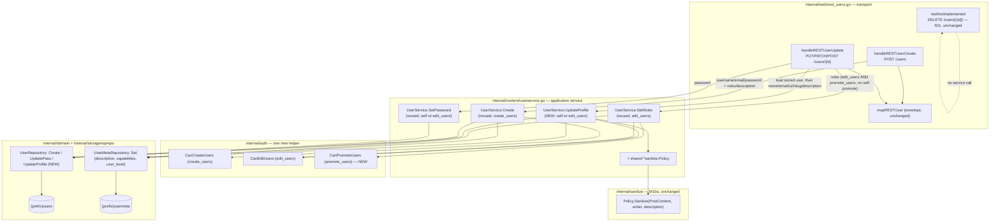

# M10.C — REST User Write Parity: Design

## Overview

Four facts about the code as it stands set this milestone's shape.

**The user write surface is a wall of `501`s, by design.** `registerRESTUsers`
(`internal/web/rest_users.go:21`) wires `GET /users`, `GET /users/me`, and
`GET /users/{id}` to real handlers (`handleRESTUsersCollection`,
`handleRESTUserMe`, `handleRESTUserSingle`), then registers `restNotImplemented`
for `POST /users` (`"rest_cannot_create"`), a `PUT`/`PATCH`/`DELETE` loop on
`/users`, and a `POST`/`PUT`/`PATCH`/`DELETE` loop on `/users/{id}`
(`"rest_cannot_edit"`) — including, deliberately, `POST /users/{id}`, because
WordPress treats `POST` on a single item as an update. 10.C replaces exactly
two of those stub groups — `POST /users` and the `POST`/`PUT`/`PATCH` entries on
`/users/{id}` — and leaves the two `DELETE` stubs (and the collection
`PUT`/`PATCH`) untouched (Req 8). The read handlers, `mapRESTUser`
(`rest_users.go:124`, builds the `self`+`collection` `_links` envelope and
resolves `RESTUser` vs `RESTUserEdit`), and `restUserContext`
(`rest_users.go:36`, decides view vs edit context) are not touched (Req 9.1).

**M10.B already built the pattern this milestone copies, one surface over.**
`content.MediaWriteService` (`internal/content`) loads the authoritative stored
row, authorizes against *that* row (never the body), runs caller-supplied text
through the shared `*sanitize.Policy` with a fail-closed posture, and is
nil-gated into the web layer by a `WithMediaWrites` builder
(`internal/web/contentfeatures.go:19`) so a `Server` built without it keeps
serving `501` stubs rather than panicking. The policy defaults to
`sanitize.New()` when unwired — never nil — so an un-wired service sanitizes
rather than silently not sanitizing. 10.C is the user analogue: it adds the
missing write method to `content.UserService`, a `WithUserWrites` builder, and
two REST handlers, reusing every one of those postures.

**`content.UserService` already owns create, roles, and password — and only
lacks a general profile update.** `UserService`
(`internal/content/userservice.go`) has `Create(ctx, actor, u domain.User,
plainPassword string, roles ...string)` gated on `auth.CanCreateUsers`
(`userservice.go:39`); `Bootstrap` (no-auth, CLI only); `SetRoles(ctx, actor,
userID, roles...)` gated on `auth.CanEditUsers` (`userservice.go:71`); and
`SetPassword(ctx, actor, userID, plainPassword)` permitted when
`actor.UserID == userID` OR `auth.CanEditUsers` (`userservice.go:81`). Its
`provision` helper (`userservice.go:48`) hashes with `password.Hash` and calls
`writeRoles` (`userservice.go:92`), which sets `{prefix}capabilities` (via
`auth.SerializeCapabilities`) and `{prefix}user_level`. What it has **no** method
for is updating `name`/`email`/`url`/`description`/`slug` — a general
profile-field update. That gap, plus the matching `domain.UserRepository` port
method it needs, is the center of this milestone.

**No sanitize field kind names a user field, and nothing in the users path is
wired to the Policy today.** `sanitize.FieldKind`
(`internal/sanitize/sanitize.go:17`) is exactly `{PostContent, PostExcerpt,
PostTitle, CommentContent}` — there is no user-description kind. And unlike
posts/comments/media, `content.UserService` is not even constructed in `main.go`
today (only the CLI bootstrap and e2e tests build it, `cmd/grimoire-cli/main.go:267`),
so it currently holds no `*sanitize.Policy` at all. So two decisions are forced:
which `FieldKind` governs `description` (resolved below: reuse `PostContent`,
D8), and how the shared process-wide policy reaches `UserService` (resolved:
a `WithUserContentPolicy` option plus a `main.go` construction, mirroring
`WithMediaContentPolicy`).

This design adds **one method on `content.UserService`** (`UpdateProfile`) plus
a `*sanitize.Policy` field and its option, **one method on
`domain.UserRepository`** (profile-field update) plus **one domain value object**
(`domain.UserProfileFields`), **one `auth` helper** (`CanPromoteUsers`), **two
REST handlers** (`handleRESTUserCreate`, `handleRESTUserUpdate`) replacing two
stub groups, and **one `WithUserWrites` builder** plus the `main.go` wiring. The
REST create handler reuses the existing `UserService.Create` directly rather
than minting a wrapper. **No migration** (Req 9.2): every users-table column
(`display_name`, `user_email`, `user_url`, `user_nicename`) and the
`description` usermeta key already exist. No change to any read response shape.

Three things found during design under-specify or contradict the requirements.
They are collected in "Findings" rather than resolved silently; Finding 1 (no
`ByEmail` for the duplicate-email check) changes what gets built.

## Architecture



Two edges carry the milestone's argument.

**`Update --> UP` reads the stored user and the `{id}` segment, never a body
identity.** The self-vs-others decision is `id == actor.UserID` evaluated
against the `{id}` path segment and the resolved principal's `UserID` — the same
posture `UserService.SetPassword` (`userservice.go:81`) and
`PostWriteService.Update` already enforce — so a forged identity field in the
request body cannot escalate (Req 5.5, 11.2). The service still loads the stored
row by ID so an unknown `{id}` fails as `domain.ErrNotFound` → `404` before any
write (Req 7.4).

**`Del -.-> Del` is a dangling `501` with no service edge.** `DELETE /users` and
`DELETE /users/{id}` keep their `restNotImplemented` registrations and never
reach `UserService` (Req 8). The two write handlers are the only new edges into
the service; delete is explicitly out of scope (D4).

## Capability model (Requirement 5, 6)

The capabilities already exist in `internal/auth/roles.go` (`create_users`,
`edit_users`, `promote_users`, `list_users`, `delete_users`, administrator-only
by default); no new capability *name* is introduced. The ownership rule reuses
the existing `UserService.SetPassword` logic (self OR `edit_users`), stated here
because the brief asked which helpers are needed.

**`auth.CanCreateUsers` and `auth.CanEditUsers` are used as-is; one helper is
added.** `auth.CanCreateUsers` (`policy.go:84`, `create_users`) and
`auth.CanEditUsers` (`policy.go:87`, `edit_users`) exist. There is **no
`CanPromoteUsers` helper** — only the raw capability `promote_users` in the roles
table. Req 6.4 asks the `promote_users` check to resolve "through the specific
existing `promote_users` capability path ... optionally wrapped as a new
`auth.CanPromoteUsers` helper added alongside `CanEditUsers` that itself calls
`Principal.Can("promote_users")`". This design **adds the helper** rather than an
inline `actor.Can("promote_users")`, because it reads at the same level as its
two siblings and keeps every user-capability decision a named function:

```go
// CanPromoteUsers reports whether actor may assign roles to users. Added
// alongside CanEditUsers (internal/auth/policy.go); it is nothing more than the
// promote_users capability read through the one capability mechanism, so no
// second capability path and no new role table is introduced (Req 6.4).
func CanPromoteUsers(actor Principal) bool { return actor.Can("promote_users") }
```

The self-vs-others decision is evaluated against the `{id}` path segment and the
resolved principal's `UserID`, never a request-body field (Req 5.5, 11.2). An
unauthenticated caller holds no capabilities, so every gate fails and the handler
returns `403` (`rest_cannot_create` for create, `rest_cannot_edit` for update) —
the forbidden-write convention `rest_posts.go`/`rest_media.go` already use, which
returns `http.StatusForbidden` for a capability failure rather than a distinct
`401` (Req 5.6, D6).

| Operation | Capability | Evaluated against |
|---|---|---|
| create (`POST /users`) | `create_users` | the acting principal (Req 5.1, 5.2) |
| update own profile/password (`{id} == actor.UserID`) | *none* (self-edit) | `{id}` vs `actor.UserID` (Req 5.3, D2) |
| update other's profile/password (`{id} != actor.UserID`) | `edit_users` | `{id}` vs `actor.UserID` (Req 5.4) |
| assign `roles` (create or update) | `edit_users` **AND** `promote_users` | the acting principal (Req 6.1) |
| assign `roles` to own record (`{id} == actor.UserID`) | **rejected** (no self-promote) | `{id}` vs `actor.UserID` (Req 6.2) |

The role-assignment gate is deliberately stricter than `UserService.SetRoles`'s
own `edit_users`-only gate: SetRoles checks `edit_users`, but the REST surface
additionally requires `promote_users` and forbids self-promotion, so the handler
layer evaluates the full `edit_users AND promote_users AND not-self` decision
*before* delegating to SetRoles (see Finding 3 on the double-gate).

## Components and Interfaces

This milestone adds one method on `content.UserService` plus a policy field,
one method on the `domain.UserRepository` port plus one value object, one `auth`
helper, two REST handlers, and one `Server` builder. Each is specified in the
subsections below. The data types these components exchange
(`UserProfileFields`, the `UserProfileUpdate` service input, and the two REST
request body structs) are collected in **Data Models**.

### `content.UserService` additions (Requirements 1, 3, 4, 5, 6, 7, 11)

`UserService` gains a `*sanitize.Policy` field (so it can sanitize
`description`), its option/constructor change, and one new method:
`UpdateProfile`. The existing `Create`, `SetRoles`, and `SetPassword` are reused
verbatim.

#### Policy field, option, constructor change

Today `NewUserService(u, m, prefix)` takes no policy (`userservice.go:24`). It
gains a never-nil `policy` field threaded by an option, mirroring
`WithMediaContentPolicy`:

```go
// UserService gains one field beside users/meta/prefix:
type UserService struct {
	users  domain.UserRepository
	meta   domain.UserMetaRepository
	prefix string
	// policy is the write-boundary content policy applied to the free-text
	// description field (Req 4). It defaults to sanitize.New() in the
	// constructor and is NEVER nil: an unwired service sanitizes rather than
	// silently passing input through, matching MediaWriteService / PostWriteService
	// / the Server (fail closed, Req 11.1/11.3).
	policy *sanitize.Policy
}

// UserServiceOption follows the MediaWriteOption style.
type UserServiceOption func(*UserService)

// WithUserContentPolicy wires the shared *sanitize.Policy (in production the
// process-wide sanitize.New()) into UserService. When omitted, the constructor's
// sanitize.New() default still applies, so the service never silently skips
// sanitization of description (Req 4, 11.1).
func WithUserContentPolicy(p *sanitize.Policy) UserServiceOption {
	return func(s *UserService) { s.policy = p }
}

// NewUserService constructs a UserService. The content policy defaults to
// sanitize.New() (never nil / fail closed); pass WithUserContentPolicy to share
// the process-wide policy. The variadic option is additive, so the existing
// CLI/e2e call sites (cmd/grimoire-cli/main.go:267, test/e2e/*) compile
// unchanged and get the default-policy behavior.
func NewUserService(u domain.UserRepository, m domain.UserMetaRepository, prefix string, opts ...UserServiceOption) *UserService {
	s := &UserService{users: u, meta: m, prefix: prefix, policy: sanitize.New()}
	for _, opt := range opts {
		opt(s)
	}
	return s
}
```

The variadic option keeps every existing `NewUserService(repos.Users,
repos.UserMeta, prefix)` call (CLI bootstrap and five e2e harnesses) compiling
and behaving identically — they get the `sanitize.New()` default, which only
affects the new `UpdateProfile` path they never call.

#### `UpdateProfile`

Loads the stored user, authorizes self-vs-others against the `{id}` versus the
actor, sanitizes `description` through the Policy, persists the users-table
fields via the new `UpdateProfile` port method and `description` via
`UserMetaRepository.Set`. Password and roles are **not** handled here — they
continue to flow through the existing `SetPassword` and `SetRoles`, which the
handler orchestrates (Req 3.5, D3). This keeps `UpdateProfile` the pure
profile-field path and leaves the already-tested password/role gates untouched.

```go
// UserProfileUpdate is the partial-update request for the profile fields
// UpdateProfile owns: name, email, url, slug, and description. Every field is a
// pointer so UpdateProfile distinguishes "omitted" (nil — leave the stored value
// untouched, Req 7.2) from "explicitly set to empty", exactly as
// restPostWriteRequest / MediaMetaUpdate do. Password and roles are NOT here;
// they flow through SetPassword / SetRoles (Req 3.5).
type UserProfileUpdate struct {
	Name        *string // display_name
	Email       *string // user_email
	URL         *string // user_url
	Slug        *string // user_nicename
	Description *string // {prefix}usermeta description (D7)
}

// UpdateProfile authorizes and applies a user profile edit. It loads the stored
// user by ID (Req 7.1); evaluates the self-vs-others capability against THAT id
// versus actor.UserID (Req 5.3-5.5, 11.2) — never a body value; sanitizes a
// supplied description through the Policy at the actor's tier (Req 4); persists
// the changed users-table fields through UserRepository.UpdateProfile and a
// changed description through UserMetaRepository.Set with key "description"
// (Req 3.1, 3.4, D7). On any policy error, capability failure, or missing row
// it writes nothing (fail closed, Req 11.3). Returns ErrForbidden on a
// capability failure and domain.ErrNotFound when id resolves to no user
// (Req 7.4).
func (s *UserService) UpdateProfile(ctx context.Context, actor auth.Principal, id int64, upd UserProfileUpdate) (domain.User, error) {
	cur, err := s.users.ByID(ctx, id)
	if err != nil {
		return domain.User{}, err // domain.ErrNotFound bubbles up (Req 7.4)
	}
	// Self-vs-others: own record needs no capability; another's needs edit_users
	// (Req 5.3, 5.4, D2). Mirrors SetPassword's rule exactly.
	if actor.UserID != id && !auth.CanEditUsers(actor) {
		return domain.User{}, ErrForbidden
	}

	fields := domain.UserProfileFields{} // all-nil = no users-table write
	if upd.Name != nil {
		fields.DisplayName = upd.Name
	}
	if upd.Email != nil {
		fields.Email = upd.Email
	}
	if upd.URL != nil {
		fields.URL = upd.URL
	}
	if upd.Slug != nil {
		fields.Nicename = upd.Slug // Req 7.3
	}

	// description is the one free-text field the Policy governs (Req 4.1, D8).
	var sanitizedDesc *string
	if upd.Description != nil {
		writer := sanitize.For(actor) // Req 4.3; tier C when actor holds unfiltered_html (Req 4.2)
		v, err := s.policy.Sanitize(sanitize.PostContent, writer, *upd.Description)
		if err != nil {
			return domain.User{}, err // fail closed → handler maps to 400 (Req 4.4)
		}
		sanitizedDesc = &v
	}

	if fields.any() { // only touch the users row when a users-table field was supplied
		if err := s.users.UpdateProfile(ctx, id, fields); err != nil {
			return domain.User{}, err
		}
	}
	if sanitizedDesc != nil {
		if err := s.meta.Set(ctx, id, "description", *sanitizedDesc); err != nil { // D7: prefixless key
			return domain.User{}, err
		}
	}
	return s.users.ByID(ctx, id) // re-read so the handler envelopes the stored values (Req 7.6)
}
```

`fields.any()` is a tiny helper on `UserProfileFields` reporting whether any
pointer is non-nil, so a request that supplies only `description` (or only
`password`/`roles`, handled by the caller) does not issue an empty users-table
`UPDATE`. The byte-identity concern M10.B guarded against does not arise: omitted
fields are `nil` and never reach persistence; a supplied field that equals the
stored value writes identical bytes (observationally a no-op) and `description`
is sanitized from the caller's supplied string, never re-sanitized from `cur`.

#### Create reuse (Requirement 1)

The REST create handler calls the existing `UserService.Create` directly — no
thin wrapper is added (the brief's "keep it minimal and reuse Create"). `Create`
already gates on `create_users`, hashes the password through `provision` →
`password.Hash` (Req 2.1), inserts the user, and writes role meta via
`writeRoles` (Req 1.1, 1.6). The handler is responsible for: required-field
validation (`username`/`email`/`password`, Req 1.3); duplicate detection
(Finding 1); the role-assignment gate (Req 6, applied before passing `roles` to
`Create`); and sanitizing a supplied `description` through
`UserService.UpdateProfile` *after* the create returns the new ID, so create and
update share one description-sanitize path (Req 1.7). Create therefore grows no
new method; the create-time `description` write reuses `UpdateProfile` on the
freshly created ID.

#### Sentinels

Reusing `content.ErrForbidden` (already defined in `content`, returned by
`Create`/`SetRoles`/`SetPassword`) for every capability failure keeps the
transport's `errors.Is(err, content.ErrForbidden)` branch identical to
`rest_posts.go`/`rest_media.go`. No new `content`-level sentinel is invented for
the policy path: `UpdateProfile` returns the policy error **unchanged** (the
`PostWriteService`/`MediaWriteService` posture), and — crucially — the only
policy error any field kind can raise is `sanitize.ErrTitleNotConverging`, which
is reachable **only** on the `PostTitle` path. `description` maps to
`PostContent`, whose tier dispatch runs `p.tierB.Sanitize(in)` (or the tier-C
byte-identity bypass) and returns `(string, nil)` — it **cannot error at all**
(verified against `internal/sanitize/policy.go` `SanitizeAt` and `sanitize.go`
`TierFor`). So the realistic policy-error surface for `description` is empty; the
service and handler nonetheless fail closed on any non-nil error and map it to
`400 rest_invalid_param` (Req 4.4), so a future field-kind change cannot silently
become a `500`.

### `domain.UserRepository` additions (Requirement 3)

Two changes: one new method and one value object. Both are additive.

#### The new profile-update method

```go
// Added to the UserRepository interface (internal/domain/repository.go), beside
// UpdatePass:
type UserRepository interface {
	// ... existing: ByLogin, ByNicename, ByID, Create, UpdatePass, List, Count ...

	// UpdateProfile persists the supplied users-table profile fields to the
	// user's {prefix}users row. Only non-nil fields in f are written, so a
	// partial update leaves the omitted columns untouched (Req 7.2). It persists
	// display_name, user_email, user_url, and user_nicename only — never
	// description (that is {prefix}usermeta, Req 3.4) and never the password
	// (that stays on UpdatePass, Req 3.5). It returns domain.ErrNotFound when no
	// user has the given ID, matching the UpdatePass contract (Req 3.3). It is
	// additive and requires no migration: every target column already exists on
	// {prefix}users (Req 3.2, 9.2).
	UpdateProfile(ctx context.Context, id int64, f UserProfileFields) error
}
```

Signature choice (requirements left this open): a single `UserProfileFields`
value object with pointer fields, **not** discrete parameters. Rationale: it
mirrors `domain.MediaMeta` from M10.B as a write-side value object; it gives the
repository partial-update semantics (write only the supplied columns) without a
four-parameter signature where every caller must pass four values and the
repository cannot tell "set to empty" from "leave alone"; and it names exactly
the four users-table columns this method persists and nothing else.

#### The value object

```go
// UserProfileFields is the set of {prefix}users columns UpdateProfile may write
// (Req 3.1). Every field is a pointer so a nil field means "leave the stored
// column unchanged" (partial update, Req 7.2) and a non-nil field (including a
// pointer to "") means "set to this value". description, password, and roles
// are deliberately absent: description is usermeta (Req 3.4), password is
// UpdatePass (Req 3.5), roles are the capabilities meta via SetRoles (Req 6.3).
type UserProfileFields struct {
	DisplayName *string // display_name
	Email       *string // user_email
	URL         *string // user_url
	Nicename    *string // user_nicename (REST "slug", Req 7.3)
}

// any reports whether any field is set, so a caller can skip an empty UPDATE.
func (f UserProfileFields) any() bool {
	return f.DisplayName != nil || f.Email != nil || f.URL != nil || f.Nicename != nil
}
```

#### No migration (Requirement 3.2, 9.2)

Confirmed against `domain.User` (`internal/domain/entities.go:75`: `ID`, `Login`,
`Nicename`, `DisplayName`, `Pass`, `Email`, `URL`, `Registered`,
`ActivationKey`, `Status`) and the usermeta the service already writes. Every
target already exists:

| Field | Column / row | Already present because |
|---|---|---|
| name | `{prefix}users.display_name` | `domain.User.DisplayName`; written by `UserRepository.Create` |
| email | `{prefix}users.user_email` | `domain.User.Email`; core users column |
| url | `{prefix}users.user_url` | `domain.User.URL`; core users column |
| slug | `{prefix}users.user_nicename` | `domain.User.Nicename`; read by `ByNicename` |
| description | `{prefix}usermeta` row, `meta_key = 'description'` | `UserMetaRepository.Set` already writes `{prefix}capabilities`/`{prefix}user_level` into the same table (D7) |
| password | `{prefix}users.user_pass` | `UpdatePass` already writes it |
| roles | `{prefix}usermeta` `{prefix}capabilities`/`{prefix}user_level` | `writeRoles` already writes them |

No file is added under `internal/storage/migrations`; the task list should assert
that explicitly, mirroring M10a's and M10.B's no-migration checks (Req 9.2).

#### `wprepo.UserRepo.UpdateProfile` implementation note

The concrete `*wprepo.UserRepo` gains `UpdateProfile`, building a single `UPDATE`
of `{prefix}users` that sets only the columns whose pointer is non-nil (so the
SQL touches exactly the supplied fields), keyed by `ID`, and returning
`domain.ErrNotFound` when the update matches no row — the same
`errNotFoundIfMissing`-style check `UpdatePass` already uses. With all four
fields nil the method is never called (the service's `fields.any()` guard), so
the implementation need not special-case an empty field set, but it should still
no-op safely if called with none set.

### `auth.CanPromoteUsers` (Requirement 6.4)

One new helper in `internal/auth/policy.go`, beside `CanEditUsers`
(`policy.go:87`), shown in the Capability model above. It is `actor.Can(
"promote_users")` and nothing more — no second capability mechanism, no new role
table.

### REST handlers (Requirements 1, 2, 5, 6, 7, 10)

`registerRESTUsers` replaces exactly two stub groups and leaves the rest
untouched:

```go
func (s *Server) registerRESTUsers(r chi.Router) {
	r.Method(http.MethodGet, "/users", s.handleRESTUsersCollection())
	r.Method(http.MethodGet, "/users/me", s.handleRESTUserMe())
	r.Method(http.MethodGet, "/users/{id}", s.handleRESTUserSingle())

	if s.userWrite != nil { // nil-gated (Req 9.3)
		r.Method(http.MethodPost, "/users", s.handleRESTUserCreate())        // was restNotImplemented (Req 1)
		for _, m := range []string{http.MethodPost, http.MethodPut, http.MethodPatch} {
			r.Method(m, "/users/{id}", s.handleRESTUserUpdate())             // was restNotImplemented (Req 7)
		}
	} else {
		r.Method(http.MethodPost, "/users", restNotImplemented("rest_cannot_create", "Creating a user"))
		r.Method(http.MethodPost, "/users/{id}", restNotImplemented("rest_cannot_edit", "Updating or deleting a user"))
		for _, m := range []string{http.MethodPut, http.MethodPatch} {
			r.Method(m, "/users/{id}", restNotImplemented("rest_cannot_edit", "Updating or deleting a user"))
		}
	}

	// Unchanged 501 stubs regardless of wiring (Req 8):
	for _, m := range []string{http.MethodPut, http.MethodPatch, http.MethodDelete} {
		r.Method(m, "/users", restNotImplemented("rest_cannot_edit", "Updating or deleting a user"))
	}
	r.Method(http.MethodDelete, "/users/{id}", restNotImplemented("rest_cannot_edit", "Updating or deleting a user"))
}
```

Note the single-item write loop now covers `POST`/`PUT`/`PATCH` (the three update
verbs, Req 7.1); `DELETE /users/{id}` keeps its own `restNotImplemented`
registration (Req 8.2), and `PUT`/`PATCH`/`DELETE /users` (collection) keep
theirs (Req 8.1). When `s.userWrite` is nil, every write verb keeps the exact
`501` stub it has today, so a `Server` built without `WithUserWrites` is
byte-identical to the current behavior (Req 9.3).

Both handlers use the shared auth preamble from
`rest_posts.go`/`rest_media.go` verbatim: an Application Password skips CSRF
(`isAppPasswordAuth`); a session enforces M4 CSRF via `requireSessionCSRFREST`
→ `403 rest_forbidden` (Req 10.1, 10.2):

```go
if !isAppPasswordAuth(r.Context()) {
	if _, hasSession := sessionFrom(r.Context()); hasSession {
		if !s.requireSessionCSRFREST(w, r) {
			return
		}
	}
}
principal, _ := PrincipalFrom(r.Context())
```

#### `handleRESTUserCreate` (Requirements 1, 5, 6)

```go
// handleRESTUserCreate serves POST .../users (Req 1). Auth matches
// rest_posts/rest_media (Req 10). Required fields (username/email/password) are
// validated before any store call (Req 1.3); duplicate login/email are reported
// in that order (Req 1.4, 1.5; Finding 1); roles require edit_users AND
// promote_users (Req 6.1). On success it responds 201 with the edit-context
// envelope (Req 1.2).
func (s *Server) handleRESTUserCreate() http.HandlerFunc {
	return func(w http.ResponseWriter, r *http.Request) {
		// ... shared auth preamble ...
		principal, _ := PrincipalFrom(r.Context())

		var body restUserCreateBody
		if err := json.NewDecoder(r.Body).Decode(&body); err != nil {
			writeRESTError(w, http.StatusBadRequest, "rest_invalid_param", "Invalid request body.") // Req 7.5
			return
		}
		// Required fields (Req 1.3).
		if body.Username == nil || *body.Username == "" ||
			body.Email == nil || *body.Email == "" ||
			body.Password == nil || *body.Password == "" {
			writeRESTError(w, http.StatusBadRequest, "rest_missing_callback_param",
				"Missing parameter(s): username, email, password.")
			return
		}
		// Role gate BEFORE any write (Req 6.1): a create carrying roles requires
		// edit_users AND promote_users. (Create itself is not a self-record, so
		// the no-self-promote rule of Req 6.2 does not apply to create.)
		if len(body.Roles) > 0 && (!auth.CanEditUsers(principal) || !auth.CanPromoteUsers(principal)) {
			writeRESTError(w, http.StatusForbidden, "rest_cannot_edit_roles",
				"Sorry, you are not allowed to assign roles to users.")
			return
		}
		// Duplicate detection, username first (Req 1.4), then email (Req 1.5).
		// See Finding 1 on how each lookup is performed.
		// ... existing_user_login / existing_user_email → 400, no write ...

		id, err := s.userWrite.Create(r.Context(), principal, domain.User{
			Login: *body.Username, Nicename: niceFromLogin(body), Email: *body.Email,
			DisplayName: displayFromBody(body),
		}, *body.Password, body.Roles...)
		if err != nil {
			switch {
			case errors.Is(err, content.ErrForbidden):
				writeRESTError(w, http.StatusForbidden, "rest_cannot_create",
					"Sorry, you are not allowed to create users.") // Req 5.1, 5.6
			default:
				writeRESTError(w, http.StatusInternalServerError, "rest_user_create_failed", "Could not create user.")
			}
			return
		}
		// A supplied description is sanitized + persisted via UpdateProfile on the
		// new ID, so create and update share one description path (Req 1.7).
		if body.Description != nil {
			if _, err := s.userWrite.UpdateProfile(r.Context(), principal, id, content.UserProfileUpdate{Description: body.Description}); err != nil {
				// policy error → 400 (Req 4.4); otherwise 500.
			}
		}
		u, err := s.restUsers.ByID(r.Context(), id)
		// ... map through mapRESTUser in edit context, 201 (Req 1.2) ...
	}
}
```

`s.userWrite` is the new `*content.UserService` field on the `Server` (see Server
wiring). The create handler calls `UserService.Create` (reused) and
`UserService.UpdateProfile` (for `description`) — both on the same service
instance.

#### `handleRESTUserUpdate` (Requirements 5, 6, 7)

```go
// handleRESTUserUpdate serves PUT/PATCH/POST .../users/{id} (Req 7). Auth matches
// create. {id} must parse to a positive int (Req 7.4). The service loads the
// stored user, authorizes self-vs-others against {id} vs the actor, sanitizes
// description, and persists; password routes through SetPassword and roles
// through the promote-gated SetRoles. The 200 response is the edit-context
// envelope re-read from storage (Req 7.1, 7.6).
func (s *Server) handleRESTUserUpdate() http.HandlerFunc {
	return func(w http.ResponseWriter, r *http.Request) {
		// ... shared auth preamble ...
		principal, _ := PrincipalFrom(r.Context())

		id, err := strconv.ParseInt(chi.URLParam(r, "id"), 10, 64)
		if err != nil || id <= 0 {
			writeRESTError(w, http.StatusNotFound, "rest_user_invalid_id", "Invalid user ID.") // Req 7.4
			return
		}
		var body restUserUpdateBody
		if err := json.NewDecoder(r.Body).Decode(&body); err != nil {
			writeRESTError(w, http.StatusBadRequest, "rest_invalid_param", "Invalid request body.") // Req 7.5
			return
		}
		upd, code, verr := parseRESTUserUpdate(body) // slug/email/url format, roles type (Req 7.5)
		if verr != nil {
			writeRESTError(w, http.StatusBadRequest, code, verr.Error())
			return
		}

		// Roles gate FIRST, before any profile write, so a forbidden role change
		// is a clean fail-closed 403 with no partial profile update (Req 6, 11.3).
		if len(body.Roles) > 0 {
			if id == principal.UserID { // no self-promote (Req 6.2)
				writeRESTError(w, http.StatusForbidden, "rest_cannot_edit_roles",
					"Sorry, you are not allowed to edit your own roles.")
				return
			}
			if !auth.CanEditUsers(principal) || !auth.CanPromoteUsers(principal) { // Req 6.1
				writeRESTError(w, http.StatusForbidden, "rest_cannot_edit_roles",
					"Sorry, you are not allowed to assign roles to users.")
				return
			}
		}

		// Profile fields (name/email/url/slug/description).
		u, err := s.userWrite.UpdateProfile(r.Context(), principal, id, upd)
		if err != nil {
			switch {
			case errors.Is(err, domain.ErrNotFound):
				writeRESTError(w, http.StatusNotFound, "rest_user_invalid_id", "Invalid user ID.") // Req 7.4
			case errors.Is(err, content.ErrForbidden):
				writeRESTError(w, http.StatusForbidden, "rest_cannot_edit",
					"Sorry, you are not allowed to edit this user.") // Req 5.3-5.6
			default:
				// description policy error → 400 (Req 4.4); otherwise 500.
				writeRESTError(w, http.StatusBadRequest, "rest_invalid_param",
					"The supplied description could not be accepted.")
			}
			return
		}
		// Password: self OR edit_users, enforced inside SetPassword (Req 2.1).
		if body.Password != nil {
			if err := s.userWrite.SetPassword(r.Context(), principal, id, *body.Password); err != nil {
				// content.ErrForbidden → 403 rest_cannot_edit; else 500.
			}
		}
		// Roles: already gated above; apply through SetRoles (Req 6.3).
		if len(body.Roles) > 0 {
			if err := s.userWrite.SetRoles(r.Context(), principal, id, body.Roles...); err != nil {
				// content.ErrForbidden → 403 rest_cannot_edit_roles; else 500.
			}
		}
		u, _ = s.restUsers.ByID(r.Context(), id) // re-read so GET reflects stored values (Req 7.6)
		// ... map through mapRESTUser in edit context, 200 (Req 7.1) ...
	}
}
```

`parseRESTUserUpdate` validates field *types/formats* before the service is
called (slug is a non-empty identifier, email/url are well-formed, `roles` is a
JSON array of strings), matching how `rest_media.go`'s `parseRESTMediaUpdate`
validates `post` before `MediaWriteService.Update`. A wrong-typed field is caught
by JSON decoding into the pointer struct and yields `400 rest_invalid_param`
(Req 7.5).

The `POST /users/{id}` verb routes to this same update handler (Req 7.1 includes
`POST`), so the create/update split is purely collection-vs-item: `POST /users`
creates, `POST /users/{id}` updates — exactly WordPress's convention and the
reason the existing stub registered `POST /users/{id}` as an edit.

### Server wiring (Requirement 9.3)

The `Server` gains one dependency and the shared policy reaches `UserService` in
`main.go`.

**Server field + builder.** A new `userWrite` field holds the write-capable
`*content.UserService`, nil until `WithUserWrites`, mirroring `mediaWrite`
(`router.go:70`) and `WithMediaWrites` (`contentfeatures.go:19`):

```go
// internal/web/router.go — new field beside mediaWrite
	// userWrite backs the REST user write surface (POST /wp-json/.../users and
	// PUT/PATCH/POST /users/{id}, Req 1/7); nil until WithUserWrites, in which
	// case registerRESTUsers keeps the 501 restNotImplemented stubs for the
	// write verbs. Harnesses that omit it still compile and serve the stubs.
	userWrite *content.UserService

// internal/web/contentfeatures.go — new builder
// WithUserWrites enables the REST user write surface (Req 1, 7) by wiring the
// capability-checked *content.UserService as s.userWrite. It returns the same
// Server for chaining. Mirroring WithMediaWrites, this is a non-breaking builder
// rather than a new positional parameter. When uw is nil, registerRESTUsers
// keeps the 501 restNotImplemented stubs for the user write verbs.
func (s *Server) WithUserWrites(uw *content.UserService) *Server {
	s.userWrite = uw
	return s
}
```

The read path's `s.restUsers` (`domain.UserRepository`) and `s.restMapper` are
unchanged; the create/update re-reads go through `s.restUsers.ByID` exactly as
the existing GET handlers do, and the envelope goes through the existing
`mapRESTUser` in edit context.

**`main.go` construction.** The shared `contentPolicy` already exists
(`cmd/grimoire/main.go:89`) and is threaded into the comment, post, and media
services. 10.C constructs `UserService` next to them with the same instance and
wires it in — this is new, because today `main.go` builds no `UserService` at all
(only the CLI/e2e do):

```go
	userWrite := content.NewUserService(
		repos.Users, repos.UserMeta, cfg.Database.TablePrefix,
		content.WithUserContentPolicy(contentPolicy),
	)
	// ... .WithMediaWrites(mediaWrite).WithUserWrites(userWrite).WithContentPolicy(contentPolicy) ...
```

So one `*sanitize.Policy` governs post writes, comment writes, media updates, and
now user `description` — the single-instance invariant M10a established (Req 4.2,
11.1), now covering the user surface too. The existing CLI/e2e `NewUserService`
calls keep the three-argument form and get the default-policy behavior.

## Data Models

The data types the components above exchange. Each is defined in full in the
subsection of **Components and Interfaces** that owns it; they are catalogued
here so the model set is reviewable in one place. All additions are additive —
no field is removed or retyped, so no existing reader or caller regresses.

### `restUserCreateBody` (create request, WordPress JSON vocabulary)

The `POST /users` body. `username`/`email`/`password` are required (Req 1.3);
`roles` is a plain slice (presence triggers the role gate); the rest are
optional. Defined under **REST handlers → `handleRESTUserCreate`**.

```go
type restUserCreateBody struct {
	Username    *string  `json:"username"`
	Email       *string  `json:"email"`
	Password    *string  `json:"password"`
	Name        *string  `json:"name"`        // display_name
	Slug        *string  `json:"slug"`        // user_nicename
	URL         *string  `json:"url"`
	Description *string  `json:"description"` // sanitized via UpdateProfile (Req 1.7)
	Roles       []string `json:"roles"`
}
```

### `restUserUpdateBody` (partial update request)

The `PUT`/`PATCH`/`POST /users/{id}` body. Pointers distinguish omitted from
explicitly-empty, giving partial-update semantics (Req 7.2); `roles` presence
triggers the promote gate. Defined under **REST handlers →
`handleRESTUserUpdate`**.

```go
type restUserUpdateBody struct {
	Name        *string  `json:"name"`        // display_name
	Email       *string  `json:"email"`       // user_email
	URL         *string  `json:"url"`         // user_url
	Slug        *string  `json:"slug"`        // user_nicename (Req 7.3)
	Description *string  `json:"description"` // sanitized (Req 4.1)
	Password    *string  `json:"password"`    // SetPassword (Req 2.1)
	Roles       []string `json:"roles"`       // SetRoles, promote-gated (Req 6)
}
```

### `content.UserProfileUpdate` (service input)

The profile-field subset `UserService.UpdateProfile` owns (name/email/url/slug/
description); password and roles are excluded (Req 3.5). Defined under
**`content.UserService` → `UpdateProfile`**.

```go
type UserProfileUpdate struct {
	Name        *string // display_name
	Email       *string // user_email
	URL         *string // user_url
	Slug        *string // user_nicename
	Description *string // {prefix}usermeta "description" (D7)
}
```

### `domain.UserProfileFields` (write-side value object)

The `{prefix}users` columns `UserRepository.UpdateProfile` persists, distinct
from `domain.User` so the port names exactly the four columns it writes
(mirroring `domain.MediaMeta`). Defined under **`domain.UserRepository`
additions**.

```go
type UserProfileFields struct {
	DisplayName *string // display_name
	Email       *string // user_email
	URL         *string // user_url
	Nicename    *string // user_nicename
}
```

### `description` usermeta key (D7)

`description` is persisted through `UserMetaRepository.Set(ctx, userID,
"description", sanitized)` — the **prefixless** `meta_key` `description`, unlike
`{prefix}capabilities`/`{prefix}user_level`. It is read back through the same
mechanism the mapper uses for capabilities. No `domain.User` field and no users
column is involved; `description` is pure usermeta (Req 3.4).

### `{prefix}users` columns touched

`display_name`, `user_email`, `user_url`, `user_nicename` — all existing columns,
written only when the corresponding `UserProfileFields` pointer is non-nil. The
password column `user_pass` is written only via the existing `UpdatePass`
(through `SetPassword`), never via `UpdateProfile`.

## Findings

Three things in `requirements.md` under-specify a dependency or assume code that
does not exist. They are here rather than papered over; Finding 1 changes what
gets built.

### Finding 1 — there is no `ByEmail` on `UserRepository` for the duplicate-email check

Requirement 1.5 requires a duplicate `email` on create to produce `400
existing_user_email`, and Req 1.4 requires a duplicate `username` to produce
`400 existing_user_login`, checked **before** email. The duplicate-username check
has a read: `UserRepository.ByLogin(ctx, login)` (`repository.go`) returns the
user or `domain.ErrNotFound`, so "login already exists" is `ByLogin` returning a
non-`ErrNotFound` hit. But `UserRepository` has **no `ByEmail`** — its reads are
`ByLogin`, `ByNicename`, `ByID`, `List`, `Count` — so there is no existing way to
detect a duplicate email.

**Resolution (changes what gets built):** add one read method,
`UserRepository.ByEmail(ctx, email string) (User, error)` returning
`domain.ErrNotFound` when absent, as the minimal additive read needed to satisfy
Req 1.5. It is a pure `SELECT` on an existing column (`user_email`), requires no
migration, and mirrors `ByLogin` exactly. The create handler then performs the
two checks in order — `ByLogin` first (`existing_user_login`), `ByEmail` second
(`existing_user_email`) — and, per Req 1.4's second sentence, returns on the
first conflict so a request with both duplicates reports only
`existing_user_login`. This is noted as a Finding because the requirements name
the error code and ordering but assume a read that is not present; the one-method
addition is the smallest thing that makes Req 1.4/1.5 implementable. (Rejected
alternative: deferring email-duplicate detection to a database unique-constraint
violation surfaced from `Create` — grimoire's schema does not guarantee a unique
index on `user_email` across the WordPress-overlay DBs it supports, and a
constraint error could not distinguish login from email to pick the right code,
so an explicit pre-check is required.)

### Finding 2 — no sanitize `FieldKind` names a user field; `description` reuses `PostContent`

Requirement 4.1 and D8 require `description` to be sanitized at "the broad
rich-text field kind (the `PostContent`-equivalent `$allowedposttags`/tier-B,
tier-C passthrough path)". But `sanitize.FieldKind`
(`internal/sanitize/sanitize.go:17`) is exactly `{PostContent, PostExcerpt,
PostTitle, CommentContent}` — there is **no** `UserDescription` kind.

**Resolution (a decision the requirements left to the design):** reuse
`sanitize.PostContent` for `description`; do **not** add a new `FieldKind`.
Rationale: `TierFor` (`sanitize.go:71`) selects tier C for an `unfiltered_html`
writer and tier B otherwise for every kind except `CommentContent`, so
`PostContent` gives a non-unfiltered writer tier B (`$allowedposttags` subset)
and an unfiltered writer tier C (byte-identical passthrough) — **exactly** D8,
with no new enum value, no new tier-table entry, and no change to the
already-fuzzed `sanitize` package. D8 itself says "the `PostContent`-equivalent",
which `PostContent` *is*. The one semantic wrinkle: the constant literally means
`post_content`, so a reader of `UpdateProfile` sees a user's bio sanitized under
a post-named kind. A dedicated `UserDescription` kind would read more honestly at
the call site, but it would require touching the `sanitize` package (a new iota,
a new line in `TierFor`, and new test coverage) to produce *identical* tier
behavior — pure cost for no behavioral change. The design chooses the reuse and
documents the wrinkle with a comment at the `UpdateProfile` `Sanitize` call so the
intent is unmistakable; if a future milestone needs user-specific tier behavior,
that is the moment to add the kind. The realistic error surface is empty:
`PostContent` cannot return a policy error (only `PostTitle` can, via
`ErrTitleNotConverging`), so the fail-closed `→ 400` mapping (Req 4.4) is a
guard against future change, not a live path.

### Finding 3 — `SetRoles`'s own `edit_users` gate overlaps the handler's promote gate

Requirement 6 requires role assignment via REST to need **both** `edit_users`
AND `promote_users`, and to forbid self-promotion. But the existing
`UserService.SetRoles` (`userservice.go:71`) gates on `auth.CanEditUsers` only —
it knows nothing of `promote_users` or self-promotion. If the handler simply
called `SetRoles`, a caller with `edit_users` but not `promote_users` would
succeed, violating Req 6.1.

**Resolution:** the handler performs the full `edit_users AND promote_users AND
not-self` decision *before* delegating to `SetRoles`, and only reaches `SetRoles`
when all three hold (see `handleRESTUserCreate`/`handleRESTUserUpdate`). `SetRoles`
is left unchanged — its `edit_users` check is then a redundant inner guard, which
is harmless and desirable: it means a non-REST caller of `SetRoles` (none today,
but the CLI could grow one) still cannot assign roles without `edit_users`, and
the REST path's stricter gate is layered on top rather than replacing it. The
`promote_users` check and the self-promote rule live in exactly one place (the
handler), the `edit_users` check lives in two (handler and `SetRoles`), and the
double-check is defense in depth, not a contradiction. Req 6.3 explicitly says to
apply the permitted role change "through the existing
`content.UserService.SetRoles`", so SetRoles is deliberately not modified.

**Nothing else in the requirements was found unimplementable.** The password
path reuses `SetPassword` untouched (Req 2.1); the self-vs-others rule reuses
`SetPassword`'s exact logic (Req 5.3-5.5); the response envelope is the existing
`RESTUserEdit` the GET path already produces, which carries no hash/token/secret
(Req 2.2); `description` persistence reuses `UserMetaRepository.Set` (Req 3.4);
and no read response shape changes (Req 9.1).

## Error Handling

Every failure on the user write path is a fail-closed, no-persist outcome mapped
to a specific HTTP status and WordPress-style error code. The table below is the
single source of truth; it merges the create and update mappings shown inline
with each handler. **No sanitize-originated error is reachable for `description`**
(`PostContent` returns `(string, nil)`; only `PostTitle` can raise
`ErrTitleNotConverging`, and no user field maps to `PostTitle`), so the "policy
error → 400" row is a fail-closed guard against future change rather than a live
path. There is no generic policy-error branch and no `isPolicyError` /
`content.ErrSanitize` wrapper — the service returns any policy error unchanged
and the handler maps it to `400 rest_invalid_param`, matching
`rest_posts.go`/`rest_media.go`.

| Operation | Condition | Status | Code | Decided in |
|---|---|---|---|---|
| create | missing `username`/`email`/`password` | 400 | `rest_missing_callback_param` | handler (Req 1.3) |
| create | duplicate `username` (checked first) | 400 | `existing_user_login` | handler, `ByLogin` (Req 1.4; Finding 1) |
| create | duplicate `email`, non-duplicate `username` | 400 | `existing_user_email` | handler, `ByEmail` (Req 1.5; Finding 1) |
| create | lacks `create_users` / unauthenticated | 403 | `rest_cannot_create` | service → handler (Req 5.1, 5.6) |
| create | `roles` without `edit_users`+`promote_users` | 403 | `rest_cannot_edit_roles` | handler (Req 6.1) |
| create | malformed JSON body | 400 | `rest_invalid_param` | handler (Req 7.5) |
| create | `description` policy error (guard; not reachable) | 400 | `rest_invalid_param` | service → handler (Req 4.4) |
| create | insert failure | 500 | `rest_user_create_failed` | handler |
| update | invalid/non-positive `{id}` | 404 | `rest_user_invalid_id` | handler (Req 7.4) |
| update | unknown user (`domain.ErrNotFound`) | 404 | `rest_user_invalid_id` | service → handler (Req 7.4) |
| update | malformed JSON / wrong-typed field | 400 | `rest_invalid_param` | handler, `parseRESTUserUpdate` (Req 7.5) |
| update | editing another's record without `edit_users` / unauthenticated | 403 | `rest_cannot_edit` | service → handler (Req 5.4, 5.6) |
| update | `password` on another's record without `edit_users` | 403 | `rest_cannot_edit` | `SetPassword` → handler (Req 2.1, 5.4) |
| update | `roles` without `edit_users`+`promote_users` | 403 | `rest_cannot_edit_roles` | handler (Req 6.1) |
| update | `roles` on own record (self-promote) | 403 | `rest_cannot_edit_roles` | handler (Req 6.2) |
| update | `description` policy error (guard; not reachable) | 400 | `rest_invalid_param` | service → handler (Req 4.4) |
| update | persist failure | 500 | `rest_user_update_failed` | handler |
| create/update | session missing/invalid CSRF | 403 | `rest_forbidden` | `requireSessionCSRFREST` (Req 10.2) |
| create | success | 201 | — | handler (Req 1.2) |
| update | success | 200 | — | handler (Req 7.1) |
| any | `DELETE /users[/{id}]` | 501 | `rest_cannot_edit` | `restNotImplemented` (Req 8) |

The duplicate-detection order is load-bearing: `ByLogin` is consulted before
`ByEmail`, and the handler returns on the first conflict, so a request carrying
both a duplicate login and a duplicate email reports only `existing_user_login`
(Req 1.4). The role gate is evaluated before any profile write, so a forbidden
role change is a clean `403` with no partial profile update (Req 11.3).

## Security considerations

- **Sanitize-before-persist on `description`.** The one free-text user field is
  run through the shared `sanitize.Policy` at the actor's tier (`sanitize.For(
  principal)`, tier C for `unfiltered_html` holders) before it reaches
  `UserMetaRepository.Set` (Req 4.1, 4.2, 11.1), using `PostContent` — the same
  broad rich-text kind M10a applies to post bodies (Finding 2, D8). A user bio
  therefore carries no weaker a guarantee than a post body. `name`/`slug`/
  `email`/`url` are not markup fields: they are validated for format/identifier
  shape in `parseRESTUserUpdate` and persisted as plain column values, never with
  un-vetted markup (Req 4.5).
- **Capability against the `{id}` and the stored user, never the body.** The
  self-vs-others decision is `id == actor.UserID` on the `{id}` path segment and
  the resolved principal (Req 5.5, 11.2) — the same posture as
  `UserService.SetPassword` and `PostWriteService.Update`. The request body
  carries no identity field that is consulted for authorization, so a forged body
  cannot change who may edit. Role assignment is gated on the acting principal's
  `edit_users` AND `promote_users` and forbidden on the caller's own record, so a
  caller cannot escalate their own privileges (Req 6.2, 11.2).
- **Fail closed.** A policy error, a capability failure, a missing user, a
  required-field or duplicate failure each result in **no write** and the stored
  state unchanged (Req 11.3): the service returns before any `UpdateProfile`/
  `Set`/`UpdatePass`/`writeRoles`, and the handler maps the sentinel to
  `400`/`403`/`404`. The default content policy is `sanitize.New()`, never nil,
  so an un-wired `UserService` sanitizes rather than passing input through.
- **Password is bcrypt-only and never echoed.** Created/updated passwords flow
  through `provision`/`SetPassword` → `password.Hash` (bcrypt), reusing the one
  existing scheme and introducing no second hash format (Req 2.1, 11.4). No `$wp$`
  issuance and no `NeedsRehash` policy is added (D1, Req 2.3). The response
  envelope is `RESTUserEdit`, which has no password/hash/token/CSRF field, so no
  create or update response can leak one (Req 2.2).
- **Single-policy invariant.** The same process-wide `*sanitize.Policy` governs
  post writes, comment writes, media updates, and now user `description`, wired
  through `WithUserContentPolicy` from the `main.go` `contentPolicy`
  (`main.go:89`), so sanitization behavior cannot drift between surfaces (Req 4.2,
  11.1).
- **Authentication parity.** User writes authenticate identically to post,
  comment, and media writes: an Application Password skips CSRF, a session
  enforces M4 CSRF via `requireSessionCSRFREST` → `403 rest_forbidden` (Req 10.1,
  10.2). No per-handler Policy call is made beyond the service's (Req 10.3):
  sanitization lives in exactly one place on the user write path.
- **DELETE stays closed.** `DELETE /users` and `DELETE /users/{id}` keep their
  `restNotImplemented` stubs and never reach `UserService` (Req 8).

## Testing strategy

**Why no property-based tests.** Property-based testing does not apply to this
milestone, for the same reason it did not to M10.B. 10.C is a REST write surface
over existing user machinery: its behavior is capability gating (including the
`edit_users`+`promote_users` and no-self-promote rules), HTTP status/code
mapping, duplicate detection ordering, partial-update field merging, and
delegation to M10a's already-property-tested `sanitize.Policy`. There is no new
pure transformation with a "for all inputs X, property P(X) holds" shape — the
sanitization *is* M10a's Policy, whose properties (idempotence, allow-list
closure, tier-C identity) are already covered by `internal/sanitize`'s fuzz and
`testing/quick` suites and are not re-proved here. The field-kind choice
(`description` → `PostContent`) is a fixed decision, not a property. So this
milestone is verified by example-based unit and integration tests, pure Go,
SQLite always, with no new `GRIMOIRE_TEST_*` environment variables.

1. **`content.UserService` unit tests** (Req 1, 3, 4, 5, 6, 7, 11) — against a
   fake `domain.UserRepository`/`UserMetaRepository` and the **real**
   `sanitize.Policy`, asserting on what reached the ports, so a refactor that
   moved sanitization or the capability check out of the service fails:
   - `UpdateProfile`: self-record permitted without `edit_users`; other-record
     requires `edit_users` (`ErrForbidden` otherwise), evaluated against the id,
     never the body; a missing id → `domain.ErrNotFound`; only supplied fields
     reach `UserRepository.UpdateProfile` (partial update); `description`
     sanitized at the mapped kind (a `<script>` in a tier-B writer's description
     is stripped) and persisted via `Set` with key `description`;
   - the tier-C case: an `unfiltered_html` holder's `description` survives with
     markup intact (input the Policy demonstrably alters at tier B);
   - `Create` reuse: `create_users` present/absent (`ErrForbidden`); password
     reaches the store only as a bcrypt hash (`provision`).
2. **`wprepo.UserRepo` contract tests** (Req 3) — `UpdateProfile` writes
   display_name/user_email/user_url/user_nicename, writes only the supplied
   columns, and returns `ErrNotFound` for an unknown ID; `ByEmail` (Finding 1)
   returns the row or `ErrNotFound`. Run on SQLite through the existing storage
   test harness the other user reads use.
3. **`internal/web` transport tests** (Req 1, 2, 5, 6, 7, 8, 9, 10) — end-to-end
   through the router with the real `UserService` wired via `WithUserWrites`, so
   a transport that bypassed the service could not pass:
   - create: 201 edit-context envelope on success (shape matches
     `GET /users/{id}`); `rest_missing_callback_param` 400 (missing
     username/email/password); `existing_user_login` 400 and `existing_user_email`
     400 (duplicate-first ordering: a both-duplicate request reports only login);
     `rest_cannot_create` 403 for a caller lacking `create_users` and for an
     anonymous caller; `rest_cannot_edit_roles` 403 for a create carrying roles
     without `edit_users`+`promote_users`;
   - update: 200 edit-context envelope; `rest_user_invalid_id` 404 (bad/unknown
     id); partial update leaves omitted fields unchanged; `rest_invalid_param`
     400 (malformed/wrong-typed body); self-edit permitted without `edit_users`;
     other-user edit `rest_cannot_edit` 403; roles without `edit_users`+
     `promote_users` → `rest_cannot_edit_roles` 403; self-promote →
     `rest_cannot_edit_roles` 403; `POST /users/{id}` routes to update, not
     create;
   - **capability matrix (Req 12.1):** anonymous, self-edit, other-user edit,
     create with/without `create_users`, role assignment with/without
     `edit_users`+`promote_users` including the self-promote rejection;
   - **content-safety (Req 12.2):** create/update a `description` with markup →
     a tier-A/B writer's markup is reduced, a tier-C (`unfiltered_html`) writer's
     `description` is preserved byte-identically; a subsequent `GET /users/{id}`
     returns the sanitized stored value (Req 7.6);
   - auth: Application Password skips CSRF; session without CSRF token → 403
     `rest_forbidden`; the DELETE/collection stubs still answer 501 (Req 8); a
     `Server` built without `WithUserWrites` answers 501 on every write verb
     (Req 9.3).
4. **wiring test** (Req 9.3) — `WithUserWrites` makes the write surface reachable:
   `POST /users` no longer answers the `501` stub once a `UserService` is wired
   (the non-501 observable signal that `s.userWrite` reached the router), mirroring
   `mediawrite_wiring_test.go`.
5. `gofmt`, `go vet`, `go build ./...`, `go test ./...` green at the end of every
   task (Req 12.3), matching M10a's and M10.B's close-out discipline.

## Traceability

| Requirement | Components |
|---|---|
| 1 — create via `POST /users` | `handleRESTUserCreate` + `restUserCreateBody`; `UserService.Create` (reused); required-field validation; duplicate `ByLogin`/`ByEmail` ordering (Finding 1); `description` via `UpdateProfile`; 201 edit-context envelope |
| 2 — password reuses bcrypt | `provision`/`SetPassword` → `password.Hash`; `RESTUserEdit` carries no secret; no `$wp$`/`NeedsRehash` (D1) |
| 3 — new `UserRepository` port | `domain.UserRepository.UpdateProfile`; `domain.UserProfileFields` (+`any()`); `wprepo.UserRepo.UpdateProfile`; `description` via `UserMetaRepository.Set` key `description`; password on `UpdatePass`, roles on `SetRoles`; no migration (table of existing columns) |
| 4 — sanitize field-kind mapping | `UserService.UpdateProfile` `Sanitize(PostContent, sanitize.For(actor), description)`; tier C for `unfiltered_html`; fail-closed → 400; Finding 2 (`PostContent` reuse, D8) |
| 5 — capability model | `auth.CanCreateUsers`; self-vs-others `id == actor.UserID` + `auth.CanEditUsers`; stored-id evaluation never body; `rest_cannot_create`/`rest_cannot_edit` 403 (incl. unauthenticated, D6) |
| 6 — role gating / no self-promote | `auth.CanPromoteUsers` (NEW); handler `edit_users AND promote_users AND not-self`; `SetRoles` (reused, Finding 3 double-gate); `rest_cannot_edit_roles` 403 |
| 7 — partial update + envelope | `handleRESTUserUpdate` + `restUserUpdateBody`/`parseRESTUserUpdate`; `UserService.UpdateProfile` pointer semantics; `slug`→`user_nicename`; `rest_user_invalid_id` 404; `rest_invalid_param` 400; re-read → 200 edit-context |
| 8 — DELETE stays 501 | `registerRESTUsers` leaves DELETE + collection PUT/PATCH as `restNotImplemented`; no service edge |
| 9 — no read/migration regression | GET handlers + `mapRESTUser` + `restUserContext` unchanged; no `internal/storage/migrations` file; `userWrite` field + `WithUserWrites` nil-gate (Req 9.3) |
| 10 — auth parity | `isAppPasswordAuth`/`sessionFrom`/`requireSessionCSRFREST`; `rest_forbidden`; no per-handler Policy call |
| 11 — correctness/safety invariants | sanitize-before-persist on `description`; `{id}`/stored-identity capability; fail-closed; bcrypt-only password; Security considerations |
| 12 — test coverage | capability-matrix + content-safety transport tests; `WithUserWrites` wiring test; `gofmt`/`vet`/`build`/`test` green (pure Go, SQLite) |
