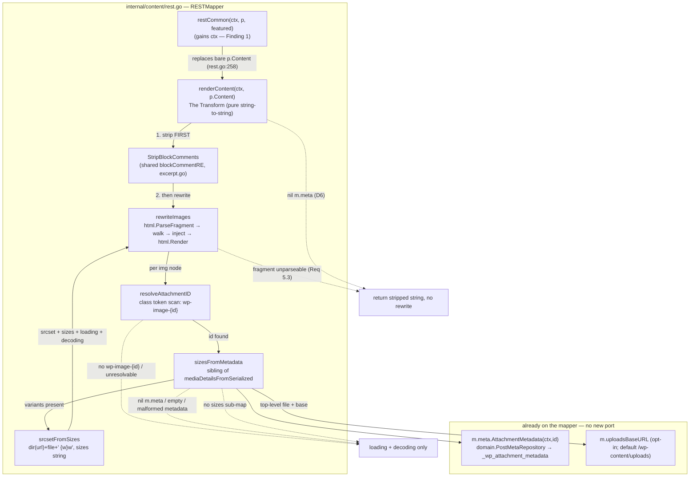

# M10.D — REST `content.rendered` Improvements: Design

## Overview

Four facts about the code as it stands set this milestone's shape.

**`content.rendered` is a raw pass-through at exactly one site.**
`(*RESTMapper).restCommon` (`internal/content/rest.go:258`) builds the shared
`restItemCommon` with `Content: RESTContentRendered{Rendered: p.Content,
Protected: p.Password != ""}` — the stored `post_content` handed straight out,
no transform. Both `(*RESTMapper).Post` and `(*RESTMapper).Page` flow through
`restCommon`, so that one assignment is the single transform site this milestone
changes (D1). 10.D inserts a render step **there and nowhere else**, replacing
the bare `p.Content` with a pure function of it.

**The block-comment stripper already exists.** `internal/content/excerpt.go`
defines `blockCommentRE = regexp.MustCompile(`(?s)<!--\s*/?\s*wp:.*?-->`)`
(non-greedy, dot-matches-newline) and `Excerpt` already calls
`blockCommentRE.ReplaceAllString(p.Content, "")` as its first step. 10.D reuses
that exact pattern — factored into a shared `StripBlockComments` helper and
called by both `Excerpt` and The Transform — rather than inventing a second
regex (D2).

**The mapper already reaches attachment metadata, but only decodes
width/height.** `(*RESTMapper).Media` (`internal/content/rest.go`) calls
`m.meta.AttachmentMetadata(ctx, media.ID)` (`domain.PostMetaRepository`, served
by `wprepo.PostMetaRepo.AttachmentMetadata` reading `_wp_attachment_metadata`,
`""` when unset — `internal/storage/wprepo/postmeta.go`), and
`mediaDetailsFromSerialized` (`internal/content/rest.go`) PHP-unserializes that
blob and reads `width`/`height` via the `phpInt` helper. The **same blob**
carries the `sizes` sub-map and a top-level `file` that `srcset` candidates are
built from — fields the existing decoder ignores. So the dependency The
Transform needs (`m.meta`) is **already on the mapper**; 10.D adds a sibling
decoder, not a new port.

**`golang.org/x/net/html` is already a dependency.** `go.mod:16` pins
`golang.org/x/net v0.59.0` (forward, direct), introduced for `internal/sanitize`
in M10a. Sanitize consumes it as a **token stream** (`html.NewTokenizer`); 10.D
uses the same module through its **parse-tree** API (`html.ParseFragment` +
`html.Render`) for `` rewriting — a different entry point into a module
already vendored and trusted, so no new dependency enters the graph (D3).

This design adds **one shared helper** (`content.StripBlockComments`, with a
tiny behavior-preserving refactor of `Excerpt`), **one unexported render method**
on `RESTMapper` (`renderContent`) called from `restCommon` in place of the bare
`p.Content`, **one additive opt-in field** on `RESTMapper` (an uploads base URL,
see Finding 3), **one sibling metadata decoder** (`sizesFromMetadata`), and a
small set of unexported rewriting helpers (`rewriteImages`,
`resolveAttachmentID`, `srcsetFromSizes`). No new domain port, no new capability,
no write boundary, no migration, no REST route change, no template edit. The
only emitted field that changes is `RESTContentRendered.Rendered`.

Three things found during design do not match the requirements as written —
most importantly `restCommon`'s lack of a `ctx`, and D6's "opt-in dependency"
framing against an `m.meta` that is a *required* constructor argument. They are
collected in "Findings" rather than resolved silently; Findings 1 and 3 change
what gets built.

## Architecture



Three edges carry the milestone's argument.

**`Common --> Render` is the only edit to the response shape.** Everything
`restCommon` emits — ID, dates, slug, status, type, link, guid, title, excerpt,
author, featured_media, comment_status, ping_status, and
`RESTContentRendered.Protected` — is untouched (Req 4.4). Only the `Rendered`
string is routed through The Transform. Comment/media/excerpt/title/guid
rendered fields never reach `restCommon` and so are never transformed (Req 4.3,
D7).

**`Strip --> Rewrite` fixes the pipeline order: strip first, then rewrite.**
Block-comment stripping runs on the raw string before any HTML parse (see
"Rendering model" for the rationale). The two steps are independent in effect —
`blockCommentRE` matches only `<!-- wp:… -->` comment tokens, which carry no
`` — but ordering strip-first means the parser never has to carry the
Gutenberg delimiter comments through the tree, and the comment-free, image-free
input reaches `html.Render` only if an `` is present at all (see the
short-circuit below).

**The dotted edges are the whole graceful-degradation story.** An ``
with no resolvable `wp-image-{id}`, an id that resolves to empty/missing/
malformed metadata, or metadata with no `sizes` sub-map, each degrade to
`loading="lazy"`/`decoding="async"` only — never a wrong `srcset`/`sizes`
(Req 2.5, 3.2, 3.3, D4). A `nil` `m.meta`, or a fragment `html.ParseFragment`
cannot parse, degrades further to the block-comment-stripped string with no
image rewriting at all (Req 5.3, 6.1, 6.2). No path errors the REST response.

## Rendering model

The Transform is `renderContent`, a method on `RESTMapper` whose entire
observable effect is a string→string rewrite of the rendered HTML. Its pipeline
is fixed:

1. **Strip Gutenberg block comments first** (`StripBlockComments`, over the
   shared `blockCommentRE`). This is a pure regex replace on the raw string,
   identical to `Excerpt`'s first step.
2. **Short-circuit when there is nothing to rewrite.** If the stripped string
   contains no `` nodes, inject attributes per
   ``, and re-serialize to just the fragment. If the fragment cannot be
   parsed, return the stripped string (Req 5.3).

### Why strip-then-rewrite

Three orderings were considered; strip-first-then-rewrite is chosen.

- **Strip first (chosen).** `blockCommentRE` operates on the raw text and is
  oblivious to the HTML tree; running it before the parse means the parser is
  handed content already free of the Gutenberg delimiter comments, so the
  serialized output never has to reproduce or re-escape them. It also lets the
  no-`` short-circuit (step 2) run on the already-stripped string, which is
  what makes the byte-identical invariant (Req 4.5) hold for the overwhelmingly
  common comment-free, image-free post without a parse round-trip.
- **Rewrite first, then strip.** Rejected: `html.Render` emits comment nodes in
  its own canonical form, so a subsequent regex strip would be operating on
  parser-normalized output rather than the stored string — more surface for
  surprise, no benefit.
- **Strip inside the tree walk** (drop comment nodes during the walk). Rejected:
  it couples the two concerns, forces every post (including image-free ones)
  through the parser to get stripping, and breaks the byte-identical invariant
  because an image-free post would still be parsed and re-serialized.

### Signature and dependencies

```go
// renderContent is The Transform (D1): the single content.rendered render step,
// block-comment stripping plus responsive-image rewriting, applied to the
// stored post_content on the REST read path. It is pure with respect to the
// store beyond the per- attachment-metadata lookups it performs, performs
// no write, and never errors the response — on any failure it degrades to the
// block-comment-stripped string (Req 5.3, 6.1, 6.2). ctx is threaded so the
// per-image AttachmentMetadata lookups can honor cancellation (Finding 1).
func (m *RESTMapper) renderContent(ctx context.Context, rendered string) string
```

**`ctx` is threaded into `restCommon`.** This is the key design point and
Finding 1. `restCommon` has no `ctx` parameter today, and The Transform needs
one: the responsive path does a `m.meta.AttachmentMetadata(ctx, id)` lookup per
resolved ``, and that port method already takes a `ctx`. Two options were
weighed:

- **(a) Do the per-`` metadata lookups inside the rewrite, which requires a
  `ctx`.** The lookup is one call per *resolved* `wp-image-{id}` (not per
  ``; unresolved images never look up), reusing `m.meta` exactly as
  `(*RESTMapper).Media` already does.
- **(b) Give `restCommon` a `ctx` parameter.** `restCommon` is unexported and
  called from exactly two sites, `Post` and `Page`, both of which already hold a
  `ctx`. The blast radius is two call sites in the same file.

**Both are needed and both are taken:** the design does the per-`` lookups
(a) *and* threads `ctx` through `restCommon` (b), because (a) cannot be done
without (b). `restCommon` becomes `restCommon(ctx context.Context, p
domain.Post, featuredMedia int64)`; `Post` and `Page` pass their existing `ctx`.
This is the minimal change: the alternative — pre-resolving every image's
metadata in `Post`/`Page` and passing a map into a ctx-free `restCommon` —
duplicates the resolve-the-`wp-image-{id}` logic across the two callers and the
transform, so it is rejected.

**No new domain port.** `m.meta` (`domain.PostMetaRepository`) is already the
attachment-metadata source on the mapper (`NewRESTMapper` sets it; `Media` uses
it). The responsive path reuses it verbatim. The only *new* wiring 10.D adds is
the uploads base URL needed to build size-variant URLs (Finding 3), carried as
an opt-in field with a WordPress-faithful default, so an existing construction
site that does not set it still produces correct `loading`/`decoding` and
correct `srcset` URLs under the default `/wp-content/uploads` base.

**D6 reconciled (Finding 2).** D6 calls the attachment-metadata access an
"opt-in dependency" that, when "not wired", degrades to stripping-only. But
`m.meta` is a *required* `NewRESTMapper` argument, not opt-in. The design honors
D6's *intent* — never panic, degrade gracefully — by nil-guarding `m.meta` at
the top of the responsive path: a mapper constructed in a test with a nil
`m.meta`, or any future partially-constructed mapper, falls back to
stripping-only (step 2 above) rather than dereferencing nil. The genuinely
opt-in piece 10.D introduces is the uploads base URL (Finding 3), which is what
D6's "opt-in" language actually fits.

## SEO considerations

10.D is a REST-only, read-path transform, and the stored content and the
public-facing render path are deliberately left alone — so there is no SEO
surface to regress.

- **Stored `post_content` is never rewritten.** The Transform runs inside
  `restCommon` on the response path and never calls a writer: no row in
  `{prefix}posts` changes, no migration is added (Req 1.4, 4.2, D1). What a
  crawler or the public site reads from storage is byte-for-byte what it was
  before 10.D.
- **The public HTML templates are untouched.** `internal/render` and
  `themes/default/templates/*.tmpl` are not modified by this milestone (Req 4.1,
  D1), so the server-rendered HTML served to browsers and search engines — the
  markup that actually carries SEO weight — is unchanged. The responsive/lazy
  attributes and `srcset` are added only to the JSON a REST client reads, where
  WordPress itself adds them via `wp_filter_content_tags`.
- **The Transform's own additions are SEO-neutral where they do appear.**
  `loading="lazy"`, `decoding="async"`, and `srcset`/`sizes` match WordPress's
  own REST output; they improve client-side image loading and do not strip
  `alt`, `src`, or any existing attribute (Req 5.2). Block-comment stripping
  removes only Gutenberg delimiter comments, never visible content (Req 1.3), so
  the rendered text a REST-driven client indexes is the same prose, minus
  invisible comments — again matching WordPress.

Because every SEO-bearing output (stored content, public templates) is outside
The Transform's reach, enabling 10.D changes nothing a search engine sees
through the site itself (AC 18.1 / 18.3).

## Components and Interfaces

This milestone adds a shared block-comment helper (with a tiny `Excerpt`
refactor), one unexported render method on `RESTMapper` and its rewriting
helpers, one sibling metadata decoder, and one opt-in mapper field. Each is
specified below; the data types they exchange (`sizeVariant`, the decoded slice,
the `srcset`/`sizes` string forms) are catalogued in **Data Models**.

### `content.StripBlockComments` — shared block-comment helper (Requirement 1.2)

`blockCommentRE` and the strip operation are factored out of `Excerpt` into a
small exported-to-package helper, and `Excerpt` is refactored to call it. This
is behavior-preserving: `blockCommentRE` keeps its exact current pattern and the
replacement is the same `ReplaceAllString(…, "")`.

```go
// StripBlockComments removes Gutenberg block-delimiter comments
// (<!-- wp:paragraph -->, <!-- /wp:paragraph -->, and every wp: variant) from
// s, preserving the inner block content between a block's opening and closing
// delimiters (Req 1.1, 1.3). It is the single definition of "strip Gutenberg
// block comments" in the package, shared by Excerpt and renderContent (D2); it
// uses the existing blockCommentRE and introduces no second regex (Req 1.2).
// Content with no block-comment delimiters is returned unchanged (Req 1.5).
func StripBlockComments(s string) string {
	return blockCommentRE.ReplaceAllString(s, "")
}
```

```go
// Excerpt (internal/content/excerpt.go) — the one-line refactor:
//   BEFORE: text := blockCommentRE.ReplaceAllString(p.Content, "")
//   AFTER:  text := StripBlockComments(p.Content)
```

`blockCommentRE` stays declared in `excerpt.go` (the helper and `Excerpt` live
in the same file and package), so there is one pattern and one place to change
it (D2). Factoring to a function rather than inlining the regex twice is what
Req 1.2 asks for ("factored into a shared helper … SHALL NOT introduce a second
block-comment regular expression").

### `(*RESTMapper).renderContent` — The Transform (Requirements 1, 2, 3, 5, 6)

The render method called from `restCommon`. Its pipeline is "Rendering model"
above; its body is nil-guards, the strip, the short-circuit, and the delegation
to `rewriteImages`.

```go
// renderContent applies The Transform to a stored post_content string on the
// REST read path (D1). Order is fixed: strip block comments, then (only if an
//  is present and the metadata dependency is wired) rewrite images. It
// never panics and never errors — a nil m.meta, an unparseable fragment, or an
// unresolvable image degrades to the block-comment-stripped string or to
// lazy/decoding-only, never to corrupted markup (Req 5.3, 6.1, 6.2).
func (m *RESTMapper) renderContent(ctx context.Context, rendered string) string {
	stripped := StripBlockComments(rendered) // Req 1 (strip first)

	// Byte-identical invariant (Req 4.5) + nil-safe fallback (Req 6.1, 6.2, D6):
	// comment-free, image-free content, or a mapper with no metadata source,
	// returns the stripped string without ever entering the HTML parser.
	if m.meta == nil || !containsIMG(stripped) {
		return stripped
	}
	return m.rewriteImages(ctx, stripped) // Req 2, 3, 5
}
```

`containsIMG` is a case-folded `strings.Contains(s, "`, and re-serializes to just the fragment —
no wrapping `<html><head><body>` introduced into the output. This is a real
pitfall and the approach is pinned below.

```go
// rewriteImages parses s as an HTML fragment, adds responsive/lazy attributes to
// each media-library , and re-serializes. It preserves all surrounding
// markup and every  attribute other than the ones Req 2 adds (Req 5.2),
// and is idempotent (an attribute already present is left in place, Req 2.6,
// 5.4). On a parse failure it returns s unchanged (Req 5.3).
func (m *RESTMapper) rewriteImages(ctx context.Context, s string) string {
	// Parse as a fragment in <body> context so no <html>/<head>/<body> wrapper
	// is synthesized into the output. html.ParseFragment with a body context
	// node returns the fragment's top-level nodes directly.
	ctxNode := &html.Node{Type: html.ElementNode, Data: "body", DataAtom: atom.Body}
	nodes, err := html.ParseFragment(strings.NewReader(s), ctxNode)
	if err != nil {
		return s // Req 5.3 — never corrupt, never panic
	}
	for _, n := range nodes {
		m.walkAndRewrite(ctx, n) // depth-first; rewrites  in place
	}
	var buf bytes.Buffer
	for _, n := range nodes {
		if err := html.Render(&buf, n); err != nil {
			return s // belt-and-braces: serialize failure → original stripped string
		}
	}
	return buf.String()
}
```

**Fragment parse/serialize, pinned.** `html.ParseFragment(r, context)` is the
correct entry point: given a `context` node of `<body>` it parses `s` as if it
were the inner HTML of a `<body>`, returning a `[]*html.Node` of the fragment's
top-level nodes — with **no** synthesized `<html>`/`<head>`/`<body>` wrapper.
Serialization is the inverse: `html.Render` is called over **each** returned
node in order and the outputs concatenated, so the result is exactly the
fragment's nodes re-emitted, never a whole document. (The rejected alternative —
`html.Parse` then descend to the `<body>` element and render its children —
works but forces the caller to locate `<body>` in the synthesized document tree
and risks emitting the wrapper if that descent is wrong; `ParseFragment` removes
the hazard by construction.) `atom.Body` comes from
`golang.org/x/net/html/atom`, a sub-package of the module already in `go.mod`.

**Markup preservation and well-formedness (Req 5.2).** The walk mutates only
`` start-tag attributes; text nodes, non-`` elements, and existing
`` attributes other than the Req-2 additions are left untouched. `html.
Render` emits well-formed HTML5 for any tree `ParseFragment` produced, so the
output is well-formed by construction. The HTML5 parser *does* normalize some
input (e.g. it closes implicitly-closed tags, lowercases tag names) — this is
the standard, documented consequence of a tree-based rewrite and matches what
WordPress's own DOM-based `wp_filter_content_tags` does; it is why the no-``
short-circuit exists, so content without images is never normalized.

```go
// walkAndRewrite descends n depth-first and rewrites each  element it
// finds. It is the DOM walk; attribute injection is in rewriteImageNode.
func (m *RESTMapper) walkAndRewrite(ctx context.Context, n *html.Node) {
	if n.Type == html.ElementNode && n.DataAtom == atom.Img {
		m.rewriteImageNode(ctx, n)
	}
	for c := n.FirstChild; c != nil; c = c.NextSibling {
		m.walkAndRewrite(ctx, c)
	}
}

// rewriteImageNode injects the Req-2 attributes on a single  node,
// idempotently. loading="lazy" and decoding="async" are added to every
// media-library  (Req 2.4); srcset/sizes are added only when the image
// resolves to an attachment with size variants (Req 2.1-2.3). An attribute the
//  already carries is left in place, never duplicated or overwritten
// (Req 2.6).
func (m *RESTMapper) rewriteImageNode(ctx context.Context, n *html.Node) {
	setIfAbsent(n, "loading", "lazy")    // Req 2.4
	setIfAbsent(n, "decoding", "async")  // Req 2.4

	id, ok := resolveAttachmentID(n)     // Req 3.1 — wp-image-{id} only
	if !ok {
		return // Req 3.2 — lazy/decoding only, no srcset/sizes
	}
	variants, fullW := m.sizesFromMetadata(ctx, id) // Req 2.2, 3.3, 3.4
	if len(variants) == 0 {
		return // Req 2.5, 3.3 — no variants → lazy/decoding only
	}
	base := attrValue(n, "src") // the full-size URL whose directory anchors srcset
	srcset, sizes := srcsetFromSizes(base, variants, fullW)
	if srcset != "" {
		setIfAbsent(n, "srcset", srcset) // Req 2.1, 2.2, 2.6
		setIfAbsent(n, "sizes", sizes)   // Req 2.3, 2.6
	}
}
```

`setIfAbsent(n, name, value)` scans `n.Attr` for `name`; if present it returns
untouched (idempotence, Req 2.6, 5.4), otherwise it appends
`html.Attribute{Key: name, Val: value}`. `attrValue(n, name)` returns the
existing value or `""`. Both are tiny unexported helpers over the
`[]html.Attribute` slice.

### `resolveAttachmentID` — `wp-image-{id}` resolution (Requirement 3.1, D4)

Resolves an `` to its attachment id **only** through
`class="wp-image-{id}"`, never from `src` (Req 3.1). A **class-token scan** is
chosen over a loose regex: the `class` attribute is split on whitespace into
tokens and each token tested for the `wp-image-` prefix with a numeric
remainder. This is more robust than a regex like `wp-image-(\d+)` run over the
whole attribute, which would false-match a substring inside another token (e.g.
`class="not-a-wp-image-5-thing"`); a token scan requires the whole token to be
`wp-image-{digits}`.

```go
// resolveAttachmentID extracts {id} from an 's class="… wp-image-{id} …"
// (D4). It scans whitespace-separated class tokens and returns the integer that
// follows the "wp-image-" prefix of a token that is exactly wp-image-{digits};
// (0, false) when no such token exists (Req 3.1, 3.2). It never consults src.
func resolveAttachmentID(n *html.Node) (int64, bool) {
	class := attrValue(n, "class")
	for _, tok := range strings.Fields(class) {
		rest, ok := strings.CutPrefix(tok, "wp-image-")
		if !ok {
			continue
		}
		if id, err := strconv.ParseInt(rest, 10, 64); err == nil && id > 0 {
			return id, true
		}
	}
	return 0, false
}
```

### `sizesFromMetadata` — the `sizes` sub-map decoder (Requirement 3.3, 3.4, D5)

A new sibling of `mediaDetailsFromSerialized` that reads the `sizes` sub-map
(and the top-level `file`/`width`) from the PHP-unserialized
`_wp_attachment_metadata` blob. It does **not** change
`mediaDetailsFromSerialized`'s width/height behavior used by the media endpoint
(Req 3.4) — it is additive, reusing `php.Unserialize` and the existing `phpInt`
helper.

```go
// sizesFromMetadata reads attachment id's _wp_attachment_metadata, decodes its
// "sizes" sub-map into size variants, and returns them along with the full-size
// width (the top-level "width", used for the sizes attribute). It mirrors
// mediaDetailsFromSerialized's empty-value tolerance (Req 3.3): a nil m.meta, an
// empty/missing/malformed blob, or an absent "sizes" key each yield (nil, 0),
// which the caller treats as "no variants" (lazy/decoding only). It performs the
// one per-resolved- metadata lookup renderContent needs ctx for (Finding 1).
func (m *RESTMapper) sizesFromMetadata(ctx context.Context, id int64) ([]sizeVariant, int) {
	if m.meta == nil {
		return nil, 0 // D6 nil-safety (Req 6.2)
	}
	raw, err := m.meta.AttachmentMetadata(ctx, id)
	if err != nil || raw == "" {
		return nil, 0 // Req 3.3 — missing/empty → no variants
	}
	v, err := php.Unserialize(raw)
	if err != nil {
		return nil, 0 // Req 3.3 — malformed → no variants
	}
	top, ok := v.(map[string]any)
	if !ok {
		return nil, 0
	}
	fullW := phpInt(top["width"]) // top-level full-size width (for sizes attr)
	sizesMap, ok := top["sizes"].(map[string]any)
	if !ok {
		return nil, fullW // no sizes sub-map → no variants, Req 2.5
	}
	variants := make([]sizeVariant, 0, len(sizesMap))
	for _, sv := range sizesMap {
		entry, ok := sv.(map[string]any)
		if !ok {
			continue
		}
		file, _ := entry["file"].(string)
		w := phpInt(entry["width"])
		if file == "" || w <= 0 {
			continue // skip incomplete entries rather than emit a wrong candidate
		}
		variants = append(variants, sizeVariant{File: file, Width: w, Height: phpInt(entry["height"])})
	}
	return variants, fullW
}
```

The `sizes` sub-map keys (`thumbnail`, `medium`, `large`, …) are not used — only
the per-entry `file`/`width`/`height` matter for `srcset`. Entry iteration order
over a Go map is nondeterministic; `srcsetFromSizes` sorts by width so the
emitted `srcset` is stable and testable (see below).

### `srcsetFromSizes` — candidate and `sizes`-attribute construction (Requirement 2.2, 2.3, D5)

Builds the `srcset` value from the variants and the `sizes` value from the
full-size width.

```go
// srcsetFromSizes builds the srcset and sizes attribute strings. Each srcset
// candidate is the attachment URL's directory joined with the size's file
// basename, followed by a " {width}w" descriptor (D5, Req 2.2), candidates
// comma-space separated and sorted ascending by width for a stable, testable
// result. The sizes string is WordPress's default responsive form (Req 2.3).
// base is the  src (the full-size URL); dir(base) anchors every candidate.
func srcsetFromSizes(base string, variants []sizeVariant, fullWidth int) (srcset, sizes string) {
	dir := urlDir(base) // everything up to and including the last "/"
	sort.Slice(variants, func(i, j int) bool { return variants[i].Width < variants[j].Width })
	parts := make([]string, 0, len(variants))
	for _, v := range variants {
		parts = append(parts, dir+v.File+" "+strconv.Itoa(v.Width)+"w")
	}
	srcset = strings.Join(parts, ", ")
	if fullWidth > 0 {
		sizes = "(max-width: " + strconv.Itoa(fullWidth) + "px) 100vw, " + strconv.Itoa(fullWidth) + "px"
	}
	return srcset, sizes
}
```

**The `sizes` string is pinned to `(max-width: {w}px) 100vw, {w}px`.** This is
WordPress's default output from `wp_calculate_image_sizes` / the
`wp_filter_content_tags` path in WordPress 6.x–7.x, where `{w}` is the full-size
image width in pixels (e.g. `(max-width: 800px) 100vw, 800px`). It is the exact
form WordPress core emits for a content image with a known width; grimoire
matches it byte-for-byte. When the full-size width is unknown (`fullWidth == 0`)
the `sizes` attribute is omitted rather than emitting a `0px` form — a wrong
value is never emitted (Req 2.5 spirit).

**`srcset` URL construction is pinned to `dir(src) + file + " {width}w"`.** The
candidate URL is the directory of the ``'s own `src` (its full-size URL)
plus the size's `file` basename — WordPress stores size `file`s as bare
basenames in the *same directory* as the full-size image, so `dir(src)+file` is
the size-variant URL. This matches the uploads convention in
`internal/content/media.go` (`URL = TrimRight(BaseURL,"/") + "/" + relPath`): a
size variant shares the full-size image's `relDir`. `urlDir` returns everything
through the final `/` of `base` (or `""` if `base` has none), so
`https://x/wp-content/uploads/2024/03/photo.jpg` →
`https://x/wp-content/uploads/2024/03/`.

**Why anchor on `src`, not the metadata `file`.** See Finding 3. The ``'s
`src` is the full-size image URL as WordPress itself emitted it into the
content, already carrying whatever scheme/host/base the site uses — so deriving
every candidate from `dir(src)` needs no uploads-base configuration at all for
the `srcset` *URLs*. The uploads base URL (Finding 3) is retained as the
**fallback** anchor only when `src` is empty or relative in a way that yields no
usable directory, and is the piece that reconciles D6's "opt-in dependency"
wording.

### `RESTMapper` opt-in uploads base (Requirement 6.3, D6, Finding 3)

One additive field and one option method, following the existing
`WithPermalinks` builder style on `RESTMapper`:

```go
// internal/content/rest.go — RESTMapper gains one field:
	// uploadsBaseURL is the uploads root used to anchor srcset candidate URLs
	// when an 's own src does not yield a usable directory. It defaults to
	// "/wp-content/uploads" (matching internal/content/media.go's MediaConfig
	// default) in NewRESTMapper, so a mapper that never calls WithUploadsBaseURL
	// still builds correct candidates (Req 6.3, D6).
	uploadsBaseURL string

// WithUploadsBaseURL configures the uploads root for srcset URL fallback,
// returning the same RESTMapper for chaining (the WithPermalinks pattern). It
// is the one opt-in dependency 10.D adds; omitting it keeps the default.
func (m *RESTMapper) WithUploadsBaseURL(base string) *RESTMapper {
	m.uploadsBaseURL = base
	return m
}
```

`NewRESTMapper` sets `uploadsBaseURL: "/wp-content/uploads"` alongside the
existing flat-permalink default, so no construction site is forced to change and
the "additive, no change to call shape" guarantee holds (Req 6.3). In practice
`dir(src)` resolves the candidate directory for every WordPress-authored content
image (its `src` is a full upload URL), so `uploadsBaseURL` is a safety net; it
is wired in `main.go` from the same uploads config `MediaService` already reads,
keeping one source of truth for the uploads base.

## Data Models

The data types the components above exchange. All additions are additive — no
existing type is removed or retyped, so no existing reader regresses. **No new
`domain` type and no migration**: The Transform reads the existing
`_wp_attachment_metadata` through the existing `m.meta` port and emits into the
existing `RESTContentRendered.Rendered` string.

### `content.sizeVariant` (decoded size-variant)

The decoded shape of one entry of the `_wp_attachment_metadata` `sizes` sub-map,
returned by `sizesFromMetadata`. Unexported — it never leaves the package.

```go
// sizeVariant is one decoded entry of _wp_attachment_metadata["sizes"]: a size's
// file basename and pixel dimensions. Height is decoded for completeness; only
// File and Width are used to build a srcset candidate (width descriptor).
type sizeVariant struct {
	File   string // basename, e.g. "photo-300x200.jpg"
	Width  int    // used for the "{width}w" descriptor
	Height int    // decoded, currently unused by srcset
}
```

### String formats produced by The Transform

Not Go types, but the two output strings the design pins (so they are
reviewable in one place):

- **`srcset`** — `"{dir}{file} {width}w"` per variant, joined by `", "`, sorted
  ascending by width. Example:
  `https://x/wp-content/uploads/2024/03/photo-300x200.jpg 300w, https://x/wp-content/uploads/2024/03/photo-768x512.jpg 768w`.
- **`sizes`** — `"(max-width: {w}px) 100vw, {w}px"`, `{w}` the full-size width.
  Example: `(max-width: 800px) 100vw, 800px`.

### Unchanged types

`RESTContentRendered`, `restItemCommon`, `RESTPost`, `RESTPage`, `RESTMedia`,
and `RESTMediaDetails` are **unchanged** (Req 4.4): The Transform mutates only
the value of `RESTContentRendered.Rendered`, not any field, tag, or type. The
`mediaDetailsFromSerialized` decoder is unchanged (Req 3.4); `sizesFromMetadata`
is its new, independent sibling.

## Findings

Three things in `requirements.md` assume code shaped differently from what
exists. They are stated and resolved here; Findings 1 and 3 change what gets
built.

### Finding 1 — `restCommon` has no `ctx`, but The Transform needs one

`restCommon` (`internal/content/rest.go:258`) is
`func (m *RESTMapper) restCommon(p domain.Post, featuredMedia int64) restItemCommon`
— no `context.Context`. The responsive-image path must call
`m.meta.AttachmentMetadata(ctx, id)` per resolved ``, and that port method
takes a `ctx`. So The Transform cannot do its per-image lookups without a `ctx`
reaching `restCommon`.

**Resolution (changes what gets built):** thread `ctx` through `restCommon` —
`restCommon(ctx, p, featured)` — and do the per-`` metadata lookups inside
the rewrite (option (a)+(b) in "Rendering model"). `restCommon` is unexported
and called only from `Post` and `Page`, both of which already hold a `ctx`, so
the blast radius is two call sites in one file. The rejected alternative
(pre-resolving all image metadata in `Post`/`Page` into a map passed to a
ctx-free `restCommon`) duplicates the `wp-image-{id}` resolve logic across three
places. This is the one signature change 10.D makes to existing code.

### Finding 2 — `m.meta` is a *required* constructor argument, not the "opt-in dependency" D6 describes

D6 (and Req 6.1/6.3) frame the attachment-metadata access as an "opt-in
dependency" that may be "not wired", in which case The Transform "falls back to
block-comment stripping only". But `m.meta` (`domain.PostMetaRepository`) is a
**required** positional argument of `NewRESTMapper`, always non-nil in
production, and already used by `(*RESTMapper).Media`. There is no "not wired"
state through the normal constructor; the requirement's mental model does not
match the code.

**Resolution:** honor D6's *intent* (never panic; degrade gracefully) rather
than its literal "opt-in" wording. The Transform **nil-guards `m.meta`** at the
top of `renderContent` and again in `sizesFromMetadata`, so a mapper constructed
without a metadata source — a hand-built test mapper, or any future partial
construction — degrades to stripping-only instead of dereferencing nil (Req 6.1,
6.2). The genuinely new opt-in piece 10.D introduces is the **uploads base URL**
(Finding 3), which is what D6's "opt-in dependency" language actually fits:
additive, defaulted, no change to existing call shape. The design reuses
`m.meta` and does **not** add a new metadata port.

### Finding 3 — the attachment base URL for `srcset` is not on the mapper; derive it from `src`, with an opt-in uploads base as fallback

Req 2.2 requires each `srcset` candidate to be "the attachment URL's directory
joined with that size's `file` basename". The design must know the attachment's
URL to take its directory. `RESTMapper` holds `terms`, `meta`, `users`,
`prefix`, and `permalinks` — **no media URL source and no uploads base**.
`media.URL` is precomputed by `MediaService` for the media *endpoint*, but
`restCommon` renders a *post*, not a media item, and does not load each
referenced attachment's `domain.Media`.

Two sources of the attachment URL were weighed:

- **The ``'s own `src`** (chosen primary). WordPress emits content images
  with their full-size upload URL already in `src`; `dir(src)` is exactly the
  directory the size variants live in. This needs **no new wiring** — the URL is
  already in the content being transformed — and is robust to whatever
  scheme/host/base the site uses.
- **The metadata top-level `file`** (e.g. `2024/03/photo.jpg`) joined to a
  configured uploads base. This is the fallback for the rare `` whose `src`
  yields no usable directory (empty/relative). It requires an uploads base URL,
  which the mapper does not have today.

**Resolution (changes what gets built):** anchor `srcset` on `dir(src)` as the
primary, and add **one additive opt-in field** — `uploadsBaseURL`, defaulted to
`/wp-content/uploads` (matching `internal/content/media.go`) via a
`WithUploadsBaseURL` builder in the `WithPermalinks` style — as the fallback
anchor. This is the minimal new wiring (one defaulted field, no new port, no
change to existing construction sites), and it is the concrete thing D6's
"opt-in dependency" refers to.

### Finding 4 — the seeded fixture has no `sizes` sub-map, so render tests supply their own metadata

The `storagetest` contract seeds attachment 201 with
`_wp_attachment_metadata = a:2:{s:5:"width";i:800;s:6:"height";i:600;}`
(`internal/storage/storagetest/contract.go:176`) — width/height only, **no
`sizes` sub-map and no top-level `file`**. That fixture is sufficient for
`mediaDetailsFromSerialized` (which reads only width/height) but cannot exercise
`sizesFromMetadata`'s variant decoding or the `srcset` construction.

**Resolution:** the render tests do **not** depend on the shared fixture for the
responsive path. `renderContent` and `sizesFromMetadata` are tested against a
**fake `domain.PostMetaRepository`** (or a table of raw PHP-serialized blobs
decoded directly) that returns a richer `_wp_attachment_metadata` carrying a
`sizes` sub-array — e.g.
`a:3:{s:4:"file";s:18:"2024/03/photo.jpg";s:5:"width";i:1600;s:5:"sizes";a:…}`
with per-size `{file,width,height}` entries. This keeps the pure Transform tests
self-contained and SQLite-free (Req 8.2), and avoids editing the shared
cross-vendor fixture (which other repos' contract tests assert against). If a
contract-level test is later wanted, the fixture can gain a `sizes` sub-map
additively, but 10.D does not require touching it.

**Nothing else in the requirements was found unimplementable.** Block-comment
stripping reuses `blockCommentRE` directly (Req 1.2); `golang.org/x/net/html`
and `php.Unserialize`/`phpInt` are already present; the resolution,
degradation, and idempotence rules map cleanly onto the DOM walk; and no write
path, capability, or migration is touched.

## Error Handling

The Transform **never fails the REST request** — there are no new error
responses, no new HTTP statuses, and no new WordPress error codes. This is a
read-path render step, so every "failure" is a graceful degradation to a less
enhanced (but still valid) `content.rendered` string. The table below is the
complete set of degradations:

| Situation | Behavior | Requirement |
|---|---|---|
| Content has no Gutenberg block comments | stripping leaves content unchanged | 1.5 |
| Content has no `` (and no comments) | returned byte-identical to today | 4.5 |
| `m.meta` is nil (metadata dependency unwired) | strip-only; no image rewrite; no panic | 6.1, 6.2, D6 |
| Fragment cannot be parsed as HTML | return the block-comment-stripped string; no rewrite | 5.3 |
| `` has no resolvable `wp-image-{id}` | add `loading`/`decoding` only | 3.2, D4 |
| Resolved id's metadata empty / missing / malformed | treat as no variants: `loading`/`decoding` only | 3.3 |
| Resolved attachment has no `sizes` sub-map / no usable variant | `loading`/`decoding` only; omit `srcset`/`sizes` | 2.5 |
| Full-size width unknown | omit `sizes` rather than emit `0px` | 2.5 (spirit) |
| An attribute already present on the `` | left in place; not duplicated/overwritten | 2.6, 5.4 |
| `html.Render` fails on a parsed tree (belt-and-braces) | return the stripped string | 5.3 |

No `error` value propagates out of `renderContent`; its signature returns a
bare `string`. The `AttachmentMetadata` port *can* return an error (a DB
failure), and `sizesFromMetadata` treats that error as "no variants" rather than
surfacing it — a transient metadata read failure degrades one image's responsive
markup, it does not 500 the whole post response. This matches
`mediaDetailsFromSerialized`'s existing empty-on-error tolerance (Req 3.3).

## Testing strategy

**Why no property-based tests.** Property-based testing does not apply here, for
the same reason it did not to 10.B (`../10.1-rest-media-write`) or 10.C
(`../10.2-rest-user-write`). The Transform is a fixed, example-enumerable
rewrite: a specific set of block-comment and `` cases map to a specific set
of outputs. The one genuinely universal property in play — that an HTML parse →
rewrite → serialize round-trip stays well-formed and closed over the markup — is
`golang.org/x/net/html`'s own invariant, already exercised where
`internal/sanitize` consumes the parser and fuzz/`testing/quick`-tested there;
10.D does not re-prove it. The `wp-image-{id}` resolution, the `srcset`/`sizes`
string forms, and the degradation branches are a fixed table, not a property. So
this milestone is verified by table-driven example tests, matching the direction
10.B and 10.C established.

1. **`renderContent` table-driven tests** (Req 8.1) — pure Go, no DB, against a
   **fake `domain.PostMetaRepository`** returning controlled
   `_wp_attachment_metadata` blobs (Finding 4), asserting the exact output
   string for each row of the Req 8 matrix:
   - **block-comment stripping:** delimiters removed, inner block content
     preserved (`<!-- wp:paragraph --><p>Hi</p><!-- /wp:paragraph -->` →
     `<p>Hi</p>`, Req 1.1/1.3); comment-free content unchanged (Req 1.5);
   - **responsive markup, variants present:** a `wp-image-{id}` `` whose
     metadata has a `sizes` sub-map gets `srcset` (candidates = `dir(src)+file+"
     {w}w"`, sorted by width), `sizes` = `(max-width: {w}px) 100vw, {w}px`, plus
     `loading="lazy"`/`decoding="async"` (Req 2.1-2.4);
   - **no-variant case:** resolvable `` whose metadata has no `sizes` →
     `loading`/`decoding` only, `srcset`/`sizes` omitted (Req 2.5, 3.3);
   - **unresolvable ``:** `wp-image-{id}` absent, or id non-resolving →
     `loading`/`decoding` only, never a wrong `srcset` (Req 3.2, D4); `src` is
     never consulted for identity;
   - **idempotence:** `renderContent(renderContent(x)) == renderContent(x)` —
     second application strips nothing new and does not duplicate
     `loading`/`decoding`/`srcset`/`sizes` on an `` that already has them
     (Req 2.6, 5.4);
   - **nil-safe fallback:** a mapper with nil `m.meta` → stripping only, no panic
     (Req 6.1, 6.2, D6);
   - **byte-identical invariant:** comment-free, image-free content → output
     equals today's `restCommon` value byte-for-byte (Req 4.5).
2. **Markup-preservation / fragment tests** (Req 5.2, 5.3) — asserting the
   output is **not** wrapped in `<html>`/`<head>`/`<body>` (the `ParseFragment`
   pitfall, pinned explicitly as an assertion); surrounding text nodes and
   non-`` elements are preserved; existing `` attributes other than
   the Req-2 additions are untouched; and content The parser cannot handle
   gracefully returns the stripped string rather than corrupted markup or a
   panic (Req 5.3).
3. **`StripBlockComments` refactor test** (Req 1.2) — a direct test that
   `StripBlockComments` matches the pre-refactor `Excerpt` behavior on the block
   patterns, and that `Excerpt`'s existing tests still pass unchanged
   (behavior-preserving refactor).
4. **`sizesFromMetadata` decoder tests** (Req 3.3, 3.4) — valid `sizes` sub-map
   decoded to the expected variants; empty/missing/malformed → `(nil, 0)`; and a
   guard test that `mediaDetailsFromSerialized`'s width/height output is
   unchanged by this milestone (Req 3.4).
5. **No new env var, no network, SQLite-only** (Req 8.2) — every test above is
   pure Go against fakes or the in-memory decode path; none opens a socket or
   reads an environment variable.
6. **No migration** (Req 4.2) — the task list asserts no file is added under
   `internal/storage/migrations`, as 10.B's and 10.C's did.
7. `gofmt`, `go vet`, `go build ./...`, `go test ./...` green at the end of
   every task (Req 8.3).

## Traceability

| Requirement | Design sections / components |
|---|---|
| 1 — strip block-comment delimiters | Rendering model (strip-first); `StripBlockComments` (shared `blockCommentRE`, `Excerpt` refactor); `renderContent` step 1; no-write (SEO considerations) |
| 2 — responsive + lazy markup | `rewriteImageNode` (`loading`/`decoding`, idempotent `setIfAbsent`); `srcsetFromSizes` (candidate URLs, pinned `sizes` string); Data Models (string formats) |
| 3 — `wp-image-{id}` resolution + graceful degradation | `resolveAttachmentID` (class-token scan, never `src`); `sizesFromMetadata` (sibling decoder, empty-tolerant, `mediaDetailsFromSerialized` unchanged); Error Handling table |
| 4 — no storage/template/sibling-field regression | SEO considerations (templates + stored content untouched); `renderContent` byte-identical short-circuit (4.5); `restCommon` only `Rendered` changes (4.4); no migration (4.2) |
| 5 — HTML-aware, robust, idempotent | `rewriteImages` (`html.ParseFragment`+`html.Render`, fragment-not-wrapped); markup preservation; parse-failure fallback (5.3); `setIfAbsent` idempotence (5.4) |
| 6 — nil-safe / opt-in / additive | `renderContent`/`sizesFromMetadata` nil-guards (Finding 2); `WithUploadsBaseURL` opt-in default (Finding 3); additive call shape |
| 7 — out-of-scope exclusions | Overview + SEO (no block re-render, no write route, no template/stored/sibling-field change); scope limited to post/page `content.rendered` |
| 8 — test coverage + close-out | Testing strategy (table-driven matrix, no PBT rationale, SQLite-only/no-env, no-migration assert, gofmt/vet/build/test gate) |
