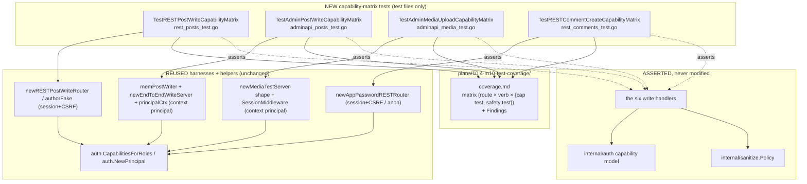

# M10.E — M10 Write-Route Test Coverage: Design

## Overview

Five facts about the tree as it stands set this milestone's shape. 10.E is not
a feature: it adds no production code, no route, and no migration. It is the
test-coverage close-out that makes roadmap Requirement 19.2 — "every new write
endpoint SHALL be covered by a capability-matrix test and a content-safety
test" — an auditable checklist rather than a claim.

**The write-route surface is fixed at six routes, and it is closed.** The
Introduction table of `requirements.md` enumerates them: (1) REST posts/pages
create/update/delete (`internal/web/rest_posts.go`), (2) REST comments create
(`internal/web/rest_comments.go`), (3) admin posts create/update/delete
(`internal/web/adminapi_posts.go`), (4) admin media create
(`internal/web/adminapi_media.go`), (5) REST media create/update
(`internal/web/rest_media.go`), (6) REST users create/update
(`internal/web/rest_users.go`). 10.E audits exactly these and no others. No
`restNotImplemented` stub is promoted; every DELETE verb that is a `501` stub
today stays one and is recorded as an excluded cell.

**Routes 5 and 6 are already fully covered — verified by reading the source,
not by trusting the Glossary.** The eight capability-matrix tests the Glossary
names all exist at the exact symbols and files claimed:
`TestRESTMediaCreateCapabilityMatrix`, `TestRESTMediaUpdateCapabilityMatrix`,
`TestRESTMediaCreateMIMEBypassMatrix`, `TestRESTMediaWriteAuthMatrix`
(`internal/web/rest_media_test.go:1028/1084/1158/1278`);
`TestRESTUserCreateCapabilityMatrix`, `TestRESTUserUpdateSelfVsOtherMatrix`,
`TestRESTUserRoleAssignmentMatrix`, `TestRESTUserWriteAuthMatrix`
(`internal/web/rest_users_test.go:1041/1117/1185/1331`). Their content-safety
siblings exist too (`TestRESTMediaUpdateSanitizesScriptBeforeWriter`,
`TestRESTUserUpdateDescriptionSanitizedBeforeWriter`, et al.). So Requirement 4
is pure inventory: 10.E cites these cells by name and adds nothing to them.

**Routes 1–4 carry content-safety proofs but lack a consolidated capability
matrix.** The M10a post/comment/admin paths were shipped with end-to-end
content-safety proofs (`TestRESTPostCreate/UpdateSanitizesContentExcerptAnd
TitleEndToEnd`, `TestAdminPostCreate/UpdateSanitizesContentExcerptAndTitle
EndToEnd`, `TestRESTCommentCreateAnonymousSanitizesTierABeforeWriter`), but
authorization coverage is scattered single-case tests
(`TestAdminPostUpdateForbidden`, `TestAdminPostDeleteMissingRecordIsForbidden`,
`TestRESTPostCreateForbidden`), not the table-driven allowed-vs-forbidden
matrix 10.B/10.C established. The gap 10.E closes is therefore precise: **four
new capability matrices** for the post/admin-post/admin-media/comment routes,
consolidating the scattered cases and adding the missing allowed/forbidden
cells.

**The content-safety half of routes 1–4 is already satisfied, and the audit
confirms it at writer level.** Each existing content-safety proof asserts the
**stored / writer-visible** value, not an escaped response:
`TestAdminPostCreate/UpdateSanitizesContentExcerptAndTitleEndToEnd` read back
through an in-memory `memPostWriter` via `mem.get(id)` and assert the stored
`Content`/`Excerpt`/`Title`; `TestRESTCommentCreateAnonymousSanitizesTier
ABeforeWriter` reads `repos.Comments.List(...)` and asserts the stored
`Content`. Both drive the REAL service
(`content.PostWriteService`/`content.CommentService`) over the REAL store, so a
transport that bypassed the Policy could not pass. This is the single most
important finding of the audit: **Requirement 3 is satisfied by existing tests;
10.E only cites them.** No new admin-post or comment content-safety test is
needed. The only gap-fill work is the four capability matrices of Requirement 2.

**Two distinct auth-injection mechanisms exist, and the test designs must
respect the difference.** This is a real per-route distinction, not a stylistic
one:

- **REST routes (1, 2, 5, 6)** authenticate through a **session fake + CSRF**.
  The harnesses build a `*fakeSessions` carrying an `auth.Principal` and a
  `domain.Session{CSRFToken: ...}`, attach a session cookie and a matching
  `X-CSRF-Token` header, and let the live `requireSessionCSRFREST` gate run
  (`matrixFake` / `userMatrixFake` / `uploaderFake` patterns). Anonymous cells
  send a bare `&fakeSessions{}` and no CSRF token.
- **Admin-API routes (3, 4)** authenticate through a **context-injected
  principal**. The handler reads `PrincipalFrom(r.Context())`; the tests inject
  that principal directly with `principalCtx("edit_posts")`
  (`internal/web/adminapi_test.go:54`) for the handler-level post tests, or run
  the full router through `SessionMiddleware(srv.adminAPIRouter())` with a
  `fakeSessions{p:..., s:...}` for the admin-media upload test. There is **no
  CSRF synchronizer in the `principalCtx` handler path**; the router-level
  `requireCapabilityJSON("edit_posts")` gate and the handler-level
  `content.ErrForbidden` → `403 "forbidden"` mapping are the two authorization
  seams.

The milestone produces **one durable artifact** — a committed coverage document
at `plans/10.4-m10-test-coverage/coverage.md` holding the matrix and the
Findings — and **four new capability-matrix tests**. Nothing under `internal/`
changes.

## Architecture

Three decisions govern the whole milestone; each is an open question the brief
asked to be resolved, and each is resolved here with its rationale.

### Decision A — the coverage matrix and Findings live in a committed `coverage.md`

**Resolution: a dedicated committed document at
`plans/10.4-m10-test-coverage/coverage.md`**, with the matrix as a Markdown
table and a Findings section, created and maintained by the tasks.

Rationale. The matrix is the milestone's *deliverable* (Req 1, Req 5.3), not a
by-product of the design. It must be durable and auditable, and it must be
updated as each task adds a test — a table embedded in `design.md` would go
stale the moment the first task lands, because `design.md` is a frozen artifact
by the time tasks run. Keeping it under `plans/` means it travels with the spec
in version control and is reviewable on its own. The requirements make this
explicit: Req 1.1 calls it "a coverage matrix … mapping each cell to the name
of its capability-matrix test and the name of its content-safety test," Req 5.3
requires "the Findings SHALL be captured in the milestone's coverage document
alongside the coverage matrix," and D2 names it "a deliverable." This design
therefore specifies `coverage.md`'s eventual contents (the matrix below is that
spec); the tasks create and fill it.

### Decision B — a Finding-linked test asserts current behavior, with a comment pointing to the Finding

**Resolution: assert the CURRENT (observed) behavior with a comment pointing to
the Finding entry in `coverage.md`**, rather than committing a
failing/`t.Skip`-ped test.

Rationale. Req 5.2 offers two forms and asks the design to pin one. A
red-or-skipped test in the suite muddies the "all green" close-out gate (Req
7.2: `go test ./...` green at the end of every task) and the roadmap wants a
green M10 close-out; a `t.Skip` silently drops coverage and a failing test
blocks the gate. Asserting the current behavior keeps the suite green and
truthful about what the code *does*, while the Finding in `coverage.md`
documents what the code *should* do, pending an explicit decision (Req 5.1 — no
silent production patch). This is the strictly-better form for a close-out
milestone. **Note the expectation is zero Findings**: the audit already
confirms routes 1–4 behave correctly (the scattered forbidden tests pass
today), so this form is a contingency, not a planned output.

### Decision C — the gating capability and forbidden role sets, pinned per route

**Resolution: pinned below against `internal/auth/roles.go` and
`internal/auth/policy.go`.** Every matrix builds its principals through
`auth.CapabilitiesForRoles` / `auth.NewPrincipal` (Req 2.6) via the existing
`matrixFake` / `userMatrixFake` / `principalCtx` helpers, never a hand-forged
capability set.

The default-role capability membership, read verbatim from `roles.go`:

| Role | Holds (write-relevant) |
|---|---|
| subscriber | `read` only |
| contributor | `read`, `edit_posts`, `delete_posts` (no `publish_posts`, no `upload_files`, no `edit_others_posts`) |
| author | adds `upload_files`, `publish_posts`, `edit_published_posts`, `delete_published_posts` |
| editor | adds `edit_others_posts`, `delete_others_posts`, `unfiltered_html`, `moderate_comments` |
| administrator | adds `unfiltered_upload`, `create_users`, `edit_users`, `promote_users`, `manage_options`, … |

The per-route gating capability and forbidden response, read from the handlers
and `policy.go`:

| Route | Verb | Gating decision | Allowed roles | Forbidden → |
|---|---|---|---|---|
| REST posts/pages create | POST | `auth.CanCreatePost(actor, type, status, author)` → needs `edit_posts` (+ `publish_posts` when status=publish) | author, editor, administrator (contributor allowed for draft create) | `403 rest_cannot_create` |
| REST posts/pages update | PUT/PATCH | `auth.CanEditPost(actor, type, stored.status, stored.author)` → own needs `edit_posts`; others' needs `edit_others_posts`; published needs `edit_published_posts` | own: author+; others': editor, administrator | `403 rest_cannot_edit` |
| REST posts/pages delete | DELETE | `auth.CanDeletePost(actor, type, stored.status, stored.author)` → `delete_posts` / `delete_others_posts` / `delete_published_posts` | own: author+; others': editor, administrator | `403 rest_cannot_edit` (code reused, `rest_posts.go:458`) |
| REST comment create | POST | anonymous-allowed; `p.Can("moderate_comments")` gates only status (`isModerator`, `rest_comments.go:17-20`), never create | anonymous, subscriber, author, editor, administrator (all may create) | n/a for create; empty-after-sanitize → `400 rest_comment_content_invalid` |
| Admin posts create | POST | router gate `requireCapabilityJSON("edit_posts")` + `PostWriteService.Create` → `CanCreatePost` | `edit_posts` holders (contributor+); anonymous → `401 unauthorized` | `403 forbidden` (handler `ErrForbidden`) / `403 forbidden` (router gate) |
| Admin posts update | PUT | router `edit_posts` gate + `PostWriteService.Update` → `CanEditPost` against stored author | own author+; others' editor/administrator | `403 forbidden` |
| Admin posts delete | DELETE | router `edit_posts` gate + `PostWriteService.Delete` → `CanDeletePost` | own author+; others' editor/administrator | `403 forbidden` |
| Admin media create | POST | router `edit_posts` gate; upload accepted after MIME sniff | any `edit_posts` holder reaching the handler (admin in practice) | router gate: `401`/`403 forbidden` |
| REST media create | POST | `MediaWriteService.Create` → `actor.Can("upload_files")` | author, editor, administrator | `403 rest_cannot_create` |
| REST media update | PUT/PATCH/POST | `CanEditPost(actor, "post", "inherit", stored.author)` → `edit_posts` / `edit_others_posts` | own: contributor+; others': editor, administrator | `403 rest_cannot_edit` |
| REST users create | POST | `UserService.Create` → `create_users` (+ `edit_users`&`promote_users` for roles) | administrator / explicit `create_users` grant | `403 rest_cannot_create` |
| REST users update | PUT/PATCH/POST | self-vs-others against stored id; self needs none, others need `edit_users`; roles need `edit_users`+`promote_users` | self: any; others': `edit_users` holders | `403 rest_cannot_edit` / `rest_cannot_edit_roles` |

One nuance pinned for the admin-media gate (route 4). The admin router gates the
whole `/admin/api/*` surface on `requireCapabilityJSON("edit_posts")`
(defined at `adminapi.go:80`, wired at `adminroutes.go:84`). The media *upload*
handler itself does not re-check a
separate `upload_files` capability — it sniffs the MIME and stores. So the
admin-media matrix's allowed/forbidden split is on `edit_posts` (the gate that
actually governs the route), not `upload_files`. This is recorded as Finding 3
so the matrix's role table is honest about what the route actually enforces
rather than what WordPress nominally names.

## Components and Interfaces

10.E's "components" are the four new capability-matrix tests and the
`coverage.md` deliverable; the coverage matrix below specifies the deliverable,
and each per-route test is specified under "Test designs per route."

### The coverage matrix

This is the spec of `coverage.md`'s eventual contents. Every M10 write route ×
verb from the Introduction table appears exactly once. **Existing** cells cite a
test that is present today (by exact symbol and file). **To add** cells name the
test 10.E will write. **Excluded** cells are recorded decisions (Req 1.4), not
gaps.

| # | Route | Verb | Capability-matrix test | Content-safety test |
|---|---|---|---|---|
| 1 | REST posts/pages | POST (create) | **To add:** `TestRESTPostWriteCapabilityMatrix` (`rest_posts_test.go`) | **Existing:** `TestRESTPostCreateSanitizesContentExcerptAndTitleEndToEnd` (`rest_posts_test.go`) |
| 1 | REST posts/pages | PUT/PATCH (update) | **To add:** `TestRESTPostWriteCapabilityMatrix` | **Existing:** `TestRESTPostUpdateSanitizesContentExcerptAndTitleEndToEnd` (`rest_posts_test.go`) |
| 1 | REST posts/pages | DELETE | **To add:** `TestRESTPostWriteCapabilityMatrix` (delete sub-cases) | **Excluded:** DELETE carries no content body → no content-safety cell (Req 1.4) |
| 1 | REST posts collection | PUT/PATCH/DELETE | — | **Excluded:** `restNotImplemented` `501` stubs (`rest_posts.go:39`), never governed writes (Req 1.4) |
| 1 | REST posts item | POST | — | **Excluded:** `restNotImplemented` `501` stub (`rest_posts.go:41`) (Req 1.4) |
| 2 | REST comments | POST (create) | **To add:** `TestRESTCommentCreateCapabilityMatrix` (`rest_comments_test.go`) | **Existing:** `TestRESTCommentCreateAnonymousSanitizesTierABeforeWriter` (`rest_comments_test.go`) + `TestRESTCommentCreateLoggedInEditorUsesForPrincipalTierC` (tier-C dual, Req 3.5) |
| 2 | REST comments | PUT/PATCH/DELETE | — | **Excluded:** `restNotImplemented` `501` stubs (`rest_comments.go:54/57`) (Req 1.4) |
| 3 | Admin posts | POST (create) | **To add:** `TestAdminPostWriteCapabilityMatrix` (`adminapi_posts_test.go`) | **Existing:** `TestAdminPostCreateSanitizesContentExcerptAndTitleEndToEnd` |
| 3 | Admin posts | PUT (update) | **To add:** `TestAdminPostWriteCapabilityMatrix` | **Existing:** `TestAdminPostUpdateSanitizesContentExcerptAndTitleEndToEnd` |
| 3 | Admin posts | DELETE | **To add:** `TestAdminPostWriteCapabilityMatrix` (delete sub-cases; consolidates `TestAdminPostDeleteMissingRecordIsForbidden`) | **Excluded:** DELETE carries no content body (Req 1.4) |
| 4 | Admin media | POST (create) | **To add:** `TestAdminMediaUploadCapabilityMatrix` (`adminapi_media_test.go`) | **Excluded:** binary upload, no caller-supplied markup; author-seam behavior covered by `TestAdminMediaUploadAuthorsAttachmentToActingAdmin` (Req 1.4) |
| 5 | REST media | POST (create) | **Existing:** `TestRESTMediaCreateCapabilityMatrix`, `TestRESTMediaCreateMIMEBypassMatrix`, `TestRESTMediaWriteAuthMatrix` (`rest_media_test.go`) | **Existing:** binary create → no markup cell; filename sanitized by `TestRESTMediaCreateSanitizesHostileFilename` |
| 5 | REST media | PUT/PATCH/POST (update) | **Existing:** `TestRESTMediaUpdateCapabilityMatrix` (`rest_media_test.go`) | **Existing:** `TestRESTMediaUpdateSanitizesScriptBeforeWriter` (`rest_media_test.go`) |
| 5 | REST media | DELETE | — | **Excluded:** `501` stubs, asserted stable by `TestRESTMediaDeleteCollectionStays501` / `TestRESTMediaDeleteItemStays501WithWiredService` (Req 1.4) |
| 6 | REST users | POST (create) | **Existing:** `TestRESTUserCreateCapabilityMatrix`, `TestRESTUserWriteAuthMatrix` (`rest_users_test.go`) | **Existing:** `TestRESTUserCreateSanitizesDescriptionBeforeStore` (`rest_users_test.go`) |
| 6 | REST users | PUT/PATCH/POST (update) | **Existing:** `TestRESTUserUpdateSelfVsOtherMatrix`, `TestRESTUserRoleAssignmentMatrix` (`rest_users_test.go`) | **Existing:** `TestRESTUserUpdateDescriptionSanitizedBeforeWriter` + `TestRESTUserUpdateDescriptionUnfilteredHTMLSurvivesVerbatim` (tier-C dual, Req 3.5) |
| 6 | REST users | DELETE/collection | — | **Excluded:** `501` stubs, asserted stable by `TestRESTUserDeleteAndCollectionStubsStay501` (Req 1.4) |

Summary: **four new capability-matrix tests** (`TestRESTPostWriteCapabilityMatrix`,
`TestAdminPostWriteCapabilityMatrix`, `TestAdminMediaUploadCapabilityMatrix`,
`TestRESTCommentCreateCapabilityMatrix`). **Zero new content-safety tests** —
every content-safety cell is already backed (Finding 1). All DELETE/collection
`501` cells are excluded-with-reason.

### Test designs per route

Each new test mirrors the table-driven style of
`TestRESTMediaCreateCapabilityMatrix` (`rest_media_test.go:1028`): a `cases`
slice of `{name, fake/ctx, wantCode, wantErr}`, a `t.Run` per cell, a
status-and-error-code assertion, and a no-state-change assertion for every
forbidden cell.

#### 1 — `TestRESTPostWriteCapabilityMatrix` (Req 2.1, 2.2, 2.6, 2.7)

- **File:** `internal/web/rest_posts_test.go`.
- **Harness/helpers reused:** `newRESTPostWriteRouter(t, fake)`
  (`rest_posts_test.go:57`, wires the REAL `content.PostWriteService` over the
  live SQLite `PostWriter`), `authorSessionPost`, `decodeRESTErrCode`,
  `latestPost` / `repos.AdminPosts.ListForAdmin` for the no-write assertion. New
  per-role fakes follow `authorFake`'s shape but vary role and `UserID`.
- **Auth mechanism:** session fake + CSRF (REST). Each non-anonymous cell
  carries the session cookie and matching `X-CSRF-Token`; the anonymous cell
  sends neither.
- **Allowed/forbidden table.** CREATE (POST `/wp-json/wp/v2/posts`, draft so
  `publish_posts` is not required): anonymous → `403 rest_cannot_create`;
  subscriber → `403 rest_cannot_create` (lacks `edit_posts`); contributor/
  author/editor/administrator (as the stored author, UserID 1) → `201`. A
  publish sub-case adds: contributor → `403` (lacks `publish_posts`), author+ →
  `201`. UPDATE (PUT `/posts/1`, seeded author 1): anonymous/subscriber → `403
  rest_cannot_edit`; author-as-1 (own) → `200`; author-as-7 (other) → `403
  rest_cannot_edit` (lacks `edit_others_posts`); editor-as-7 / admin-as-7 →
  `200`. DELETE (DELETE `/posts/1`): same shape as update, forbidden code `403
  rest_cannot_edit` (the handler reuses the edit code, `rest_posts.go:458`).
- **Gating asserted:** `CanCreatePost` / `CanEditPost` / `CanDeletePost` against
  the stored author, forbidden codes `rest_cannot_create` (create) and
  `rest_cannot_edit` (update/delete).
- **No-state-change on forbidden:** for create, assert no new post carries the
  submitted title via `repos.AdminPosts.ListForAdmin(...)` (the `latestPost`
  negative form); for update, snapshot `repos.PostWriter.ByID(1)` before and
  assert `Title`/`Content` unchanged after; for delete, assert
  `repos.PostWriter.ByID(1)` still resolves (not `domain.ErrNotFound`).

#### 2 — `TestRESTCommentCreateCapabilityMatrix` (Req 2.5, 2.6, 2.7)

- **File:** `internal/web/rest_comments_test.go`.
- **Harness/helpers reused:** `newAppPasswordRESTRouter(t, fake, false, "")`
  (`rest_apppassword_comments_test.go:34`), `decodeRESTErrCode`,
  `repos.Comments.List(ctx, domain.CommentFilter{PostID: 1})` for the no-write
  check — exactly the readback the existing comment proofs use.
- **Auth mechanism:** session fake + CSRF for the logged-in cells; bare request
  (no cookie, no CSRF) for the anonymous-allowed cell, matching
  `TestRESTCommentCreateAnonymousSanitizesTierABeforeWriter`.
- **Authorization contract (the real one, pinned from `rest_comments.go`):**
  comment create is **anonymous-allowed**; `p.Can("moderate_comments")` gates
  only the comment *status/moderation* seam (`isModerator`,
  `rest_comments.go:17-20`), never whether a comment may be created. The matrix
  therefore tables the *outcomes the route actually distinguishes*, not a
  create capability that does not exist:
  - anonymous (unique email) → `201`, comment persisted;
  - subscriber (session+CSRF) → `201`, persisted;
  - editor (`moderate_comments`) → `201`, persisted;
  - markup-only body that sanitizes to empty at tier A → `400
    rest_comment_content_invalid`, **no comment persisted** (the forbidden-shape
    cell; this consolidates
    `TestRESTCommentCreateMarkupOnlyBodyMapsErrCommentEmptyTo400`);
  - closed-comments post → `403 rest_comment_closed`, no comment persisted;
  - session cell with missing/mismatched CSRF → `403 rest_forbidden`, no comment
    persisted (the CSRF seam).
- **No-state-change on forbidden:** for each non-`201` cell, scan
  `repos.Comments.List(...)` by the cell's unique `author_email` and assert it
  is absent.
- **Honesty note carried into `coverage.md`:** because create has no forbidden
  *capability*, this "capability matrix" is really an
  authorization-contract matrix — the `moderate_comments` seam and the
  CSRF/closed/empty gates are what it exercises. Finding 2 records this so the
  matrix cell in `coverage.md` is not misread as an allowed-vs-forbidden
  capability split like the others.

#### 3 — `TestAdminPostWriteCapabilityMatrix` (Req 2.3, 2.6, 2.7)

- **File:** `internal/web/adminapi_posts_test.go` (package `web`, white-box).
- **Harness/helpers reused:** `newEndToEndWriteServer(mem)` +
  `memPostWriter` (`adminapi_posts_test.go`), which wires the REAL
  `content.PostWriteService` over an in-memory `domain.PostWriter` and a
  `fakeAdmin` reading back from the same store; `withURLParam`; `principalCtx`
  and the `authorCtx`/`withAuth` context-principal helpers;
  `s.jsonHandler(s.adminPostCreate/Update/Delete)`.
- **Auth mechanism:** **context-injected principal** (`principalCtx(...)` /
  `withAuth(...)`), NOT a session fake. This matrix exercises the handler +
  `PostWriteService` authorization via the real capability model; it does not
  run the router-level `requireCapabilityJSON` gate (that gate is a separate,
  already-proven middleware), so the forbidden outcome it asserts is the
  handler's `content.ErrForbidden` → `403 "forbidden"` mapping
  (`adminapi.go:47-48`). This is the correct mechanism because the scattered
  tests being consolidated (`TestAdminPostUpdateForbidden`,
  `TestAdminPostDeleteMissingRecordIsForbidden`) all use `principalCtx` /
  stubbed `ErrForbidden` — the matrix uses the REAL service so the ownership
  decision is genuine rather than a stub's canned return.
- **Allowed/forbidden table.** Principals built through
  `auth.NewPrincipal(uid, name, roles)` and attached with `withAuth`. CREATE:
  subscriber-principal → `403 forbidden`; author-as-1 → `201`. UPDATE (stored
  post author 1 in `mem`): author-as-1 (own) → `200`; author-as-7 (other) →
  `403 forbidden`; editor-as-7 → `200`. DELETE: same ownership shape, `204` on
  success, `403 forbidden` on the other-author-without-`delete_others_posts`
  cell; the missing-record cell asserts `403 forbidden` (consolidating
  `TestAdminPostDeleteMissingRecordIsForbidden`, since `PostWriteService` maps a
  missing record to `ErrForbidden`, never `ErrNotFound`).
- **Gating asserted:** `CanCreatePost`/`CanEditPost`/`CanDeletePost` through the
  real service; forbidden status `403`, error code `forbidden`
  (admin-API JSON envelope).
- **No-state-change on forbidden:** read `mem.get(id)` (or `mem.ByID`) and
  assert the stored post is unchanged for update, still present for a forbidden
  delete, and that `mem` gained no row for a forbidden create (the
  `memPostWriter` id counter did not advance / no new title present).

#### 4 — `TestAdminMediaUploadCapabilityMatrix` (Req 2.4, 2.6, 2.7)

- **File:** `internal/web/adminapi_media_test.go` (package `web`, white-box).
- **Harness/helpers reused:** the `newMediaTestServer` /
  `TestAdminMediaUploadAuthorsAttachmentToActingAdmin` shape — a `Server` with
  `srv.auth = fakeSessions{p:..., s:...}` and
  `srv.media = content.NewMediaService(repo, writer, MediaConfig{...})`, driven
  through `SessionMiddleware(srv.adminAPIRouter())`; a multipart form body built
  with `multipart.NewWriter` carrying the PNG signature so
  `http.DetectContentType` sniffs `image/png`. An `authorCapturingMediaWriter`
  (or a counting `capturingMediaRepo`) observes whether a row was created.
- **Auth mechanism:** **context-injected principal** via the full admin router
  (`SessionMiddleware` resolves the `fakeSessions` principal into the request
  context, then `requireCapabilityJSON("edit_posts")` runs). The forbidden cell
  is therefore gated by the router's `edit_posts` capability check
  (`requireCapabilityJSON`, wired at `adminroutes.go:84`), returning the admin
  JSON `403 forbidden` (or `401 unauthorized` for the anonymous cell).
- **Allowed/forbidden table.** administrator (holds `edit_posts`) with a valid
  CSRF token → `201`, and `writer.created` has length 1. subscriber-principal
  (lacks `edit_posts`) → `403 forbidden`, `writer.created` empty. anonymous (no
  session) → `401 unauthorized`, no row.
- **Gating asserted:** the route's effective gate is `edit_posts` (Finding 3 —
  the handler does not separately check `upload_files`). Forbidden status
  `403`/`401`, admin JSON envelope code `forbidden`/`unauthorized`.
- **No-state-change on forbidden:** assert the capturing writer recorded zero
  `Create` calls (`len(writer.created) == 0`), so no media row was created for
  a forbidden caller.

## Data Models

10.E introduces no Go data type and no domain model — it adds no production
code. Its only "data models" are the structure of the `coverage.md` deliverable
and the shape of each capability-matrix test's table row.

**`coverage.md` matrix row shape.** Each row of the coverage matrix carries the
columns: route number, route, verb, capability-matrix test name, content-safety
test name, and status (`existing` | `to-add` | `excluded-with-reason`).
Alongside the matrix the document carries a Findings list (the three structural
findings below).

**Per-test Go table-row shape.** Each matrix is table-driven, mirroring
`TestRESTMediaCreateCapabilityMatrix`'s `cases` slice: a per-cell row of roughly
`struct{ name string; fake *fakeSessions /* or ctx principal */; wantCode int;
wantErr string }`, with `t.Run` per cell, a status-and-error-code assertion, and
a no-state-change assertion on every forbidden cell. The REST matrices carry a
`*fakeSessions` (session+CSRF); the admin matrices carry a context-injected
principal instead.

No new domain type, no migration, no production data model — the only models are
the test fixtures and the coverage document.

## Findings

The audit produced three structural findings. None reveals a bug; none
triggers the Decision-B Finding-linked-test path (that path is reserved for a
Req 5.1 authorization/sanitization defect, of which there are none). All three
are recorded in `coverage.md` alongside the matrix (Req 5.3).

### Finding 1 — Requirement 3 is already satisfied; no new content-safety test is needed

The brief asked to verify, by reading the source, whether the pre-existing
admin-post and comment content-safety proofs assert *stored / writer-visible*
state or merely an escaped response. They assert stored state.
`TestAdminPostCreate/UpdateSanitizesContentExcerptAndTitleEndToEnd` wire the
REAL `content.PostWriteService` over an in-memory `memPostWriter` and read the
sanitized record back via `mem.get(id)`, asserting the stored `Content`,
`Excerpt`, and reduced-to-plain-text `Title`.
`TestRESTCommentCreateAnonymousSanitizesTierABeforeWriter` reads
`repos.Comments.List(...)` and asserts the stored `Content` had its `<script>`
stripped and `<em>` preserved; `TestRESTCommentCreateLoggedInEditorUsesForPrincipal
TierC` asserts the tier-C passthrough on the same path. **Resolution:**
Requirement 3 is satisfied by existing tests; 10.E cites them in the matrix and
adds no admin-post or comment content-safety test. The gap-fill is purely the
four capability matrices (Requirement 2). This is the audit's central
conclusion and matches D1's expectation.

### Finding 2 — REST comment create has no forbidden *capability*, so its "matrix" is an authorization-contract matrix

Comment create is anonymous-allowed (`rest_comments.go` builds
`sanitize.Anonymous()` when no principal is present and proceeds); the only
capability in the path, `moderate_comments`, gates comment *status*, not
creation (`isModerator`). There is no caller for whom create returns a
capability `403`. **Resolution:** `TestRESTCommentCreateCapabilityMatrix` tables
the outcomes the route genuinely distinguishes — anonymous/subscriber/editor
all `201`; empty-after-sanitize `400 rest_comment_content_invalid`;
closed-comments `403 rest_comment_closed`; session-without-CSRF `403
rest_forbidden` — and the matrix cell in `coverage.md` is annotated as an
authorization-contract matrix, not an allowed-vs-forbidden capability split, so
it is not misread against the other three. This satisfies Req 2.5's
"covers the route's actual authorization contract — including the
anonymous-allowed create path and the `moderate_comments`-gated status seam."

### Finding 3 — the admin-media upload route is gated by `edit_posts`, not `upload_files`

The REST media route checks `actor.Can("upload_files")` inside
`MediaWriteService.Create`. The **admin** media route does not: the
`/admin/api/*` surface is gated once at the router by
`requireCapabilityJSON("edit_posts")` (wired at `adminroutes.go:84`), and
`adminMediaUpload`
itself only enforces CSRF, the size cap, and the MIME sniff — it never checks
`upload_files`. **Resolution:** `TestAdminMediaUploadCapabilityMatrix` splits
allowed vs forbidden on `edit_posts` (the gate that actually governs the route),
and `coverage.md` records that the admin-media route's effective upload
capability is `edit_posts`. This is a documentation finding, not a defect: in
the default role table every `edit_posts` holder from author up also holds
`upload_files`, so no principal can reach the admin upload handler without
upload rights. No production change (Req 6.1).

### A note on the two auth mechanisms (structural, not a defect)

The admin-API routes authorize through a context-injected principal with no
CSRF synchronizer in the `principalCtx` handler path, while the REST routes use
a session fake plus the `requireSessionCSRFREST` gate. This is the documented
REST/admin-API asymmetry, already relied on by every existing test in both
families; the new matrices respect it (per-route "Auth mechanism" above) rather
than papering over it. It is called out here so a reviewer reading `coverage.md`
understands why the admin matrices inject principals directly and the REST
matrices carry cookies and CSRF tokens.

## Testing strategy

10.E adds only tests and `coverage.md`; the strategy is therefore entirely
about how the four new capability matrices assert, and it inherits the
close-out discipline of M10a–M10.D (Req 7).

**Pure Go, SQLite-only, no new environment surface.** Every new test runs
through the existing harnesses, which build a temp-file SQLite database
(`config.DatabaseConfig{Vendor: "sqlite"}`), apply migrations, and seed
fixtures. No new `GRIMOIRE_TEST_*` variable, no network access (Req 7.1). The
REST matrices drive the live `chi` router end-to-end; the admin matrices drive
the real handlers with the real `content.PostWriteService` / `MediaService` over
in-memory or SQLite writers.

**Principals come only from the real auth path.** Every cell builds its
principal through `auth.CapabilitiesForRoles` / `auth.NewPrincipal` via
`matrixFake` / `userMatrixFake` / `principalCtx` / `withAuth`; no test
hand-forges a capability set (Req 2.6). This is what makes a `403` cell a proof
about the real capability model rather than about a stub.

**Every forbidden cell proves no state change.** The matrices assert on the
transport response (status code + WordPress-faithful error code) AND on the
absence of a persisted mutation (Req 2.7): count rows before/after
(`countUsers`-style, `assertNoNewAttachment`-style), snapshot-and-compare the
stored record (`repos.PostWriter.ByID` / `mem.get`), or assert a capturing
writer recorded zero `Create` calls. A forbidden caller provably mutates
nothing.

**No property-based testing.** PBT is inappropriate here. A capability matrix is
a *fixed, enumerated* role table (anonymous / subscriber / contributor / author
/ editor / administrator against a known route), not a universally-quantified
property over a large input space — 100 random iterations would find no edge
case a hand-picked role enumeration does not, and the roles are a closed set,
not a generator. The content-safety guarantee that *is* property-shaped
("for all markup, the writer sees inert content") is already covered by the
existing service-level and transport-level proofs, which 10.E only cites. This
matches the M10a–M10.D precedent, whose designs likewise omit a Correctness
Properties section. `gofmt`, `go vet`, `go build ./...`, and `go test ./...`
are green at the end of every task (Req 7.2); the current contracts are asserted
as-is (Req 7.3).

## No production change

10.E is test-and-document only (Req 6). The milestone:

- adds only test files (four new capability-matrix test functions in existing
  `*_test.go` files) and one committed document, `coverage.md`, and modifies no
  production source under `internal/` — unless a Requirement 5 Finding is
  explicitly decided to authorize a change, which the audit does not expect
  (Req 6.1);
- adds **no database migration** — it enables no new write surface — and the
  task list verifies explicitly that no file is added under
  `internal/storage/migrations`, as M10a/M10.B/M10.C/M10.D did (Req 6.2);
- adds **no new REST or admin-API route** and changes **no `restNotImplemented`
  registration**: every `501` stub (REST posts collection/item writes, comment
  update/delete, media/user DELETE and collection stubs) stays `501` and is a
  recorded excluded cell (Req 6.3);
- reuses `internal/sanitize.Policy` and the `internal/auth` capability model
  without modification, asserting their behavior rather than altering it
  (Req 6.4).

## Traceability

This design refines **roadmap group 10.E** and traces to roadmap **Requirement
19.2** (`../wordpress-core-parity-roadmap/requirements.md:608` — every new write
endpoint covered by a capability-matrix test and a content-safety test before it
is considered done):

- **Overview + The coverage matrix** ↔ Req 1 (the auditable matrix deliverable
  that makes roadmap 19.2 concrete) and D2; the matrix is the spec of
  `coverage.md` (Decision A).
- **Test designs per route §§1, 3, 4, 2** ↔ Req 2.1–2.5 (the capability-matrix
  half of roadmap 19.2 for the post / admin-post / admin-media / comment routes);
  the real-auth-path and no-state-change constraints ↔ Req 2.6, 2.7.
- **Finding 1 + the matrix's content-safety column** ↔ Req 3 (the content-safety
  half of roadmap 19.2 for the pre-existing admin/comment paths) and D3 — already
  satisfied, cited not duplicated (Req 3.3).
- **The coverage matrix's route-5/6 rows** ↔ Req 4 (roadmap 19.2 already
  satisfied for the 10.B media and 10.C user routes; inventoried, not
  duplicated) and Req 4.4.
- **Findings** ↔ Req 5 (Decision B pins the Finding-linked-test form: assert
  current behavior with a pointer to `coverage.md`); captured in `coverage.md`
  per Req 5.3.
- **No production change** ↔ Req 6; **Testing strategy** ↔ Req 7 and roadmap
  Requirement 19.3 (pure Go / SQLite-only / no new env / all gates green).

10.E depends on M10a (roadmap group 10.A / Req 15, the `internal/sanitize`
Policy), M10.B (`../10.1-rest-media-write`, roadmap 16) and M10.C
(`../10.2-rest-user-write`, roadmap 17), whose tests it inventories and whose
table-driven matrix pattern it mirrors; the read-path render tests of M10.D
(`../10.3-rest-content-rendered`, roadmap 18) are out of scope. The out-of-scope
plugin surface traces to roadmap **Requirement 19.1**. 10.E is the test-coverage
close-out of the M10 write-parity arc that 10.B–10.D built.
