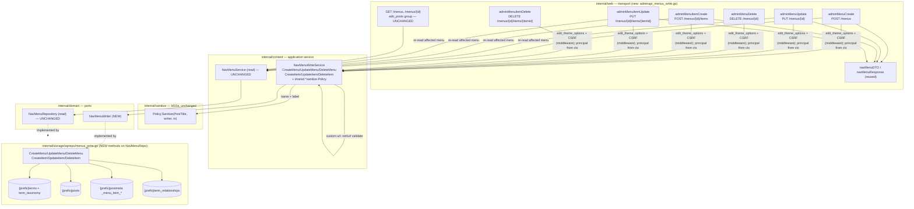

# M10.F — Navigation Menu Editing: Design

## Overview

M4 shipped navigation menus read-only and deferred editing with no milestone
attached. The read path is stable and this milestone adds the first write path
over it, so the design is almost entirely about mirroring an existing read
mapping in reverse behind the pattern M10.B/M10.C already established. Five facts
about the code as it stands set the shape.

**The read repo already defines the exact storage mapping the write side must
invert.** `wprepo.NavMenuRepo.menuItems` (`internal/storage/wprepo/menus.go`)
reads a menu's items by joining `{prefix}posts` (`post_type = "nav_menu_item"`)
to the `nav_menu` term through `{prefix}term_relationships`, then folds five
`{prefix}postmeta` keys (`_menu_item_type`, `_menu_item_object`,
`_menu_item_object_id`, `_menu_item_menu_item_parent`, `_menu_item_url`) into one
flat row with a `COALESCE(MAX(CASE ...))` pivot, and `resolveMenuTarget` derives
the displayed label/URL from the item's type. The writer does the inverse:
INSERT/UPDATE the `{prefix}posts` row, UPSERT exactly those five postmeta keys,
and maintain the `{prefix}term_relationships` link. Nothing about the read path
changes; the writer only has to produce rows the existing reader already knows
how to assemble (Req 3.2, 6.1).

**M10a built the write pattern this milestone copies, down to the fail-closed
Policy default.** `content.PostWriteService` and `content.MediaWriteService`
(`internal/content/writeservices.go`) each hold a `*sanitize.Policy` that
defaults to `sanitize.New()` and is never nil, sanitize caller strings at the
actor's tier via `sanitize.For(principal)`, and fail closed (abandon the write)
on any policy error. `content.NavMenuWriteService` is the menu analogue, reusing
every one of those postures (D4, D5, Req 4).

**The term-write route group is the exact web-layer template.** The nil-gated
group at `internal/web/adminroutes.go:119-126` runs
`s.requireCapabilityJSON("manage_categories")` + `s.csrfJSONMiddleware`, is wired
by a `WithAdminWrites`-style builder that stores `s.termWrite`, and is only
registered `if s.termWrite != nil`. 10.F clones this group verbatim with one
substitution — `edit_theme_options` for `manage_categories` — and a new nil-gated
field `s.navMenuWrite` (D1, D2, Req 7.3, 8.2).

**The admin menu DTOs already exist and already match `domain.NavMenu`.**
`navMenuDTO`/`navMenuResponse` (`internal/web/adminapi_menus.go`) map a
`domain.NavMenu` and its recursive item tree to the camelCase wire shape. Every
write response re-reads the affected menu through the existing read service and
emits the same DTO, so a create/update/delete is observable on a subsequent
`GET /admin/api/menus/{id}` with no second mapper (Req 1.1, 1.5, 2.5).

**No table is new.** Every table the write path touches — `{prefix}terms`,
`{prefix}term_taxonomy`, `{prefix}posts`, `{prefix}postmeta`,
`{prefix}term_relationships` — already exists and is already read by
`NavMenuRepo`. Reusable write helpers already exist too: `insertReturningID`,
`upsertPostMeta` (DELETE-then-INSERT single-valued postmeta, in
`internal/storage/wprepo/media.go:243`), `errNotFoundIfZero`, `vendorOf`, and the
`RunInTx` transaction wrapper. The milestone adds no file under
`internal/storage/migrations` (Req 6.4).

This design adds **one domain port** (`domain.NavMenuWriter`), **one application
service** (`content.NavMenuWriteService` holding the shared `*sanitize.Policy`),
**six `wprepo` write methods** implementing the port, **one builder option**
(`WithNavMenuWrites`) plus one nil-gated `Server` field, and **one web handler
file** registering five routes in a new `edit_theme_options` + CSRF group. The
read service, read port, and read repo are untouched (Req 3.1, 9.4).

### Resolved open questions

The requirements flagged four questions for the design. They are decided here and
treated as fixed below, not re-opened.

| # | Question | Decision |
|---|---|---|
| 1 | Menu-location assignment (`theme_mods`) | **Out of scope.** 10.F does not read or write `theme_mods`. Binding a menu to a theme location stays a read-only concern surfaced through `MenuByLocation`; the write path never touches the `nav_menu_locations` map. No endpoint accepts a location. |
| 2 | Slug derivation | **Auto-derive from `name` when the caller omits `slug`**, using WordPress `sanitize_title` semantics (see `sanitizeTitleSlug`, Data Models). A caller-supplied slug is used after the same normalization. On collision with an existing `nav_menu` term slug, append a numeric suffix (`-2`, `-3`, …) until unique. |
| 3 | Item-type validation set | **Accepted `_menu_item_type`: `custom`, `post_type`, `taxonomy`.** For `post_type`/`taxonomy`, `_menu_item_object`/`_menu_item_object_id` are stored as supplied **without** verifying the referenced object exists (matching `resolveMenuTarget`, which tolerates a dangling reference and falls back to the stored label). An unknown type value is rejected `400`. |
| 4 | Reorder/nest payload shape | **Per-item `menu_order` + parent-item-ID fields on the item create/update payload.** No bulk "set-whole-tree" operation. A non-zero parent item ID must resolve to another `nav_menu_item` linked to the same menu term, else `400` (Req 5.4); `0` means top-level. |

## Architecture



Three edges carry the milestone's argument.

**The write handlers and the read service share one mapper.** After a successful
create or update the handler calls `s.menus.Get(ctx, menuID)` — the existing read
service — and emits `navMenuDTO(menu)`. The write path never constructs a
response shape of its own, so "the read reflects exactly what the write
persisted" (Req 1.5, 2.5) holds by construction rather than by a parallel DTO
that could drift.

**Sanitization lives in exactly one place.** Only `NavMenuWriteService` calls the
Policy (for `name` and `label`) and validates the `custom` URL; the handlers do
no per-request Policy call (Req 8.3). The `edit_theme_options` gate and the CSRF
check are route middleware; the service still fail-closes independently on any
policy or validation error so a mis-wired route cannot bypass sanitization.

**Capability and CSRF are enforced before the service, authorization reads the
principal not the body.** The route group applies `edit_theme_options` + CSRF, so
a forbidden caller never reaches the service (403) and a missing/invalid CSRF
token is rejected before any handler body runs. The service resolves the acting
principal from the request context only to build the Policy's `sanitize.For`
writer argument (Req 4.5, 9.2) — never from a request-body field.

## Findings

Codebase facts that shape the design, verified against the files cited.

1. **The read pivot defines five postmeta keys; the writer must maintain all
   five.** `menuItems` (`menus.go:170-187`) coalesces `_menu_item_type`,
   `_menu_item_object`, `_menu_item_object_id`, `_menu_item_menu_item_parent`,
   and `_menu_item_url`. `CreateItem` writes all five; `UpdateItem` upserts only
   the keys whose fields were supplied (partial update). This is the "mirror in
   reverse" Req 3.2 names.

2. **`resolveMenuTarget` tolerates a dangling object reference.** For a
   `post_type`/`taxonomy` item whose `_menu_item_object_id` resolves to no row,
   `resolveMenuTarget` (`menus.go:210-250`) returns `fallbackLabel(row.Title)` and
   the stored URL rather than erroring. The write path matches that tolerance: it
   stores `_menu_item_object`/`_menu_item_object_id` **as supplied without a
   write-time existence check** (resolved open question 3). The only cross-row
   validation the writer performs is the parent-item check (Req 5.4), because a
   bad parent corrupts the *tree*, which `buildMenuTree` guards against at read
   time only defensively (cycle cut-off).

3. **`buildMenuTree` orders by `menu_order` then `ID` and nests by
   `_menu_item_menu_item_parent`, with `parent == 0` meaning top-level.** So
   persisting `menu_order` (Req 5.1) and the parent postmeta (Req 5.2) with the
   `0`-is-top-level convention (Req 5.3) is sufficient for the read tree to render
   the ordered, nested structure; no separate "tree" storage exists.

4. **Reusable write helpers already exist.** `insertReturningID(ctx, q, vendor,
   table, cols, returning, args...)`, `upsertPostMeta(ctx, tx, prefix, postID,
   key, value)` (DELETE-then-INSERT), `errNotFoundIfZero(res)`, `vendorOf(db)`,
   and `formatTS(t)` (`internal/storage/wprepo/helpers.go`, `media.go`). The term
   writer's own `TermRepo.Create`/`Delete` (`writers.go:118-185`) show the exact
   two-row term INSERT (terms + term_taxonomy with `taxonomy`/`description`/
   `parent`/`count` defaults) and the cascade DELETE ordering
   (term_relationships → term_taxonomy → terms) this milestone reuses.

5. **The admin JSON error handler already maps the sentinels this design needs.**
   `jsonHandler` (`internal/web/adminapi.go:37-64`): `domain.ErrNotFound` → 404,
   `content.ErrForbidden` → 403, `badRequestError` → 400, everything else → 500.
   The write handlers raise exactly these: `domain.ErrNotFound` for a missing
   menu/item, `badRequestError` for a bad id, a decode failure, an unknown item
   type, a bad `custom` URL, a bad parent, or a policy error surfaced as a 400.
   `edit_theme_options` failure is handled by `requireCapabilityJSON` middleware
   (403) before the handler runs; CSRF failure by `csrfJSONMiddleware`.

6. **The read repo exposes no `ByItemID`.** `NavMenuRepo` reads whole menus, not
   single items. The writer therefore owns its own item-scoped existence/lookup
   queries (`itemBelongsToMenu`) for the `{itemId}`-404 (Req 2.4) and parent
   (Req 5.4) checks, rather than routing through the read port.

## Components and Interfaces

The milestone adds one domain port, one content service, six storage write
methods, one builder option + `Server` field, and one web handler file with five
routes. The request/response data types they exchange are collected in **Data
Models**.

### `domain.NavMenuWriter` port (Requirement 3.1)

A new write port added alongside the unchanged read-only
`domain.NavMenuRepository` (`internal/domain/repository.go:243`). It carries the
six create/update/delete methods for menus and items. Partial updates use a
patch struct of pointer fields (the `MediaMetaUpdate`/`UserProfileFields` posture
already in the tree) so "field not supplied = unchanged" is expressible; `ctx`
and the prefix/tenant binding are handled the way sibling writers are (`NavMenuRepo`
already holds `prefix`, so no per-call prefix argument — consistent with
`PostRepo`/`TermRepo`).

```go
// internal/domain/repository.go — NEW, beside NavMenuRepository (unchanged).

// NavMenuWriter creates, updates, and deletes nav_menu terms and their
// nav_menu_item posts. It is the write counterpart of the read-only
// NavMenuRepository; wprepo.NavMenuRepo implements both. Every method writes the
// same {prefix}terms / {prefix}term_taxonomy / {prefix}posts / {prefix}postmeta /
// {prefix}term_relationships layout the read path assembles, so a written menu
// round-trips through Menus/MenuByID unchanged (Req 3.2, 6.1).
type NavMenuWriter interface {
	// CreateMenu inserts one nav_menu term (a {prefix}terms row plus a
	// {prefix}term_taxonomy row, taxonomy="nav_menu") and returns its term_id.
	// name and slug are already sanitized/normalized by the service; slug is
	// already collision-resolved (CreateMenu does the final uniqueness check in
	// its transaction to close the create/create race). (Req 1.1)
	CreateMenu(ctx context.Context, name, slug string) (int64, error)

	// UpdateMenu applies a partial update to an existing nav_menu term's
	// name/slug. A nil field is left unchanged (Req 1.2). Returns
	// domain.ErrNotFound when id is not a nav_menu term (Req 1.4).
	UpdateMenu(ctx context.Context, id int64, patch NavMenuPatch) error

	// DeleteMenu removes the menu term, its term_taxonomy row, every linked
	// nav_menu_item post, those items' _menu_item_* postmeta rows, and the
	// term_relationships rows for the menu term, in one transaction, leaving no
	// orphan (Req 6.3). Returns domain.ErrNotFound when id is not a nav_menu
	// term (Req 1.4).
	DeleteMenu(ctx context.Context, id int64) error

	// CreateItem inserts one nav_menu_item post linked to menuID's term, writes
	// its _menu_item_* postmeta, and returns the new item's post ID. The item's
	// fields are fully specified (the service has sanitized label, validated a
	// custom URL, and validated the type and parent). Returns domain.ErrNotFound
	// when menuID is not a nav_menu term (Req 2.1, 2.4).
	CreateItem(ctx context.Context, menuID int64, item NavMenuItemInput) (int64, error)

	// UpdateItem applies a partial update to itemID (which must be a
	// nav_menu_item linked to menuID). A nil field is left unchanged (Req 2.2).
	// Returns domain.ErrNotFound when itemID is not an item of menuID (Req 2.4).
	UpdateItem(ctx context.Context, menuID, itemID int64, patch NavMenuItemPatch) error

	// DeleteItem removes itemID's {prefix}posts row, its _menu_item_* postmeta,
	// and its term_relationships row for menuID's term (Req 2.3, 6.3). Returns
	// domain.ErrNotFound when itemID is not an item of menuID (Req 2.4).
	DeleteItem(ctx context.Context, menuID, itemID int64) error

	// ItemBelongsToMenu reports whether itemID is a nav_menu_item linked to
	// menuID's term. The service uses it for the parent-item validation of
	// Req 5.4 (a non-zero parent must be another item of the same menu) without
	// a second round-trip through the read port, which reads whole menus only.
	ItemBelongsToMenu(ctx context.Context, menuID, itemID int64) (bool, error)
}
```

### `content.NavMenuWriteService` (Requirements 1, 2, 4, 5, 9)

The menu analogue of `TermWriteService`/`MediaWriteService`: it owns the Policy
calls, the URL validation, the type/parent validation, the slug derivation, and
the create/update/delete orchestration over the write port. It holds a non-nil
`*sanitize.Policy` and resolves the acting principal per call for the Policy's
writer argument. The `edit_theme_options` capability gate is enforced by the
route middleware, not re-checked here (D1 places the gate on the route group,
matching the term-write group); the service nonetheless fail-closes on every
policy/validation error so sanitization and input validation cannot be bypassed
(Req 8.3, 9.1, 9.3).

```go
// internal/content/navmenuwrite.go — NEW.

// NavMenuWriteService performs create/update/delete of nav menus and items,
// routing every caller-supplied name and label through the shared
// sanitize.Policy and validating every custom URL before persistence (Req 4, 9).
// It is the menu analogue of MediaWriteService/TermWriteService.
type NavMenuWriteService struct {
	w      domain.NavMenuWriter
	reader domain.NavMenuRepository // read-back after write, and slug-uniqueness lookup
	// policy defaults to sanitize.New() and is NEVER nil: an unwired service
	// sanitizes rather than silently passing input through (fail closed,
	// Req 4, 9.1), matching PostWriteService / MediaWriteService.
	policy *sanitize.Policy
}

type NavMenuWriteOption func(*NavMenuWriteService)

// WithNavMenuContentPolicy injects the process-wide *sanitize.Policy. When
// omitted, the constructor's sanitize.New() default applies, so the service
// never leaves itself with a nil Policy (Req 3.4, 4).
func WithNavMenuContentPolicy(p *sanitize.Policy) NavMenuWriteOption {
	return func(s *NavMenuWriteService) { s.policy = p }
}

func NewNavMenuWriteService(w domain.NavMenuWriter, reader domain.NavMenuRepository, opts ...NavMenuWriteOption) *NavMenuWriteService {
	s := &NavMenuWriteService{w: w, reader: reader, policy: sanitize.New()}
	for _, opt := range opts {
		opt(s)
	}
	return s
}
```

**Where it sanitizes and validates.** For every supplied `name` and `label` the
service calls `s.policy.Sanitize(sanitize.PostTitle, sanitize.For(principal), in)`
(Req 4.1, 4.2) — the plain-text title reduction, identical to the media
title/alt path. The writer argument is `sanitize.For(principal)` when a principal
is present and `sanitize.Anonymous()` only when none is (Req 4.5); in practice the
`edit_theme_options` gate guarantees an authenticated administrator, so the
anonymous branch is a fail-closed default, not a live path. A non-nil Policy
error is returned unchanged and mapped to 400 by the handler (Req 4.6); it can
only arise from the `PostTitle` non-convergence path, never from an unrecognised
kind (the kind is a fixed constant), exactly as `MediaWriteService` documents.

**Where it validates the custom URL (Req 4.3).** A `custom` item's `url` is
**not** run through the Policy as markup. It is validated with `net/url`:

```go
// validateCustomURL parses and vets a custom menu item URL (Req 4.3). It accepts
// a relative path (href="/local/page", which the read path renders verbatim) and
// an absolute URL whose scheme is in the acceptable set; it rejects anything that
// fails to parse or carries a non-acceptable scheme (javascript:, data:, vbscript:,
// …) rather than storing un-vetted markup. The returned string is the escaped,
// re-serialized form persisted to _menu_item_url.
func validateCustomURL(raw string) (string, error) {
	u, err := url.Parse(strings.TrimSpace(raw))
	if err != nil {
		return "", errInvalidMenuURL // -> 400 badRequestError at the handler
	}
	if u.Scheme == "" { // relative URL (kses-style "/local/page"): accept
		return u.String(), nil
	}
	switch strings.ToLower(u.Scheme) {
	case "http", "https", "mailto", "tel", "ftp": // acceptable schemes
		return u.String(), nil
	default:
		return "", errInvalidMenuURL
	}
}
```

The acceptable-scheme set is kept deliberately small and aligned with the
schemes the Policy's own URL handling allows; a rejected URL is a `400` with no
persistence (fail closed, Req 4.6, 9.3).

**Where it validates type and parent.** On item create/update: an item `type`
outside `{custom, post_type, taxonomy}` is a `400` (resolved open question 3). A
non-zero `parentID` is checked with `w.ItemBelongsToMenu(ctx, menuID, parentID)`;
if it does not resolve to another `nav_menu_item` of the same menu the service
returns a `400` and writes nothing (Req 5.4). `parentID == 0` is accepted as
top-level and skips the check (Req 5.3).

**Method sketches** (orchestration; SQL is the writer's, below):

```go
func (s *NavMenuWriteService) CreateMenu(ctx context.Context, principal auth.Principal, in MenuInput) (domain.NavMenu, error) {
	name, err := s.policy.Sanitize(sanitize.PostTitle, sanitize.For(principal), in.Name) // Req 4.2
	if err != nil {
		return domain.NavMenu{}, err // fail closed -> 400
	}
	slug, err := s.resolveSlug(ctx, in.Slug, name) // derive-or-normalize + uniquify (open Q2)
	if err != nil {
		return domain.NavMenu{}, err
	}
	id, err := s.w.CreateMenu(ctx, name, slug)
	if err != nil {
		return domain.NavMenu{}, err
	}
	return s.reader.MenuByID(ctx, id) // handler emits navMenuDTO (Req 1.1, 1.5)
}

func (s *NavMenuWriteService) CreateItem(ctx context.Context, principal auth.Principal, menuID int64, in MenuItemInput) (domain.NavMenu, error) {
	item, err := s.vetItem(ctx, principal, menuID, in) // sanitize label, validate url/type/parent
	if err != nil {
		return domain.NavMenu{}, err
	}
	if _, err := s.w.CreateItem(ctx, menuID, item); err != nil {
		return domain.NavMenu{}, err // domain.ErrNotFound (unknown menu) -> 404
	}
	return s.reader.MenuByID(ctx, menuID) // Req 2.1, 2.5
}
```

`UpdateMenu`/`UpdateItem` build a patch struct (pointer per field), sanitizing or
validating only the supplied fields, then call the writer and re-read. `DeleteMenu`/
`DeleteItem` call the writer and return no body. All six return `domain.ErrNotFound`
unchanged from the writer for a missing menu/item (Req 1.4, 2.4), which the
handler maps to 404.

### `wprepo.NavMenuRepo` write methods (Requirements 3.2, 6)

The six `NavMenuWriter` methods are added to the existing `NavMenuRepo` (new file
`internal/storage/wprepo/menus_write.go`; a `var _ domain.NavMenuWriter =
(*NavMenuRepo)(nil)` assertion sits beside the existing read assertion). Each runs
in a `RunInTx` transaction and reuses `insertReturningID`, `upsertPostMeta`,
`errNotFoundIfZero`, `vendorOf`, and `formatTS`. The SQL per method:

**CreateMenu** — mirrors `TermRepo.Create`: INSERT into `{prefix}terms`
(`name`, `slug`) via `insertReturningID` returning `term_id`, then INSERT into
`{prefix}term_taxonomy` (`term_id`, `taxonomy="nav_menu"`, `description=""`,
`parent=0`, `count=0`). The slug-uniqueness re-check (SELECT by slug under
`taxonomy="nav_menu"`, appending `-N`) runs inside the same transaction so two
concurrent creates cannot both claim one slug (Req 1.1).

**UpdateMenu** — UPDATE `{prefix}terms` SET `name`/`slug` for the supplied fields
WHERE `term_id = ?`, guarded by an EXISTS check against `{prefix}term_taxonomy`
(`taxonomy="nav_menu"`) so it can only touch a `nav_menu` term; `errNotFoundIfZero`/
`errNotFoundIfMissing` on no match → `domain.ErrNotFound` (Req 1.2, 1.4). A no-op
rename (same name/slug) is not a 404 — the same MySQL-RowsAffected caveat
`TermRepo.Update` documents applies, so the EXISTS form is used.

**DeleteMenu** — one transaction, cascade ordered to leave no orphan (Req 6.3):
(1) collect the item post IDs linked to the menu term (JOIN
`{prefix}term_relationships` → `{prefix}term_taxonomy` on
`taxonomy="nav_menu"` AND `term_id = ?`); (2) DELETE those items'
`{prefix}postmeta` rows (`post_id IN (...)`); (3) DELETE those items'
`{prefix}posts` rows; (4) DELETE the `{prefix}term_relationships` rows for the
menu's `term_taxonomy_id`; (5) DELETE the `{prefix}term_taxonomy` row; (6) DELETE
the `{prefix}terms` row with `errNotFoundIfZero` → `domain.ErrNotFound` on no
match (Req 1.4, 6.3). Only the nav-menu item posts are removed — a `post_type`/
`taxonomy` item's *referenced* post or term is a foreign object and is never
touched.

**CreateItem** — INSERT `{prefix}posts` (`post_title` = sanitized label,
`post_type="nav_menu_item"`, `post_status="publish"`, `menu_order` = order,
`post_author`, date columns via `formatTS` like `PostRepo.Create`) returning the
new post `ID`; INSERT the `{prefix}term_relationships` row (`object_id` = new post
ID, `term_taxonomy_id` = the menu term's `term_taxonomy_id`, `term_order=0`);
`upsertPostMeta` for each of `_menu_item_type`, `_menu_item_object`,
`_menu_item_object_id`, `_menu_item_menu_item_parent`, and — for `custom` —
`_menu_item_url` (Req 6.1, 6.2). A missing menu term (no `term_taxonomy_id`
lookup) → `domain.ErrNotFound`.

**UpdateItem** — UPDATE `{prefix}posts` SET only the supplied `post_title`/
`menu_order`, guarded by `post_type="nav_menu_item"`; `upsertPostMeta` for only
the supplied `_menu_item_*` keys. The item-belongs-to-menu guard (a JOIN through
`term_relationships` to the menu term) runs first; no match →
`domain.ErrNotFound` (Req 2.2, 2.4).

**DeleteItem** — after the belongs-to-menu guard: DELETE the item's
`{prefix}postmeta`, its `{prefix}term_relationships` row for the menu term, and
its `{prefix}posts` row, in one transaction (Req 2.3, 6.3); no match →
`domain.ErrNotFound`.

**ItemBelongsToMenu** — SELECT EXISTS over `{prefix}posts p` JOIN
`{prefix}term_relationships tr` (`tr.object_id = p.ID`) JOIN
`{prefix}term_taxonomy tt` WHERE `p.post_type="nav_menu_item"` AND
`tt.taxonomy="nav_menu"` AND `tt.term_id = ?` AND `p."ID" = ?` (the `"ID"`
quoting the read path uses for PostgreSQL applies here too).

### Web layer (Requirements 1, 2, 5, 7, 8)

A new handler file `internal/web/adminapi_menus_write.go` and a new route group.
The read routes and their `edit_posts` gate (`adminroutes.go:84-90`) are
untouched (Req 7.4).

**Builder + nil-gated field** (D4, Req 3.3), mirroring `WithMediaWrites`:

```go
// internal/web/contentfeatures.go (or router.go field + this builder)
type Server struct {
	// ...
	navMenuWrite *content.NavMenuWriteService // nil until WithNavMenuWrites
}

// WithNavMenuWrites enables the admin-API menu write surface (POST/PUT/DELETE on
// /admin/api/menus and /menus/{id}/items). When nmw is nil the write group is
// not registered and the server keeps serving the existing GET read routes
// unchanged (Req 3.3).
func (s *Server) WithNavMenuWrites(nmw *content.NavMenuWriteService) *Server {
	s.navMenuWrite = nmw
	return s
}
```

**Route group** in `adminAPIRouter`, cloning the term-write group
(`adminroutes.go:119-126`) with `edit_theme_options` (Req 7.3, 8.2):

```go
if s.navMenuWrite != nil {
	r.Group(func(gr chi.Router) {
		gr.Use(s.requireCapabilityJSON("edit_theme_options")) // D1, Req 7.1-7.3
		gr.Use(s.csrfJSONMiddleware)                           // Req 8.2
		gr.Method(http.MethodPost, "/menus", s.jsonHandler(s.adminMenuCreate))
		gr.Method(http.MethodPut, "/menus/{id}", s.jsonHandler(s.adminMenuUpdate))
		gr.Method(http.MethodDelete, "/menus/{id}", s.jsonHandler(s.adminMenuDelete))
		gr.Method(http.MethodPost, "/menus/{id}/items", s.jsonHandler(s.adminMenuItemCreate))
		gr.Method(http.MethodPut, "/menus/{id}/items/{itemId}", s.jsonHandler(s.adminMenuItemUpdate))
		gr.Method(http.MethodDelete, "/menus/{id}/items/{itemId}", s.jsonHandler(s.adminMenuItemDelete))
	})
}
```

Each handler: parse the `{id}`/`{itemId}` path params (non-numeric →
`badRequestError` → 400); `PrincipalFrom(r.Context())` for the Policy writer;
decode the JSON body into the partial-update DTO (decode failure → 400); call the
service; on success for create/update re-read via `s.menus.Get` and
`writeJSON(navMenuDTO(menu))` (201 for create, 200 for update); on delete
`w.WriteHeader(http.StatusNoContent)` with no body (Req 1.3). Error mapping is
entirely the existing `jsonHandler` switch (Finding 5): `domain.ErrNotFound` →
404 (Req 1.4, 2.4), `content.ErrForbidden` → 403 (defense-in-depth; the gate
normally returns 403 first, Req 7.1), `badRequestError` → 400 (bad id, decode
error, unknown type, bad `custom` URL, bad parent, or a policy error surfaced as
a 400, Req 4.6, 5.4). Missing/invalid CSRF is rejected by `csrfJSONMiddleware`
before the handler (Req 8.2). No `wp-json` route is added (Req 8.1).

## Data Models

The write DTOs and the domain patch/input structs the components exchange. The
**response** shape is the existing `navMenuResponse`/`navMenuItemResponse`
(`internal/web/adminapi_menus.go`), reused verbatim (Req 1.1, 2.5) — no new
response type.

### Web request DTOs (partial update via pointer fields)

Pointer fields distinguish "omitted — leave unchanged" (`nil`) from "set to this
value", the `restPostWriteRequest`/`MediaMetaUpdate` posture already in the tree.

```go
// POST /menus body. slug optional (auto-derived from name when omitted, open Q2).
type menuCreateRequest struct {
	Name string `json:"name"`
	Slug string `json:"slug"` // optional
}

// PUT /menus/{id} body — partial. A nil field is left unchanged (Req 1.2).
type menuUpdateRequest struct {
	Name *string `json:"name"`
	Slug *string `json:"slug"`
}

// POST /menus/{id}/items body.
type menuItemCreateRequest struct {
	Label    string `json:"label"`
	URL      string `json:"url"`      // only for type=custom
	Type     string `json:"type"`     // custom | post_type | taxonomy (open Q3)
	Object   string `json:"object"`   // e.g. page/category (post_type/taxonomy)
	ObjectID int64  `json:"objectId"` // referenced object id (stored as-is, open Q3)
	ParentID int64  `json:"parentId"` // parent item id; 0 = top-level (Req 5.2-5.3)
	Order    int    `json:"order"`    // menu_order (Req 5.1)
}

// PUT /menus/{id}/items/{itemId} body — partial (Req 2.2). menu_order and
// parentId are per-item fields here; there is NO bulk tree endpoint (open Q4).
type menuItemUpdateRequest struct {
	Label    *string `json:"label"`
	URL      *string `json:"url"`
	Type     *string `json:"type"`
	Object   *string `json:"object"`
	ObjectID *int64  `json:"objectId"`
	ParentID *int64  `json:"parentId"`
	Order    *int    `json:"order"`
}
```

### Content-layer inputs and domain patch/input structs

```go
// internal/content — the service's own input value objects (sanitized/validated
// before they become the domain structs below).
type MenuInput struct{ Name, Slug string }
type MenuItemInput struct {
	Label, URL, Type, Object string
	ObjectID, ParentID       int64
	Order                    int
}

// internal/domain — carried across the NavMenuWriter port.

// NavMenuPatch is a partial menu update; a nil field is left unchanged (Req 1.2).
type NavMenuPatch struct {
	Name *string
	Slug *string
}

// NavMenuItemInput is a fully-specified item for CreateItem (the service has
// sanitized Label, validated URL for type=custom, validated Type, and validated
// ParentID). It maps 1:1 to the five _menu_item_* keys plus post_title/menu_order
// the read path reads back (Req 6.1).
type NavMenuItemInput struct {
	Label    string // -> post_title (sanitized)
	URL      string // -> _menu_item_url (custom only; validated)
	Type     string // -> _menu_item_type (custom|post_type|taxonomy)
	Object   string // -> _menu_item_object
	ObjectID int64  // -> _menu_item_object_id (stored as-is)
	ParentID int64  // -> _menu_item_menu_item_parent (0 = top-level)
	Order    int    // -> menu_order
}

// NavMenuItemPatch is a partial item update; a nil field is left unchanged
// (Req 2.2). Only the supplied _menu_item_* keys / post columns are rewritten.
type NavMenuItemPatch struct {
	Label    *string
	URL      *string
	Type     *string
	Object   *string
	ObjectID *int64
	ParentID *int64
	Order    *int
}
```

### Slug derivation and uniqueness (resolved open question 2)

`sanitizeTitleSlug` reproduces WordPress `sanitize_title` semantics; `resolveSlug`
derives-or-normalizes then uniquifies against existing `nav_menu` slugs:

```go
// sanitizeTitleSlug mirrors WordPress sanitize_title: lowercase; spaces and
// underscores -> hyphens; strip characters that are not [a-z0-9-]; collapse
// repeated hyphens; trim leading/trailing hyphens.
func sanitizeTitleSlug(s string) string {
	s = strings.ToLower(strings.TrimSpace(s))
	s = regexp.MustCompile(`[\s_]+`).ReplaceAllString(s, "-")
	s = regexp.MustCompile(`[^a-z0-9-]+`).ReplaceAllString(s, "")
	s = regexp.MustCompile(`-{2,}`).ReplaceAllString(s, "-")
	return strings.Trim(s, "-")
}

// resolveSlug: if caller supplied a slug, normalize it; else derive from name.
// Then append -2, -3, ... until the slug is unique among nav_menu terms. The
// writer re-checks uniqueness inside its CreateMenu transaction to close the race.
func (s *NavMenuWriteService) resolveSlug(ctx context.Context, supplied, name string) (string, error) {
	base := sanitizeTitleSlug(supplied)
	if base == "" {
		base = sanitizeTitleSlug(name)
	}
	if base == "" {
		base = "menu" // name sanitized to empty: a stable non-empty fallback
	}
	candidate := base
	for n := 2; ; n++ {
		existing, err := s.reader.MenuBySlug(ctx, candidate)
		if err != nil {
			return "", err
		}
		if existing.ID == 0 { // MenuBySlug returns zero-value NavMenu{} for a miss
			return candidate, nil
		}
		candidate = fmt.Sprintf("%s-%d", base, n)
	}
}
```

`MenuBySlug` already returns a zero-value `NavMenu{}` (not `ErrNotFound`) for an
unknown slug (`menus.go:68-82`), so the `existing.ID == 0` test is the correct
miss check. The `-N` suffix rule matches the pinned decision; there is no existing
term-slug uniquifier helper to reuse, so this is the canonical rule for the
milestone.

### No migration (Requirement 6.4)

No file is added under `internal/storage/migrations`. Every target table and
column the writer touches already exists and is already read by `NavMenuRepo`:
`{prefix}terms` (`term_id`/`name`/`slug`), `{prefix}term_taxonomy`
(`term_taxonomy_id`/`term_id`/`taxonomy`/`description`/`parent`/`count`),
`{prefix}posts` (`post_title`/`menu_order`/`post_type`/… ), `{prefix}postmeta`
(`post_id`/`meta_key`/`meta_value`), and `{prefix}term_relationships`
(`object_id`/`term_taxonomy_id`/`term_order`). The task list verifies the
migrations directory is unchanged, as M10a/M10.B/M10.C did.

## Testing strategy

No property-based testing. This milestone is admin-API CRUD over an existing
storage mapping with no pure-function transformation whose correctness is best
expressed as a universal property; the earlier M10 write milestones
(M10.B/M10.C) and the 10.1/10.2/10.3 designs likewise used example and
integration tests rather than PBT for their write surfaces. The coverage below is
unit + integration (pure Go, SQLite-only, no new env var or external dependency,
Req 10.3), and `gofmt`/`go vet`/`go build ./...`/`go test ./...` are green at the
end of every task.

**Capability-matrix tests (Req 10.1, 7).** For each of the six write routes,
assert an administrator (holds `edit_theme_options`) is allowed and a
non-administrator holding only `edit_posts` is forbidden (`403`) with no row
written. Add an unauthenticated caller (`403`/login-gate) and confirm the read
routes still work for an `edit_posts` caller after the write group is wired
(Req 7.4, 9.4) — the read gate did not move.

**Content-safety tests (Req 10.2, 4).** A menu `name` and an item `label`
containing markup (`<script>…`, `<b>x</b>`) persist as plain text (the
`sanitize.PostTitle` reduction), observable on a subsequent `GET`. A `custom`
item `url` of `javascript:alert(1)` (and `data:…`) is rejected `400` with no
persistence; an `http(s)` URL and a relative `/path` are accepted and stored
escaped. A policy error path returns `400` and writes nothing (fail closed).

**Storage round-trip + teardown tests (Req 6).** Create a menu, create items of
each type (`custom`, `post_type`, `taxonomy`) with order and nesting, then read
the menu back through `NavMenuService.Get` and assert the tree matches (order via
`menu_order`, nesting via parent, `custom` label/URL via `resolveMenuTarget`, and
a `post_type`/`taxonomy` item with a dangling `object_id` falling back to the
stored label — the tolerance of Finding 2). `DeleteMenu` leaves no orphan: assert
zero rows remain in `{prefix}posts` (the items), `{prefix}postmeta` (their meta),
and `{prefix}term_relationships` for the menu term, and that a foreign referenced
post/term is untouched.

**Validation tests.** Unknown item `type` → `400`; a `parentId` that is not an
item of the same menu (nonexistent, or an item of a different menu) → `400` with
no persistence (Req 5.4); `parentId == 0` accepted as top-level; a missing
`{id}`/`{itemId}` → `404` (Req 1.4, 2.4). Slug: omitted slug derives from name;
a collision appends `-2`; an explicit slug is normalized then uniquified.

**Nil-gated wiring test (Req 3.3).** A `Server` built without
`WithNavMenuWrites` serves `GET /menus` and `/menus/{id}` and returns
`404`/`405` (not a panic) for the write verbs; a `Server` built with it registers
all six.

## Traceability

| Requirement | Design element |
|---|---|
| 1.1 CreateMenu → `nav_menu` term, read-shape response | `NavMenuWriter.CreateMenu`; `wprepo` two-row INSERT (mirrors `TermRepo.Create`); handler re-reads + `navMenuDTO` (201) |
| 1.2 UpdateMenu partial | `NavMenuPatch` pointer fields; `UpdateMenu` sets only supplied `name`/`slug` |
| 1.3 DeleteMenu → success, no body | `adminMenuDelete` → `204 No Content` |
| 1.4 unknown `{id}` → 404, no change | `domain.ErrNotFound` from writer (EXISTS/`errNotFoundIfZero`) → `jsonHandler` 404 |
| 1.5 read reflects persisted name/slug | handler re-reads via `s.menus.Get`, one shared DTO |
| 2.1 CreateItem storage (posts + postmeta + relationship) | `wprepo.CreateItem` SQL |
| 2.2 UpdateItem partial | `NavMenuItemPatch` pointer fields; `UpdateItem` upserts only supplied keys |
| 2.3 DeleteItem removes posts + postmeta + relationship | `wprepo.DeleteItem` transaction |
| 2.4 bad `{itemId}` not of `{id}` → 404 | `ItemBelongsToMenu` guard → `domain.ErrNotFound` |
| 2.5 item read-back resolved via read path | re-read via `s.menus.Get`; `resolveMenuTarget`/`buildMenuTree` unchanged |
| 3.1 new `NavMenuWriter`, read port unchanged | `domain.NavMenuWriter` added beside unchanged `NavMenuRepository` |
| 3.2 `wprepo` mirrors read mapping in reverse | six write methods maintaining the five `_menu_item_*` keys + relationship |
| 3.3 nil-gated builder | `WithNavMenuWrites` + `s.navMenuWrite != nil` route-group guard |
| 3.4 non-nil Policy / fail closed | `policy` defaults to `sanitize.New()`; errors returned unchanged |
| 4.1/4.2 label & name → `sanitize.PostTitle` | `policy.Sanitize(sanitize.PostTitle, …)` in `vetItem`/`CreateMenu` |
| 4.3 custom URL validated as URL, not markup | `validateCustomURL` (`net/url` + scheme allow-list) |
| 4.4 unfiltered_html tier behavior unchanged | `sanitize.For(principal)`; `PostTitle` plain-text reduction regardless of tier |
| 4.5 writer from principal / Anonymous fallback | `sanitize.For(principal)` else `sanitize.Anonymous()` |
| 4.6 policy error / bad URL → 400, no persist | error returned before writer; `badRequestError`/sentinel → 400 |
| 5.1 order → `menu_order` | `NavMenuItemInput.Order` → `{prefix}posts.menu_order` |
| 5.2 parent → `_menu_item_menu_item_parent` | `ParentID` → postmeta key |
| 5.3 parent 0 = top-level | parent-check skipped for `0`; `buildMenuTree` `parent==0` convention |
| 5.4 bad/cross-menu parent → 400, no persist | `ItemBelongsToMenu` in the service before the writer |
| 6.1 full item model written | `CreateItem` writes `post_title`/`menu_order` + five postmeta + relationship |
| 6.2 custom vs post_type/taxonomy fields | `vetItem` + `CreateItem` branch on `Type` |
| 6.3 clean teardown, no orphans | `DeleteMenu`/`DeleteItem` cascade ordering in one transaction |
| 6.4 no migration | no `internal/storage/migrations` file; reuse existing tables |
| 7.1/7.2 writes gated on `edit_theme_options` | `requireCapabilityJSON("edit_theme_options")` on the group |
| 7.3 mirror term-write group | route group cloned from `adminroutes.go:119-126` |
| 7.4 read gate unchanged | `GET` routes stay in the `edit_posts` group, untouched |
| 8.1 session + context principal, no wp-json | admin-API handlers only; `PrincipalFrom(ctx)` |
| 8.2 CSRF enforced | `csrfJSONMiddleware` on the group |
| 8.3 one Policy call site | only `NavMenuWriteService` calls the Policy; handlers do not |
| 9.1 sanitize/validate before persistence | service runs Policy + URL validation before the writer |
| 9.2 capability vs resolved principal | gate + principal from context, never a body field |
| 9.3 fail closed on any error | every error path returns before the writer; writes run in `RunInTx` |
| 9.4 read path unchanged | read service/port/repo untouched; `DeleteMenu` leaves foreign objects alone |
| 10.1 capability-matrix tests | admin-allowed / `edit_posts`-forbidden per route |
| 10.2 content-safety tests | markup→plain-text; `javascript:`/`data:` URL rejected |
| 10.3 pure Go, SQLite-only, toolchain green | unit + integration tests, no new dependency |
