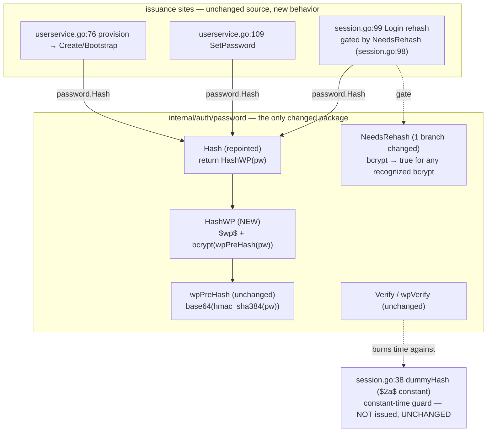

# M10.G — `$wp$` as grimoire's issued password format: Design

## Overview

Six facts about the code as it stands make this a small, surgical milestone.

**The whole verification surface is already built.** `password.Verify`
(`internal/auth/password/password.go:52`) already routes WordPress 6.8
wrapped-bcrypt (`$wp$` → `wpVerify`, `wp.go:43`), phpass portable hashes
(`$P$`/`$H$` via `phpass.Identify`/`phpass.Verify`), and PHP-written bcrypt
(`$2y$`, normalized to `$2a$` by `normalizeBcrypt`, `password.go:140`), each with
the `wpMagicQuotesSlash` (`password.go:85`) `addslashes()` retry. Nothing in the
verify path needs to change: an issued `$wp$` hash verifies through exactly the
`wpVerify` branch that already exists. This milestone adds *issuance*, not
verification.

**The login rehash is already wired.** `SessionManager.Login` already contains
the migration block — after a correct-password verify, `if
password.NeedsRehash(u.Pass) { if nh, herr := password.Hash(pw); herr == nil { _
= m.Users.UpdatePass(ctx, u.ID, nh) } }` (`session.go:98`). The transport is
complete; it is dormant only because `Hash` emits bare bcrypt and `NeedsRehash`
returns `false` for a `DefaultCost` bcrypt hash. This milestone supplies the two
behavior changes that make that already-present block fire and emit `$wp$`.

**`password.Hash` is a single choke point.** All three issuance sites —
`userservice.go:76` (`provision`, serving `Create`/`Bootstrap`),
`userservice.go:109` (`SetPassword`), and `session.go:99` (login rehash) — call
`password.Hash`. Repointing that one function body flips every issuance site at
once with no caller edit (D1). This is the milestone's central leverage: a
one-line body change at a choke point changes what grimoire *writes* everywhere.

**`NeedsRehash` checks `isWPHash` first, so `$wp$` stays terminal despite its
embedded bcrypt.** An issued `$wp$` hash contains an embedded bcrypt at
`DefaultCost`, and this milestone changes the bcrypt branch of `NeedsRehash` to
return `true` for *any* recognized bcrypt. But `NeedsRehash`
(`password.go:117`) tests `isWPHash` *before* `isBcrypt`, returns `false` there,
and never reaches the bcrypt branch for a `$wp$` input (the embedded bcrypt is
only exposed after the literal `$wp` is stripped, which only `wpVerify` does).
So `$wp$` remains terminal — verified in place, never rehashed — and the branch
order is what guarantees it (D2).

**The pre-hash is already length-safe.** `wpPreHash` (`wp.go:30`) yields
`base64(hmac_sha384(password, "wp-sha384"))` — base64 of a 48-byte HMAC-SHA384 =
64 bytes, within bcrypt's 72-byte input limit. The entire password feeds the
HMAC regardless of length, so a >72-byte password is never truncated; the
pre-hash exists for exactly this reason (`wp.go:12`, D5). `HashWP` inherits this
for free by bcrypt-ing `wpPreHash(password)` rather than the raw password.

**`dummyHash` must not be touched.** `session.go:38` holds a fixed `$2a$` bcrypt
constant used only by the unknown-user constant-time guard: an unknown login
runs `verifyPassword(pw, dummyHash)` purely to burn the same time a real compare
would, then returns `ErrInvalidCredentials`. It is never written to the
database and never issued. It needs **no** change — it is not an issuance site —
and is flagged here explicitly so it is not "fixed" to `$wp$` under the
mistaken impression that every bcrypt literal must migrate.

This design makes **one new exported function** (`password.HashWP`), **a
one-line repoint of `password.Hash`**, and **a one-branch change to
`password.NeedsRehash`**. No change to `Verify`, `wpVerify`, `wpPreHash`,
`isWPHash`, `isBcrypt`, `normalizeBcrypt`, `wpMagicQuotesSlash`, phpass,
`fasthash.go`, `session.go`, or `userservice.go`. No new config, no new
dependency, no migration.

## Architecture



Two edges carry the milestone's argument.

**`Hash --> HashWP` flips every issuance site.** `provision`, `SetPassword`, and
the login rehash all call `password.Hash` and none of them change; repointing
`Hash` to `HashWP` makes all three write `$wp$`. This is D1's "one change, every
site" leverage shown as a single edge.

**`Rehash -.-> NeedsRehash` is what wakes the dormant migration.** The login
rehash block already exists and is gated by `NeedsRehash(u.Pass)`. Changing the
bcrypt branch of `NeedsRehash` to return `true` for a `DefaultCost` bcrypt hash
makes that gate open for every legacy bcrypt row (phpass and unknown already
opened it), so the already-wired block migrates legacy rows to `$wp$` on the
next correct login — with no new transport code (D2).

The `Verify -.-> Dummy` edge is drawn only to mark `dummyHash` as in the graph
but out of scope: it is read by the constant-time guard and is never an
issuance target.

## Components and Interfaces

Three edits, all in `internal/auth/password`. Each is specified below with its
exact before/after and failure behavior folded in (no separate Error Handling
section: the only failure path is `bcrypt.GenerateFromPassword` returning an
error, handled identically to today).

### `password.HashWP` — the new issuer (Requirements 1, 7)

A new exported function reproducing WordPress 6.8's `wp_hash_password`:
`"$wp$"` concatenated with a `DefaultCost` bcrypt hash of the HMAC-SHA384
pre-hash.

```go
// HashWP returns a WordPress 6.8 "$wp$" wrapped-bcrypt hash of password at
// DefaultCost: the literal "$wp$" followed by bcrypt(wpPreHash(password)). The
// HMAC-SHA384 pre-hash (wpPreHash) domain-separates the input and bounds it to
// 64 bytes, so passwords longer than bcrypt's 72-byte limit are not truncated
// (Req 7). A hash issued here verifies through the existing wpVerify path and
// is accepted by a live WordPress 6.8 wp_check_password (shared-DB round-trip,
// Req 1.4). If bcrypt.GenerateFromPassword fails, HashWP returns that error and
// an empty string (Req 1.5).
func HashWP(password string) (string, error) {
	b, err := bcrypt.GenerateFromPassword(wpPreHash(password), DefaultCost)
	if err != nil {
		return "", err
	}
	return wpPrefix + string(b), nil
}
```

Three facts make this correct and already-covered by the verify path:

- `wpPreHash` already returns `[]byte` (`wp.go:30`), so it feeds
  `bcrypt.GenerateFromPassword` (which takes `[]byte`) directly — no
  `[]byte(...)` conversion, no intermediate string.
- `wpPrefix == "$wp$"` (`wp.go:21`), so the returned string is `"$wp$" +
  <bcrypt>`.
- The embedded bcrypt from Go is `$2a$`. Tracing `wpVerify` (`wp.go:43`) for an
  issued `$wp$2a$…`: it computes `bc := normalizeBcrypt(hash[len("$wp"):])`.
  `hash[len("$wp"):]` keeps the leading `$` (slicing after the 3-char `"$wp"`,
  **not** after `"$wp$"`), yielding `$2a$…`; `normalizeBcrypt` leaves `$2a$`
  untouched (it only rewrites `$2y$`); `bcrypt.CompareHashAndPassword(bc,
  wpPreHash(password))` then matches. So an issued `$wp$2a$…` verifies through
  the unchanged `wpVerify` path, and `Verify(correct, h)` is `(true, nil)` /
  `Verify(wrong, h)` is `(false, nil)` with no new code (Req 1.3, 3-trace of
  Req 1.4). Stored WordPress hashes carry `$2y$` and also verify via the same
  `normalizeBcrypt` step — both shapes pass.

### `password.Hash` — repointed to `HashWP` (Requirement 2)

The only change is the body; the signature is unchanged, so all three callers
(`userservice.go:76`, `:109`, `session.go:99`) compile and switch to `$wp$`
with no edit.

```go
// BEFORE (password.go:32):
func Hash(password string) (string, error) {
	b, err := bcrypt.GenerateFromPassword([]byte(password), DefaultCost)
	if err != nil {
		return "", err
	}
	return string(b), nil
}

// AFTER:
// Hash returns the WordPress 6.8 "$wp$" hash of password at DefaultCost. It
// delegates to HashWP so every issuance site (user create, password update,
// login rehash) writes the single WordPress-faithful format (D1, Req 2).
func Hash(password string) (string, error) {
	return HashWP(password)
}
```

The old bare-bcrypt body is **removed**, not kept as dead code: there is no
production need for a bcrypt-only issuer after this milestone (bcrypt becomes
verify-only, D3/Req 6). The one place that needs to synthesize a plain bcrypt
row — the `NeedsRehash` upgrade-policy test and the login-upgrade test — calls
`bcrypt.GenerateFromPassword` directly, exactly as `password_test.go` already
does in `TestNeedsRehash`/`TestVerifyBcrypt2yNormalization`. So no
`hashBcrypt`-style production helper is introduced; the test owns its own legacy
hash construction.

### `password.NeedsRehash` — one branch changed (Requirements 3, 4)

The **only** change is the bcrypt branch: a recognized bcrypt hash now returns
`true` unconditionally (previously `cost < DefaultCost`). Every other branch is
untouched.

```go
// BEFORE (password.go:117): bcrypt branch returned cost < DefaultCost.
func NeedsRehash(hash string) bool {
	switch {
	case isWPHash(hash):
		return false
	case phpass.Identify(hash):
		return true
	case isBcrypt(hash):
		cost, err := bcrypt.Cost([]byte(normalizeBcrypt(hash)))
		if err != nil {
			return true
		}
		return cost < DefaultCost   // ← old policy
	default:
		return true
	}
}

// AFTER: bcrypt (any recognized cost) is now legacy and flagged for upgrade.
func NeedsRehash(hash string) bool {
	switch {
	case isWPHash(hash):
		return false              // $wp$ terminal — checked FIRST (see below)
	case phpass.Identify(hash):
		return true               // unchanged
	case isBcrypt(hash):
		return true               // ← D2: any bcrypt is legacy, flag for upgrade
	default:
		return true               // unchanged
	}
}
```

Outcomes: `$wp$` → `false`; phpass → `true`; bcrypt at or below `DefaultCost` →
`true` (the deliberate reversal of Req 3.1); unknown → `true`. The `isBcrypt`
branch no longer calls `bcrypt.Cost`/`normalizeBcrypt`, so those become unused by
`NeedsRehash` (still used by `Verify`/`wpVerify`).

**Branch order guarantees `$wp$` terminality.** `isWPHash` is evaluated before
`isBcrypt`. An issued `$wp$` hash matches `isWPHash` and returns `false`
immediately; the bcrypt branch is never reached for it, even though it embeds a
`DefaultCost` bcrypt. Only after `wpVerify` strips the literal `$wp` does the
embedded bcrypt become visible, and `NeedsRehash` never does that stripping. So
`$wp$` stays off the upgrade path forever (Req 3.5, 4.3) while every legacy
bcrypt/phpass/unknown row is flagged (Req 3.1–3.4), and the already-wired
`session.go:98` block migrates them on next correct login (Req 4.1, 4.2). A
wrong-password login never reaches the rehash block (it returns at the verify
failure), and a failed `UpdatePass` is ignored (`_ =`), so login still succeeds
(Req 4.4, 4.5) — both unchanged in `session.go`.

### Unchanged components — the inherited-behavior surface (Requirements 5, 9)

Stated explicitly because the milestone's correctness depends on them *not*
changing:

- `Verify`, `wpVerify`, `wpPreHash`, `isWPHash`, `isBcrypt`, `normalizeBcrypt`,
  `wpMagicQuotesSlash`, and all of phpass — verification is byte-for-byte
  unchanged, so no legacy login regresses (Req 5.1–5.5).
- `session.go` — `Login`, `verifyPassword`, and `dummyHash` are untouched. The
  rehash block's *behavior* changes only because `Hash` and `NeedsRehash`
  changed beneath it; its source does not. `dummyHash` stays a `$2a$` constant
  (never issued/stored, Finding 6).
- `userservice.go` — `provision` (`:76`) and `SetPassword` (`:109`) keep their
  `password.Hash` calls verbatim; they now store `$wp$` (Req 2.2, 2.3).
- `internal/auth/fasthash.go` — `HashFast`/`VerifyFast` and `$generic$`
  Application-Password hashing are out of scope and unchanged (Req 9).

## Data Models

No Go type changes. The only data model is the string anatomy of the issued and
verified hash.

**Issued `$wp$` hash (grimoire-written):**

```
$wp$ 2a$ 12 $ <22-char salt> <31-char digest>
└┬─┘ └────────────── embedded Go bcrypt ──────────────┘
 │    └ $2a$ (Go emits $2a$; cost = DefaultCost = 12)
 └ wpPrefix literal
```

- Full string = `wpPrefix + string(bcrypt(wpPreHash(pw)))`
  = `"$wp$" + "$2a$12$" + salt + digest`.
- `DefaultCost == bcrypt.DefaultCost == 12` (`password.go:28`).

**Pre-hash fed to bcrypt (`wpPreHash`, `wp.go:30`):**

```
base64_std( hmac_sha384( password, key="wp-sha384" ) )
   = base64(48-byte HMAC)  = 64 bytes
```

- 48-byte SHA-384 output → `base64.StdEncoding` → 64 bytes, ≤ bcrypt's 72-byte
  input limit, so no truncation (Req 7.1). The full password always feeds the
  HMAC, so a >72-byte password contributes entirely (Req 7.2).

**`$2y$` vs `$2a$` — both verify.** A stored WordPress-written hash is
`$wp$2y$12$…` (PHP emits `$2y$`); a grimoire-issued hash is `$wp$2a$12$…` (Go
emits `$2a$`). `wpVerify` runs the embedded bcrypt through `normalizeBcrypt`,
which rewrites `$2y$`→`$2a$`, so both shapes verify against the same
`wpPreHash(password)`. The golden test vector `wpGolden =
"$wp$2y$12$iWN5xRwDE7i9R5jVJvCyqOxS1CNnwUggQaF8O2W9Bg8TuXQz.ngrS"`
(`password_test.go`) is a live-WordPress `$2y$` vector for plaintext
`wpGoldenPlain = "grimoire-test-123"`; a freshly `HashWP`-issued hash for the
same plaintext is `$wp$2a$…` with a fresh salt (so not byte-equal to the golden
vector, but both verify true for the plaintext and false for a wrong one).

## Findings

Codebase facts established during design that shape it:

1. **The verification surface is complete.** `Verify` already handles `$wp$`,
   phpass, `$2y$`, and the magic-quotes fallback (`password.go:52–83`). Issuance
   reuses it with zero verify-side change — an issued `$wp$2a$…` flows through
   the existing `wpVerify` branch. This is why the milestone is three edits in
   one package.

2. **The login rehash is already wired** at `session.go:98`. The transport for
   legacy-row migration exists and is gated by `NeedsRehash`. This milestone's
   two behavior changes (`Hash` emits `$wp$`; `NeedsRehash` flags bcrypt) are the
   only things needed to make it fire and emit `$wp$` — no new login code.

3. **`password.Hash` is the single issuance choke point.** `userservice.go:76`,
   `userservice.go:109`, and `session.go:99` all call it. One body line
   (`return HashWP(password)`) flips all three (D1). Confirmed by grepping
   `password.Hash` — three call sites, no others.

4. **`NeedsRehash` branch order makes `$wp$` terminal despite its embedded
   bcrypt.** `isWPHash` precedes `isBcrypt` in the switch (`password.go:118`
   vs `:122`), so a `$wp$` input returns `false` before the (now `true`-always)
   bcrypt branch is reached. Without this order, flagging all bcrypt would
   wrongly re-flag `$wp$`.

5. **The pre-hash is 64 bytes ≤ 72**, so wrapping with bcrypt never truncates
   (Req 7); this is the documented reason WordPress wraps with an HMAC pre-hash
   (`wp.go:12`). `HashWP` bcrypt-s `wpPreHash(pw)`, inheriting the bound.

6. **`dummyHash` (`session.go:38`) is a bare `$2a$` bcrypt constant used ONLY by
   the unknown-user constant-time guard.** It is compared against via
   `verifyPassword(pw, dummyHash)` purely to equalize timing and is never written
   to the DB or issued. It needs **no** change — flagged explicitly so it is not
   mistakenly "migrated" to `$wp$`. (A `$wp$` dummy would also needlessly add an
   HMAC per unknown-user login.)

## Testing strategy

Pure Go, no new dependency, no SQLite beyond the existing session test harness.
`gofmt`, `go vet`, `go build ./...`, `go test ./...` green at the end of every
task (D6/Req 10).

**Unit tests — `internal/auth/password`** (extend `password_test.go`,
reusing `wpGolden`/`wpGoldenPlain`; no real user hashes embedded, Req 10.5):

- **Issuance round-trip / `Hash` emits `$wp$`.** `h, _ := Hash("…")`; assert
  `strings.HasPrefix(h, "$wp$")`; assert `Verify("…", h)` → `(true, nil)` and
  `Verify("wrong", h)` → `(false, nil)` (Req 1.2, 1.3, 2.1, 10.1). This replaces
  the existing `TestHashAndVerify` assertion that `Hash` starts with `$2`
  (that assertion must be updated to `$wp$`, since the issued format changed).
  Add the same for `HashWP` directly (Req 1.1).
- **`NeedsRehash(Hash(pw)) == false`** — a fresh issued hash is terminal
  (Req 10.2).
- **`NeedsRehash` table with the flipped cell.** Extend `TestNeedsRehash`:
  `{"bcrypt default cost", string(strong), true}` — the D2 reversal (was
  `false`); keep `{phpass, true}`, `{below-cost bcrypt, true}`, `{unknown,
  true}`; and `$wp$` → `false` (already `TestNeedsRehashWPHash`). `strong`/`weak`
  are built with `bcrypt.GenerateFromPassword` in-test, as today (Req 3.1–3.5,
  10.3).
- **Pre-hash length / >72-byte password.** Hash a password longer than 72 bytes
  with `HashWP` and assert `Verify` returns `(true, nil)` for the full password
  and `(false, nil)` for a truncated-at-72 variant — proving the whole password
  feeds the HMAC and nothing is silently truncated (Req 7.2).
- **`HashWP` error passthrough** is covered implicitly; `bcrypt` only errors on
  a cost out of range (not reachable via the fixed `DefaultCost`), so Req 1.5 is
  asserted by code review of the `if err != nil { return "", err }` path rather
  than a forced-error unit test.

**Integration test — `internal/auth`** over `SessionManager.Login`, reusing the
existing session test harness:

- Seed a legacy **bcrypt** row (`bcrypt.GenerateFromPassword` in-test) → log in
  with the correct password → assert `UpdatePass` was called with a `$wp$` hash
  (observe via the harness's user repo) (Req 4.1).
- Seed a **phpass** row (the `$P$6WXYZ…` vector already in `password_test.go`) →
  correct login → assert `UpdatePass` with a `$wp$` hash (Req 4.2).
- Seed a **`$wp$`** row (`wpGolden`) → correct login → assert `UpdatePass` is
  **not** called (Req 4.3).
- **Wrong password** on any seeded row → assert no `UpdatePass` and
  `ErrInvalidCredentials` (Req 4.5).

**No property-based testing.** This milestone is a fixed issuer (`HashWP` has no
input-varying contract beyond "prefix is `$wp$` and it round-trips", already an
example assertion) and a fixed-table upgrade policy (`NeedsRehash` is a
four-branch classifier enumerated exhaustively by the table above). There is no
universal "for all inputs X, P(X)" worth 100 iterations that the example tables
don't already pin — the input space that matters is the small set of hash-format
classes, each tested by one representative. PBT would add iterations without
finding cases the enumerated table misses.

## Traceability

| Design element | Requirement IDs |
|---|---|
| `HashWP` emits `"$wp$" + bcrypt(wpPreHash(pw))` at `DefaultCost` | 1.1, 1.2, 1.3, 1.4, 1.5 |
| `HashWP` bcrypt-s the 64-byte pre-hash (no truncation) | 7.1, 7.2, 7.3, D5 |
| `Hash` repointed to `HashWP` (old bcrypt body removed) | 2.1, D1 |
| `provision`/`Create` (`userservice.go:76`) stores `$wp$`, call unchanged | 2.2 |
| `SetPassword` (`userservice.go:109`) stores `$wp$`, call unchanged | 2.3 |
| `Login` rehash (`session.go:99`) stores `$wp$`, call unchanged | 2.4 |
| `NeedsRehash` bcrypt branch → `true` (any recognized cost) | 3.1, 3.2 |
| `NeedsRehash` phpass → `true`, unknown → `true` (unchanged) | 3.3, 3.4 |
| `NeedsRehash` `$wp$` → `false`, `isWPHash`-first branch order | 3.5, Finding 4 |
| Login migrates legacy bcrypt / phpass → `$wp$` on correct login | 4.1, 4.2 |
| Login does NOT rehash a `$wp$` row | 4.3 |
| Rehash best-effort; failed `UpdatePass` still logs in; wrong pw no upgrade | 4.4, 4.5 |
| `Verify`/`wpVerify`/`normalizeBcrypt`/magic-quotes unchanged | 5.1, 5.2, 5.3, 5.4, 5.5 |
| `$wp$` is the single issued scheme; bcrypt+phpass verify-only; supersedes 10.C | 6.1, 6.2, 6.3, D3 |
| No new config flag; `$wp$` unconditional | 8.1, 8.2, D4 |
| `fasthash.go` / `$generic$` / Application Passwords untouched | 9.1, 9.2 |
| Unit tests: `Hash`→`$wp$` round-trip, fresh-hash `NeedsRehash==false` | 10.1, 10.2 |
| `NeedsRehash` table with flipped default-cost-bcrypt cell | 10.3 |
| Login-upgrade integration test over `SessionManager.Login` | 10.4 |
| Reuse `wpGolden`/`wpGoldenPlain`; no real hashes; no new dep/env/SQLite | 10.5, 10.6 |
| Toolchain green each task | 10.7, D6 |
| `dummyHash` unchanged (constant-time guard, not issued) | Finding 6 |
