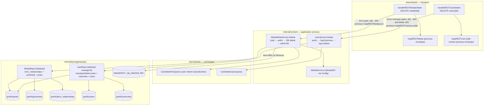

# M11 — REST delete parity (media + users): Design

## Overview

Four facts about the code as it stands set this milestone's shape.

**The two delete surfaces are the last `501`s on the REST write path, and they
are the *only* registrations this milestone touches.** `registerRESTMedia`
(`internal/web/rest_media.go:21`) wires `GET`, the live `POST` create, and the
live `PUT/PATCH/POST /media/{id}` update under an `if s.mediaWrite != nil`
gate, then unconditionally registers `DELETE /media/{id}` as
`restNotImplemented("rest_cannot_edit", "Updating or deleting media")`
(`rest_media.go:51`). `registerRESTUsers` (`internal/web/rest_users.go:26`) does
the same, keeping `DELETE /users/{id}` a `501` stub *inside* the
`if s.userWrite != nil` block (`rest_users.go:50`). M11 replaces exactly those
two `DELETE` registrations with real handlers under the same nil-gates; when the
write service is nil the `501` stub stays (Req 10.5).

**M10a/M10.B/M10.C already built every pattern this milestone copies.** The
delete handlers reuse the create/update auth preamble verbatim — Application
Password skips CSRF (`isAppPasswordAuth`), a session enforces the M4
`X-CSRF-Token` contract (`requireSessionCSRFREST`), principal via
`PrincipalFrom` (Req 11.1, 11.2). The media delete reuses
`MediaWriteService`'s stored-row ownership posture
(`auth.CanEditPost(actor, "post", "inherit", cur.AuthorID)` on update becomes
`auth.CanDeletePost(actor, "post", "inherit", cur.AuthorID)` on delete, Req 3.3).
The user delete reuses `UserService`'s capability-gate shape. The storage
deletes mirror the existing `PostWriter.Delete`
(`internal/storage/wprepo/writers.go:105`) and the multi-table transactional
`TermRepo.Delete` (`writers.go:172`) / `NavMenuRepo.DeleteMenu`
(`internal/storage/wprepo/menus_write.go:135`) precedents.

**The media file path is already on `domain.Media`.** `MediaRepo.ByID`
(`internal/storage/wprepo/media.go`) reads the `_wp_attached_file` postmeta via a
`JOIN ... AS pm` and scans it into `mediaRow.Filename` (`media.go:20`), which
`toDomain()` carries onto `domain.Media.Filename` (`media.go:38`) — the same
relative path `MediaService.Store` writes at create time
(`internal/content/media.go:99`, `filepath.ToSlash(relPath)`). So the service
gets the on-disk relative path straight off the loaded attachment: no second
postmeta read is needed, *provided* the attachment is loaded before the DB
delete removes that postmeta row (see Finding 3). The absolute path is
`filepath.Join(s.media.Config().UploadsDir, filepath.FromSlash(cur.Filename))` —
the exact join `Store` uses at `media.go:84`.

**WordPress hard-deletes attachments and users; neither trashes.** Both routes
require `?force=true`; its absence is `400 rest_trash_not_supported`, never a
trash (Req 2, 6). The media hard delete removes the `{prefix}posts` row, its
`{prefix}postmeta`, its `{prefix}term_relationships`, *and* the on-disk file
(Req 4). The user hard delete first reassigns-or-deletes the user's authored
posts, then removes the `{prefix}users` row and `{prefix}usermeta`, all in one
transaction (Req 9).

This design adds **two domain port methods** (`MediaWriter.Delete`,
`UserRepository.Delete`) plus their `wprepo` implementations, **one method on
each existing content service** (`MediaWriteService.Delete`,
`UserService.Delete`), and **two REST handlers** (`handleRESTMediaDelete`,
`handleRESTUserDelete`) replacing the two `501` stubs. No migration (every
target table exists, Req 10.3), no new capability name (Req 11.5), no read-port
change (Req 10.4).

The standalone `## Correctness Properties` and `## Error Handling` H2s are
omitted deliberately (matching the 10.1/10.2/10.3 siblings): this milestone adds
fixed-verb delete endpoints with enumerable branches, not pure functions over a
large input space, so there is no "for all inputs" property worth a PBT harness
(see Testing strategy). Fail-closed and error-mapping behavior is folded into
the component descriptions below.

## Architecture



Three edges carry the milestone's argument.

**`MDel --> MWS` hands the handler-computed `previous` back, never a post-delete
read.** The handler loads the stored attachment and maps it through
`mapRESTMedia` *before* calling the service, so the `previous` envelope reflects
the attachment as it existed (Req 1.3). The service returns the captured
`domain.Media` it loaded; the handler already holds its mapped form.

**`MWS --> MW` then `MWS --> Disk`: DB delete first, file unlink best-effort
second.** The service computes `previous`, deletes the database rows via
`MediaWriter.Delete`, then unlinks the file. A missing file is non-fatal
(`os.IsNotExist`, Req 4.3). This order is deliberate (see the service section).

**`UDel --> US --> UR` keeps the transaction boundary in storage.** The
reassign-or-delete of authored posts and the user/usermeta removal happen in one
`wprepo` `RunInTx` (Req 9.3), so a half-reassigned/half-deleted state cannot
persist. The handler owns the self-delete `403` and the `reassign`-target
existence check; the service owns the `delete_users` gate and the
`previous`-capture.

## Capability model (Requirements 3, 8)

No new capability name is introduced (Req 11.5, D7). Both helpers already exist
in `internal/auth/policy.go`.

**Media delete uses `auth.CanDeletePost`, keyed off the stored `post_author`.**
`CanDeletePost(actor, postType, status, authorID)`
(`internal/auth/policy.go:59`) mirrors `CanEditPost` with the `delete_*` family.
An attachment is a `{prefix}posts` row with `post_status = "inherit"`, so passing
`status = "inherit"` keeps the `delete_published_*`/`delete_private_*` branches
from firing (verified: both branches gate on `status == "publish"` /
`status == "private"`), reducing the decision to own vs others:
`delete_posts` for `storedAuthor == actor.UserID`, `delete_others_posts`
otherwise. Passing `postType = "post"` selects the `*_posts` family via
`capSuffix`, exactly as `MediaWriteService.Update` does with `CanEditPost`
(`internal/content/mediawriteservice.go`). The author is always read from the
stored row loaded by ID, never from the request (Req 3.3).

**User delete uses `auth.CanDeleteUsers`, administrator-only by default.**
`CanDeleteUsers(actor)` (`internal/auth/policy.go:98`) is `actor.Can("delete_users")`;
`delete_users` is granted only to the administrator role
(`internal/auth/roles.go:134`). So the user-delete test matrix needs an admin
actor for the allowed case (Finding 6).

| Operation | Capability | Evaluated against |
|---|---|---|
| media delete, own attachment | `delete_posts` | `stored.AuthorID == actor.UserID` (Req 3.1) |
| media delete, other's attachment | `delete_others_posts` | `stored.AuthorID != actor.UserID` (Req 3.2) |
| user delete | `delete_users` | the acting principal (Req 8.1) |
| user self-delete | — (forbidden regardless) | `{id} == actor.UserID` → `403` (Req 8.3) |

An unauthenticated caller holds no capabilities, so the media gate fails
(`403 rest_cannot_delete`, Req 3.4) and the user gate fails
(`403 rest_user_cannot_delete`, Req 8.4) — the forbidden-write convention the
create/update handlers already use (`http.StatusForbidden`, not `401`).

## Components and Interfaces

This milestone adds two domain port methods and their `wprepo` implementations,
one delete method on each existing content service, and two REST handlers. The
data types these components exchange (the delete envelope, the `force` parse,
and the `reassign` parse) are collected in **Data Models**.

### `domain.MediaWriter.Delete` (Requirements 4, 10.1)

One additive method on the existing interface
(`internal/domain/repository.go:222`), beside `Create`/`SetParent`/`UpdateMeta`.
The compile-time assertion `var _ domain.MediaWriter = (*MediaRepo)(nil)`
already exists (`internal/storage/wprepo/media.go:14`); adding the method to the
impl keeps it satisfied — no new assertion is needed.

```go
// BEFORE (internal/domain/repository.go:221)
type MediaWriter interface {
	Create(ctx context.Context, m Media) (int64, error)
	SetParent(ctx context.Context, id, parentID int64) error
	UpdateMeta(ctx context.Context, id int64, m MediaMeta) error
}

// AFTER
type MediaWriter interface {
	Create(ctx context.Context, m Media) (int64, error)
	SetParent(ctx context.Context, id, parentID int64) error
	UpdateMeta(ctx context.Context, id int64, m MediaMeta) error
	// Delete hard-deletes an attachment's {prefix}term_relationships rows, its
	// {prefix}postmeta rows, and finally its {prefix}posts row, in one
	// transaction (Req 4.1). It returns domain.ErrNotFound when no attachment
	// has the given ID (Req 4.4), matching the UpdateMeta/SetParent contract and
	// the existing PostWriter.Delete. It does NOT touch the on-disk file — that
	// is the Media_Write_Service's job (Req 4.2), because the storage layer has
	// no knowledge of UploadsDir.
	Delete(ctx context.Context, id int64) error
}
```

#### `wprepo.MediaRepo.Delete` implementation

Mirrors `TermRepo.Delete` (`writers.go:172`): raw `tx.ExecContext` with `?`
placeholders inside `RunInTx`, deepest-dependency-first, `errNotFoundIfZero` on
the final `{prefix}posts` delete.

```go
// Delete removes an attachment's term relationships, postmeta, and posts row in
// one transaction, deepest-dependency-first so no orphan can survive a partial
// failure. ErrNotFound when the posts DELETE affected no row (Req 4.4).
func (r *MediaRepo) Delete(ctx context.Context, id int64) error {
	return r.db.RunInTx(ctx, nil, func(ctx context.Context, tx bun.Tx) error {
		// (1) term_relationships: an attachment can carry gallery/category
		// relationships (object_id = the attachment's post ID), Finding 5.
		relQ := "DELETE FROM " + r.prefix + "term_relationships WHERE object_id = ?"
		if _, err := tx.ExecContext(ctx, relQ, id); err != nil {
			return err
		}
		// (2) postmeta: _wp_attached_file, _wp_attachment_image_alt, and any
		// other attachment meta (post_id = the attachment's post ID).
		metaQ := "DELETE FROM " + r.prefix + "postmeta WHERE post_id = ?"
		if _, err := tx.ExecContext(ctx, metaQ, id); err != nil {
			return err
		}
		// (3) the posts row itself; no row removed -> domain.ErrNotFound.
		pID := rebind.Ident(vendorOf(r.db), "ID")
		postQ := "DELETE FROM " + r.prefix + "posts WHERE " + pID + " = ?"
		res, err := tx.ExecContext(ctx, postQ, id)
		if err != nil {
			return err
		}
		return errNotFoundIfZero(res)
	})
}
```

`rebind.Ident(vendorOf(r.db), "ID")` is the cross-vendor `"ID"` quoting used in
raw SQL elsewhere in this package (`NavMenuRepo.DeleteMenu`,
`menus_write.go:137`): Postgres declares the column quoted as `"ID"`, so an
unquoted `ID` folds to `id` and fails on that vendor alone. The bun query-builder
paths use `bun.Ident("ID")` for the same reason; raw SQL uses `rebind.Ident`.
The `term_relationships` and `postmeta` deletes do not reference `"ID"`
(they filter on `object_id`/`post_id`), so they need no rebinding.

The posts delete is intentionally not guarded by `post_type = 'attachment'`: the
service only ever calls `Delete` after loading the row via `reader.ByID`, which
already filters `post_type = "attachment"` (`media.go` `ByID`), so a non-attachment
ID reaches `Delete` only if the caller bypassed the service — and the `{id}`
that reached here was resolved as an attachment. Keeping the delete keyed on the
primary key alone matches `PostWriter.Delete` exactly.

### `domain.UserRepository.Delete` (Requirements 9, 10.2)

One additive method on the existing interface
(`internal/domain/repository.go:325`), beside
`ByLogin`/`ByNicename`/`ByID`/`Create`/`UpdatePass`/`UpdateProfile`/`ByEmail`/`List`/`Count`.
The compile-time assertion `var _ domain.UserRepository = (*UserRepo)(nil)`
already exists (`internal/storage/wprepo/users.go:14`).

```go
// Delete removes a user and reassigns-or-deletes their authored content in one
// transaction (Req 9). reassignTo == 0 deletes the user's authored
// {prefix}posts rows; a positive reassignTo sets post_author = reassignTo on
// them. In both cases the authored-content step runs BEFORE the usermeta and
// users rows are removed (Req 9.1, 9.2). Returns domain.ErrNotFound when no user
// has the given ID (Req 9.5), matching UpdatePass/UpdateProfile.
Delete(ctx context.Context, id int64, reassignTo int64) error
```

#### `wprepo.UserRepo.Delete` implementation

One `RunInTx`, four possible statements, authored-content first.

```go
func (r *UserRepo) Delete(ctx context.Context, id int64, reassignTo int64) error {
	return r.db.RunInTx(ctx, nil, func(ctx context.Context, tx bun.Tx) error {
		if reassignTo > 0 {
			// Reassign authored posts to the target user (Req 9.1).
			upd := "UPDATE " + r.prefix + "posts SET post_author = ? WHERE post_author = ?"
			if _, err := tx.ExecContext(ctx, upd, reassignTo, id); err != nil {
				return err
			}
		} else {
			// Delete the user's authored content (Req 9.2). Collect the post IDs
			// first, then delete their postmeta and term_relationships before the
			// posts rows, so a reassign=false delete leaves no orphaned post meta
			// or relationships -- mirroring a full post delete (see rationale).
			pID := rebind.Ident(vendorOf(r.db), "ID")
			sel := "SELECT " + pID + " FROM " + r.prefix + "posts WHERE post_author = ?"
			rows, err := tx.QueryContext(ctx, sel, id)
			if err != nil {
				return err
			}
			var postIDs []int64
			for rows.Next() {
				var pid int64
				if err := rows.Scan(&pid); err != nil {
					rows.Close()
					return err
				}
				postIDs = append(postIDs, pid)
			}
			if err := rows.Err(); err != nil {
				rows.Close()
				return err
			}
			rows.Close()
			for _, pid := range postIDs {
				if _, err := tx.ExecContext(ctx,
					"DELETE FROM "+r.prefix+"term_relationships WHERE object_id = ?", pid); err != nil {
					return err
				}
				if _, err := tx.ExecContext(ctx,
					"DELETE FROM "+r.prefix+"postmeta WHERE post_id = ?", pid); err != nil {
					return err
				}
			}
			if _, err := tx.ExecContext(ctx,
				"DELETE FROM "+r.prefix+"posts WHERE post_author = ?", id); err != nil {
				return err
			}
		}
		// usermeta next (Req 9.1, 9.2: after authored content, before users row).
		if _, err := tx.ExecContext(ctx,
			"DELETE FROM "+r.prefix+"usermeta WHERE user_id = ?", id); err != nil {
			return err
		}
		// finally the users row; no row removed -> domain.ErrNotFound (Req 9.5).
		uID := rebind.Ident(vendorOf(r.db), "ID")
		res, err := tx.ExecContext(ctx,
			"DELETE FROM "+r.prefix+`users WHERE `+uID+" = ?", id)
		if err != nil {
			return err
		}
		return errNotFoundIfZero(res)
	})
}
```

**`"ID"` cross-vendor quoting.** Both the posts-ID `SELECT` (reassign=false
branch) and the final `{prefix}users` delete reference the quoted primary key,
so both build it with `rebind.Ident(vendorOf(r.db), "ID")` — never a bare `ID`,
for the same Postgres case-folding reason the rest of this package guards
against. The `post_author`, `user_id`, `object_id`, and `post_id` filters are
ordinary lowercase columns and need no rebinding.

**Decision: reassign=false cascades authored posts' postmeta and
term_relationships (pinned).** A bare `DELETE FROM {prefix}posts WHERE post_author = id`
would leave every deleted post's `{prefix}postmeta` and `{prefix}term_relationships`
rows orphaned (the schema has no FK cascade). WordPress's own
`wp_delete_user(..., reassign=false)` deletes each authored post through
`wp_delete_post(..., force_delete=true)`, which tears down the post's meta and
term relationships too. This design mirrors that: collect the authored post IDs,
delete their `term_relationships` and `postmeta`, then the posts rows. This keeps
the reassign=false branch a true full-post delete, consistent with the media
hard delete's no-orphan guarantee (Req 4), and is validated by the Req 12.5
storage round-trip. The reassign>0 branch does **not** cascade — the posts
survive under a new author, so their meta and relationships must survive too.

### `content.MediaWriteService.Delete` (Requirements 1, 3, 4)

A new method on the existing `MediaWriteService`
(`internal/content/mediawriteservice.go`), beside `Create`/`Update`. It reuses
the struct's existing fields (`media *MediaService`, `reader domain.MediaRepository`,
`writer domain.MediaWriter`) — no constructor or option change.

```go
// Delete hard-deletes an attachment: it loads the stored row (bubbling
// ErrNotFound, Req 1.4/4.4), authorizes the delete against the stored
// post_author via CanDeletePost (Req 3), removes the database rows through
// MediaWriter.Delete, then best-effort unlinks the on-disk file (Req 4.2).
// It returns the attachment as it existed immediately before deletion so the
// handler can envelope it as "previous" (Req 1.3). A capability failure returns
// ErrForbidden with nothing deleted (fail closed, Req 3).
func (s *MediaWriteService) Delete(ctx context.Context, actor auth.Principal, id int64) (domain.Media, error) {
	cur, err := s.reader.ByID(ctx, id)
	if err != nil {
		return domain.Media{}, err // domain.ErrNotFound bubbles up (Req 1.4)
	}
	// Ownership keys off the STORED post_author, status "inherit" (same posture
	// as Update's CanEditPost). delete_posts for own, delete_others_posts for
	// another's (Req 3.1-3.3). Never a request-supplied author.
	if !auth.CanDeletePost(actor, "post", "inherit", cur.AuthorID) {
		return domain.Media{}, ErrForbidden
	}

	// DB delete FIRST (Req 4.1), then unlink the file (Req 4.2). Order rationale
	// below. The relative path is cur.Filename (the _wp_attached_file value the
	// reader already carried on domain.Media, Finding 3) captured BEFORE the
	// delete removes that postmeta row.
	if err := s.writer.Delete(ctx, id); err != nil {
		return domain.Media{}, err
	}
	if rel := cur.Filename; rel != "" {
		full := filepath.Join(s.media.Config().UploadsDir, filepath.FromSlash(rel))
		if err := os.Remove(full); err != nil && !os.IsNotExist(err) {
			// A missing file is non-fatal (Req 4.3); a real unlink error is
			// logged and swallowed so a gone/locked file cannot leave a
			// half-deleted DB row re-appear. The rows are already gone.
			// (log via the service's logger; the DB delete has committed.)
		}
	}
	return cur, nil // the "previous" object (Req 1.3)
}
```

**Order: capture `previous` → DB delete → file unlink (pinned, DB-delete-first).**
Three orderings were considered:

1. *unlink → DB delete*: if the DB delete then fails, the row survives pointing
   at a file that is already gone — the worst outcome (a live attachment whose
   bytes are missing). Rejected.
2. *DB delete → unlink* (chosen): if the unlink fails or the file is already
   absent, the DB rows are already gone and the attachment is fully removed from
   every query path; a leftover orphaned file on disk is a cleanup nuisance, not
   a correctness break, and Req 4.3 explicitly makes a missing file non-fatal.
   The window where rows are gone but the file lingers is strictly safer than the
   reverse.
3. *capture-before-either*: mandatory regardless, because `MediaWriter.Delete`
   removes the `_wp_attached_file` postmeta row, after which the relative path
   can no longer be read. `cur` is loaded first and carries `Filename`, so the
   path is in hand before anything is deleted (Finding 3).

The file path comes from `cur.Filename` — no second postmeta read — because
`MediaRepo.ByID` already joins `_wp_attached_file` into `mediaRow.Filename`
(`media.go`). This is the single most important sequencing constraint in the
milestone.

### `content.UserService.Delete` (Requirements 5, 8, 9)

A new method on the existing `UserService` (`internal/content/userservice.go`),
beside `Create`/`UpdateProfile`/`SetPassword`/`SetRoles`. It reuses the struct's
existing `users domain.UserRepository` field.

```go
// Delete authorizes and performs a user hard delete. It requires delete_users
// (Req 8.1); the handler owns the self-delete 403 and the reassign-target
// existence check (see below), so by the time Delete runs the actor is
// authorized and reassignTo is already validated. It loads the stored user as
// "previous" (Req 5.3) BEFORE calling repo.Delete, then delegates the
// transactional reassign/delete to UserRepository.Delete (Req 9). Returns
// ErrForbidden on a capability failure (nothing deleted) and domain.ErrNotFound
// when id resolves to no user (Req 5.4/9.5).
func (s *UserService) Delete(ctx context.Context, actor auth.Principal, id int64, reassignTo int64) (domain.User, error) {
	if !auth.CanDeleteUsers(actor) {
		return domain.User{}, ErrForbidden // Req 8.1
	}
	prev, err := s.users.ByID(ctx, id)
	if err != nil {
		return domain.User{}, err // domain.ErrNotFound bubbles up (Req 5.4)
	}
	if err := s.users.Delete(ctx, id, reassignTo); err != nil {
		return domain.User{}, err
	}
	return prev, nil // the "previous" object (Req 5.3)
}
```

**Division of responsibility (pinned).** Two user-delete checks are *not* the
service's job, matching Finding 4:

- **Self-delete** (`{id} == actor.UserID` → `403 rest_user_cannot_delete`, Req
  8.3) is a *handler* concern. It is decided against the `{id}` path segment and
  the resolved principal (Req 8.5), which are transport values; the service does
  not re-derive the principal's identity from anything else. The handler checks
  it before calling `Delete`.
- **Reassign-target existence** (a `reassign=<id>` that does not resolve to an
  existing user → `400 rest_user_invalid_reassign`, Req 7.3) is also a *handler*
  concern. The handler resolves it with `s.restUsers.ByID(reassignTo)` before
  calling `Delete`, so the `400` is returned without opening a transaction. The
  service receives an already-validated `reassignTo` and passes it straight to
  the repo. This keeps the "no partial state" guarantee (Req 9.4) simple: the
  only work inside the transaction is the reassign/delete + user removal, never a
  validation that could have been done up front.

The `delete_users` capability gate lives in the service (not the handler) so a
service-level test can assert the forbidden path without a transport, mirroring
how `UserService.Create` owns `create_users`.

### Web handlers (Requirements 1, 2, 5, 6, 7, 8, 11)

Both handlers replace a single `restNotImplemented` registration and are wired
under the existing nil-gates. The auth preamble is copied verbatim from the
create/update handlers in the same files.

#### `registerRESTMedia` change

```go
	// BEFORE (rest_media.go:51): unconditional 501 stub.
	r.Method(http.MethodDelete, "/media/{id}", restNotImplemented("rest_cannot_edit", "Updating or deleting media"))

	// AFTER: live handler when mediaWrite is wired, else the 501 stub (Req 10.5).
	if s.mediaWrite != nil {
		r.Method(http.MethodDelete, "/media/{id}", s.handleRESTMediaDelete())
	} else {
		r.Method(http.MethodDelete, "/media/{id}", restNotImplemented("rest_cannot_edit", "Updating or deleting media"))
	}
```

(Because the existing `if s.mediaWrite != nil` block already registers the
`PUT/PATCH/POST /media/{id}` update handlers, the cleanest edit moves the
`DELETE /media/{id}` line *into* both arms of that block — the live handler in
the non-nil arm, the stub in the nil arm — rather than leaving it after the
block. Either arrangement satisfies Req 10.5; the folded form keeps the gate in
one place.)

#### `handleRESTMediaDelete`

```go
// handleRESTMediaDelete serves DELETE .../media/{id} (Req 1-4). Auth matches
// handleRESTMediaUpdate verbatim: an Application Password skips CSRF; a session
// enforces the M4 X-CSRF-Token contract. {id} must parse to a positive int
// (else 404 rest_post_invalid_id, Req 11.3). force=true is mandatory (else 400
// rest_trash_not_supported, Req 2.1); force is read from the query only (Req
// 2.3). The "previous" envelope is mapRESTMedia(cur) computed BEFORE the service
// delete (Req 1.3); on success it responds 200 {"deleted": true, "previous": ...}.
func (s *Server) handleRESTMediaDelete() http.HandlerFunc {
	return func(w http.ResponseWriter, r *http.Request) {
		if !isAppPasswordAuth(r.Context()) {
			if _, hasSession := sessionFrom(r.Context()); hasSession {
				if !s.requireSessionCSRFREST(w, r) {
					return
				}
			}
		}
		principal, _ := PrincipalFrom(r.Context())

		id, err := strconv.ParseInt(chi.URLParam(r, "id"), 10, 64)
		if err != nil || id <= 0 {
			writeRESTError(w, http.StatusNotFound, "rest_post_invalid_id", "Invalid media ID.") // Req 11.3
			return
		}
		if !restForceDelete(r) {
			writeRESTError(w, http.StatusBadRequest, "rest_trash_not_supported",
				"Supply force=true to delete this media.") // Req 2.1
			return
		}

		// Load + map the stored attachment BEFORE deleting, so "previous"
		// reflects it as it existed (Req 1.3). A 404 here matches
		// handleRESTMediaSingle (Req 1.4).
		cur, err := s.restMedia.ByID(r.Context(), id)
		if err != nil {
			if errors.Is(err, domain.ErrNotFound) {
				writeRESTError(w, http.StatusNotFound, "rest_post_invalid_id", "Invalid media ID.")
				return
			}
			writeRESTError(w, http.StatusInternalServerError, "rest_list_failed", "Could not look up media.")
			return
		}
		previous, err := s.mapRESTMedia(r, cur)
		if err != nil {
			writeRESTError(w, http.StatusInternalServerError, "rest_delete_failed", "Could not map media.")
			return
		}

		if _, err := s.mediaWrite.Delete(r.Context(), principal, id); err != nil {
			switch {
			case errors.Is(err, domain.ErrNotFound):
				writeRESTError(w, http.StatusNotFound, "rest_post_invalid_id", "Invalid media ID.")
			case errors.Is(err, content.ErrForbidden):
				writeRESTError(w, http.StatusForbidden, "rest_cannot_delete",
					"Sorry, you are not allowed to delete this media.") // Req 3
			default:
				writeRESTError(w, http.StatusInternalServerError, "rest_delete_failed", "Could not delete media.")
			}
			return
		}
		_ = writeRESTResponse(w, r, http.StatusOK, restDeleteEnvelope(previous)) // Req 1.2
	}
}
```

#### `registerRESTUsers` change

```go
	// BEFORE (rest_users.go:50, inside the if s.userWrite != nil block):
	r.Method(http.MethodDelete, "/users/{id}", restNotImplemented("rest_cannot_edit", "Updating or deleting a user"))

	// AFTER (same block): the live handler. The else arm already keeps the stub.
	r.Method(http.MethodDelete, "/users/{id}", s.handleRESTUserDelete())
```

#### `handleRESTUserDelete`

```go
// handleRESTUserDelete serves DELETE .../users/{id} (Req 5-9). Auth matches
// handleRESTUserUpdate verbatim. {id} must parse to a positive int (else 404
// rest_user_invalid_id, Req 11.4). force=true is mandatory (else 400
// rest_trash_not_supported, Req 6.1). reassign is required and validated:
// "false" -> 0, a positive int that resolves to an existing user -> that id,
// anything else -> 400 rest_user_invalid_reassign (Req 7). Self-delete -> 403
// rest_user_cannot_delete (Req 8.3). The "previous" envelope is the edit-context
// mapRESTUser(cur) computed before the delete (Req 5.3).
func (s *Server) handleRESTUserDelete() http.HandlerFunc {
	return func(w http.ResponseWriter, r *http.Request) {
		if !isAppPasswordAuth(r.Context()) {
			if _, hasSession := sessionFrom(r.Context()); hasSession {
				if !s.requireSessionCSRFREST(w, r) {
					return
				}
			}
		}
		principal, _ := PrincipalFrom(r.Context())

		id, err := strconv.ParseInt(chi.URLParam(r, "id"), 10, 64)
		if err != nil || id <= 0 {
			writeRESTError(w, http.StatusNotFound, "rest_user_invalid_id", "Invalid user ID.") // Req 11.4
			return
		}
		if !restForceDelete(r) {
			writeRESTError(w, http.StatusBadRequest, "rest_trash_not_supported",
				"Supply force=true to delete this user.") // Req 6.1
			return
		}
		// Self-delete is forbidden regardless of capability (Req 8.3), decided
		// against {id} and the resolved principal (Req 8.5).
		if id == principal.UserID {
			writeRESTError(w, http.StatusForbidden, "rest_user_cannot_delete",
				"Sorry, you are not allowed to delete yourself.")
			return
		}
		// reassign is required and parsed from the query only (Req 7). "false"
		// -> 0; a positive int -> candidate id; anything else -> 400.
		reassignTo, ok := parseRESTReassign(r)
		if !ok {
			writeRESTError(w, http.StatusBadRequest, "rest_user_invalid_reassign",
				"Invalid reassign parameter.") // Req 7.1, 7.2
			return
		}
		// A reassign target id must resolve to an existing user (Req 7.3). Done
		// in the handler so the 400 precedes any transaction.
		if reassignTo > 0 {
			if _, err := s.restUsers.ByID(r.Context(), reassignTo); err != nil {
				if errors.Is(err, domain.ErrNotFound) {
					writeRESTError(w, http.StatusBadRequest, "rest_user_invalid_reassign",
						"Invalid reassign parameter.")
					return
				}
				writeRESTError(w, http.StatusInternalServerError, "rest_user_delete_failed", "Could not look up reassign target.")
				return
			}
		}

		// Load + map the stored user BEFORE deleting (Req 5.3). 404 matches
		// handleRESTUserSingle (Req 5.4).
		cur, err := s.restUsers.ByID(r.Context(), id)
		if err != nil {
			if errors.Is(err, domain.ErrNotFound) {
				writeRESTError(w, http.StatusNotFound, "rest_user_invalid_id", "Invalid user ID.")
				return
			}
			writeRESTError(w, http.StatusInternalServerError, "rest_list_failed", "Could not look up user.")
			return
		}
		previous, err := s.mapRESTUser(r, cur, content.RESTContextEdit) // edit-context (Req 5.2)
		if err != nil {
			writeRESTError(w, http.StatusInternalServerError, "rest_user_delete_failed", "Could not map user.")
			return
		}

		if _, err := s.userWrite.Delete(r.Context(), principal, id, reassignTo); err != nil {
			switch {
			case errors.Is(err, content.ErrForbidden):
				writeRESTError(w, http.StatusForbidden, "rest_user_cannot_delete",
					"Sorry, you are not allowed to delete users.") // Req 8.1
			case errors.Is(err, domain.ErrNotFound):
				writeRESTError(w, http.StatusNotFound, "rest_user_invalid_id", "Invalid user ID.")
			default:
				writeRESTError(w, http.StatusInternalServerError, "rest_user_delete_failed", "Could not delete user.")
			}
			return
		}
		_ = writeRESTResponse(w, r, http.StatusOK, restDeleteEnvelope(previous)) // Req 5.2
	}
}
```

**Handler ordering (both routes).** The checks run in a fixed order so each
returns the WordPress-faithful code without doing avoidable work:
`{id}` parse → `force` → (user: self-delete → `reassign` parse → `reassign`
existence) → load+map `previous` → service call. The capability gate is
evaluated inside the service (returned as `ErrForbidden`), which the handler maps
to the forbidden code. Anonymous callers hit that `ErrForbidden` path and get the
`403` (Req 3.4, 8.4).

## Data Models

Three small transport constructs. No request body is read on either route; both
`force` and `reassign` come from the query string only (Req 2.3, and D-level
"query only" scope).

### The delete envelope (Requirements 1.2, 5.2)

The success body is WordPress's `{"deleted": true, "previous": <object>}`, where
`previous` is the resource envelope a `GET` would have returned immediately
before deletion (media: `mapRESTMedia`; user: edit-context `mapRESTUser`). Since
`previous` is an already-built `map[string]any` envelope, a tiny helper keeps the
two handlers identical:

```go
// restDeleteEnvelope wraps an already-mapped resource envelope in the WordPress
// force-delete response shape (Req 1.2, 5.2). previous is the map produced by
// mapRESTMedia / mapRESTUser before the delete executed.
func restDeleteEnvelope(previous map[string]any) map[string]any {
	return map[string]any{"deleted": true, "previous": previous}
}
```

A `map[string]any` (not a typed struct) is chosen so the nested `previous`
envelope — itself `map[string]any` with `_links`/`_embedded` — serializes
unchanged through `writeRESTResponse`, exactly as the create/update handlers pass
their mapped envelopes.

### `force` parsing (Requirements 2.1, 6.1)

```go
// restForceDelete reports whether the request opts into a permanent delete.
// WordPress accepts "true"/"1"; absent, empty, or any other value is NOT force
// (Req 2.1, 6.1). Read from the query string only (Req 2.3).
func restForceDelete(r *http.Request) bool {
	switch r.URL.Query().Get("force") {
	case "true", "1":
		return true
	default:
		return false
	}
}
```

### `reassign` parsing (Requirement 7)

```go
// parseRESTReassign maps the required reassign query parameter to a reassignTo
// value for UserRepository.Delete. "false" -> (0, true) ("delete authored
// content", Req 7.4). A parseable positive integer -> (id, true) (candidate
// target; existence is checked separately, Req 7.5). Absent, empty, "true", a
// non-integer, zero, or a negative -> (0, false) (invalid, Req 7.1, 7.2). The
// bool is "valid", not "present": an absent reassign is invalid, because
// reassign is required.
func parseRESTReassign(r *http.Request) (int64, bool) {
	raw := r.URL.Query().Get("reassign")
	if raw == "" {
		return 0, false // required (Req 7.1)
	}
	if raw == "false" {
		return 0, true // delete authored content (Req 7.4)
	}
	n, err := strconv.ParseInt(raw, 10, 64)
	if err != nil || n <= 0 {
		return 0, false // unparseable / non-positive (Req 7.2)
	}
	return n, true // candidate target id (Req 7.5; existence checked in the handler)
}
```

Note `reassign=0` and `reassign=-1` are invalid (`rest_user_invalid_reassign`),
not "delete content": only the literal `false` selects the delete-content branch,
matching WordPress, where the delete branch is the string `false` and any numeric
reassign is a user id that must exist.

## Findings

1. **No `Delete` on either port today — the additions are purely additive.**
   `domain.MediaWriter` (`internal/domain/repository.go:221`) has
   `Create`/`SetParent`/`UpdateMeta` and no delete; `domain.UserRepository`
   (`:325`) has the read/create/update methods and no delete. Adding one method
   to each interface, implemented on the existing `MediaRepo`/`UserRepo`, keeps
   the already-present `var _ domain.MediaWriter`/`var _ domain.UserRepository`
   assertions satisfied without new assertions, and changes no read port
   (Req 10.4).

2. **`PostWriter.Delete` is the storage precedent, and `TermRepo.Delete` /
   `NavMenuRepo.DeleteMenu` are the multi-table-transaction precedents.**
   `PostWriter.Delete` (`writers.go:105`) is a single `NewDelete` keyed on
   `bun.Ident("ID")` + `errNotFoundIfZero`. The multi-table deletes
   (`TermRepo.Delete`, `writers.go:172`; `NavMenuRepo.DeleteMenu`,
   `menus_write.go:135`) use raw `tx.ExecContext` inside `RunInTx`, deepest
   dependency first, `rebind.Ident(vendorOf(db), "ID")` for the quoted primary
   key in raw SQL, and `errNotFoundIfZero` on the final row. M11's two `Delete`
   methods follow the multi-table shape exactly.

3. **The media file's relative path is already on `domain.Media.Filename`, read
   from `_wp_attached_file` — and it MUST be captured before the DB delete.**
   `MediaRepo.ByID` (`media.go`) scans the `_wp_attached_file` postmeta value
   (via `JOIN ... AS pm`) into `mediaRow.Filename`, which `toDomain()` puts on
   `domain.Media.Filename`. So `MediaWriteService.Delete` reads the on-disk
   relative path from the `cur` it already loaded — no separate postmeta read.
   But `MediaWriter.Delete` removes that postmeta row, so the path is
   unrecoverable afterward; the service loads `cur` (and thus the path) first,
   then deletes. The absolute path is
   `filepath.Join(s.media.Config().UploadsDir, filepath.FromSlash(cur.Filename))`
   — the same join `MediaService.Store` uses (`media.go:84`).

4. **Self-delete and reassign-target existence are handler/service concerns, not
   storage.** The self-delete `403` (Req 8.3) is decided in the handler against
   the `{id}` path segment and the resolved principal (Req 8.5) — transport
   values the storage layer never sees. The reassign-target existence `400`
   (Req 7.3) is resolved in the handler with `s.restUsers.ByID(reassignTo)`
   before any transaction opens. `UserRepository.Delete` receives an
   already-validated `reassignTo` and only performs the Req 9 transaction, so the
   "no partial state" guarantee (Req 9.4) covers nothing but the actual
   reassign/delete + user removal.

5. **`{prefix}term_relationships` rows do exist for attachments, so the media
   delete must clean them.** Attachments can be assigned taxonomy terms
   (galleries, categories on media), stored as `{prefix}term_relationships` rows
   with `object_id = the attachment's post ID` — the same `object_id` keying the
   `media.go` filters and `menus_write.go` collection use. `MediaWriter.Delete`
   deletes `WHERE object_id = ?` first (Req 4.1), and the Req 12.5 storage
   round-trip asserts zero relationship rows remain. (If no such row exists, the
   `DELETE` is a harmless no-op.)

6. **`delete_users` is administrator-only, so the user-delete capability matrix
   needs an admin actor for the allowed case.** `CanDeleteUsers` is
   `actor.Can("delete_users")` (`policy.go:98`), and `delete_users` is granted
   only to the administrator role (`roles.go:134`). The Req 12.1 matrix therefore
   uses an administrator principal for the permitted delete and a
   non-administrator (e.g. editor/author) for the forbidden
   `403 rest_user_cannot_delete`.

## Testing strategy

Pure Go over SQLite, no new environment variable and no new dependency; `gofmt`,
`go vet`, `go build ./...`, and `go test ./...` green at the end of every task
(Req 12.6, D8). Three layers, matching the 10.1/10.2/10.3 siblings.

**No property-based testing.** Both delete surfaces are fixed-verb endpoints
whose behavior is a small set of enumerable branches (force present/absent;
own/others/anonymous capability; reassign false/valid-id/invalid/missing;
self vs other; file present/absent), not a pure function over a large input
space. There is no meaningful "for all inputs X, P(X)" statement to generate
against — the interesting cases are the branch boundaries, which example-based
tests cover exhaustively. This matches the no-PBT decision in M10.B/M10.C.

**Unit tests — content services (table-driven, fake ports):**

- `MediaWriteService.Delete`: own-attachment allowed with `delete_posts`;
  own-attachment forbidden without it (`ErrForbidden`, nothing deleted);
  other's-attachment requires `delete_others_posts`; `ErrNotFound` bubbles from
  an unknown id; the returned `previous` equals the loaded stored row; the
  on-disk file is unlinked on success; a pre-removed file is non-fatal (delete
  still succeeds); the DB delete runs before the unlink (a fake writer error
  leaves the file untouched and returns the error).
- `UserService.Delete`: `delete_users` allowed (admin) vs forbidden (non-admin →
  `ErrForbidden`); `ErrNotFound` from an unknown id; `previous` equals the loaded
  user; `reassignTo` is passed through to the repo unchanged for both the
  `reassign=false` (0) and `reassign=<id>` (>0) branches.

**Storage round-trip — `wprepo` over an in-memory/temp SQLite DB (Req 12.5):**

- `MediaRepo.Delete`: seed an attachment (posts row + `_wp_attached_file` and
  `_wp_attachment_image_alt` postmeta + a `term_relationships` row); after
  `Delete`, assert zero `{prefix}posts`, zero `{prefix}postmeta`, and zero
  `{prefix}term_relationships` rows for the id, and `ByID` returns
  `domain.ErrNotFound`; a second `Delete` of the same id returns
  `domain.ErrNotFound`.
- `UserRepo.Delete` reassign>0: seed a user with authored posts (plus their
  postmeta/relationships); after `Delete(id, target)`, assert the authored posts'
  `post_author` moved to `target`, their meta/relationships survive, and the
  `{prefix}users` + `{prefix}usermeta` rows for the deleted user are gone.
- `UserRepo.Delete` reassign=0: assert the authored posts AND their postmeta/
  term_relationships are gone (the cascade decision), and the user +
  usermeta are gone.
- Transactionality: an injected mid-transaction failure (e.g. a forced error on
  the final users delete) rolls everything back — the user, usermeta, and
  authored content are exactly as before (Req 9.4).
- `ErrNotFound` from both `Delete` methods for an unknown id.

**Web handler tests — through the live chi router with real content services
(Req 12.1-12.4):**

- Capability matrix: media own-attachment with/without `delete_posts`;
  other's-attachment with/without `delete_others_posts`; anonymous → `403
  rest_cannot_delete`. Users: admin (allowed) vs non-admin → `403
  rest_user_cannot_delete`; self-delete → `403 rest_user_cannot_delete`;
  anonymous → `403`.
- `force` contract: each route without `force=true` → `400
  rest_trash_not_supported`, stored state unchanged.
- `reassign` contract: missing, unparseable, and `reassign=<non-existent id>`
  each → `400 rest_user_invalid_reassign`; `reassign=false` and
  `reassign=<existing id>` each succeed.
- Envelope shape: a successful delete returns `{"deleted": true, "previous": …}`
  whose `previous` matches the corresponding `GET` representation (media envelope;
  user edit-context envelope), computed before the delete.
- Invalid `{id}`: non-positive / non-integer → `404 rest_post_invalid_id`
  (media) / `rest_user_invalid_id` (users); CSRF: a session request without a
  valid `X-CSRF-Token` → `403 rest_forbidden`; an Application Password request
  skips CSRF.
- Nil-gate: a `Server` built without `WithMediaWrites`/`WithUserWrites` still
  serves the `501` stub on both `DELETE` routes (Req 10.5).

**No-migration check:** a task asserts no file is added under
`internal/storage/migrations` (Req 10.3), mirroring M10.B/M10.C.

## Traceability

| Design element | Requirements |
|---|---|
| `handleRESTMediaDelete` replacing the `501` stub; `200` on success | 1.1 |
| `restDeleteEnvelope` + `mapRESTMedia(cur)` success body | 1.2, 12.4 |
| `previous` computed by loading+mapping before the service delete | 1.3 |
| media `{id}` → `404 rest_post_invalid_id`, nothing deleted | 1.4, 11.3 |
| `restForceDelete` gate on media; `400 rest_trash_not_supported` | 2.1, 2.2 |
| `force` read from query only | 2.3 |
| `MediaWriteService.Delete` ownership via `CanDeletePost` (own/others) | 3.1, 3.2, 3.3 |
| anonymous media delete → `403 rest_cannot_delete` | 3.4 |
| `MediaRepo.Delete` removes relationships + postmeta + posts row | 4.1 |
| service unlinks `_wp_attached_file` path under `UploadsDir` | 4.2 |
| missing file non-fatal (`os.IsNotExist`) | 4.3 |
| `MediaWriter.Delete` → `domain.ErrNotFound` for unknown id | 4.4, 10.1 |
| post-delete `GET` → `404`; no meta/relationship rows remain | 4.5, 12.5 |
| `handleRESTUserDelete` replacing the `501` stub; `200` on success | 5.1 |
| edit-context `mapRESTUser(cur)` success body | 5.2, 12.4 |
| `previous` loaded+mapped before delete | 5.3 |
| user `{id}` → `404 rest_user_invalid_id`, nothing deleted | 5.4, 11.4 |
| `restForceDelete` gate on users; `400 rest_trash_not_supported` | 6.1, 6.2 |
| `parseRESTReassign`: required / unparseable → `400 rest_user_invalid_reassign` | 7.1, 7.2 |
| handler reassign-target existence check → `400 rest_user_invalid_reassign` | 7.3 |
| `reassign=false` → `reassignTo == 0` | 7.4 |
| `reassign=<id>` → `reassignTo = id` | 7.5 |
| `UserService.Delete` gate via `CanDeleteUsers`; `403 rest_user_cannot_delete` | 8.1, 8.4 |
| non-self delete permitted with `delete_users` | 8.2 |
| handler self-delete → `403 rest_user_cannot_delete` | 8.3, 8.5 |
| `UserRepo.Delete` reassign>0 moves `post_author` before user removal | 9.1 |
| `UserRepo.Delete` reassign=0 deletes authored posts (+ meta/rel cascade) | 9.2 |
| single `RunInTx` for reassign/delete + user removal | 9.3 |
| rollback on any step failure | 9.4 |
| `UserRepository.Delete` → `domain.ErrNotFound` for unknown id | 9.5, 10.2 |
| additive ports, no read-port change | 10.1, 10.2, 10.4 |
| no migration (task asserts none under `internal/storage/migrations`) | 10.3 |
| nil-gated `DELETE` registrations keep the `501` stub when unwired | 10.5 |
| AppPassword skips CSRF; session enforces `X-CSRF-Token` → `403 rest_forbidden` | 11.1, 11.2 |
| `{id}` parse errors → `404` (media/user codes) | 11.3, 11.4 |
| no new capability name, no route beyond the two `DELETE` verbs | 11.5 |
| capability matrix, force, reassign, envelope, storage round-trip, toolchain | 12.1, 12.2, 12.3, 12.4, 12.5, 12.6 |
