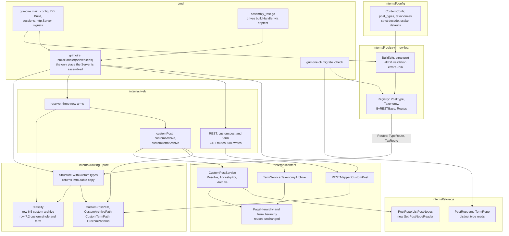

# M12 — custom post types and taxonomies (read-first): Design

## Overview

Nine facts about the code as it stands set this milestone's shape. Where the
requirements brief and the code disagree, the code wins and the disagreement is
named.

**The lower layers are already parameterized; the hard-codes are a short, known
list.** `PostRepo.BySlug` and `PublishedByID` take `types ...string`
(`internal/storage/wprepo/repo.go:160`, `:194`). `domain.ArchiveFilter` carries
`Taxonomy`, `TermIDs` and `Types` (`internal/domain/repository.go`), and
`PostRepo.archiveWhere` applies all three (`repo.go:256`).
`TermRepository.BySlug(taxonomy, slug)`, `TermReader.ListByTaxonomy(taxonomy)`
and `content.LoadTermHierarchy(ctx, reader, taxonomy)`
(`internal/content/archive.go:94`) take the taxonomy as an argument, and
`PostTermsRepository.TermsForPost(postID, taxonomy)` is taxonomy-parameterized.
The sites that are NOT: `RecentPosts` (`repo.go:147`, deliberately stays),
`adminTypes` default (`adminreads.go:24-29`, deliberately stays), `Authors()`
(`adminreads.go:118`, changes), `PostService.BySlug/PublishedByID`
(`internal/content/post.go:73,85`, deliberately stay), `registerRESTPosts`
(`internal/web/rest_posts.go:30`, stays; a sibling registration is added),
`restTermBase` (`rest_terms.go:66`, stays; a sibling is added),
`capSuffix` (`internal/auth/policy.go:11`, stays; one helper is added), and
`adminKnownTaxonomies` (`internal/web/adminapi_posts.go:34`, write side, untouched).

**`internal/routing` is pure and imports only `internal/domain`, so the
registry cannot live in it and routing must not import the registry.** `go list`
on the package confirms its sole internal import is `domain`. `Structure` is a
value type with unexported fields built by `Parse` (`routing.go:169`); the
precedent for adding data to it after the fact without churning `Parse`'s
signature is `Notes()` (`routing/notes.go:39`). So M12 defines plain route value
types (`routing.TypeRoute`, `routing.TaxRoute`) in routing, a new leaf package
`internal/registry` imports `config` and `routing` to validate and to construct
them, and `Structure.WithCustomTypes` returns an immutable copy carrying them. No
import cycle is possible: `config` imports nothing internal, `routing` imports
`domain`, `registry` imports both, and `content`/`web` import `registry`.

**Row 7 of the classifier already claims the bare `/{slug}` form under the most
common WordPress preset, so the custom archive row must precede it (decided: D6 and
Requirement 7.8-7.9 adopt this placement).**
Under `/%postname%/` (one segment) and `/blog/%postname%/` (front + one
segment), `ParamsFromPath` + `Match` (`classify.go:138-146`) succeed for any
single-token path, so `/products/` is `KindPost{Slug: "products"}` before any
custom row runs, and a `has_archive` type would be unreachable under WordPress's
own "Post name" preset. WordPress itself gives CPT rules priority over the post
structure (extra permastruct rules are prepended to the rule set). The design
therefore places the ARCHIVE row between row 6 and row 7 and leaves the single
and term rows after row 7, which is exactly the split D6 now states. Decided: the
requirements adopt this (D6; Requirement 7.8 serves the archive at its slug under
`/%postname%/`, 7.9 makes a same-slug post or page unreachable; Finding 1). Singles and terms
cannot collide with row 7 because they need at least two segments and a literal
prefix the structure's own shape does not match (a rewrite slug equal to the
front is a startup error, Req 3.7).

**M15 registers `/{slug}/*` only when pages are wired, and a wiring gap of exactly
that kind shipped once.** `Routes` registers `/{slug}/*` only when `s.pages != nil`
(`internal/web/router.go:333-335`). M15 shipped with `WithPages` and
`restMapper.WithPages` never called from `cmd/grimoire/main.go`, so nested pages
404ed in the real binary while every test passed, because each test builds its own
Server. PR #74 added the two calls (they are present in `main.go` now), but nothing
in `go test` would catch their removal. M12 adds more of the same kind of wiring
(`WithRegistry`, the registry-aware mapper), so Requirement 13 extracts the
assembly into a function with a test that drives it (Component 11). M12 itself
still does not lean on the `/{slug}/*` wildcard. A throwaway chi probe (deleted after use) established what M12 can lean on:
`/products/*` matches `/products/`, `/products/x` and `/products/a/b` and beats
`/{slug}/*`; `/products` (bare) is NOT matched by `/products/*`, so a front-ful
archive needs its bare form registered explicitly (`/blog/products` falls to
`/blog/{postname}` otherwise); explicit `/products`, `/products/` and
`/products/*` coexist without a panic; `/category/*`, the permalink patterns and
the date patterns keep their routes.

**The nested-walk machine is reusable for hierarchical CPTs through a one-method
adapter.** `LoadPageHierarchy` takes a `domain.PageReader` and only calls
`ListPages(ctx, afterID, limit)` (`internal/content/pagehier.go:64`). A tiny
adapter binding a `post_type` to the new `PostNodeReader.ListPostNodes` satisfies
that interface, so `PageHierarchy.Ancestry`, `ResolvePath` and `recoverPath` are
reused unchanged. Two defects in M15's service are NOT inherited: its leaf is
confirmed by `posts.BySlug(leaf.Slug)` (`pagehier.go:272`), which picks the newest
row of that slug regardless of parent, so two leaves sharing a slug under
different parents can serve the wrong body; and its recovery 301s to a
non-published page's canonical (the node graph deliberately includes every
status), disclosing that a draft exists. The new service confirms the leaf with
`PublishedByID(leaf.ID, typeName)` and refuses to recover to a non-published
node. M15's `PageService` is left untouched (Findings 5, 6).

**Generalizing the term archive has one correctness trap and one naming
decision.** `archiveWhere` defaults `Types` to `{"post"}` when empty
(`repo.go:257-260`), so a taxonomy archive that does not set
`ArchiveFilter.Types` to the taxonomy's object types lists `post` rows and never
a CPT row. And `CategoryMovedError` says "category" in its name and message
(`archive.go:49`). The design reuses it for hierarchical custom taxonomies and
documents the debt rather than renaming a type four tested handlers match on.

**The REST layer has four hard-wired assumptions that a naive generalization
would trip.** `restPostBase` pluralizes with `+"s"` (`rest_posts.go:47`) and so
does `mapRESTPost`'s link base (`rest_posts.go:494`); `mapRESTPost`'s `default`
arm maps every non-page type through the POST mapper (`rest_posts.go:500-520`),
which would emit `categories`/`tags` arrays and a post-shape `link` for a CPT;
`restTermBase`'s `default` arm maps every non-category taxonomy to `/tags`
(`rest_terms.go:66-72`) and `restTermLink` builds `TagPath` for every
non-category taxonomy (`rest_terms.go:90-93`); and `restAbs("")` returns the site
root (`rest_envelope.go:77-80`), so an empty `link` would advertise the home
page. Each is addressed in Components and listed in the trap list.

**The single-item REST gate answers 404 to everyone who cannot edit, and the requirements now say so.**
`handleRESTPostSingle` returns `404 rest_post_invalid_id` for a non-published row
when `canEditPosts` is false (`rest_posts.go:164-167`, `:184-187`), for anonymous
and for authenticated callers alike, and `canEditPosts` is the coarse
`p.Can("edit_posts")`, not `CanEditPost`. Decided: Requirement 8.4 and D7 were
amended to "404 `rest_post_invalid_id` for anonymous and authenticated callers
alike, byte-for-byte consistent with posts and pages today", and the design
mirrors that code path (Finding 4).

**Config decoding has two properties the schema depends on.** `config.Load` uses
a plain `yaml.Unmarshal` (`config.go:128`), which ignores unknown keys, so a
typo such as `hierarchial: true` would silently serve a flat type: D4 says
operator misconfiguration must be loud. And `has_archive` is a bool-or-string
union, and yaml.v3 (YAML 1.2) reads `yes`/`on` as strings, so `has_archive: yes`
would become an archive slug named "yes". The design decodes the `content:`
subtree strictly through its own `UnmarshalYAML` and rejects boolean-looking
strings in the union.

**The admin list already accepts any `type` string.** `adminPosts` passes
`q.Get("type")` to `AdminListFilter.Type` with no validation
(`internal/web/adminapi.go:226`), and `AdminService.List` turns it into
`AdminPostFilter.Types` (`internal/content/adminread.go:89-91`). An
authenticated caller can therefore already list `shop_order` rows today, which
sits badly with D2. Decided: Requirement 2.8-2.10 adopt tightening the handler
to `{post, page}` plus registered names, with `400 invalid_type` otherwise (a
behavior change to a currently open authenticated endpoint; Finding 2).

The standalone `## Correctness Properties` and `## Error Handling` H2s are
omitted deliberately, matching the 13, 14 and 15 siblings. M12 is a set of
enumerable routing and wiring branches (archive / single / nested single /
term / nested term / wrong ancestry / orphan / cycle / not routed / write verb →
501) and startup validation rules, each a finite case with a named expected
outcome. Nothing here is a pure function over a large input space for which a
"for all inputs X, P(X)" statement carries information a table of the branches
does not; the classifier/constructor fixed point is checked over the finite
product of structures × entries × slash forms (see Testing strategy).
Error-posture behavior is folded into the component descriptions.

This design adds: **a `content:` config section** (strict decode, defaults); **a
`registry` leaf package** (all D4 validation, lookups, route projection); **three
classifier Kinds and `Target.TypeName`**, with the archive row ahead of row 7;
**`Structure.WithCustomTypes`** and four pure path/pattern builders; **one
additive storage port** (`PostNodeReader`) plus a narrow author-types read and two
narrow diagnostic reads; **`CustomPostService`** and **`TermService.TaxonomyArchive`**;
**three handlers and one registration block** in `web`; **REST read registration for
CPTs and CTs**; **a `buildHandler` assembly function in `cmd/grimoire` with its
own test** (Requirement 13); and **a `migrate -check` diagnostic**. No migration, no table, no
column, no new capability name (D9).

## Architecture



Seven edges carry the milestone's argument.

**`RG --> WCT` is the only coupling between registry and routing, and it points
one way.** The registry projects its public entries into `routing.TypeRoute` and
`routing.TaxRoute` and hands them to `Structure.WithCustomTypes`. Routing never
sees a `registry.PostType`, a config struct, or a REST base. A `Structure` that
never saw `WithCustomTypes` holds nil slices; every custom loop iterates zero
times, every constructor returns `""` for an unknown name, and `CustomPatterns`
returns nil, so Classify, the pattern set and `Notes()` are byte-for-byte what
they are today (Req 1.5, 7.3). This is the same zero-value-safe posture
`NewServer` takes with `permalinks` (`router.go:NewServer`).

**`MN --> ASM` makes the wiring a tested unit.** `main()` does the work that
needs a process (flags, config, database, theme, sessions, signals, the
`http.Server`) and hands everything the Server needs to `buildHandler`, which is the
only place `web.NewServer` and the `With*` chain are called (Req 13.1, 13.2).
`assembly_test.go` calls the same function over a migrated SQLite database, so a
removed `WithPages`, `WithRegistry` or mapper call fails `go test` instead of
shipping (Component 11).

**`BLD` runs after the permalink options are read, which fixes the startup
order.** Validation needs the resolved `category_base`, `tag_base` and front,
which `resolvePermalinks` derives from three option reads
(`cmd/grimoire/permalinks.go:38-44`), and those need the open database. So
`main.go` cannot validate inside `config.Load`: `Build` runs immediately after
`resolvePermalinks` (`main.go:104`) and before the REST mapper is constructed
(`main.go:106`), because both the mapper and the server must receive the
augmented `Structure`. A validation error logs and exits 1 like every other
startup failure in `main.go`.

**`CL` gains two rows and their positions are the correctness story.** Row 6.5
(custom archive) sits after the date row and BEFORE row 7. Row 7.2 (custom single,
custom term) sits after row 7 and BEFORE the M15 `KindPage` row 7.5 and the flat
row 8. A page whose path begins with a registered custom base is claimed by
7.2 and so becomes unreachable at that URL, the documented consequence of D6.
Because classification, not chi registration order, decides precedence, and all
custom patterns dispatch to `s.resolve`, chi's silent last-wins at parameter
nodes stays unobservable (`router.go:306-332` records the rationale).

**`HND --> CPS` and `HND --> TAX` converge on one canonical per entity.** Each
handler resolves, builds the canonical from the RESOLVED row's own ancestry
(`CustomPostPath`, `CustomTermPath`, `CustomArchivePath`), 301s through
`redirectCanonical` when `r.URL.Path` differs, and renders. The REST `link` is
built by the same `Structure` constructors, so the advertised link and the served
URL cannot diverge (Req 4.6).

**`CPS --> PH` is reuse by adapter, not by copy.** `CustomPostService` binds a
`post_type` to `ListPostNodes` through a four-line adapter satisfying
`domain.PageReader`, loads a `PageHierarchy` in one paginated read (Req 5.6) and
uses its `Ancestry`, `ResolvePath` and `recoverPath` unchanged, giving orphan and
cycle degradation for free (Req 5.4, 5.5). `TermService.TaxonomyArchive` reuses
`TermHierarchy` the same way.

**`CLI --> AUD` and `CLI --> RG` keep the diagnostic read-only and
non-exposing.** The CLI reads `SELECT post_type, COUNT(*)` and
`SELECT taxonomy, COUNT(*)` grouped, subtracts the reserved sets exported by
`registry` and the configured names, and prints names and counts only. Nothing
reaches the registry, and no title, slug or body is read (D2, Req 11).

## Capability model

M12 introduces no capability NAME (D9, Req 8.3). It adds one derivation rule and
one gate.

The suffix rule: `auth.CapabilitySuffix(capabilityType string) string` returns
`capabilityType + "s"`, and `"posts"` for the empty string. `capSuffix(postType)`
(`internal/auth/policy.go:11`) is rewritten to call it with `"page"` or `"post"`,
so `post` → `posts` and `page` → `pages` are byte-identical to today and there is
one rule site. A custom `capability_type: event` therefore derives `events`, giving
the family `edit_events`, `edit_others_events`, and so on. These are not new names
introduced by grimoire: they are the names WordPress's own
`register_post_type(capability_type => 'event')` derives, and they are held only by
roles that a plugin or the database already grants them. The default
`capability_type: post` derives `posts`, so a default CPT is gated by exactly the
`edit_posts` family posts already use. D3 has no plural field, so WordPress's
`['story','stories']` array form is not representable; the default plural rule
matches WordPress's string-form behavior (`story` → `storys`). An explicit plural
is a candidate follow-up.

The gate: public CPT routes and REST collections serve PUBLISHED rows only, with no
capability check, as posts do. The one capability decision in this milestone is the
single-item REST read of a non-published row. Today
`handleRESTPostSingle` calls `canEditPosts` (`rest_posts.go:164`), which is
`PrincipalFrom(...) && p.Can("edit_posts")` (`rest_posts.go:184-187`). The CPT gate
is its exact analogue, `p.Can("edit_" + auth.CapabilitySuffix(entry.CapabilityType))`,
chosen over `CanEditPost` deliberately: `CanEditPost` adds author and status
sub-checks (`edit_others_*`, `edit_published_*`) that posts and pages do not apply
on this path, and "consistently with posts/pages today" is the requirement. Outcome
matrix, mirroring the code: published row → 200 for everyone; non-published row,
anonymous → 404 `rest_post_invalid_id`; non-published row, authenticated without the
derived capability → 404 `rest_post_invalid_id`; with the capability → 200. A
request whose `{id}` names a row of another type → 404 (`rest_posts.go:160-163`).
No path in M12 returns 401 or 403 for a CPT read; decided: Requirement 8.4 and D7 say 404 for every non-editor (Finding 4).

Public HTML routes never consult capabilities. The admin API read keeps its existing
middleware (`RequireLogin` + `RequireCapability("edit_posts")`,
`internal/web/adminroutes.go:58-62`); M12 only changes which `type` values it
accepts (Component 8).

## Components and Interfaces

The components are listed in dependency order. Each is traced to a Requirement or
decision in the Traceability table.

### 1. `config.ContentConfig` (Requirements 1.1-1.5; D3)

A new file `internal/config/content.go` and one field on `Config`
(`config.go:20-28`): `Content ContentConfig \`yaml:"content"\``.

```go
// ContentConfig is the operator-declared registry source (D2): the only way a
// custom post type or taxonomy is served.
type ContentConfig struct {
	PostTypes  []PostTypeConfig `yaml:"post_types"`
	Taxonomies []TaxonomyConfig `yaml:"taxonomies"`
}

type PostTypeConfig struct {
	Name           string     `yaml:"name"`
	Public         *bool      `yaml:"public"`      // nil -> true
	RESTBase       string     `yaml:"rest_base"`   // "" -> Name
	HasArchive     HasArchive `yaml:"has_archive"` // false | true | "slug"
	Slug           string     `yaml:"slug"`        // "" -> Name
	WithFront      *bool      `yaml:"with_front"`  // nil -> true
	Hierarchical   bool       `yaml:"hierarchical"`
	CapabilityType string     `yaml:"capability_type"` // "" -> "post"
	Taxonomies     []string   `yaml:"taxonomies"`
}

type TaxonomyConfig struct {
	Name         string   `yaml:"name"`
	ObjectTypes  []string `yaml:"object_types"`
	Public       *bool    `yaml:"public"`    // nil -> true
	RESTBase     string   `yaml:"rest_base"` // "" -> Name
	Slug         string   `yaml:"slug"`      // "" -> Name
	WithFront    *bool    `yaml:"with_front"`
	Hierarchical bool     `yaml:"hierarchical"`
}

// HasArchive is WordPress's bool-or-string has_archive. Enabled with an empty
// Slug means "use the entry's rewrite slug" (Req 1.4).
type HasArchive struct {
	Enabled bool
	Slug    string
}

func (h *HasArchive) UnmarshalYAML(n *yaml.Node) error
func (c *ContentConfig) UnmarshalYAML(n *yaml.Node) error
```

Why `*bool` for `public` and `with_front`: both default to true, and a plain `bool`
cannot tell "omitted" from `false`. Why plain `bool` for `hierarchical`: its default
is false, so the zero value is the default. Why defaults live in
`applyDefaults` (`config.go:186`) via a `ContentConfig.applyDefaults()` call: Req 1.2
and 1.3 say "THE Config loader SHALL apply the defaults", every default is a plain
scalar, and none needs a second entry to compute. `applyDefaults` deliberately does
NOT touch an empty `Name` (so `Slug`/`RESTBase` stay empty and `Build` reports the
empty name) and performs no cross-entry check; every rejection is `registry.Build`'s,
because the checks that need option-derived bases cannot run at `Load` time.

`UnmarshalYAML` on `ContentConfig` re-encodes its own node and decodes it with
`yaml.Decoder.KnownFields(true)`, so a misspelt key inside `content:` is a load
error naming the field, while every other config section keeps today's lenient
behavior (changing `config.Load` globally would reject configs that load today).
`HasArchive.UnmarshalYAML` accepts a `!!bool` scalar or a non-empty `!!str` scalar
and rejects any string equal (case-insensitively) to `yes`, `no`, `on`, `off`, `y`,
`n`, `true` or `false`, since those arrive as strings under YAML 1.2 and almost
certainly mean a boolean. `has_archive: true` with `public: false` is accepted and
ignored (an unrouted type has no archive).

### 2. `registry` package (Requirements 1, 3; D2, D4)

A new package `internal/registry` (pure: imports `config` and `routing`, no
storage, HTTP, or content). The layering argument is in the Overview; the rejected
alternatives are (a) a registry inside `routing`, which would force routing to
import `config` and make `Parse` order-dependent on option reads, and (b) a
registry inside `config`, which would force `config` to import `routing` (a
`config`→`routing` edge nothing else needs) and would put option-derived validation
inside the file loader.

```go
// PostType is a validated, fully defaulted post type entry.
type PostType struct {
	Name           string
	Slug           string   // rewrite slug, single segment
	ArchiveSlug    string   // "" when has_archive is false
	RESTBase       string
	Public         bool
	WithFront      bool
	Hierarchical   bool
	CapabilityType string
	Taxonomies     []string // EFFECTIVE: declared taxonomies plus taxonomies naming this type in object_types, deduplicated, declaration order
}

func (p PostType) HasArchive() bool
// Heading is the archive title: Name with '-' and '_' replaced by spaces and the
// first letter upper-cased. D3 has no label field, so this is the only title
// available; a label field is a follow-up.
func (p PostType) Heading() string

type Taxonomy struct {
	Name         string
	Slug         string
	RESTBase     string
	Public       bool
	WithFront    bool
	Hierarchical bool
	ObjectTypes  []string // EFFECTIVE: declared object_types plus types listing this taxonomy, deduplicated
}

type Registry struct{ /* unexported: ordered slices + name and rest_base indexes */ }

// BuiltinBases is deliberately not a parameter type: Build takes the
// routing.Structure itself, so validation calls the SAME pure helpers
// (Structure.ReservedBases, Structure.CustomBase, Structure.Front) Classify and
// the constructors call, and the validator cannot drift from the router.
func Build(cfg config.ContentConfig, st routing.Structure) (*Registry, error)

// All lookups are nil-receiver safe and report ok=false on a nil Registry, so
// web code needs no nil guard and a Server without a registry behaves as today.
func (r *Registry) Empty() bool
func (r *Registry) PostTypes() []PostType            // declaration order
func (r *Registry) Taxonomies() []Taxonomy           // declaration order
func (r *Registry) PostType(name string) (PostType, bool)
func (r *Registry) Taxonomy(name string) (Taxonomy, bool)
func (r *Registry) PostTypeByRESTBase(base string) (PostType, bool)
func (r *Registry) TaxonomyByRESTBase(base string) (Taxonomy, bool)
// TaxonomyRESTBase resolves a taxonomy name to its rest_base, including the
// built-ins (category -> categories, post_tag -> tags), for the per-taxonomy
// term arrays on a CPT item.
func (r *Registry) TaxonomyRESTBase(name string) (string, bool)
// Routes projects the PUBLIC entries into the plain value types routing owns.
func (r *Registry) Routes() ([]routing.TypeRoute, []routing.TaxRoute)

// Reserved sets, exported so Build and the migrate -check diagnostic share one
// source (Req 3.3, 3.4, 11).
func ReservedPostTypes() []string
func ReservedTaxonomies() []string
```

`Build` collects every violation with `errors.Join` so an operator fixes the file in
one pass; each message names the config path (`content.post_types[1].name`) and the
offending value. The rules, in the order they run:

- R1 (Req 3.1): `name` non-empty.
- R2 (Req 3.2): `name` matches `^[a-z0-9_-]+$`, at most 20 characters for a post
  type and 32 for a taxonomy. The same pattern governs `capability_type`.
- R3 (Req 3.3, 3.4): `name` is not in `ReservedPostTypes()` (the fourteen types of
  Req 3.3) or `ReservedTaxonomies()` (the five of Req 3.4).
- R4 (Req 3.5): no two post types and no two taxonomies share a name. A post type and
  a taxonomy MAY share a name (distinct namespaces in WordPress and in the database
  columns).
- R5 (Req 3.6, 3.7): for PUBLIC entries only (an unrouted entry has no URL), the
  rewrite slug and the archive slug each match `^[a-z0-9][a-z0-9_-]*$` and are a
  single segment, and the resolved segment sequence (front, when `with_front`, then
  the slug) must not collide with:
  - any other public entry's resolved sequence, where collision means one sequence
    is a prefix of, or equal to, the other (so `blog/x` and a front-less `blog` are
    rejected as ambiguous);
  - any of `Structure.ReservedBases()`, the resolved category, tag and author
    sequences built by the SAME `archivePrefix` + `baseSegments` helpers the
    constructors use, with the same prefix rule;
  - the structure's front: a sequence equal to the front, or to a prefix of it, is
    rejected (the `baseCollidesWithFront` rule applied to custom bases, Req 3.7);
  - the first-segment reserved routes: `admin`, `wp-json`, `wp-admin`, `wp-content`,
    `wp-includes`, `assets`, `theme`, `login`, `logout`, `comment`, `healthz`,
    `favicon.ico`, `feed`. These are registered ahead of the content patterns
    (`router.go:233`, `adminroutes.go:53`, `static.go:22,35`, `router.go` theme
    static), so a custom base there would be silently unreachable or would collide
    at `Mount`.
- R6 (Req 3.6): `rest_base` matches `^[a-z0-9_-]+$`, is unique across ALL entries
  (post types and taxonomies share `/wp/v2/`), and is not one of `posts`, `pages`,
  `media`, `comments`, `users`, `categories`, `tags` (Req 3.6) nor one of the
  unimplemented core collections `types`, `taxonomies`, `statuses`, `settings`,
  `search`, `blocks`, `themes`, `plugins` (so the follow-up `/wp/v2/types` and
  `/wp/v2/taxonomies` cannot be shadowed, Req 10.6). A taxonomy `rest_base` is also a
  JSON key on CPT items, so it must not equal a key of `restItemCommon` (`id`,
  `date`, `date_gmt`, `modified`, `modified_gmt`, `slug`, `status`, `type`, `link`,
  `guid`, `title`, `content`, `excerpt`, `author`, `featured_media`,
  `comment_status`, `ping_status`).
- R7 (Req 3.8): every `taxonomies` entry on a post type names a registered taxonomy or
  `category` / `post_tag`; every `object_types` entry on a taxonomy names a
  registered post type or `post` / `page`. Anything else, including a reserved
  non-served name such as `nav_menu`, is rejected.
- R8 (Req 3.9): database state is never consulted. Build has no database access;
  "declared type has no rows" is logged by `main.go` from `CountByStatus` and is not
  an error.

Non-fatal observations (a taxonomy attached to no object type; see Finding 9) are
returned through `Registry.Notes() []string` and logged at WARN by `main.go`, the
`Structure.Notes()` precedent (`cmd/grimoire/permalinks.go:logPermalinkNotes`).

### 3. `routing` additions (Requirements 4, 5, 6, 7; D5, D6)

Everything in this section is pure, adds no import, and changes no existing
signature. The only edited existing bodies are `Classify` (two rows) and
`archivePrefix` (no behavior change; see below).

```go
// TypeRoute and TaxRoute are the plain, registry-free value types routing
// consumes. Defined here so routing never imports registry.
type TypeRoute struct {
	Name         string // registry key; carried to the handler as Target.TypeName
	Slug         string // single-segment rewrite slug for singles
	ArchiveSlug  string // single-segment archive slug; "" means no archive
	WithFront    bool
	Hierarchical bool
}
func (t TypeRoute) HasArchive() bool { return t.ArchiveSlug != "" }

type TaxRoute struct {
	Name         string
	Slug         string
	WithFront    bool
	Hierarchical bool
}

// WithCustomTypes returns a copy of s that serves the given public custom types
// and taxonomies. s is not modified. Passing nil, nil returns a Structure
// observably identical to s.
func (s Structure) WithCustomTypes(types []TypeRoute, taxes []TaxRoute) Structure

// Front returns a copy of the structure's leading literal segments. Added so
// the registry can state the front-collision rule against the same value
// Classify uses. (The field comment at routing.go:134-141 said no caller needed
// it; the registry now does.)
func (s Structure) Front() []string

// ReservedBases returns the resolved segment sequences of the category, tag and
// author archives, each built from archivePrefix + baseSegments, for the
// registry's overlap check.
func (s Structure) ReservedBases() [][]string

// CustomBase is the resolved segment sequence for a custom slug: the front when
// withFront, then the slug. A Flat structure has no front (Parse never sets one),
// so withFront is a no-op there.
func (s Structure) CustomBase(slug string, withFront bool) []string
```

`WithCustomTypes` copies the struct value (`out := s`), then sets `out.customTypes =
slices.Clone(types)`, `out.customTaxes = slices.Clone(taxes)` and
`out.customNotes = out.shadowNotes()`. It follows how `Parse` builds the struct:
unexported fields, no mutation after construction, `slices.Concat` where a backing
array is shared (`routing.go:213`). The two new fields sit beside `notes`. The front
is materialized in one place: `archivePrefix` and `CustomBase` both call a new
`frontIf(withFront bool) []string`, so the "which prefixes carry the front"
decision stays single-sited (`routing.go:480-500`, whose comment names this as the
design goal). `archivePrefix` output is unchanged.

Custom Kinds and the Target field (`classify.go:11-26`, `:28-46`):

```go
const (
	// ... KindNone .. KindPage unchanged ...
	KindCustomPost    // M12: /{slug}/{postname}/ or nested, for a registered type
	KindCustomArchive // M12: /{archive-slug}/ for a type with has_archive
	KindCustomTerm    // M12: /{slug}/{term}/ or nested, for a registered taxonomy
)

type Target struct {
	// ... existing fields ...
	// TypeName is the registry key (post type name or taxonomy name). Set when
	// Kind is KindCustomPost, KindCustomArchive or KindCustomTerm.
	TypeName string
}
```

`TypeName` rather than reusing `Slug`: `Slug` documents "the tag slug or the author
nicename" (`classify.go:38-39`), the slug of the ITEM; the registry key is neither
the rewrite slug (a type named `book` may be served under `/library/`) nor an item,
and the handler must look the entry up by key independent of how the URL is
spelled. Overloading `Slug` would give one field two meanings keyed on `Kind`, and a
handler that read it for the wrong Kind would 404 silently.

The rows (positions are the design's most important output):

```go
	// Row 6 -- date archives (unchanged).

	// Row 6.5 (M12) -- a custom post type archive. BEFORE row 7 by design:
	// under /%postname%/ and /<front>/%postname%/ row 7 would claim /products/ as
	// a post slugged "products" (Finding 1). The match is exact, so nothing under
	// the archive base is claimed here. After row 6, so a date-shaped archive slug
	// loses to the date archive exactly as a post would (noted at startup).
	for _, tr := range s.customTypes {
		if tr.HasArchive() && slices.Equal(segs, s.CustomBase(tr.ArchiveSlug, tr.WithFront)) {
			t.Kind, t.TypeName = KindCustomArchive, tr.Name
			return t
		}
	}

	// Row 7 -- the structure's own post shape (unchanged).

	// Row 7.2 (M12) -- custom single and custom term. AFTER row 7 (D6): both need
	// at least one segment below a base, so the structure's post shape cannot
	// match them (a base equal to the front is a startup error, Req 3.7). BEFORE
	// row 7.5 (KindPage) and row 8 (D6): a registered base claims every path
	// rooted at it. A path rooted at a base names that entry or nothing, the
	// category-row precedent (classify.go:82-93), so a deeper path under a
	// non-hierarchical entry is KindNone, not a fall-through to the page walk.
	for _, tr := range s.customTypes {
		rest, ok := trimSegmentPrefix(segs, s.CustomBase(tr.Slug, tr.WithFront))
		if !ok || len(rest) == 0 {
			continue // bare base: not claimed; falls through (see below)
		}
		if !tr.Hierarchical && len(rest) != 1 {
			return t // KindNone
		}
		t.Kind, t.TypeName, t.Segments = KindCustomPost, tr.Name, slices.Clone(rest)
		return t
	}
	for _, xr := range s.customTaxes { /* identical, producing KindCustomTerm */ }

	// Row 7.5 (M15 KindPage) and rows 8, 9 unchanged.
```

The bare form is a decision. A bare `/{slug}` for a type without `has_archive`, and
the bare `/{slug}` of any taxonomy, is NOT claimed: it falls through to row 8 and the
flat `/{slug}` lookup, so a page slugged like a custom slug stays reachable at the
bare URL, which is WordPress's behavior (no CPT or taxonomy rule matches the bare
form). This differs from the category rows (`classify.go:82-93`, where a bare base is
`KindNone`), which D3's brief asks to mirror for "no index". The reconciliation: no
taxonomy index exists either way (a bare taxonomy URL never renders a term archive),
but 404ing it would make a page slugged `genre` unreachable for no benefit. Req 7.4's
"page unreachable at that URL" is honored for every URL a custom shape claims
(`/genre/x/`). Rejected alternative: mirror the category row exactly (`KindNone`).
That is stricter than WordPress and removes data from the site gratuitously.

Multi-segment rewrite slugs (WordPress allows `shop/items`) are REJECTED by registry
rule R5, not supported. Justification: each public entry then owns exactly one first
segment after the front, so the overlap rule is a short sequence-prefix check, the
chi patterns are `/F/S/*`, and no entry can shadow part of another's tree. The
routing layer does not hard-code the restriction: `CustomBase` uses `baseSegments`-style
splitting, so lifting the rule later is a registry-only change. The cost is that a
site using `rewrite.slug = 'shop/items'` cannot be served until then; it is listed as
a candidate follow-up.

`with_front` and Flat: `CustomBase` prepends `s.front` when `withFront`. A Flat
structure (plain permalinks, or the unsupported-structure fallback) has an empty
front (`routing.go:134-142`), so `with_front` has no effect and `/books/x` is the
shape. `TrailingSlash` is false for a Flat structure (`routing.go:187`), so the
canonical is `/books/x`; under a trailing-slash structure it is `/books/x/`.

Path constructors, the only places a custom URL is built (they join
`CategoryPath`/`TagPath`/`AuthorPath` as the archive-path family and reuse
`archivePath` for the trailing-slash rule, `routing.go:653`):

```go
// CustomPostPath builds the canonical path for an item of a registered type.
// ancestry is root-first and self-inclusive (the PagePath convention). It returns
// "" -- the "no servable canonical" guard handlers 404 on -- for an unregistered
// type, an empty ancestry, and a non-hierarchical type given more than one segment.
func (s Structure) CustomPostPath(typeName string, ancestry []string) string

// CustomArchivePath returns "" unless the type is registered and has an archive.
func (s Structure) CustomArchivePath(typeName string) string

// CustomTermPath mirrors CustomPostPath for a registered taxonomy.
func (s Structure) CustomTermPath(taxName string, ancestry []string) string
```

Fixed-point property (tested over the finite matrix, Testing strategy): for every
structure, every registered entry and every ancestry the constructor accepts,
`Classify(constructor(...))` yields the matching Kind, the same `TypeName`, and
`Segments` equal to the ancestry (or `Target.Kind == KindCustomArchive` for the
archive); and a constructor never returns a path `Classify` declines, because both
read `CustomBase` and the row conditions mirror the constructors' guards.

Chi patterns (mirrors `ArchivePatterns`, `routing.go:698`):

```go
// CustomPatterns returns the chi patterns the custom routes need, derived from
// the same CustomBase the classifier and constructors use. Nil when no custom
// entry is registered.
func (s Structure) CustomPatterns() []string
```

For each public type: `joinPattern(base, "*")` (singles; the wildcard also matches
`/S/`), and, when `has_archive`, `bothSlashForms(joinPattern(archiveBase))` (the bare
archive without and with a trailing slash, registered explicitly because a
front-ful bare archive is otherwise unrouted, per the probe). For each public
taxonomy: `joinPattern(base, "*")`. No bare taxonomy pattern: the bare form is not
claimed (above). The set is duplicate-free by registry rule R5 (distinct resolved
sequences); a routing test asserts it like `ArchivePatterns`' duplicate-free test,
because chi overwrites a duplicate silently. `contentPatterns` appends
`st.CustomPatterns()` after `st.ArchivePatterns()` and before `"/{slug}"`
(`router.go:402-406`); the chi order does not matter (every pattern dispatches to
`s.resolve`).

Startup diagnostics (`CustomNotes()`, a separate method so the existing `Notes()`
output and its tests are byte-identical): (a) a custom archive path equal to the
structure's own post shape (the row 6.5 override), stating that the archive wins and
a post slugged like it is unreachable; (b) an archive or single base whose first
segment is a four-digit year, which the date row (row 6) claims first. These are
decidable from the Structure alone, so they live in `shadowNotes`, called from
`WithCustomTypes`.

### 4. `domain` additions (Requirements 2.4, 2.5, 11; D9)

Beside `PageNode`/`PageReader` (`repository.go:502-530`), all additive:

```go
// PostNode is the lean projection the hierarchical walks are built on. It is an
// alias of PageNode so M15's page code, tests and the PageReader port are not
// renamed; Requirements and this design call it PostNode.
type PostNode = PageNode

// PostNodeReader streams the node graph for ONE post_type, every status, ordered
// by ID ascending under a keyset cursor. ListPages is the postType=="page"
// special case and is left untouched.
type PostNodeReader interface {
	ListPostNodes(ctx context.Context, postType string, afterID int64, limit int) ([]PostNode, error)
}

// AuthorTypeReader is the typed variant of AdminPostRepository.Authors.
type AuthorTypeReader interface {
	AuthorsOfTypes(ctx context.Context, postTypes []string) ([]AuthorOption, error)
}

// TypeCount is one distinct post_type or taxonomy and how many rows carry it.
type TypeCount struct {
	Name  string
	Count int
}

// PostTypeAuditor and TaxonomyAuditor are the operator-only reads behind
// `migrate -check`, declared narrowly for the reason NicenameAuditor is
// (repository.go:NicenameAuditor): no request path calls them.
type PostTypeAuditor interface {
	DistinctPostTypes(ctx context.Context) ([]TypeCount, error)
}
type TaxonomyAuditor interface {
	DistinctTaxonomies(ctx context.Context) ([]TypeCount, error)
}
```

### 5. `storage` additions (Requirements 2, 11; D9)

All on existing concrete types in `internal/storage/wprepo`; no migration.

- `(*PostRepo).ListPostNodes(ctx, postType, afterID, limit)`: the body of `ListPages`
  (`repo.go:351`) with `Where("post_type = ?", postType)`. Same projection
  (`ID, post_name, post_parent, post_status`), same keyset `ID > afterID ORDER BY
  ID`, no `post_status` filter (an ancestry may climb through a non-published
  ancestor, M15 Finding 7), same `bun.Ident("ID")` quoting (PostgreSQL folds an
  unquoted `ID`). `ListPages` is left exactly as is (Req 2.4); a contract case
  asserts `ListPostNodes(..., "page", ...)` equals `ListPages` on the same fixture.
- `factory.Set` gains ONE field, `PostNodeReader domain.PostNodeReader`, assigned
  `posts` in `New` (beside `PageReader`, `factory.go:69`, `:204`).
- `(*PostRepo).AuthorsOfTypes(ctx, types)`: the body of `Authors`
  (`adminreads.go:109`) with the type list as a parameter; `Authors(ctx)` becomes
  `return r.AuthorsOfTypes(ctx, []string{"post", "page"})`, which produces the
  identical statement. `main.go` obtains the narrow port by type assertion on
  `repos.AdminPosts`, the `repos.NavMenus.(domain.NavMenuWriter)` precedent
  (`main.go:155`); a compile-time `var _ domain.AuthorTypeReader = (*PostRepo)(nil)`
  guards it, and no second `Set` field is added.
- `(*PostRepo).DistinctPostTypes` and `(*TermRepo).DistinctTaxonomies`: one
  `SELECT post_type, COUNT(*) ... GROUP BY post_type ORDER BY post_type` (and the
  `term_taxonomy.taxonomy` twin). Names and counts only, all statuses; no content
  column is read.
- Deliberately unchanged: `RecentPosts`, `BySlug`/`PublishedByID` defaults,
  `adminTypes` default, `CountByStatus`, `archiveWhere` (including its
  `Types`-defaults-to-`post` rule: callers must set `Types`, Finding 3).

### 6. `content` additions (Requirements 2.7, 4, 5, 6, 9; D5, D7, D8)

#### 6a. Taxonomy archive

```go
// TaxonomyArchive resolves a term of a registered custom taxonomy and returns its
// page of published items. It generalizes CategoryArchive for custom taxonomies and
// leaves CategoryArchive and TagArchive untouched: re-pointing them would risk the
// byte-for-byte guarantee for the two shipped archives for no M12 benefit, and the
// duplication is one 20-line function.
func (s *TermService) TaxonomyArchive(ctx context.Context, tax registry.Taxonomy, segments []string, page, perPage int) (Archive, error)
```

Behavior:

- Hierarchical: `LoadTermHierarchy(ctx, s.hier, tax.Name)`, `ResolvePath(segments)`;
  on failure `h.recoverPath(segments)`, which yields the reused
  `*CategoryMovedError` (the name and message say "category"; reused deliberately,
  see Finding 7) carrying the term's canonical ancestry. The listing filter is
  `ArchiveFilter{Taxonomy: tax.Name, TermIDs: h.DescendantIDs(term.ID), Types: tax.ObjectTypes}`;
  the result's `Ancestry` is `h.Ancestry(term.ID)`.
- Flat: `len(segments) != 1` returns `domain.ErrNotFound`; otherwise
  `s.terms.BySlug(ctx, tax.Name, segments[0])` (the `TagArchive` shape, whose
  deterministic lowest-`term_id` rule is already vendor-stable), filter
  `TermIDs: []int64{term.ID}`, `Ancestry` nil.
- CORRECTNESS TRAP: `Types` MUST be set to the taxonomy's effective object types. An
  empty `Types` defaults to `{"post"}` (`repo.go:257-260`), which lists posts instead
  of the taxonomy's items and lists nothing for a CPT-only taxonomy. When
  `tax.ObjectTypes` is empty the service returns an empty archive without a query
  (an empty `Types` would otherwise silently turn into `{"post"}`).
- Pagination reuses `clamp`/`newPage`, exactly like `CategoryArchive`; a term with no
  published items is an empty archive with `Total` 0, not a 404 (the existing
  rule); `Archive.Heading` is the term name.

The same `TermHierarchy` serves the REST layer (Component 8e), loaded once per
request.

#### 6b. Custom post service

```go
// CustomPostService resolves registered custom post types. It is the single home
// of the CPT walk for the handler entry points and the REST layer.
type CustomPostService struct {
	nodes domain.PostNodeReader
	posts domain.PostRepository
}

// NewCustomPostService panics on a nil argument: a registry with entries and no
// node reader is a startup wiring error (Req 7.6), not a request-time one.
func NewCustomPostService(nodes domain.PostNodeReader, posts domain.PostRepository) *CustomPostService

// Resolve returns the published item the segments name and its root-first
// self-inclusive ancestry (the fixed point the canonical is built from).
func (s *CustomPostService) Resolve(ctx context.Context, pt registry.PostType, segments []string) (domain.Post, []string, error)

// Hierarchy loads the type's node graph once, for callers that need many
// ancestries in one request (the REST collection). Non-hierarchical types return nil.
func (s *CustomPostService) Hierarchy(ctx context.Context, pt registry.PostType) (*PageHierarchy, error)

// Archive lists the type's published items newest first.
func (s *CustomPostService) Archive(ctx context.Context, pt registry.PostType, page, perPage int) (Archive, error)
```

Non-hierarchical `Resolve`: `len(segments) != 1` → `ErrNotFound`;
`posts.BySlug(ctx, seg, pt.Name)` scoped to the type (a `book` slug never resolves a
`post`, and the reverse); ancestry `[]string{post.Slug}`. No node read.

Hierarchical `Resolve`:

```go
	h, err := LoadPageHierarchy(ctx, nodeReaderFor{s.nodes, pt.Name}) // one paginated read
	leaf, ok := h.ResolvePath(segments)
	if !ok {
		err := h.recoverPath(segments)
		var moved *PageMovedError
		if errors.As(err, &moved) && moved.Page.Status != "publish" {
			return domain.Post{}, nil, domain.ErrNotFound // no draft-slug disclosure
		}
		return domain.Post{}, nil, err
	}
	if leaf.Status != "publish" {
		return domain.Post{}, nil, domain.ErrNotFound
	}
	post, err := s.posts.PublishedByID(ctx, leaf.ID, pt.Name) // by ID, not by slug
	return post, h.Ancestry(leaf.ID), err
```

```go
// nodeReaderFor binds a PostNodeReader to one post_type so LoadPageHierarchy,
// Ancestry, ResolvePath and recoverPath are reused unchanged.
type nodeReaderFor struct {
	r        domain.PostNodeReader
	postType string
}

func (a nodeReaderFor) ListPages(ctx context.Context, afterID int64, limit int) ([]domain.PageNode, error) {
	return a.r.ListPostNodes(ctx, a.postType, afterID, limit)
}
```

`PageMovedError` is reused (its `Page`/`Ancestry` are type-neutral; only the name
says "page"); a neutral `HierarchyMovedError` would force edits to M15's service,
its handler arm and tests for no behavioral change (Finding 7). M15's `PageService`
is left untouched. `AncestryFor(ctx, pt, id)` exists for callers that have no graph
(`single` flows do not need it); the REST collection uses `Hierarchy` once instead
(the M15 REST page listing loads the graph per row; Finding 8).

`Archive`: `ArchiveFilter{Types: []string{pt.Name}}` through `PublishedArchive` and
`CountPublishedArchive`, newest first, `Heading: pt.Heading()`, pagination through
`clamp`/`newPage`, so ordering is `post_date DESC, ID DESC` (stable, no item dropped
or duplicated across pages, Req 4.2).

#### 6c. REST mapper

```go
// RESTCustomPost is the REST shape for a registered custom post type item:
// restItemCommon plus one term-id array per attached taxonomy, keyed by that
// taxonomy's rest_base.
type RESTCustomPost struct {
	restItemCommon
	Terms map[string][]int64 // key: taxonomy rest_base; never nil arrays
}

// MarshalJSON flattens Terms into the top-level object next to the common fields.
func (p RESTCustomPost) MarshalJSON() ([]byte, error)

func (m *RESTMapper) WithRegistry(r *registry.Registry) *RESTMapper

// CustomPost maps a row of a registered type. ancestry is supplied by the caller
// (one graph read per request, not per row).
func (m *RESTMapper) CustomPost(ctx context.Context, p domain.Post, pt registry.PostType, ancestry []string) (RESTCustomPost, error)
```

`CustomPost` calls `restCommon` and then overwrites `Link`: `Link =
m.permalinks.CustomPostPath(pt.Name, ancestry)`, and, when that is `""` (a
`public: false` type, which is not routed), the plain-permalink fallback
`/?p={id}&post_type={name}` (the `commentLink`/`userLink` precedent, `rest.go:283`,
`:302`), never `""`, because `restAbs("")` is the site root. `postLink` and `Canonical`
are unchanged, so a CPT row is never given a post-shape permalink (the overwritten
value is computed but discarded; the code comment names the trap). For each
`pt.Taxonomies` name it calls `m.terms.TermsForPost(ctx, p.ID, name)` and stores the
result under `m.reg.TaxonomyRESTBase(name)`, `[]int64{}` when empty.
`featured_media` reuses `m.meta.FeaturedMediaID`.

Example output keys for a `book` with taxonomy `shelf` (rest_base `shelf`) and the
built-in `category` (rest_base `categories`):
`{"id":7,"type":"book","link":"https://x/books/dune/", ..., "shelf":[3,4],"categories":[]}`.

#### 6d. Admin read

`AdminService` gains `WithAuthorTypes(r domain.AuthorTypeReader, types []string)`;
when set, `Authors` calls `r.AuthorsOfTypes(ctx, types)`, otherwise it behaves as
today. `main.go` passes `{"post","page"}` plus every registered type name.

### 7. `auth` (Requirement 8; D7)

`policy.go` gains one function and one refactor:

```go
// CapabilitySuffix is the capability-family suffix for a capability_type:
// capability_type + "s" (WordPress's string-form rule), "posts" when empty.
func CapabilitySuffix(capabilityType string) string

func capSuffix(postType string) string {
	if postType == "page" {
		return CapabilitySuffix("page")
	}
	return CapabilitySuffix("post")
}
```

`capSuffix`'s results are unchanged for every input, so `CanCreatePost`,
`CanEditPost` and `CanDeletePost` are untouched. `registry` stores the raw
`CapabilityType` and does not import `auth`; the web layer composes
`auth.CapabilitySuffix(entry.CapabilityType)`. No write policy function is added:
there is no write path in this milestone (D1), and an unused exported function would
be speculative.

### 8. `web` additions (Requirements 4-7, 9, 10, 12; D5-D8)

#### 8a. Server wiring and registration

```go
// New field on Server (router.go:Server): registry *registry.Registry;
// customPosts *content.CustomPostService.

// WithRegistry wires the registry and the CPT service. It returns the Server for
// chaining. A Server that never saw it, built on a Structure with no custom
// entries, behaves exactly as before M12.
func (s *Server) WithRegistry(reg *registry.Registry, posts *content.CustomPostService) *Server
```

`contentPatterns` appends `st.CustomPatterns()` (so the patterns exist iff the
Structure carries entries). `Routes` calls a new `requireCustomDeps` next to
`requireArchiveDeps` (`router.go:306`). Req 7.6 asks for a panic, matching
`requireArchiveDeps` and not M15's register-only-when-wired posture, because a
Structure that advertises custom patterns without the services to serve them is an
embedder error discoverable otherwise only by a 500:

```go
func (s *Server) requireCustomDeps(st routing.Structure) {
	if len(st.CustomPatterns()) == 0 {
		return
	}
	if s.registry.Empty() || s.customPosts == nil {
		panic("web: Routes registers custom post type routes but the Server has no registry: " +
			"call Server.WithRegistry(reg, content.NewCustomPostService(repos.PostNodeReader, repos.Posts))")
	}
	if s.terms == nil || !s.terms.HasHierarchy() {
		panic("web: Routes registers custom taxonomy routes but the TermService has no taxonomy reader: " +
			"call content.NewTermService(...).WithHierarchy(repos.TermReader)")
	}
}
```

"Register only when wired" is therefore expressed by the Structure: with no custom
entries nothing is registered and nothing panics, so every existing test and embedder
is unchanged (Req 1.5, 7.3, 7.5). The M15 `/{slug}/*` registration is not touched
and not depended on.

#### 8b. Dispatch and handlers

`resolve` (`handlers.go:65`) gains three arms, each with the defensive nil-registry
404 (reachable only through a Structure/Server mismatch the panic above already
rules out in `Routes`, kept because tests build Servers directly):

```go
	case routing.KindCustomPost:
		if s.registry.Empty() { return domain.ErrNotFound }
		return s.customPost(w, r, t)
	case routing.KindCustomArchive:
		if s.registry.Empty() { return domain.ErrNotFound }
		return s.customArchive(w, r, t)
	case routing.KindCustomTerm:
		if s.registry.Empty() { return domain.ErrNotFound }
		return s.customTermArchive(w, r, t)
```

```go
// customPost mirrors single()/page(): resolve, build the canonical from the
// RESOLVED row's own ancestry, 301 when the request differs, else render.
func (s *Server) customPost(w http.ResponseWriter, r *http.Request, t routing.Target) error {
	pt, ok := s.registry.PostType(t.TypeName)
	if !ok {
		return domain.ErrNotFound
	}
	post, ancestry, err := s.customPosts.Resolve(r.Context(), pt, t.Segments)
	var moved *content.PageMovedError
	if errors.As(err, &moved) {
		return s.redirectCanonical(w, r, s.permalinks.CustomPostPath(pt.Name, moved.Ancestry))
	}
	if err != nil {
		return err
	}
	canonical := s.permalinks.CustomPostPath(pt.Name, ancestry)
	if canonical == "" {
		return domain.ErrNotFound
	}
	if r.URL.Path != canonical {
		return s.redirectCanonical(w, r, canonical)
	}
	return s.renderSingle(w, r, post)
}
```

`customArchive` mirrors `dateArchive`: look up the entry, `s.customPosts.Archive(...,
pageParam(r), content.DefaultPerPage)`, then `s.renderArchive(w, r, "archive",
s.permalinks.CustomArchivePath(pt.Name), archive)`. `customTermArchive` mirrors
`categoryArchive`: look up the taxonomy, `s.terms.TaxonomyArchive(...)`; a
`*content.CategoryMovedError` becomes `redirectCanonical(w, r,
CustomTermPath(tax.Name, moved.Ancestry))`; otherwise `renderArchive(w, r, "archive",
CustomTermPath(tax.Name, archive.Ancestry or []string{archive.Term.Slug}), archive)`.
For a flat taxonomy the ancestry is the one-element slug of the RESOLVED term, the
`TagArchive` pattern. All three inherit `renderArchive`'s empty-canonical 404,
canonical 301 with `RawQuery` appended raw (`redirectCanonical`, `handlers.go:179`),
and the past-the-last-page 404 (`handlers.go:463`).

Template story, verified against `internal/render/engine.go:21-35` and the default
theme: NO template or engine change. A CPT single renders through `renderSingle`,
whose kind selection (`handlers.go:231-234`) is `page` for `post.Type == "page"` and
`single` for everything else, so a CPT row (`Type: "book"`) renders `single.tmpl`
with the existing comments, nav menu and `render.post_html` filter (`renderHTML`
applies it for kind `single`, `handlers.go:500`). CPT and CT archives render kind
`archive`, a key already in `hierarchy` (`engine.go:35`, falls back to `index`) whose
template `archive.tmpl` uses only `.Heading`, `.Posts`, `.Pagination` and `.BaseURL`.
Trap: any kind string NOT in `hierarchy` falls back to `{"index"}`
(`engine.go:88-93`), and `index.tmpl` expects `IndexData`, so inventing a kind such as
`"custom_archive"` would render the wrong template with the wrong data. The
`render.ArchiveData.Kind` doc comment (`internal/render/view.go:66`) gains `"archive"`.
`category.tmpl` is not reused for custom taxonomies because its copy says "No posts in
this category yet." Per-type theme templates (`single-{type}`, `archive-{type}`) are a
follow-up.

#### 8c. REST registration

`registerREST` (`rest_router.go:63`) gains two calls after `registerRESTTerms`:

```go
			s.registerRESTCustomPosts(nr)
			s.registerRESTCustomTerms(nr)
```

`registerRESTPosts` and its `[]string{"post","page"}` loop (`rest_posts.go:30`) are
untouched. `registerRESTCustomPosts`, for each `s.registry.PostTypes()` (every
registered type, public or not, per D3):

- `GET "/"+pt.RESTBase` → `handleRESTPostsCollection(pt.Name)` and
  `GET "/"+pt.RESTBase+"/{id}"` → `handleRESTPostSingle(pt.Name)`, the existing
  closures keyed by type: collection query `ListForAdmin{Types:{name},
  Statuses:{"publish"}}`, the `slug` filter through `restBySlug.BySlug(slug, typ)`,
  pagination headers, and the type-mismatch 404 (`p.Type != typ`,
  `rest_posts.go:160`) all work for a CPT as written.
- `POST` on the collection and `PUT`/`PATCH`/`DELETE` on both paths plus `POST` on the
  single path → `restNotImplemented` (`rest_router.go:133`), codes
  `rest_cannot_create` for the collection POST and `rest_cannot_edit` otherwise. 501,
  nothing written (Req 9.5, 12.1).

Edits inside the shared handlers, each behavior-preserving for `post`/`page`:

- `mapRESTPost` (`rest_posts.go:493`) takes a trailing `hier *content.PageHierarchy`
  (nil for post, page and non-hierarchical CPTs; the five existing call sites pass
  nil). Its link base becomes `"/wp-json/wp/v2" + s.restPostRoute(typ)`, where
  `restPostRoute` returns `/posts`, `/pages` or `/`+`RESTBase`. The switch gains a
  registered-CPT arm before the `default` Post arm (an unregistered unknown type
  keeps today's `default`):

  ```go
  case s.registry.IsPostType(typ):
      pt, _ := s.registry.PostType(typ)
      var ancestry []string
      if pt.Hierarchical && hier != nil { ancestry = hier.Ancestry(p.ID) }
      if len(ancestry) == 0 { ancestry = []string{p.Slug} }
      mapped, err := s.restMapper.CustomPost(r.Context(), p, pt, ancestry)
      // restAbs on Link and GUID.Rendered, as for posts
  ```

  `restCommonFeaturedMedia` (`rest_posts.go:558`) gains a `content.RESTCustomPost`
  case. `handleRESTPostsCollection` loads the hierarchy once before its loop when the
  type is a hierarchical CPT; the single handler loads it for its one item.
- `handleRESTPostSingle` replaces `s.canEditPosts(r)` with `s.canReadUnpublished(r,
  typ)`: `edit_`+`CapabilitySuffix(capability_type)` for a registered type,
  `edit_posts` otherwise (the existing result for post and page, unchanged).
- Cosmetic: messages built as `typ+"s"` (`"Could not list "+typ+"s."`) read "books";
  they are error text only and left alone.

`registerRESTCustomTerms` is gated on `s.termWrite != nil` exactly like
`registerRESTTerms` (`rest_terms.go:50`), because the read handlers go through
`s.termWrite.ListByTaxonomy`/`TermsByIDs` (`termAdminService`,
`adminapi_terms.go:19-25`). That couples CT REST READ to the write wiring that
`main.go` always supplies; introducing a separate reader field was rejected as churn
for no gain in the shipped binary. For each `s.registry.Taxonomies()`:
`GET "/"+RESTBase` → `handleRESTTermsCollection(tax.Name)` and `GET
"/"+RESTBase+"/{id}"` → `handleRESTTermSingle(tax.Name)`; `POST` on the collection,
`PUT`/`PATCH`/`DELETE` on the single → `restNotImplemented`. `restTermBase`
(`rest_terms.go:66`) is NOT generalized: its `default` arm maps every non-category
name to `/tags`, so a CT passed to it would silently register at `/tags`. Custom
taxonomies use their own `"/"+RESTBase` path computation.

`restTermLink` (`rest_terms.go:90`) gains a registered-taxonomy arm before the
tag fall-through: `CustomTermPath(tax.Name, ancestry)` where `ancestry` comes from
the request-scoped hierarchy (hierarchical) or is `[]string{t.Slug}` (flat).
`restTermCategoryGraph` (`rest_terms.go:129`) is generalized to
`restTermGraph(r, taxonomy)`, returning a hierarchy for `category` and for
hierarchical registered taxonomies and nil otherwise. `count` stays the documented
literal 0 (`restTerm`, `rest_terms.go:15-23`: `domain.Term` carries no post count),
and `parent` is `Term.ParentID`, populated for any taxonomy (Req 6.6).

`restRoutes()` (`rest_router.go:150`) stays as the package function (so the no-registry
output is byte-identical). A new method `(s *Server) restRouteIndex()` calls it and
adds, for each registered type and taxonomy, `"/wp/v2/"+RESTBase` and
`"/wp/v2/"+RESTBase+"/(?P<id>[\\d]+)"` with `GET` only (the write verbs answer 501,
not a supported method); `handleRESTIndex` and `handleRESTNamespaceIndex`
(`rest_router.go:175-193`) call the method.

#### 8d. Admin API read

`adminPosts` (`adminapi.go:213`) rejects a `type` outside `{post, page}` plus the
registered names with `400 invalid_type` and reads nothing (Req 2.8; the
`invalid_status` precedent, `:222`). A registered name, public or not, serves that
type's rows (Req 2.9); an empty or absent `type` keeps today's `{post, page}` default
(Req 2.10).
Write handlers are untouched: `parsePostWrite` keeps rejecting non-`post`/`page`
(`adminapi_posts.go:103`), and `adminKnownTaxonomies` (`adminapi_posts.go:34`) stays
the two built-ins (D1, Req 12.2, 12.3). The admin SPA is not changed.

### 9. `cmd/grimoire` wiring (Requirements 1, 3, 7, 13; D4, D10)

Actual order in `main.go` today: `config.Load` (`:44`) → `storage.New` (`:64`) →
`render.Load` → session manager → options → `resolvePermalinks` (`:104`) → page
service and REST mapper (`:106-113`, the `WithPages` calls PR #74 added) → … →
`posts`/`terms` → `web.NewServer(...).With...` chain → `http.Server`, scheduler and
shutdown. Validation against option-derived bases forces `Build` after
`resolvePermalinks`. After M12 the file splits in two (Component 11 pins the split):
`main()` keeps everything that needs a process, and the construction moves into
`buildHandler`. `main()` therefore gains only this, between `resolvePermalinks` and
the call to `buildHandler`:

```go
	permalinks := resolvePermalinks(context.Background(), options, log)

	// M12: build the registry from configuration only (D2), validating against the
	// resolved bases and front. A configuration error refuses to start (D4).
	reg, err := registry.Build(cfg.Content, permalinks)
	if err != nil {
		log.Error("invalid content configuration", "err", err)
		os.Exit(1)
	}
	for _, note := range reg.Notes() {
		log.Warn("content registry diagnostic", "note", note)
	}
```

Inside `buildHandler`, before any consumer is built, the function derives the
augmented Structure once and uses that single value for both the REST mapper and
the Server, preserving the M9a rule that the served path and the advertised link
come from one parse:

```go
	types, taxes := deps.Registry.Routes()
	permalinks := deps.Permalinks.WithCustomTypes(types, taxes)
	for _, note := range permalinks.CustomNotes() {
		deps.Log.Warn("custom route diagnostic", "note", note)
	}
	restMapper := content.NewRESTMapper(...).WithPermalinks(permalinks).WithUploadsBaseURL(uploadsBaseURL).WithPages(pageSvc).WithRegistry(deps.Registry)
```

and in the server chain `.WithRegistry(deps.Registry, content.NewCustomPostService(repos.PostNodeReader, repos.Posts))`
and `content.NewAdminService(...).WithAuthorTypes(repos.AdminPosts.(domain.AuthorTypeReader), registeredTypeNames(deps.Registry))`.
Doing the `WithCustomTypes` step inside the function (not in `main()`) means neither
`main()` nor a test can pass an un-augmented Structure by forgetting a step. After the
repos exist, `main.go` logs a "no rows" line per declared type with zero rows from the
existing `CountByStatus` (Req 3.9; informational). `os.Exit(1)` skips
`defer repos.Close()`, the same behavior as every other startup failure in this file.

### 10. `cmd/grimoire-cli` `migrate -check` (Requirement 11; D9)

`reportPreflight` (`cmd/grimoire-cli/main.go:156`) currently takes `(ctx, db, vendor,
prefix)` and is called once, from `runMigrate` (`:111`). Its signature gains the
declared configuration:

```go
func reportPreflight(ctx context.Context, db *sql.DB, vendor, prefix string, declared config.ContentConfig) error
```

and `runMigrate` passes `cfg.Content` (config is already loaded there, `:93`). A new
file `cmd/grimoire-cli/contenttypes.go` holds the report, mirroring
`reportDuplicateNicenames` (`permalinks.go:167`):

```go
func reportUndeclaredContentTypes(ctx context.Context, w io.Writer,
	postTypes domain.PostTypeAuditor, taxonomies domain.TaxonomyAuditor,
	declared config.ContentConfig)
```

It is called from `reportPreflight` after `reportDuplicateNicenames`, constructed from
the same `bunDB` (`wprepo.NewPostRepo(bunDB, prefix)`, `wprepo.NewTermRepo`). Behavior:
one `DistinctPostTypes` and one `DistinctTaxonomies` read; for each name that is
neither in `registry.ReservedPostTypes()`/`ReservedTaxonomies()` nor declared, print
`name`, the row count, and the exact key (`content.post_types` or `content.taxonomies`)
to add; for each declared name with no rows, print a note (Req 11.4). It prints nothing
when there is nothing to say (the Req 7.8 precedent: a line on every run stops being
read), absorbs a read error as a `Could not check ...` line, never returns an error,
and so never changes the exit status (Req 11.3). The pure subtraction is a small
function the test drives with fakes. `internal/storage/migrate/preflight.go`
(`RequiredSchema`, `Preflight`) is unchanged: it is a schema-compatibility probe with
no access to configuration or repositories, and the diagnostic needs both.

Sample output:

```
Post types in the database that are not served (add under content.post_types to expose):
  shop_order    1204 rows
  acf-field-group  18 rows
Declared in content.post_types but no rows in the database: event
```

### 11. `cmd/grimoire` server assembly (Requirement 13; D10)

**Why.** M15 shipped with `Server.WithPages` and `RESTMapper.WithPages` never called
from `main()`: every handler test built its own Server, so nested pages 404ed in the
real binary with a green suite (fixed in PR #74). M12 adds `WithRegistry` on two
types, which is the same hazard. The fix is structural: the construction becomes a
function a test can call, and a test calls it.

**The function.** A new file `cmd/grimoire/assembly.go` in `package main` holds:

```go
// buildHandler constructs every service, the REST mapper and the web Server from
// already-opened dependencies, and returns the routed handler. It is the ONLY
// place in the module that calls web.NewServer. The returned PostWriteService is
// the same instance the Server's admin writes use, so the scheduler publishes
// through the revision snapshotter and sanitize.Policy every other write path uses.
func buildHandler(deps serverDeps) (http.Handler, *content.PostWriteService, error)
```

The signature returns the `PostWriteService` as well as the handler because
`main()` hands that one instance to `scheduler.New` (`main.go`, the `sched` line);
building a second one in `main()` would duplicate the revision-snapshotter and
policy wiring that this extraction exists to keep in one place. The error return
covers the construction steps that today panic on a failed type assertion
(`repos.NavMenus.(domain.NavMenuWriter)`, `repos.AdminPosts.(domain.AuthorTypeReader)`):
they are checked with `, ok` and returned as an error. Misconfiguration
the `Server` itself detects (`requireArchiveDeps`, `requireCustomDeps`) still panics at
`Routes()` as today, and that is deliberate: the test relies on it as a second tripwire.

**What stays in `main()`, and why.**
- Flag parsing, `slog`, `config.Load`, `CheckUploadsDir`, `storage.New`/`defer
  repos.Close()`, and `render.Load`: they need the process (flags, exit codes, the
  filesystem theme directory) and their failures `os.Exit(1)`. A test supplies its own
  repos and engine instead.
- `auth.SessionManager`: a plain struct literal over `repos` and `cfg`. It stays in
  `main()` and is passed in as `serverDeps.Sessions`, so the `buildHandler` input is a
  finished dependency and a test can build the same literal in one line.
- `resolvePermalinks` and `registry.Build`: both log and exit on failure and read the
  database; the function receives their results (`Permalinks`, `Registry`).
- `sanitize.New()` (the single process Policy, Req 1.1 of the sanitizer spec): created
  once in `main()` and passed in as `serverDeps.ContentPolicy`, so the "one Policy for
  the process" comment keeps its single creation site.
- `http.Server`, `signal.NotifyContext`, the scheduler goroutine and graceful
  shutdown: process lifecycle, nothing to assert through a handler.

**What moves into `buildHandler`.** Everything between those points: the comment,
media, nav-menu and option services; the `uploadsBaseURL` constant; `PageService`; the
registry-augmented Structure; the REST mapper with its `WithPermalinks`,
`WithUploadsBaseURL`, `WithPages` and `WithRegistry`; the featured-image service,
application passwords, the term read/write adapter, the revision, autosave, post, media,
user, term, post-terms and nav-menu write services; `posts` and `terms`; and
`web.NewServer(...)` with the whole `With*` chain ending in `.Routes()`. The
`termReadWriter` type moves to `assembly.go` beside its only user.

**Grep-verifiable invariants (Req 13.2).** After the change,
`grep -rn "web.NewServer" cmd/grimoire --include=*.go` matches only `assembly.go` (plus
`main_test.go`'s existing `TestSinglePolicyWiring`, which builds a throwaway Server to
check the constructor path and is not assembly), and `grep -n "buildHandler" cmd/grimoire/main.go`
matches exactly one call. `main.go` no longer contains `.WithPages(`, `.WithRegistry(`,
`content.NewRESTMapper(` or `.Routes()`.

**The test, `cmd/grimoire/assembly_test.go`.**

The fixture builds a migrated SQLite database exactly as `storagetest`'s
`newSQLiteRepos` and `backfill_cmd_test.go`'s `newBackfillSQLite` do: `storage.New`
over `config.DatabaseConfig{Vendor: "sqlite", DSN: <t.TempDir()>/grimoire.db,
TablePrefix: "wp_"}`, then `storage.MigrationsFS` and `migrate.Apply(ctx, repos.DB(),
migFS, vendor, prefix)`. It seeds through `repos.DB()` with plain SQL (the
`SeedFixtures` idiom, a user row first) in an ID band of its own:

| Row | Type / taxonomy | Purpose |
|---|---|---|
| `about` | `page`, parent 0, publish | top-level page (control) |
| `team` | `page`, parent `about`, publish | nested page: `/about/team/` |
| `dune` | `book`, publish | CPT single and archive row |
| `vol-1` | `volume`, parent 0, publish | hierarchical CPT root |
| `part-one` | `volume`, parent `vol-1`, publish | hierarchical CPT nested single: `/volumes/vol-1/part-one/` returns 200 |
| `fiction` | term in `shelf`, attached to `dune` | CT term archive row |

The registry is built with `registry.Build` from a literal `config.ContentConfig`
declaring `book` (`slug: books`, `has_archive: true`, `taxonomies: [shelf]`), a
hierarchical `volume`, and a `shelf` taxonomy (`object_types: [book]`), over a
`routing.Structure` parsed from `/%postname%/`. The render engine comes from
`render.Load` over the repository's `themes/` directory and the `default` theme
(located relative to the test file with `../../themes`); the sessions come from a
`auth.SessionManager` over the same repos, as `main()` builds it. The test then calls
`buildHandler(serverDeps{...})` and, through `httptest.NewServer` or
`httptest.NewRecorder` on the returned handler, asserts:

| Request | Expected | Fails if the call missing is |
|---|---|---|
| `GET /about/team/` | 200 | `WithPages` on the Server |
| `GET /team/` | 301 to `/about/team/` (the nested page's flat-leaf) | `WithPages` on the Server |
| `GET /books/dune/` | 200 | `WithRegistry` on the Server |
| `GET /volumes/vol-1/part-one/` | 200 | `WithRegistry` on the Server (hierarchical arm) |
| `GET /books/` | 200 (archive) | `WithRegistry` on the Server |
| `GET /shelves/fiction/` | 200 (term archive) | `WithRegistry` on the Server |
| `GET /wp-json/wp/v2/books` | 200, one item | `restMapper.WithRegistry` or the REST registration |
| `GET /wp-json/wp/v2/shelves` | 200, one term | the REST term registration |

(The REST bases are the entries' `rest_base`; the fixture sets `rest_base: books`
and `rest_base: shelves` so the table reads as written.) Removing any `WithPages`,
`WithRegistry` or REST-mapper wiring call from `buildHandler` turns at least one row
of this table red: that is the test's purpose, and the table's right-hand column names
which call each row guards. A second small case builds the handler over an empty
registry and asserts `GET /about/team/` still returns 200 and `GET /wp-json/wp/v2/books`
returns 404, pinning that a site with no `content:` section is unchanged (Req 1.5).

**No reflection.** The test asserts through the handler's HTTP behavior, not by
reflecting into unexported fields of `web.Server`, `content.RESTMapper` or
`PostWriteService`. That is the limitation `main_test.go`'s `TestSinglePolicyWiring`
documents: the policy field is unexported in three foreign packages, so that test can
pin only the constructor path. Driving the assembled handler sidesteps the limitation
because wiring is observable as behavior (a route that exists, a body that renders).

**The extraction changes no behavior (Req 13.4).** It is a move: the same constructors
in the same order with the same arguments. The existing `cmd/grimoire` tests
(`main_test.go`, `permalinks_test.go`), the real-binary behavior verified in PR #74
(nested page 200, flat-leaf 301), and the full `go test ./...` suite stay green with no
test edited. The one difference is a failed type assertion, a programming error that could never occur
with a correctly built `storage.Set`, becoming a returned error that `main()` logs before
`os.Exit(1)` instead of a panic.

## Data Models

No table, column, migration or capability name is added (D9). The shapes that are
added are in-memory.

### Configuration and defaults

| Key | Type | Default (applied by `Load`) | WordPress analogue |
|---|---|---|---|
| `post_types[].name` | string, required | none (empty → startup error) | `register_post_type($name)` |
| `post_types[].public` | bool | true | `public` (WP default false; D3 chooses true: a declared entry is meant to be served) |
| `post_types[].rest_base` | string | `name` | `rest_base` |
| `post_types[].has_archive` | bool or string | false; `true` → archive slug = `slug` | `has_archive` |
| `post_types[].slug` | string | `name` | `rewrite.slug` |
| `post_types[].with_front` | bool | true | `rewrite.with_front` |
| `post_types[].hierarchical` | bool | false | `hierarchical` |
| `post_types[].capability_type` | string | `post` | `capability_type` |
| `post_types[].taxonomies` | list of names | empty | `taxonomies` |
| `taxonomies[].name` | string, required | none | `register_taxonomy($name)` |
| `taxonomies[].object_types` | list of names | empty | `$object_type` |
| `taxonomies[].public` | bool | true | `public` |
| `taxonomies[].rest_base` | string | `name` | `rest_base` |
| `taxonomies[].slug` | string | `name` | `rewrite.slug` |
| `taxonomies[].with_front` | bool | true | `rewrite.with_front` |
| `taxonomies[].hierarchical` | bool | false | `hierarchical` |

`public: false` registers the entry for REST (and admin read) but installs no public
route, no chi pattern and no `TypeRoute`/`TaxRoute` (Req 4.8, D3).

Example, a `book` post type with a hierarchical `shelf` taxonomy:

```yaml
content:
  post_types:
    - name: book
      slug: books            # singles at /books/{postname}/
      has_archive: true      # archive at /books/ (or has_archive: library -> /library/)
      hierarchical: false
      taxonomies: [shelf]
  taxonomies:
    - name: shelf
      slug: shelves          # terms at /shelves/{parent}/{child}/
      hierarchical: true
      object_types: [book]
```

Resolved: REST at `/wp-json/wp/v2/book` and `/wp-json/wp/v2/shelf` (rest_base defaults
to the name), items carry a `shelf` array, `capability_type` derives the `posts`
family, and `book.Taxonomies == [shelf]`, `shelf.ObjectTypes == [book]` after the
bidirectional union.

### Registry entries

`registry.PostType` and `registry.Taxonomy` are shown in Component 2. Their
`Taxonomies`/`ObjectTypes` fields are the EFFECTIVE sets, the union of both
declaration directions in declaration order, so every consumer (the archive's
`Types`, the REST term arrays) reads one list.

### Routing shapes

`routing.TypeRoute`, `routing.TaxRoute` and `Target.TypeName` are shown in Component 3.
`Structure` gains `customTypes []TypeRoute`, `customTaxes []TaxRoute` and
`customNotes []string`, all unexported and immutable after `WithCustomTypes`.

### Domain shapes

`PostNode` (alias of `PageNode`: `ID`, `Slug`, `ParentID`, `Status`), `PostNodeReader`,
`AuthorTypeReader`, `TypeCount`, `PostTypeAuditor`, `TaxonomyAuditor` (Component 4).
`domain.Post.PageAncestry` is NOT reused for CPTs: `Canonical` stays page-only, and
CPT ancestry travels as an explicit parameter.

### Server assembly input

`serverDeps` (Component 11) is the in-memory input to `buildHandler`. It carries exactly
what `main()` already holds when the construction begins, nothing derived:

```go
// serverDeps is everything main() has in scope when it assembles the server. It
// holds finished dependencies, not construction recipes, so a test supplies its own.
type serverDeps struct {
	Repos         *storage.Repositories // opened, migrated storage set
	Config        config.Config         // loaded config (Theme, Media, Session, REST, Database.TablePrefix)
	Log           *slog.Logger
	Permalinks    routing.Structure     // from resolvePermalinks, BEFORE WithCustomTypes
	Registry      *registry.Registry    // from registry.Build; empty (not nil) when no content: section
	Sessions      *auth.SessionManager  // built by main() over Repos and Config.Session
	ContentPolicy *sanitize.Policy      // the one process-wide Policy
	Engine        *render.Engine        // from render.Load
	ThemesDir     string                // --themes flag, for WithThemeStatic
}
```

Nothing else is in scope in `main()` at that point that the chain consumes. The uploads
directory is `Config.Media.UploadsDir`, the options service is built inside from
`Repos.Options`, and `uploadsBaseURL` is a constant that moves with the function.

### REST view model

`content.RESTCustomPost` (Component 6c). `MarshalJSON` marshals `restItemCommon` to an
object, then merges each `Terms` entry as a top-level key; the registry guarantees (rule
R6) no taxonomy `rest_base` equals a common key, so the merge never overwrites. The
custom taxonomy term view is the existing `restTerm` (`rest_terms.go:15-23`, fields `id,
count, name, slug, taxonomy, link, parent`). Requirement 10.1 also lists `description`, which
`restTerm` does not carry and `domain.Term` has no field for; it is not added (Finding 12).

## Findings

1. **The custom archive row precedes row 7 (decided: D6 and Requirement 7.8-7.9
   adopt this).** Under `/%postname%/` and `/<front>/%postname%/`, `ParamsFromPath`
   + `Match` claim any single-token path (`classify.go:138-146`), so `/products/` is
   `KindPost` before row 7.2. WordPress prepends CPT rules (extra permastructs) to the
   rule set, so the archive wins there. The design puts only the archive row at 6.5 and
   keeps singles and terms after row 7 as D6 states; the documented consequence is that a
   post slugged like a custom archive slug is unreachable (reported at startup via
   `CustomNotes`). Rejected alternative: keep D6 literally, which makes `has_archive`
   unusable under the most common preset. The requirements were amended to match
   (D6 places the archive row before the post-shape row; 7.8 and 7.9).

2. **The admin list accepts any `type` today (decided: Requirement 2.8-2.10 close it).** `adminPosts` forwards
   `q.Get("type")` unvalidated (`adminapi.go:226`) into `ListForAdmin`, so an
   authenticated user can list `shop_order` rows already. D2 says the database is never
   used to expose. The design restricts the parameter to `{post, page}` plus registered
   names (400 `invalid_type`), as Requirement 2.8-2.10 now state. It is a behavior change
   to an authenticated endpoint, so any existing test that passes an arbitrary `type` is
   updated in the same task.

3. **`ArchiveFilter.Types` defaults to `{"post"}` (trap).** `archiveWhere`
   (`repo.go:257-260`) and the field comment (`repository.go`, "Types ... Empty defaults to
   {post}") mean a taxonomy archive must pass the taxonomy's object types, and an empty
   object-type set must short-circuit rather than fall through to posts. Three more sites
   share the default and are deliberately left alone: `AuthorArchive`, `dateArchive` and
   the built-in `CategoryArchive`/`TagArchive` (`term.go:81,130`) list `post` only, so CPT
   rows do not appear in category, tag, author or date archives (CPT date archives and
   author inclusion are out of scope).

4. **REST single-item denial is 404 for everyone (decided: Requirement 8.4 and D7 say so).**
   `handleRESTPostSingle` returns 404 `rest_post_invalid_id` for any non-published row when
   the caller lacks `edit_posts` (`rest_posts.go:164-167`), anonymous or authenticated, and
   there is no 401/403 on that path. Requirement 8.4 was reworded from the earlier
   "401 for anonymous" to 404 for anonymous and authenticated callers alike, which is
   what the code does. The CPT gate is `p.Can("edit_"+suffix)`, not
   `CanEditPost`, for the same reason (Capability model).

5. **M15's leaf confirmation is ambiguous for shared slugs (pre-existing, not changed
   here).** `PageService.Resolve` finds the leaf node by path, then fetches the body with
   `BySlug(leaf.Slug)` (`pagehier.go:272`), which orders by `post_date DESC` over all
   parents. Two pages `a/intro` and `b/intro` therefore serve the newest row's body at both
   URLs. M15's own test comments admit the unique-leaf caveat. The new service uses
   `PublishedByID(leaf.ID, typeName)`. Recommendation: fix M15 the same way in a separate
   change; M12 does not touch `PageService`.

6. **M15's recovery redirect discloses draft pages (pre-existing).** `recoverPath`
   (`pagehier.go:181`) looks the final segment up across every node, including
   drafts, and the handler 301s to that page's canonical (`handlers.go:376-385`), after
   which the canonical 404s. An anonymous request to `/anything/secret-draft` is therefore
   told a page with that slug exists. The node graph deliberately contains every status
   (`ListPages` has no status filter), so the guard belongs in the service. The new
   `CustomPostService` returns `ErrNotFound` when the recovered node is not `publish`.
   Recommendation: same guard in `PageService.Resolve`, separately.

7. **`CategoryMovedError` and `PageMovedError` are reused, with naming debt.** The types
   are matched with `errors.As` in `categoryArchive` and `page`; both carry a type-neutral
   `Term`/`Page` node and an ancestry. Renaming to `HierarchyMovedError` would touch the
   M9b and M15 services, handlers and tests (`archive.go:49`, `pagehier.go:28`). The new
   handlers match the existing types, and their doc comments gain a line saying they also
   serve custom taxonomies and custom post types. A neutral rename is a follow-up.

8. **Per-row graph loads in M15's REST page listing (pre-existing).** `postLink` calls
   `pages.AncestryFor` per page (`rest.go:269-275`), and `AncestryFor` loads the whole
   graph each time (`pagehier.go:283`), so a 100-page collection issues up to 100
   graph reads. The category REST listing explicitly avoided this (`restTermCategoryGraph`
   comment, `rest_terms.go:111-128`). The CPT path loads once per request
   (`CustomPostService.Hierarchy`, `mapRESTPost`'s `hier` parameter).

9. **Taxonomy attachment is bidirectional and may be empty.** D3 gives a taxonomy
   `object_types` and a post type `taxonomies`. The registry unions both directions into
   the effective sets. A taxonomy attached to nothing is not a D4 error; it is a startup
   note and an always-empty archive.

10. **Trap list (each is addressed in Components):**
    - `restPostBase` naive `+"s"` pluralization (`rest_posts.go:47`) and `mapRESTPost`'s
      `+"s"` link base (`:494`): the route is `RESTBase`.
    - `mapRESTPost`'s `default` arm maps any type through the Post mapper (`:500-520`):
      a registered-CPT arm precedes it.
    - `restTermBase` default maps every non-category taxonomy to `/tags`
      (`rest_terms.go:66-72`) and `restTermLink` builds `TagPath` for every non-category
      taxonomy (`:90-93`): custom taxonomies get their own base and link arm.
    - `postLink` calls `Canonical` (`rest.go:269-276`), which would give a CPT row the
      post-shape permalink: `CustomPost` overwrites `Link` from `CustomPostPath`.
    - `restAbs("")` returns the site root (`rest_envelope.go:77-80`): a non-routed
      type's link falls back to `/?p={id}&post_type={name}`.
    - `ArchiveFilter` default `Types` (Finding 3).
    - `Authors()` hard-codes `('post','page')` (`adminreads.go:118`): `AuthorsOfTypes`.
    - `renderSingle` chooses `page` vs `single` by `post.Type == "page"`
      (`handlers.go:231-234`): a CPT gets `single` with no change, which is the intent.
    - Unknown render kinds fall back to `index` (`engine.go:88-93`): reuse `archive`.
    - `resolveSingle` uses `PostService.BySlug`, hard-coded to `post`+`page`
      (`post.go:73`): a CPT row never resolves at a flat URL, and a `post` never
      resolves under a CPT base, because `Resolve` scopes `BySlug` to the type.
    - chi: `/S` bare is not matched by `/S/*`, and a front-ful bare archive is unrouted
      without an explicit pattern (probe). Registering a base equal to `admin`,
      `wp-json`, `theme`, etc. collides with earlier static routes (rule R5).
    - `has_archive: yes` parses as the string "yes" (YAML 1.2): rejected in the union.
    - Unknown YAML keys are ignored by `yaml.Unmarshal` (`config.go:128`): the
      `content:` subtree decodes strictly.
    - Import cycle risk: none, but only because `registry` imports `routing` and not the
      reverse; `routing` must not import `registry` or `config`.
    - A rewrite slug equal to a date-shaped four-digit year loses to row 6; a
      front-equal slug is a startup error.

11. **Production once did not wire M15; PR #74 fixed it and Requirement 13 keeps it
    fixed.** `main.go` had no `WithPages` and no `NewPageService`, so the shipped
    server served no nested pages while the suite was green, since every test builds its
    own Server. PR #74 added the calls. M12 does not rely on them, but adds more wiring
    of the same kind, so the construction becomes `buildHandler` with `assembly_test.go`
    (Component 11) and removing a wiring call now fails `go test`.

12. **`count` and `description` on custom taxonomy terms.** `domain.Term` carries neither a
    post count nor a description (`rest_terms.go:15-23`). `count` is served as the same
    documented literal 0 categories and tags use; `description` is absent from the
    existing `restTerm` and stays absent. Requirement 10.1 lists both; real values need a
    `domain.Term` extension and are a follow-up.

13. **The compatibility-boundary expansion needs a doc edit.** Roadmap Requirement 25.3
    requires recording that custom types and taxonomies moved from out of scope to a
    scoped milestone. That is a documentation change in `docs/compatibility.md` (named in
    the requirements) and belongs in tasks.md, not in this design.

## Testing strategy

Property-based testing does not apply, for the reason in the Overview: the logic is a
finite set of named routing branches, startup validation rules and wiring conditions,
and each has a concrete expected outcome. The classifier/constructor fixed point is
checked by table over the finite product of structures (flat, `/%postname%/`,
`/blog/%postname%/`, `/%year%/%monthnum%/%postname%/`, a trailing-slash and a
slash-less variant, a Numeric preset) × entries (flat, hierarchical, with and without
front, archive on and off) × slash forms. Every test is pure Go over SQLite or fakes; no
new dependency; `gofmt`, `go vet`, `go build ./...` and `go test ./...` are green at the
end of every task (Req 14.8).

Config (`internal/config`), Req 14.3: every Req 1.2/1.3 default; `has_archive` as `true`,
`false`, a slug, and rejected `yes`/`"true"`; a misspelt key under `content:` fails the
load while a misspelt key under another section still loads; an absent `content:` section
yields an empty `ContentConfig` and `registry.Build` returns an empty registry (Req 1.5).

Registry (`internal/registry`), Req 14.3: one case per rule R1-R7 (empty name, bad
characters, over-length 21/33, each reserved name, duplicates, slug/archive-slug/
`rest_base` collisions against another entry, against `posts`…`tags` and the unimplemented
core set, against the category/tag/author bases including a custom `category_base` with
and without the front, the front-equality rule, each reserved route segment, taxonomy
`rest_base` equal to a JSON key, unknown `object_types`/`taxonomies`); the bidirectional
attachment union; that errors are joined (a file with three mistakes reports three); that
`public: false` entries are excluded from `Routes()` and from the slug-collision checks but
included in the `rest_base` checks.

Routing (`internal/routing`), Req 14.2: each new Kind; precedence against built-in
bases (the archive row beats row 7 under `/%postname%/`, loses to the date row; singles and
terms lose to row 7 where it matches and beat `KindPage` and row 8); a non-hierarchical
entry with a deeper path is `KindNone`; the bare base for a type without archive and for a
taxonomy falls through to `KindPost`; Flat structure; trailing slash; the three constructors
(unknown name, empty ancestry, over-long ancestry for a non-hierarchical entry → `""`);
the fixed-point matrix; `CustomPatterns` duplicate-free and exact; a Structure that never
saw `WithCustomTypes` classifies a corpus of paths identically to today (Req 7.3), and
`Notes()` is unchanged.

Storage contract (`internal/storage/storagetest`), Req 14.1: a `runPostNodeReaderContract`
attached to `RunContract` beside `runPageReaderContract` (`contract.go:1915`), with a CPT
fixture in its own ID band proving ID order, each node exactly once under keyset paging
(including a page boundary), per-type isolation (a `page` row never appears for `book`),
all statuses present, and orphan and cycle fixtures; `ListPostNodes(...,"page",...)` equals
`ListPages`; `AuthorsOfTypes` with `{post,page}` equals `Authors`; the two distinct-type
reads. SQLite always, MySQL/Postgres env-gated through the existing harness, no new env var.

Content (`internal/content`), Req 14.4: `CustomPostService` non-hierarchical (type-scoped,
published-only, a `post` of the same slug does not resolve), hierarchical (200, wrong
ancestry → `PageMovedError`, orphan, cycle, a draft leaf → not found, a recovered draft →
not found, two leaves sharing a slug under different parents each serve their own body),
archive (newest first, stable across pages, no duplicates); `TaxonomyArchive` (hierarchical
descendant-inclusive, flat via `BySlug`, `Types` set to the object types, empty object types
→ empty archive with no query, `CategoryMovedError` on a wrong ancestry); `RESTCustomPost`
JSON (term arrays keyed by `rest_base`, empty arrays not null, link from
`CustomPostPath`, the plain fallback for an unrouted type).

Handlers (`internal/web`), Req 14.4: for CPT single, CPT archive and CT archive, 200 at the
canonical, 301 from every non-canonical form (missing/extra trailing slash, wrong ancestry,
mixed case where the vendor allows) with the query string preserved RAW, 404 for unknown
type/term/item, 404 past the last page, and `?page=` pagination links built from the
canonical; the `render.post_html` filter fires for a CPT single; `Routes()` panics with the
named message when the Structure has custom patterns and the Server has no registry or no
taxonomy reader; a Server on a plain Structure is unchanged (the `routes_regression_test.go`
corpus stays green).

REST (`internal/web`), Req 14.5: CPT and CT collection and single (envelope, pagination
headers, `slug` filter, type-mismatch 404); non-published single → 404 for anonymous, 404 for
an authenticated caller without `edit_<suffix>`, 200 with it, including a non-default
`capability_type`; POST/PUT/PATCH/DELETE → 501 on both collection and single and nothing is
written; `restRouteIndex` lists the registered routes while `restRoutes()` is unchanged;
`post` and `page` JSON is byte-identical to before for the same fixtures.

CLI (`cmd/grimoire-cli`), Req 11: `reportUndeclaredContentTypes` over fakes, as
`TestReportDuplicateNicenamesNamesEachConflict` does: names the undeclared type with count
and config key, is silent when nothing is undeclared, notes a declared type with no rows,
calls each auditor exactly once, absorbs a read error, and never returns an error.

Assembly (`cmd/grimoire`), Req 13: `assembly_test.go` is its own layer, above the
handler tests and below the real-database fixture. Handler and REST tests build their
own `web.Server`, so they prove each handler works when wired but cannot prove
`main()` wires it; this layer calls the production `buildHandler` over a migrated SQLite
database (seeded top-level and nested pages, `book`, hierarchical `volume`, `shelf`) and
asserts through `httptest` that the nested page, CPT single, hierarchical CPT single,
CPT archive, term archive, `/wp-json/wp/v2/books` and `/wp-json/wp/v2/shelves` return 200
and the nested page's flat leaf returns 301. Removing a `WithPages`, `WithRegistry` or
REST-mapper call from `buildHandler` fails it. It asserts behavior, not unexported fields
(the `TestSinglePolicyWiring` limitation). The existing `cmd/grimoire` tests and the full
suite stay green unchanged (Req 13.4). SQLite only; no new dependency.

Real-database fixture, Req 14.6, 14.7: a `TestRealWordPressCustomTypes` in
`internal/routing/realdb_custom_test.go` modeled on `realdb_pages_test.go`, gated by
`GRIMOIRE_TEST_WP_DSN` with the same prefix variable. It reads the distinct non-reserved
`post_type` and `taxonomy` values from the restored database, declares the first CPT and
CT it finds (hierarchy taken from the raw `post_parent`/`term_taxonomy.parent` census),
derives each expected path by walking the raw rows inside the test (not through
`PageHierarchy`), and round-trips every derived path through `Classify`. It skips with a
message naming the missing precondition when the fixture has no CPT or no CT.

## Traceability

| Design element | File (target) | Requirements / Decisions |
|---|---|---|
| `ContentConfig`, `HasArchive`, strict subtree decode, `applyDefaults` | `internal/config/content.go`, `config.go:20-28`, `:186` | Req 1.1-1.5; D3 |
| `registry.Build` rules R1-R8, `errors.Join`, reserved sets | `internal/registry` | Req 3.1-3.9; D2, D4 |
| `Registry` lookups, `Routes`, effective attachment sets, nil-safe | `internal/registry` | Req 1.6, 2.7, 9.4; D2, D3 |
| `TypeRoute`/`TaxRoute`/`WithCustomTypes`/`Front`/`ReservedBases`/`CustomBase` | `internal/routing/routing.go` | Req 4.4, 7.2, 7.3; D5, D6 |
| `KindCustomPost/Archive/Term`, `Target.TypeName`, rows 6.5 and 7.2 | `internal/routing/classify.go:11-46`, `:124-188` | Req 4.1, 4.2, 5, 6.1, 7.1, 7.4, 7.8, 7.9; D5, D6 |
| `CustomPostPath`/`CustomArchivePath`/`CustomTermPath` | `internal/routing/routing.go` (beside `:545`, `:566`) | Req 4.4, 4.5, 4.6, 5.1, 6.2, 6.5; D5 |
| `CustomPatterns`, `contentPatterns` append | `routing.go` (beside `:698`), `router.go:402` | Req 7.5, 7.7 |
| `CustomNotes` shadow diagnostics | `internal/routing/notes.go` (beside `:121`) | Req 7.4; D6 |
| `PostNode` alias, `PostNodeReader`, `AuthorTypeReader`, auditors | `internal/domain/repository.go` (beside `:502-530`) | Req 2.2, 2.3, 2.4, 11; D9 |
| `ListPostNodes`, `AuthorsOfTypes`, distinct-type reads, `Set.PostNodeReader` | `internal/storage/wprepo/repo.go`, `adminreads.go:109`, `internal/storage/factory.go:69,204` | Req 2.1-2.6, 5.2, 5.6, 11; D9 |
| `CustomPostService` (Resolve, Hierarchy, Archive, adapter) | `internal/content/custompost.go` | Req 4.1-4.3, 5.1-5.6, 8.1; D5, D7 |
| `TermService.TaxonomyArchive` | `internal/content/term.go` (beside `:81`) | Req 2.7, 6.1-6.6; D5 |
| `RESTMapper.CustomPost`, `RESTCustomPost`, `WithRegistry` | `internal/content/rest.go` (beside `:337`) | Req 9.3, 9.4; D8 |
| `AdminService.WithAuthorTypes` | `internal/content/adminread.go:112` | Req 2.3; D9 |
| `auth.CapabilitySuffix`, `capSuffix` refactor | `internal/auth/policy.go:11` | Req 8.2, 8.3; D7 |
| `resolve` arms, `customPost`, `customArchive`, `customTermArchive` | `internal/web/handlers.go:65` (new handlers beside `:376`, `:435`) | Req 4.1-4.8, 5.1-5.3, 6.1-6.5, 7.5; D5, D6 |
| `Server.WithRegistry`, `requireCustomDeps` | `internal/web/router.go` (beside `:165`, `:368`) | Req 7.5, 7.6 |
| Template reuse (`single`, `archive`), `ArchiveData.Kind` comment | `internal/render/engine.go:21-35`, `view.go:66` | Req 4.1, 4.2, 6.1 |
| `registerRESTCustomPosts`, `mapRESTPost` generalization, `canReadUnpublished` | `internal/web/rest_posts.go:29,144,184,493,558`, `rest_router.go:63` | Req 8.2, 8.4, 9.1-9.6, 12.1; D1, D7, D8 |
| `registerRESTCustomTerms`, `restTermLink` arm, `restTermGraph` | `internal/web/rest_terms.go:49,90,129` | Req 6.6, 10.1-10.4, 12.1; D8 |
| `restRouteIndex` | `internal/web/rest_router.go:150,175-193` | Req 10.5, 10.6; D8 |
| Admin list `type` restriction (`400 invalid_type`); writes unchanged | `internal/web/adminapi.go:213`, `adminapi_posts.go:103` | Req 2.1, 2.2, 2.8-2.10, 12.2, 12.3; D1, D9 |
| `main.go`: `Build` after `resolvePermalinks`; `WithCustomTypes` and services inside `buildHandler` | `cmd/grimoire/main.go:104`, `assembly.go` | Req 1.6, 3.1-3.9, 7.5, 7.6; D2, D4 |
| `buildHandler(serverDeps)` extraction; `main()` the only caller; `web.NewServer` only here | `cmd/grimoire/assembly.go`, `main.go` | Req 13.1, 13.2, 13.4; D10 |
| `TestBuildHandler*` through `httptest` over migrated SQLite | `cmd/grimoire/assembly_test.go` | Req 13.3; D10 |
| `reportPreflight` signature and `reportUndeclaredContentTypes` | `cmd/grimoire-cli/main.go:111,156`, `contenttypes.go` | Req 11.1-11.4; D9 |
| `runPostNodeReaderContract` | `internal/storage/storagetest/contract.go` (beside `:1915`) | Req 14.1; D10 |
| Routing, config, registry, content, handler, REST, CLI tests | per package | Req 14.2-14.5, 14.8; D10 |
| `TestRealWordPressCustomTypes` | `internal/routing/realdb_custom_test.go` | Req 14.6, 14.7; D10 |
| Compatibility-boundary doc edit | `docs/compatibility.md` (tasks.md) | roadmap Req 25.3 |
