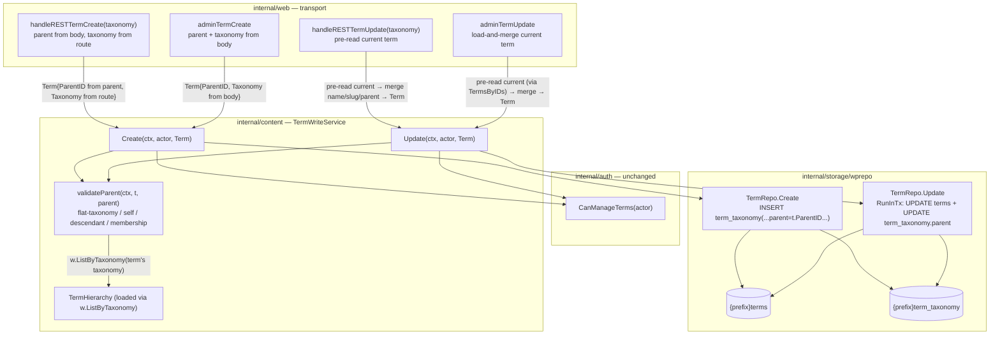

# M13 — Term re-parenting & hierarchy writes: Design

## Overview

Five facts about the code as it stands set this milestone's shape.

**The entire term write chain already exists; M13 threads one value through it
and adds the validation that value needs.** A `parent` written at the REST or
admin edge travels an already-built path: `restTermWriteRequest`
(`internal/web/rest_terms.go:33`) and `termWriteRequest`
(`internal/web/adminapi_terms.go:29`) decode the body, build a `domain.Term`,
and call `s.termWrite.Create`/`Update`; `content.TermWriteService`
(`internal/content/writeservices.go:303`) gates on `auth.CanManageTerms` and
forwards to `s.w.Create`/`Update`; `TermRepo.Create`/`Update`
(`internal/storage/wprepo/writers.go:121`, `:146`) run the SQL. The `parent`
value already has a home on the entity — `domain.Term.ParentID`
(`internal/domain/entities.go:52-62`), read-populated by M9b and documented as
"Read-only in this milestone: term reads populate it, and no write path sets
it." M13 is the write path that paragraph anticipates. No new route, no new port
method, no new capability (Req 8).

**`TermRepo.Create` hardcodes `parent = 0`; `TermRepo.Update` never touches
`term_taxonomy` at all.** `Create` INSERTs
`term_taxonomy (term_id, taxonomy, description, parent, count)` with the literal
arguments `termID, t.Taxonomy, "", 0, 0` (`writers.go:121`) — the fourth `0` is
`parent`, written regardless of `t.ParentID`. `Update` is a single `NewUpdate`
on `{prefix}terms` setting only `name`/`slug`, keyed on `term_id`, finished with
`errNotFoundIfMissing` (`writers.go:146`). Because name/slug live on
`{prefix}terms` and `parent` lives on `{prefix}term_taxonomy`, writing the
parent on update means `Update` must now touch a **second table** — so it moves
from a single `NewUpdate` to a two-statement `RunInTx` (see Storage).

**`content.TermHierarchy` is the ready-made cycle primitive, and it is
taxonomy-scoped.** `LoadTermHierarchy(ctx, reader, taxonomy)`
(`internal/content/archive.go:93`) reads one `ListByTaxonomy` and indexes the
graph into `byID`, `children`, and `roots`. `DescendantIDs(id)`
(`archive.go:277`) returns the term "followed by every term beneath it,
breadth-first," self-inclusive, with a visited-set that already terminates on a
pre-existing cycle. Two consequences fall out of the graph being loaded for a
single taxonomy: (a) membership in `byID` is exactly "a term that exists in THIS
taxonomy," so a parent that is nonexistent *or* belongs to a different taxonomy
both fail the same `_, ok := byID[parent]` check — one test covers Req 4.1 and
4.2 together; (b) the descendant walk is the cycle test — `parent == termID` or
`parent ∈ DescendantIDs(termID)` is a cycle.

**`TermWriteService` is the only layer that can see both the stored taxonomy and
the hierarchy, and it sits above both edges.** Its field `w` is a combined
`domain.TermWriter`+`domain.TermReader` (`writeservices.go:303`), so the service
can `ListByTaxonomy` to build a `TermHierarchy` and `TermsByIDs` to learn a
term's stored taxonomy without any new dependency. It is the single point above
both the REST and admin handlers, so the parent-validation rule — write once,
enforced identically for both edges — belongs here, not duplicated in two
handlers. This is the central design decision (see Architecture).

**The read side already reflects a written parent, so re-parent correctness is a
test obligation, not new code.** `restTerm.Parent` renders `t.ParentID`
(`internal/web/rest_terms.go:23-32`), so a REST write/read round-trip is free
once the write lands. M9b's `EXISTS` semi-join derives a parent category's post
set live from `term_taxonomy.parent` on every read
(`internal/storage/wprepo/repo.go:186-224`), and `TermHierarchy` is loaded per
request and deliberately not cached (`archive.go:61-130`), so a re-parent shows
up on the next archive read with no write-side bookkeeping. M13 proves these
stay correct under re-parenting; it does not modify them (Req 6, 7).

This design adds **no port method, no route, no migration, and no capability**.
It changes two storage methods (`TermRepo.Create` writes `t.ParentID`;
`TermRepo.Update` gains a transactional `term_taxonomy.parent` write), adds a
private `validateParent` helper plus two sentinels to `TermWriteService`, and
extends two request DTOs and their four handlers to carry `parent` and resolve
the omitted-vs-explicit-zero distinction before the service runs.

The standalone `## Correctness Properties` and `## Error Handling` H2s are
omitted deliberately (matching the 10.x/11 siblings): M13 adds a fixed set of
validation branches over an enumerable case space (self / descendant /
nonexistent / cross-taxonomy / flat-taxonomy / top-level / unchanged), not a
pure function over a large input space, so there is no "for all inputs X, P(X)"
statement worth a PBT harness (see Testing strategy). Fail-closed and
error-mapping behavior is folded into the component descriptions below.

## Architecture



Three edges carry the milestone's argument.

**The handler, not the service, resolves omitted-vs-explicit-zero — and it is
cheap because the handler already needs the pre-read.** `parent` arrives as a
`*int64`: `nil` means "unchanged," `*parent == 0` means "top-level," a positive
value re-parents (D2). The service stays `domain.Term`-based — `ParentID` rides
on the `Term` it already receives — so the pointer distinction must be collapsed
to a concrete `ParentID` *before* the service is called. On **create** there is
no "unchanged": a `nil` or `0` parent is top-level (Req 1.3), so the create
handler maps `nil → 0` and sets `t.ParentID` directly. On **update**, "unchanged"
needs the term's current parent, which means a pre-read of the stored term — and
the handler needs that same pre-read anyway to learn the term's **taxonomy**
(the REST update already reads it via `restTermByID`; the admin update currently
does *not*, which is a bug this milestone fixes — see Finding 3). So the update
handler pre-reads the current term, sets `t.ParentID` to the current value when
`parent` is omitted and to `*parent` when supplied, and the service and writer
always write an authoritative `ParentID`. The trade-off — one extra read per
update — is free: it is the same `TermsByIDs`/`ListByTaxonomy` read the cycle
check already requires (Finding 6), and it lets `TermRepo.Update` set
`parent = ?` unconditionally rather than branch on "was parent supplied."

**`validateParent` runs in the service, after the capability gate, before any
write.** The sequence inside both `Create` and `Update` is: `CanManageTerms`
gate (→ `ErrForbidden`, unchanged), then `validateParent` (→ `ErrTermParentCycle`
or `ErrTermParentInvalid`, nothing written), then `s.w.Create`/`Update`. The
hierarchy the check needs is loaded inside `validateParent` via
`w.ListByTaxonomy(t.Taxonomy)` — the service's `w` is a `TermReader` too, so no
new field or dependency is introduced. For a non-zero target parent the check
loads the hierarchy for the term's own taxonomy and rejects: a `post_tag` target
(flat, Req 4.3); `parent == t.ID` (self-cycle, Req 3.1); `parent ∈
DescendantIDs(t.ID)` (transitive cycle, Req 3.2 — Update only, a new term has no
descendants so this is a trivial pass on Create, Req 3.4); or a `parent` absent
from `byID` (nonexistent-or-cross-taxonomy, Req 4.1/4.2 in one check). A `parent`
of `0` short-circuits to nil (valid top-level for any taxonomy, Req 4.4).

**`TermRepo.Update` becomes transactional because the write now spans two
tables.** name/slug on `{prefix}terms`, parent on `{prefix}term_taxonomy`. Both
updates run inside one `RunInTx` so a re-parent that renames can never half-apply
(Req 2.1). The existence semantics stay on the `{prefix}terms` row via
`errNotFoundIfMissing`, preserving the documented MySQL matched-but-unchanged
no-op caveat (Req 2.5).

## Capability model (Requirement 5)

No new capability name is introduced (Req 5.3, 8.3, D5). The gate is exactly the
one `TermWriteService` already enforces: `auth.CanManageTerms(actor)`
(`internal/auth/policy.go:78`), checked at the top of `Create`/`Update` before
`validateParent` and before any read or write. A caller lacking
`manage_categories` gets `content.ErrForbidden` with nothing read and nothing
written — fail closed.

| Operation | Capability | Maps to |
|---|---|---|
| REST term create/update with `parent` | `manage_categories` | `403` rest-forbidden shape (`rest_cannot_create` / `rest_cannot_edit`) — Req 5.1 |
| admin term create/update with `parent` | `manage_categories` | admin-JSON `403` (`content.ErrForbidden` → `jsonHandler`) — Req 5.2 |

Because the gate is the first thing both `Create` and `Update` do, it precedes
`validateParent`: an unauthorized caller never triggers a hierarchy read, and a
cycle/invalid-parent in an unauthorized request still returns `403`, not `400`
(the authorization decision wins). When `s.termWrite` is `nil`, the REST term
routes remain unregistered exactly as today (`registerRESTTerms` returns early,
`rest_terms.go`), so threading `parent` through changes nothing about the
nil-gating of the write surface (Req 5.4).

## Components and Interfaces

This milestone adds two sentinels and one private helper to `TermWriteService`,
changes two `wprepo` write methods, and extends two request DTOs and their four
handlers. No interface in `internal/domain` changes (Req 8.2). The transport
types the handlers exchange are collected in **Data Models**.

### `content` sentinels (Requirements 3, 4)

Two new package-level sentinels beside `ErrForbidden`
(`internal/content/writeservices.go:16`), so handlers can map the two
parent-validation failures to `400` distinctly from the `403` forbidden path.

```go
// ErrTermParentCycle is returned by TermWriteService.Create/Update when the
// requested parent would make the term a descendant of itself -- the parent is
// the term's own id (Req 3.1) or a member of the term's descendant set
// (Req 3.2). Nothing is written. Handlers map it to 400.
var ErrTermParentCycle = errors.New("content: term parent would create a cycle")

// ErrTermParentInvalid is returned when the requested non-zero parent does not
// resolve to an existing term in the term's own taxonomy (Req 4.1, 4.2) or when
// a non-zero parent targets a flat (non-hierarchical) taxonomy such as post_tag
// (Req 4.3). Nothing is written. Handlers map it to 400.
var ErrTermParentInvalid = errors.New("content: term parent is invalid")
```

Two sentinels rather than one because the REST handler surfaces a distinct
message per shape, and a service test asserts the self/descendant cases return
`ErrTermParentCycle` specifically while the nonexistent/cross-taxonomy/flat cases
return `ErrTermParentInvalid` — though both map to `400`, keeping them separate
documents intent and keeps the test matrix honest.

### `content.TermWriteService.validateParent` (Requirements 3, 4)

A new private method on the existing `TermWriteService`, reusing the struct's
existing combined `w` field (`domain.TermWriter`+`domain.TermReader`) — no
constructor or option change. It is the single home of the parent rule for both
edges.

```go
// validateParent enforces the hierarchy rules for a term write before any row
// is written. t carries the term's taxonomy (and, on Update, its id); parent is
// the already-resolved authoritative parent value the handler computed from the
// *int64 request field (0 == top-level). It returns:
//
//   - nil when parent == 0 (top-level is valid for every taxonomy, Req 4.4), or
//     when a positive parent passes every check below.
//   - ErrTermParentInvalid when t.Taxonomy is flat (post_tag) and parent != 0
//     (Req 4.3), or when parent names no term in t.Taxonomy (Req 4.1/4.2).
//   - ErrTermParentCycle when parent == t.ID (Req 3.1) or parent is in the
//     term's descendant set (Req 3.2). On Create, t.ID is 0 and the term has no
//     descendants, so only the self check can fire and only for a parent of 0,
//     which is already short-circuited -- Create trivially passes (Req 3.4).
//
// The hierarchy is loaded once here, for t.Taxonomy only, via the combined
// reader. Because the graph is taxonomy-scoped, membership in byID is exactly
// "exists in this taxonomy", so the nonexistent and cross-taxonomy cases collapse
// into one check (Finding 2). The check NEVER consults a taxonomy value taken
// from the request for the parent (Req 4.5): it reads t.Taxonomy (the term being
// written's own taxonomy) and the stored graph.
func (s *TermWriteService) validateParent(ctx context.Context, t domain.Term, parent int64) error {
	if parent == 0 {
		return nil // top-level, valid for any taxonomy (Req 4.4)
	}
	// Flat taxonomies have no meaningful parent (Req 4.3). Only "category" is
	// hierarchical in M13 (post_tag is flat); a non-zero parent on anything that
	// is not the hierarchical category taxonomy is rejected.
	if t.Taxonomy != content.TaxonomyCategory {
		return ErrTermParentInvalid
	}
	if parent == t.ID {
		return ErrTermParentCycle // self-parent (Req 3.1)
	}
	h, err := content.LoadTermHierarchy(ctx, s.w, t.Taxonomy)
	if err != nil {
		return err
	}
	if _, ok := h.byID[parent]; !ok {
		// Absent from this taxonomy's graph == nonexistent OR cross-taxonomy
		// (Req 4.1, 4.2) -- one check, because the graph is taxonomy-scoped.
		return ErrTermParentInvalid
	}
	// Transitive cycle: the proposed parent is at or beneath the term itself
	// (Req 3.2). DescendantIDs is self-inclusive, so it already contains t.ID;
	// the explicit self check above is kept for clarity and because on Create
	// (t.ID == 0, not in the graph) DescendantIDs returns nil.
	for _, d := range h.DescendantIDs(t.ID) {
		if d == parent {
			return ErrTermParentCycle
		}
	}
	return nil
}
```

Two code-level notes pin the exact shape:

- **`validateParent` lives in `internal/content`, so it reads `h.byID` directly**
  — `byID`/`children`/`roots` are unexported fields on `TermHierarchy`
  (`archive.go`), reachable because `validateParent` is in the same package.
  (`DescendantIDs` is the exported accessor; `byID` is used directly for the
  membership check rather than adding a new exported `Has(id)` method, keeping
  the `TermHierarchy` surface unchanged per Req 8.5.)
- **`content.TaxonomyCategory`** (`internal/content/term.go:10`, `"category"`) is
  the hierarchical taxonomy; `post_tag` is flat. The flat check is written as
  "not the hierarchical taxonomy" so a future hierarchical taxonomy would be the
  only place to extend, and it matches the Out-of-scope note that M13's hierarchy
  write is scoped to `category`.

### `content.TermWriteService.Create` / `Update` (Requirements 1, 2, 3, 5)

The two existing methods gain a `validateParent` call between the capability gate
and the writer call. Signatures are unchanged — `(ctx, actor, domain.Term)` —
with `ParentID` carrying the authoritative parent the handler already resolved
(the recommended, minimal-surface approach: the pointer/omitted distinction is a
transport concern resolved in the handler, Req 1.1/2.4).

```go
// BEFORE (writeservices.go:321)
func (s *TermWriteService) Create(ctx context.Context, actor auth.Principal, t domain.Term) (int64, error) {
	if !auth.CanManageTerms(actor) {
		return 0, ErrForbidden
	}
	return s.w.Create(ctx, t)
}

// AFTER
func (s *TermWriteService) Create(ctx context.Context, actor auth.Principal, t domain.Term) (int64, error) {
	if !auth.CanManageTerms(actor) {
		return 0, ErrForbidden // Req 5.3, fail closed before any read
	}
	// t.ParentID is the authoritative value the handler resolved (0 == top-level
	// on create, Req 1.3). A new term has no descendants, so only a flat-taxonomy
	// or nonexistent/cross-taxonomy parent can fail here (Req 3.4, 4).
	if err := s.validateParent(ctx, t, t.ParentID); err != nil {
		return 0, err // ErrTermParentCycle / ErrTermParentInvalid, nothing written
	}
	return s.w.Create(ctx, t)
}
```

```go
// BEFORE (writeservices.go:329)
func (s *TermWriteService) Update(ctx context.Context, actor auth.Principal, t domain.Term) error {
	if !auth.CanManageTerms(actor) {
		return ErrForbidden
	}
	return s.w.Update(ctx, t)
}

// AFTER
func (s *TermWriteService) Update(ctx context.Context, actor auth.Principal, t domain.Term) error {
	if !auth.CanManageTerms(actor) {
		return ErrForbidden // Req 5.3
	}
	// t carries the authoritative ParentID the handler resolved from the pre-read
	// (omitted -> current value, Req 2.2; explicit 0 -> top-level, Req 2.3;
	// positive -> re-parent, Req 2.1) and the term's real taxonomy from the same
	// pre-read. validateParent runs the self/descendant cycle check (Req 3) and
	// the membership/flat check (Req 4) against the stored graph.
	if err := s.validateParent(ctx, t, t.ParentID); err != nil {
		return err // nothing written (Req 3.1-3.2, 4)
	}
	return s.w.Update(ctx, t)
}
```

The service never inspects the request pointer and never re-derives the term's
taxonomy from the request — `t.Taxonomy` is the authoritative stored taxonomy the
handler put there (from the route closure on REST create, from the request body
on admin create, from the pre-read on both updates). This keeps Req 4.5 ("never
against a taxonomy value taken from the request for the parent") satisfied by
construction: `validateParent` reads `t.Taxonomy`, the subject term's taxonomy,
not the parent's.

### `wprepo.TermRepo.Create` (Requirement 1)

One argument changes: the hardcoded `0` becomes `t.ParentID`. Everything else —
the `RunInTx`, the `insertReturningID` on `{prefix}terms`, the
`description`/`count` defaults — is unchanged (Req 1.4).

```go
// BEFORE (writers.go:121)
		q := "INSERT INTO " + r.prefix + "term_taxonomy " +
			"(term_id, taxonomy, description, parent, count) VALUES (?, ?, ?, ?, ?)"
		_, err = tx.ExecContext(ctx, q, termID, t.Taxonomy, "", 0, 0)
		return err

// AFTER
		q := "INSERT INTO " + r.prefix + "term_taxonomy " +
			"(term_id, taxonomy, description, parent, count) VALUES (?, ?, ?, ?, ?)"
		// parent is now t.ParentID (Req 1.2), replacing the hardcoded 0. The
		// service has already validated it (exists, same taxonomy, no cycle),
		// so a bad value never reaches here. 0 still means top-level (Req 1.3).
		_, err = tx.ExecContext(ctx, q, termID, t.Taxonomy, "", t.ParentID, 0)
		return err
```

The `count` argument stays the literal `0` (the fifth `?`): M13 writes no count
cache (Req 7.4, D6). Only the fourth `?` (`parent`) changes.

### `wprepo.TermRepo.Update` (Requirements 2, 8)

`Update` now writes two tables, so it moves from a single `NewUpdate` to a
`RunInTx` wrapping two statements. name/slug stay on `{prefix}terms` with the
unchanged `errNotFoundIfMissing` existence semantics; `term_taxonomy.parent` is
set in the same transaction. The order is terms-first (so the existence check —
and its `domain.ErrNotFound` — is decided on the canonical `{prefix}terms` row),
then `term_taxonomy`.

```go
// BEFORE (writers.go:146): single NewUpdate on {prefix}terms only.
func (r *TermRepo) Update(ctx context.Context, t domain.Term) error {
	res, err := r.db.NewUpdate().
		TableExpr("?", bun.Ident(r.prefix+"terms")).
		Set("name = ?", t.Name).
		Set("slug = ?", t.Slug).
		Where("term_id = ?", t.ID).
		Exec(ctx)
	if err != nil {
		return err
	}
	return errNotFoundIfMissing(ctx, res, func(ctx context.Context) (bool, error) {
		return r.db.NewSelect().
			TableExpr("?", bun.Ident(r.prefix+"terms")).
			Where("term_id = ?", t.ID).
			Exists(ctx)
	})
}

// AFTER: name/slug on {prefix}terms AND parent on {prefix}term_taxonomy, in one
// transaction so a rename+re-parent cannot half-apply (Req 2.1). The existence
// decision stays on the {prefix}terms row with the same errNotFoundIfMissing
// MySQL no-op caveat (Req 2.5). term_taxonomy.parent is written unconditionally
// because the handler always resolves ParentID to an authoritative value
// (omitted -> current, explicit -> new); there is no "parent not supplied"
// branch to guard here.
func (r *TermRepo) Update(ctx context.Context, t domain.Term) error {
	return r.db.RunInTx(ctx, nil, func(ctx context.Context, tx bun.Tx) error {
		res, err := tx.NewUpdate().
			TableExpr("?", bun.Ident(r.prefix+"terms")).
			Set("name = ?", t.Name).
			Set("slug = ?", t.Slug).
			Where("term_id = ?", t.ID).
			Exec(ctx)
		if err != nil {
			return err
		}
		// ErrNotFound (with the MySQL matched-but-unchanged caveat) is decided on
		// the {prefix}terms row, inside the transaction so the Exists check sees
		// the same snapshot. A missing term rolls back before term_taxonomy is
		// touched (Req 2.5).
		if err := errNotFoundIfMissing(ctx, res, func(ctx context.Context) (bool, error) {
			return tx.NewSelect().
				TableExpr("?", bun.Ident(r.prefix+"terms")).
				Where("term_id = ?", t.ID).
				Exists(ctx)
		}); err != nil {
			return err
		}
		// Re-parent on the taxonomy row. Keyed on term_id (every term has exactly
		// one category/tag taxonomy row); 0 means top-level (Req 2.3). No row
		// matching here would be an invariant violation for a term that just
		// passed the {prefix}terms existence check, so a 0-rows result is not
		// re-treated as ErrNotFound -- the terms row is the source of truth.
		if _, err := tx.NewUpdate().
			TableExpr("?", bun.Ident(r.prefix+"term_taxonomy")).
			Set("parent = ?", t.ParentID).
			Where("term_id = ?", t.ID).
			Exec(ctx); err != nil {
			return err
		}
		return nil
	})
}
```

The `term_taxonomy` update uses the Bun query-builder (`tx.NewUpdate`) with
`bun.Ident` for the table and plain `?` placeholders on lowercase columns
(`parent`, `term_id`), so no `rebind.Ident` cross-vendor `"ID"` quoting is
needed here — neither statement references the quoted primary key `"ID"` (both
key on `term_id`, a lowercase column). This mirrors the existing `Update`'s own
`term_id`-keyed shape.

### Web handlers (Requirements 1, 2, 4, 5, 6)

Both DTOs gain a `Parent *int64 json:"parent"` field, and the four handlers map
it onto `domain.Term.ParentID`. The two update handlers resolve
omitted-vs-explicit-zero and the term's taxonomy from a pre-read before calling
the service. The create handlers already know the taxonomy (REST from the route
closure, admin from the body).

#### REST `restTermWriteRequest` + create/update

```go
// BEFORE (rest_terms.go:33)
type restTermWriteRequest struct {
	Name *string `json:"name"`
	Slug *string `json:"slug"`
}

// AFTER: Parent is a *int64 so nil ("unchanged" on update) is distinct from the
// value 0 ("top-level"), matching the omitted-vs-explicit posture Name/Slug
// already use (D2, Req 1.1/2.4).
type restTermWriteRequest struct {
	Name   *string `json:"name"`
	Slug   *string `json:"slug"`
	Parent *int64  `json:"parent"`
}
```

**`handleRESTTermCreate(taxonomy)`** (`rest_terms.go`): the taxonomy is the route
closure param; a create has no "unchanged", so `nil` parent means top-level. The
only change is resolving `Parent` into the `domain.Term` it already builds:

```go
	// after the existing name/slug resolution, before Create:
	var parentID int64 // 0 == top-level when parent omitted or 0 (Req 1.3)
	if body.Parent != nil {
		parentID = *body.Parent
	}
	id, err := s.termWrite.Create(r.Context(), principal,
		domain.Term{Name: *body.Name, Slug: slug, Taxonomy: taxonomy, ParentID: parentID})
	if err != nil {
		switch {
		case errors.Is(err, content.ErrForbidden):
			writeRESTError(w, http.StatusForbidden, "rest_cannot_create",
				"Sorry, you are not allowed to create terms as this user.") // Req 5.1
		case errors.Is(err, content.ErrTermParentCycle), errors.Is(err, content.ErrTermParentInvalid):
			writeRESTError(w, http.StatusBadRequest, "rest_invalid_param",
				"Invalid parent term.") // Req 4.1-4.3
		default:
			writeRESTError(w, http.StatusInternalServerError, "rest_create_failed", "Could not create term.")
		}
		return
	}
```

The read-after-write (`termToREST(..., restTermCategoryGraph(...))`) already
renders the new `ParentID` through `restTerm.Parent`, so the create response
round-trips the parent with no further change (Req 6.1).

**`handleRESTTermUpdate(taxonomy)`** (`rest_terms.go`): already pre-reads the term
via `restTermByID` into `current` (that read yields `current.Taxonomy` and
`current.ParentID`). The only change is resolving `Parent` on the `updated` copy
it already builds from `current`:

```go
	updated := current // carries current.Taxonomy and current.ParentID
	if body.Name != nil {
		updated.Name = *body.Name
	}
	if body.Slug != nil {
		updated.Slug = *body.Slug
	}
	// Omitted parent -> leave updated.ParentID at current.ParentID (unchanged,
	// Req 2.2). Explicit parent (incl. 0) -> set it (Req 2.1/2.3). The service
	// then validates updated.ParentID against updated.Taxonomy's graph.
	if body.Parent != nil {
		updated.ParentID = *body.Parent
	}
	// ... existing Update call, with two added switch arms:
	//   case ErrTermParentCycle, ErrTermParentInvalid -> 400 rest_invalid_param
	// alongside the existing ErrForbidden -> 403 and ErrNotFound -> 404 arms.
```

Because `updated` starts as a copy of `current`, `updated.ParentID` already holds
the stored parent; the handler only overwrites it when `body.Parent != nil`. This
is the omitted-vs-explicit-zero resolution done entirely in the handler — the
service sees a concrete `ParentID` (Req 2.4). The read-after-write already
reflects the new parent (Req 6.1, 6.4).

#### admin `termWriteRequest` + create/update

```go
// BEFORE (adminapi_terms.go:29): non-pointer Name/Slug/Taxonomy.
type termWriteRequest struct {
	Name     string `json:"name"`
	Slug     string `json:"slug"`
	Taxonomy string `json:"taxonomy"`
}

// AFTER: Parent added as a *int64 (same omitted-vs-explicit-zero semantics as
// REST). Name/Slug/Taxonomy stay non-pointer strings -- see the relaxed update
// rule below for why a parent-only update no longer requires them both.
type termWriteRequest struct {
	Name     string `json:"name"`
	Slug     string `json:"slug"`
	Taxonomy string `json:"taxonomy"`
	Parent   *int64 `json:"parent"`
}
```

**`adminTermCreate`** (`adminapi_terms.go:72`): the taxonomy is in the body
(already required non-empty). The create still requires Name/Slug/Taxonomy
non-empty (a create names a new term — the parent-only relaxation is an *update*
concern); it only maps `Parent` onto the `domain.Term`:

```go
	var parentID int64 // top-level when omitted or 0 (Req 1.3, 4.4)
	if body.Parent != nil {
		parentID = *body.Parent
	}
	id, err := s.termWrite.Create(r.Context(), principal, domain.Term{
		Name:     body.Name,
		Slug:     body.Slug,
		Taxonomy: body.Taxonomy, // authoritative taxonomy for validateParent
		ParentID: parentID,
	})
	// err is returned as-is: jsonHandler maps content.ErrForbidden -> 403 and
	// domain.ErrNotFound -> 404; the two new parent sentinels must be wrapped as
	// badRequestError -> 400 (see the shared mapping note below).
```

**`adminTermUpdate`** (`adminapi_terms.go:99`): two changes. **(1)** The
Name/Slug-required check is *relaxed* — today it rejects any update missing
either (`if body.Name == "" || body.Slug == ""`), which makes a parent-only
re-parent impossible (Finding 3). The new rule is **load-and-merge**: the handler
pre-reads the current term (which it must do anyway to learn its taxonomy for
`validateParent` — the admin update currently builds `domain.Term{ID,Name,Slug}`
with no taxonomy at all), then merges supplied fields over it.

```go
	// AFTER: pre-read the current term (Req 2.2 unchanged-parent needs it, Req 4
	// needs its taxonomy, and the relaxed rule needs its current name/slug).
	terms, err := s.termWrite.TermsByIDs(r.Context(), []int64{id})
	if err != nil {
		return err
	}
	if len(terms) == 0 {
		return domain.ErrNotFound // jsonHandler -> 404 (Req 2.5-aligned)
	}
	cur := terms[0]

	// Relaxed rule: a parent-only update is allowed. Require at least one of
	// name / slug / parent to be present; otherwise the request changes nothing
	// and is a 400. (Empty-string name/slug are treated as "not supplied" for the
	// admin DTO's non-pointer strings; a rename to empty was already rejected by
	// the old rule and stays rejected.)
	if body.Name == "" && body.Slug == "" && body.Parent == nil {
		return badRequestError{msg: "at least one of name, slug, or parent is required"}
	}

	merged := cur // carries cur.Taxonomy and cur.ParentID
	if body.Name != "" {
		merged.Name = body.Name
	}
	if body.Slug != "" {
		merged.Slug = body.Slug
	}
	if body.Parent != nil {
		merged.ParentID = *body.Parent // explicit (incl. 0); else unchanged (Req 2.2/2.3)
	}
	if err := s.termWrite.Update(r.Context(), principal, merged); err != nil {
		return err // jsonHandler maps Forbidden/NotFound; parent sentinels wrapped to 400
	}
	return writeJSON(w, http.StatusOK, termDetailResponse{
		ID: id, Name: merged.Name, Slug: merged.Slug, Taxonomy: merged.Taxonomy,
	})
```

The pre-read serves three needs with one `TermsByIDs` call: the term's taxonomy
(for `validateParent`), its current parent (for omitted-parent "unchanged"), and
its current name/slug (so a parent-only update keeps them). The response now
echoes the real `Taxonomy` from the pre-read rather than the request body (fixing
the old "echoed back from the request body" approximation the type comment notes).

**Shared admin error mapping.** `jsonHandler` (`internal/web/adminapi.go:37`)
maps `domain.ErrNotFound → 404`, `content.ErrForbidden → 403`, `badRequestError →
400`, else `500`. `ErrTermParentCycle`/`ErrTermParentInvalid` are neither of the
first two, so both admin handlers must translate them to `badRequestError` before
returning, so the mapping yields `400` (Req 3.3, 4.1-4.3):

```go
	// in both adminTermCreate and adminTermUpdate, wrapping the service call:
	if err := /* Create or Update */; err != nil {
		if errors.Is(err, content.ErrTermParentCycle) || errors.Is(err, content.ErrTermParentInvalid) {
			return badRequestError{msg: "invalid parent term"} // -> 400 via jsonHandler
		}
		return err // ErrForbidden -> 403, ErrNotFound -> 404, else 500
	}
```

(`adminTermCreate` adds the same wrap around its `Create` call. This keeps
`ErrForbidden` on the `403` path unchanged, Req 5.2.)

## Data Models

M13 introduces no new entity and changes no table. The only data-shape changes
are the two request DTOs above and the already-present entity field they feed.

### `domain.Term.ParentID` — now written

`Term.ParentID` (`internal/domain/entities.go:52-62`) is unchanged in type
(`int64`, `0` == no parent). What changes is its lifecycle: M9b populated it on
reads and documented it read-only; M13 makes `TermRepo.Create`/`Update` write it.
The entity comment's "Read-only in this milestone: term reads populate it, and no
write path sets it" should be updated to note M13 as the write path (a
documentation-only edit; no field change). No `domain` interface changes (Req
8.2).

### The `parent` request field (Requirements 1.1, 2.4)

Both DTOs carry `Parent *int64 json:"parent"`. The pointer encodes three states;
the handler collapses them to a concrete `ParentID` before the service runs:

| Request `parent` | Pointer | Create resolves to | Update resolves to |
|---|---|---|---|
| omitted | `nil` | `0` (top-level, Req 1.3) | current stored `ParentID` (unchanged, Req 2.2) |
| `0` | `&0` | `0` (top-level, Req 1.3) | `0` (promote to top-level, Req 2.3) |
| `<id>` | `&id` | `id` (nest, Req 1.2) | `id` (re-parent, Req 2.1) |

The distinction that must survive is omitted-vs-explicit-zero on **update**: a
rename that omits `parent` must not silently reset the term to top-level (Req
2.4). The `*int64` carries it; the handler's `if body.Parent != nil` guard is the
single place it is consumed. There is no new serialized response field — the REST
read-back uses the existing `restTerm.Parent` (`rest_terms.go:23-32`), and the
admin read-back uses `termDetailResponse.Taxonomy` plus the existing shape.

## Findings

1. **The whole write chain already exists; M13 only threads `parent` and adds the
   validation.** DTO → `TermWriteService.Create`/`Update` → `TermRepo.Create`/
   `Update` is a complete path today; it simply drops `t.ParentID` on the floor
   (`Create` hardcodes `0`, `Update` never writes `term_taxonomy`). The entity
   field `ParentID` already exists and is already read-populated. No port, route,
   capability, or migration is added (Req 8) — the milestone is a write-gap fill
   plus a service-side guard.

2. **`TermHierarchy.DescendantIDs` is the ready-made cycle primitive, and the
   taxonomy-scoping collapses two checks into one.** `DescendantIDs(id)`
   (`archive.go:277`) is self-inclusive, breadth-first, and already cycle-safe via
   its visited set. Because `LoadTermHierarchy` reads a single taxonomy, `byID`
   membership is exactly "exists in this taxonomy", so a nonexistent parent and a
   cross-taxonomy parent both fail the same `byID` check (Req 4.1 + 4.2 in one),
   and the cycle check is `parent == id || parent ∈ DescendantIDs(id)`. No new
   descendant walk is written in storage (D3, Req 3.5).

3. **`adminTermUpdate`'s Name/Slug-required rule blocks a parent-only update, and
   it does not know the term's taxonomy — both must change.** Today
   `adminTermUpdate` (`adminapi_terms.go:99`) rejects any update missing name or
   slug and builds `domain.Term{ID, Name, Slug}` with **no** `Taxonomy`
   (`validateParent` would have nothing to check against). The fix is a
   load-and-merge pre-read: it relaxes the required-fields rule to "at least one
   of name/slug/parent", yields the term's taxonomy for `validateParent`, and
   supplies the current name/slug/parent so a partial update keeps the fields it
   omits. The REST update already pre-reads via `restTermByID`, so only the admin
   side needs the new read.

4. **M9b's descendant-aware counts read `term_taxonomy.parent` live, so
   re-parent correctness needs tests, not code.** The `EXISTS` semi-join and
   `CountByTermSlug` (`repo.go:186-224`) derive the descendant set from the live
   column on every read, and `TermHierarchy` is reloaded per request
   (`archive.go:61-130`, deliberately uncached). A re-parent is therefore
   reflected on the next read with zero write-side bookkeeping and no
   `term_taxonomy.count` cache to maintain (D6, Req 7). M13 adds a
   count-after-reparent test to prove this; it changes none of that read code
   (Req 8.5).

5. **REST `restTerm.Parent` already reads back `ParentID`, so the round-trip is
   free once the write lands.** `termToREST` sets `Parent: t.ParentID`
   (`rest_terms.go`), and the create/update handlers read-after-write through the
   same graph. No REST view change is needed for Req 6.1/6.4 beyond the write
   itself.

6. **The REST create handler knows its taxonomy from the route closure; both
   UPDATE handlers must pre-read the term to learn it — and that pre-read is also
   the cycle check's input.** `handleRESTTermCreate(taxonomy)` and
   `adminTermCreate` (body `Taxonomy`) have the taxonomy in hand. The updates do
   not carry a trustworthy taxonomy in the request (Req 4.5 forbids trusting a
   request taxonomy for parent resolution anyway), so each pre-reads the stored
   term. That single read serves the taxonomy lookup, the omitted-parent
   "unchanged" value, and (inside the service) the `ListByTaxonomy` the hierarchy
   is built from — one logical read obligation, not three (the service's
   `ListByTaxonomy` is a separate query, but it is the query the cycle check
   needs regardless, so no read is added purely for validation).

## Testing strategy

Pure Go over SQLite, no new environment variable and no new dependency; `gofmt`,
`go vet`, `go build ./...`, and `go test ./...` green at the end of every task
(Req 9.5, D7). Four layers.

**No property-based testing.** The parent rule is a fixed, enumerable set of
validation branches — top-level (`0`), self-cycle, descendant-cycle,
nonexistent, cross-taxonomy, flat-taxonomy (`post_tag`), and omitted-unchanged —
plus a two-table transactional write. There is no "for all inputs X, P(X)"
statement over a large input space worth generating against: the interesting
cases are the branch boundaries, which example-based and small table-driven tests
cover exhaustively. This matches the no-PBT decision in the 10.x/11 siblings.

**Cross-vendor repository contract — `wprepo` over the existing harness (Req
9.1):**

- `TermRepo.Create` writes and reads back `term_taxonomy.parent`: create a term
  with `ParentID = p`, then read it (via `ListByTaxonomy`/`TermsByIDs`) and assert
  `ParentID == p`; create with `ParentID = 0` and assert top-level. SQLite always;
  MySQL/Postgres env-gated through the existing contract harness, no new env var.
- `TermRepo.Update` writes `term_taxonomy.parent` and touches both tables
  atomically: seed a term with a name/slug and `parent = a`; `Update` it with a
  new name/slug and `parent = b`; assert the `{prefix}terms` row has the new
  name/slug AND the `{prefix}term_taxonomy` row has `parent = b` (both landed).
  `Update` to `parent = 0` promotes to top-level.
- `Update` returns `domain.ErrNotFound` for an unknown `term_id`, preserving the
  `errNotFoundIfMissing` MySQL no-op caveat (a no-op same-value rename on MySQL
  must not 404). Transactionality: a forced error on the `term_taxonomy` statement
  rolls back the `{prefix}terms` name/slug change too (no half-apply).

**Service unit tests — `TermWriteService` over a real `TermHierarchy` on a
fake/real `TermReader` (Req 9.2):** table-driven, each case asserts the sentinel
and that the underlying writer was NOT called (stored hierarchy unchanged).

- self-parent (`parent == id`) → `ErrTermParentCycle`, no write (Req 3.1).
- descendant-parent (`parent ∈ DescendantIDs(id)`) → `ErrTermParentCycle`, no
  write (Req 3.2) — seed a parent→child→grandchild chain and try to set the
  parent's parent to the grandchild.
- nonexistent parent → `ErrTermParentInvalid`, no write (Req 4.1).
- cross-taxonomy parent (a `category` term whose requested parent id belongs to a
  `post_tag` term, absent from the category graph) → `ErrTermParentInvalid`
  (Req 4.2).
- `post_tag` term with a non-zero parent → `ErrTermParentInvalid` (Req 4.3).
- `parent == 0` on any taxonomy (incl. `post_tag`) → nil, writer called with
  `ParentID == 0` (Req 4.4).
- omitted-unchanged (handler-resolved): `Update` with `ParentID` set to the
  current stored value passes and writes that value (Req 2.2) — exercised at the
  handler layer where the pointer lives.
- Create with a valid non-zero parent passes the cycle check trivially (no
  descendants) and writes `ParentID` (Req 3.4, 1.2).
- `ErrForbidden` precedes `validateParent`: an actor without `manage_categories`
  gets `ErrForbidden` even when the parent is also invalid, and no hierarchy read
  happens (Req 5.3).

**Web handler tests — through the live chi router / admin `jsonHandler` with real
content services (Req 9.3):**

- REST: parent create happy path (`201`, response `parent` echoes the written
  value); parent update happy path and promote-to-top-level (`parent: 0`);
  `400 rest_invalid_param` on a cycle and on an invalid/cross-taxonomy/flat
  parent; `403 rest_cannot_create`/`rest_cannot_edit` for a caller lacking
  `manage_categories`; omitted `parent` on a rename leaves the stored parent
  unchanged (Req 2.2).
- admin: parent create and update happy paths; **parent-only update now allowed**
  (name/slug both omitted, only `parent` supplied — asserts the relaxed rule and
  that the merged name/slug come from the pre-read); `400` (admin-JSON) on
  cycle/invalid parent (via `badRequestError`); `403` (admin-JSON) for a caller
  lacking `manage_categories`; a request with none of name/slug/parent → `400`.

**Count-after-reparent integration (SQLite, Req 9.4):** seed a parent category, a
child category, and posts filed under the child (and one post filed under BOTH
parent and child), then re-parent the child under a different parent and assert on
the next read: the original parent archive's pagination `Total`/`TotalPages`
drops the moved child's posts; the new parent archive's `Total` gains them; a
post filed under both the parent and a descendant still appears exactly once (the
`EXISTS` semi-join's appears-once guarantee); and `CountByTermSlug` for each
parent agrees with its archive listing. This exercises the live descendant-set
recomputation with no write-side count bookkeeping (Req 7).

**No-migration check:** a task asserts no file is added under
`internal/storage/migrations` (Req 8.1), mirroring the sibling specs.

## Traceability

| Design element | Requirements |
|---|---|
| `Parent *int64` on `restTermWriteRequest` + `termWriteRequest`, mapped to `domain.Term.ParentID` | 1.1, 2.4 |
| `TermRepo.Create` writes `t.ParentID` into `term_taxonomy.parent` (was hardcoded `0`) | 1.2 |
| omitted / `0` parent on create → `term_taxonomy.parent = 0` (top-level) | 1.3, 4.4 |
| `Create` keeps the single `RunInTx` + `description`/`count` defaults, only `parent` changes | 1.4 |
| `TermRepo.Update` sets `term_taxonomy.parent` on a supplied parent | 2.1 |
| handler pre-read resolves omitted `parent` to the current value (unchanged) | 2.2 |
| explicit `parent: 0` on update → top-level | 2.3 |
| `*int64` carries omitted-vs-explicit-zero, resolved in the handler before the service | 2.4 |
| `Update` existence via `errNotFoundIfMissing` on `{prefix}terms`, MySQL no-op caveat preserved | 2.5 |
| `validateParent` self-parent → `ErrTermParentCycle`, no write | 3.1 |
| `validateParent` descendant-parent (`DescendantIDs`) → `ErrTermParentCycle`, no write | 3.2 |
| REST → `400`, admin → admin-JSON `400` on the cycle sentinel; no parent altered | 3.3 |
| Create applies the cycle check, trivially passed by a new term | 3.4 |
| cycle check reuses `TermHierarchy`, no new storage walk | 3.5, 8.5 |
| non-zero parent not in the taxonomy graph → `ErrTermParentInvalid`, `400` | 4.1 |
| cross-taxonomy parent (absent from the term's taxonomy graph) → `400` | 4.2 |
| `post_tag` (flat) with a non-zero parent → `ErrTermParentInvalid`, `400` | 4.3 |
| `parent: 0` / omitted-on-create valid for any taxonomy | 4.4 |
| validation reads `t.Taxonomy` (subject term) + stored graph, never a request taxonomy for the parent | 4.5 |
| `manage_categories` gate → REST `403` rest-forbidden shape | 5.1 |
| `manage_categories` gate → admin-JSON `403` (`content.ErrForbidden` via `jsonHandler`) | 5.2 |
| gate stays `auth.CanManageTerms` in the service, before any read/write; no new capability | 5.3 |
| `s.termWrite == nil` keeps REST term routes unregistered | 5.4 |
| `restTerm.Parent` read-back reflects the written parent on next read | 6.1 |
| admin term read echoes the merged/pre-read taxonomy + new parent | 6.2 |
| re-parented term's ancestry/descendants resolve from a freshly loaded `TermHierarchy` | 6.3 |
| round-trip holds for `parent: <id>` and `parent: 0` | 6.4 |
| parent archive post set recomputed live from `term_taxonomy.parent` (no bookkeeping) | 7.1 |
| pagination `Total`/`TotalPages` + single-post-appears-once after re-parent | 7.2 |
| `CountByTermSlug` after re-parent agrees with the archive listing | 7.3 |
| no `term_taxonomy.count` cache maintenance | 7.4 |
| no migration (task asserts none under `internal/storage/migrations`) | 8.1 |
| `domain.TermWriter`/`TermReader` unchanged; `parent` rides on `domain.Term.ParentID` | 8.2 |
| no new capability name | 8.3 |
| no new `wp-json`/admin route; only DTO bodies + write methods extended | 8.4 |
| M9b read model (`TermHierarchy`, `EXISTS` semi-join, `CountByTermSlug`) unchanged, only proven | 8.5 |
| cross-vendor `TermRepo.Create`/`Update` parent write/read-back + two-table atomicity | 9.1 |
| service cycle (self/descendant), nonexistent/cross-taxonomy, flat, top-level, unchanged | 9.2 |
| REST + admin handler `403` gate and `400` parent validation; parent-only admin update allowed | 9.3 |
| count-after-reparent integration (`Total` + appears-once) | 9.4 |
| pure Go / SQLite, no new dependency, toolchain green | 9.5 |
