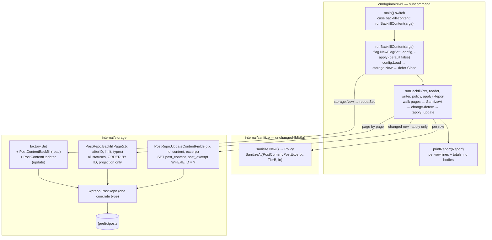

# M14 — pre-M10a content sanitization backfill: Design

## Overview

Six facts about the code as it stands set this milestone's shape.

**M10a's policy is a ready-made, unconditional sanitizer — M14 calls it, it
writes nothing new.** `Policy.SanitizeAt(k FieldKind, t Tier, in string)
(string, error)` (`internal/sanitize/policy.go:121`) takes the tier as an
explicit argument, not derived from any writer capability: tier C returns `in`
byte-identical, and tier A/B over a non-title field route straight through
`p.tierB.Sanitize(in)` (which returns `(string, nil)`, never an error). An
unrecognised `FieldKind` fails closed with a non-nil error and no persistable
value (`policy.go:139-148`). `sanitize.New()` (`internal/sanitize/policy.go:29`)
is the one constructor; the backfill builds a single policy and reuses it for
every row. Tier B is the broad `$allowedposttags` post list, built with
`AllowComments` so Gutenberg block delimiters survive while `<script>` is
stripped, and it is exactly the tier M10a applies to a non-`unfiltered_html`
writer's post content — `TierFor` returns `TierB` for a `PostContent` field
when the writer lacks the capability (`internal/sanitize/sanitize.go:69-77`).
M14 adds no policy code; it calls `SanitizeAt(sanitize.PostContent,
sanitize.TierB, …)` and `SanitizeAt(sanitize.PostExcerpt, sanitize.TierB, …)`
on content already in the database (D2).

**The `grimoire-cli` subcommand pattern is fixed and M14 copies it exactly.**
`main()` (`cmd/grimoire-cli/main.go:30`) switches on `os.Args[1]` over
`migrate`/`seed`/`createadmin`/`sessions`, each dispatched to a `runX(args)`
that parses its own `flag.NewFlagSet(name, flag.ExitOnError)` with
`cfgPath := fs.String("config", "configs/grimoire.sqlite.yaml", …)`, loads
`config.Load(*cfgPath)`, and opens storage. On any returned error `main` prints
`grimoire-cli: <err>` to stderr and `os.Exit(1)`; `usage()` (`main.go:60`) lists
the subcommands. `runMigrate -check` calls `reportPreflight` and returns without
writing — the read-only-report precedent a dry run follows (`main.go:116-118`,
`:139`). Two storage-open idioms coexist: `migrate`/`seed` take a raw
`db, err := storage.OpenSQL(cfg.Database)` (`*sql.DB`), while
`createadmin`/`sessions` take `repos, err := storage.New(cfg.Database)`, `defer
repos.Close()`, and reach ports through `repos.Users` etc. The backfill needs
the new repo ports, so it uses `storage.New` (D1).

**No existing read walks all statuses and types — the walk is a new port, and
it is additive.** Every `PostRepo` read filters `post_status = 'publish'` and a
single `post_type` (`RecentPosts` and its siblings, `internal/storage/wprepo/
repo.go:86`+). Nothing today iterates every row across draft/pending/private/
future/inherit/trash over a `{post, page, revision}` type set. M14 adds a
dedicated paginated read port for that walk (Req 3); it changes no existing read
method's behavior (Req 8.4). The columns it needs — `ID`, `post_type`,
`post_content`, `post_excerpt` — already exist on `{prefix}posts`
(`postColumns`, `repo.go:17-24`), so there is no migration, no new table, no new
column (D6, Req 8.2).

**`PostWriter.Update` is exactly the write M14 must NOT use.** `PostWriter`
(`internal/domain/repository.go:447`) exposes `ByID`/`Create`/`Update`/`Delete`;
`Update` "replaces an existing post's fields by ID." Its implementation
(`internal/storage/wprepo/writers.go:63`) is a single `NewUpdate` that sets
`post_author`, `post_date`, `post_content`, `post_title`, `post_excerpt`,
`post_status`, … and unconditionally `Set("post_modified = ?", formatTS(now))`
and `Set("post_modified_gmt = ?", formatTS(now))` — it rewrites the whole row
and bumps the modified timestamps to now. A sanitization backfill that reused it
would clobber unrelated columns and reorder "recently modified" views. M14 needs
a narrow update that sets ONLY `post_content`/`post_excerpt` by `ID` and leaves
`post_modified`/`post_modified_gmt` untouched (D4, Req 4), so it adds a dedicated
content-only update port rather than calling `PostWriter.Update`.

**The concrete `*PostRepo` already backs many ports, so the two new ports are
new methods on it, exposed as two new `Set` fields.** `PostRepo` is a plain
`struct { db *bun.DB; prefix string }` (`repo.go:75`) built once by
`NewPostRepo(db, prefix)` (`repo.go:80`). In `storage.New`
(`internal/storage/factory.go`), `posts := wprepo.NewPostRepo(bunDB, prefix)` is
constructed a single time and assigned to `PostWriter`, `AdminPosts`,
`PostCounter`, `Revisions`, and `Scheduled` — one concrete type under five
ports. M14's read port and content-only update port are best added as two more
methods on that same `*PostRepo`, exposed as two new additive `Set` fields. This
adds no new backing type, no new connection, and does not disturb the existing
five assignments (D6, Req 8.4). `Repositories` embeds `Set`, exposes `DB()
*sql.DB` and `Close()`.

**The contract harness is ready; new assertions attach to it with no new
plumbing.** `storagetest`'s `TestSQLiteContract` calls `RunContract(t, func…)`
with `newSQLiteRepos(t, extraSeeds…)`, built from `storage.New(cfg)` +
`MigrationsFS` + `migrate.Apply` + `SeedFixtures`
(`internal/storage/storagetest/sqlite_test.go:13-40`); env-gated MySQL/Postgres
reach the same `RunContract` via `newReposFromDSN`. The backfill-port contract
assertions attach to `RunContract`'s body and the extra-seed mechanism seeds
rows holding a disallowed `<script>`. No new env var, no new dependency (D7).

This design adds **one `grimoire-cli` subcommand** (`backfill-content`,
dispatched from `main()`'s switch), **two additive domain ports** (a paginated
backfill reader and a content-only updater) implemented as new methods on
`*PostRepo` and exposed as two new `Set` fields, and **one orchestration helper**
in the `cmd/grimoire-cli` package that walks the pages, applies the M10a policy,
change-detects, and accumulates an auditable report. No HTTP handler, no render
path, no capability, and no migration (Req 8).

The standalone `## Correctness Properties` and `## Error Handling` H2s are
omitted deliberately (matching the 11 and 13 siblings): M14 reuses M10a's
already-tested policy unchanged and adds a CLI sweep whose behavior is a small
set of enumerable branches — row clean / row changed / sanitize-error, dry-run /
apply, excluded type / included type — not a pure function over a large input
space, so there is no "for all inputs X, P(X)" statement worth a PBT harness
(see Testing strategy). Fail-safe and error-posture behavior is folded into the
component descriptions below.

## Architecture



Three edges carry the milestone's argument.

**`RB --> SET` opens storage through `storage.New`, not `OpenSQL`.** The
backfill needs the two new repo ports, which live on the `Set`, so
`runBackfillContent` follows the `createadmin`/`sessions` idiom:
`repos, err := storage.New(cfg.Database)` then `defer repos.Close()`, reaching
`repos.PostContentBackfill` and `repos.PostContentUpdater` (the two new fields).
On a `config.Load` or `storage.New` failure it returns the non-nil error and
writes nothing; `main` prints it and exits non-zero, exactly as the sibling
subcommands do (Req 1.6).

**`ORCH --> WALK` streams, never slurps; `ORCH --> POL` is pure; `ORCH --> UPD`
fires only on a changed row under `-apply`.** The orchestrator loops the read
port page by page under a stable `ID` cursor so a large `{prefix}posts` table is
never loaded whole (Req 3.3-3.4). For each row it computes the tier-B value of
both fields via the shared policy (Req 2); if both already equal their sanitized
value the row is skipped with no write (Req 4.1, the idempotent-fixed-point
case). A changed row under `-apply` is written through the content-only updater,
which touches only the two content columns (Req 4.2-4.4); under a dry run the
same read-and-evaluate happens but the update is never called (Req 6). A
`SanitizeAt` error on a row marks that row failed and the loop continues to the
next row (Req 9.1-9.3).

**`ORCH --> REP` is the audit trail, and it is the whole observability story.**
Because M14 does not bump `post_modified` (D4) and provides no undo (D5), the
report is how an operator sees what the sweep did: a per-row line for every
changed/failed row (by `ID`, `post_type`, which field(s), a size/diff indicator)
and end-of-run totals (scanned, changed, per-field counts, failed). Full bodies
are never printed (Req 7.2). The dry-run report and the report a subsequent
`-apply` on the unchanged database would produce name the same rows and fields,
so the preview faithfully predicts the apply (Req 6.3).

## Capability model

M14 introduces no capability name and makes no authorization decision (Req 8.3).
The backfill has no acting principal: `SanitizeAt` is called with the literal
`sanitize.TierB` for every row, never a tier derived from a writer, a capability,
or a request (Req 2.3). The sweep is gated entirely by operating-system access to
the `grimoire-cli` binary and the database — it is reachable only by explicitly
invoking the `backfill-content` subcommand, never from an HTTP handler, a
scheduler, or server startup (Req 1.4). There is no capability table here to
reproduce.

## Components and Interfaces

This milestone adds one subcommand and its orchestration helper to
`cmd/grimoire-cli`, two additive domain ports implemented as new methods on the
existing `*PostRepo`, and two new `Set` fields wiring them. No existing interface
method changes (Req 8.4). The report, cursor, and row-projection types the
components exchange are collected in **Data Models**.

### `domain.PostContentBackfill` — the paginated read port (Requirement 3)

A new additive interface in `internal/domain`, beside the existing post ports. It
streams the targeted rows page by page under a stable `ID` order, returning a
minimal projection (not a full `domain.Post`), so a large table is never loaded
whole and no full-column `ByID` round-trip is forced (Req 3.3-3.5).

```go
// PostContentBackfill streams the rows the M14 sanitization backfill targets:
// {prefix}posts rows whose post_type is one of the supplied types, across ALL
// post_status values, ordered by ID ascending so pagination is stable. It is a
// read-only port added for the backfill; it alters no existing PostRepo read
// (Req 8.4).
type PostContentBackfill interface {
	// BackfillPage returns up to limit targeted rows with ID strictly greater
	// than afterID, ordered by ID ascending. afterID == 0 starts the walk. The
	// returned rows carry only the fields the backfill needs (ID, post_type,
	// post_content, post_excerpt), never a full post row (Req 3.5). A page
	// shorter than limit (or empty) signals the walk is complete. The same row
	// is never returned twice and no targeted row is skipped, because the keyset
	// cursor is the monotonically increasing primary key (Req 3.4).
	BackfillPage(ctx context.Context, afterID int64, limit int, types []string) ([]PostContentRow, error)
}
```

Keyset pagination on `ID` (an `ID > afterID` predicate plus `ORDER BY ID` and a
`LIMIT`) is chosen over `OFFSET` deliberately: an offset walk can drop or
double-count rows if the set shifts between pages, which Req 3.4 forbids; a
keyset cursor on the immutable primary key cannot. The backfill mutates only
`post_content`/`post_excerpt`, never `ID`, so a row's cursor position is stable
even across the apply pass.

### `domain.PostContentUpdater` — the content-only update port (Requirement 4)

A second new additive interface, the narrow write. It exists specifically so the
backfill never touches `PostWriter.Update` (`internal/domain/repository.go:447`),
which replaces the whole row and bumps the modified timestamps (D4).

```go
// PostContentUpdater performs the M14 narrow write: it sets ONLY post_content
// and post_excerpt on one {prefix}posts row by ID. It MUST NOT be confused with
// PostWriter.Update, which replaces the whole row and unconditionally bumps
// post_modified/post_modified_gmt (internal/storage/wprepo/writers.go:63-104);
// this port exists so the backfill does neither (Req 4.2-4.4).
type PostContentUpdater interface {
	// UpdateContentFields sets post_content and post_excerpt on the row with the
	// given ID and changes NO other column -- notably not post_modified or
	// post_modified_gmt (Req 4.4). Both clean values are written even when only
	// one field changed, since each is a tier-B fixed point so rewriting the
	// unchanged one is a no-op in value (Req 4.5). Returns domain.ErrNotFound
	// when no row has the given ID, matching the PostWriter.Delete contract.
	UpdateContentFields(ctx context.Context, id int64, content, excerpt string) error
}
```

Two ports rather than one combined reader-writer because the two halves have
genuinely different shapes and risk profiles: the reader is a pure, dry-run-safe
streaming SELECT exercised on every run, while the updater is the only mutating
statement in the milestone and fires only under `-apply`. Splitting them lets a
dry run depend on a port that physically cannot write, and lets the contract test
for the narrow update's "changes no other column" guarantee stand alone. Both are
implemented on the same concrete `*PostRepo`, so the split costs no extra type.

#### `wprepo.PostRepo` implementations

Both methods are added to the existing `*PostRepo` (`internal/storage/wprepo/
repo.go:75`), reusing its `db`/`prefix` fields — no new constructor. `BackfillPage`
is a projection SELECT with an `ID > ?` keyset predicate, an `IN (…)` over the
type set, no `post_status` filter, `ORDER BY ID`, and a `LIMIT`. `UpdateContentFields`
is a two-column `NewUpdate` keyed on the quoted primary key, with
`errNotFoundIfZero` on the result — the same existence posture `PostWriter.Delete`
uses.

```go
// BackfillPage streams targeted rows for the M14 backfill (Req 3). All statuses,
// post_type in types, ordered by the primary key for a stable keyset cursor.
func (r *PostRepo) BackfillPage(ctx context.Context, afterID int64, limit int, types []string) ([]domain.PostContentRow, error) {
	var rows []postContentRow
	err := r.db.NewSelect().
		TableExpr("?", bun.Ident(r.prefix+"posts")).
		Column("ID", "post_type", "post_content", "post_excerpt"). // projection only (Req 3.5)
		Where("? > ?", bun.Ident("ID"), afterID).                  // keyset cursor (Req 3.4)
		Where("post_type IN (?)", bun.In(types)).                  // {post,page,revision} (Req 3.1)
		// NO post_status filter: every status is in scope (Req 3.2).
		OrderExpr("? ASC", bun.Ident("ID")).
		Limit(limit).
		Scan(ctx, &rows)
	if err != nil {
		return nil, err
	}
	return toDomainContentRows(rows), nil
}

// UpdateContentFields writes ONLY post_content/post_excerpt by ID; it does NOT
// bump post_modified/post_modified_gmt or touch any other column (Req 4.2-4.4).
func (r *PostRepo) UpdateContentFields(ctx context.Context, id int64, content, excerpt string) error {
	res, err := r.db.NewUpdate().
		TableExpr("?", bun.Ident(r.prefix+"posts")).
		Set("post_content = ?", content).
		Set("post_excerpt = ?", excerpt).
		Where("? = ?", bun.Ident("ID"), id).
		Exec(ctx)
	if err != nil {
		return err
	}
	return errNotFoundIfZero(res)
}
```

`bun.Ident("ID")` quotes the primary key for cross-vendor correctness — the same
treatment `PostWriter.Update`/`Delete` give the `"ID"` column (`writers.go:100`,
`:113`) so Postgres does not case-fold it to `id`. The `post_type`/`post_content`/
`post_excerpt` references are ordinary lowercase columns and need no quoting. The
contrast with `PostWriter.Update` is the whole point of the port: that method
carries a dozen `Set` calls including the two `post_modified*` bumps; this one
carries exactly two `Set` calls and nothing else (Req 4.3-4.4).

### `storage.Set` wiring (Requirement 8.4)

Two new additive fields on `Set` (`internal/storage/factory.go`), assigned from
the same `posts` instance already built once in `New`:

```go
// in storage.Set, beside Revisions/Scheduled:
//   PostContentBackfill domain.PostContentBackfill // M14 paginated read
//   PostContentUpdater  domain.PostContentUpdater  // M14 narrow content-only write

// in New(cfg), reusing the single posts := wprepo.NewPostRepo(bunDB, prefix):
//   PostContentBackfill: posts,
//   PostContentUpdater:  posts,
```

No new backing type, connection, or constructor — `*PostRepo` satisfies both new
interfaces by gaining the two methods above, exactly as it already satisfies
`PostWriter`, `AdminPosts`, `PostCounter`, `Revisions`, and `Scheduled` from one
construction (D6).

### `runBackfillContent` — the subcommand (Requirement 1)

A new `runBackfillContent(args []string) error` in `cmd/grimoire-cli`, dispatched
from `main()`'s switch by a new `case "backfill-content":` arm, and named in
`usage()`. It mirrors the sibling `runX` shape verbatim: own `flag.NewFlagSet`,
`-config` default, `config.Load`, open storage, return a non-nil error on any
failure so `main` prints `grimoire-cli: <err>` and exits 1 (Req 1.6).

```go
// runBackfillContent runs the opt-in M14 sanitization backfill (Req 1). It is
// DRY RUN by default: without -apply it reports the rows/fields it WOULD rewrite
// and writes nothing (Req 1.2, 6). With -apply it performs the narrow
// content-only writes (Req 1.3). It never runs as part of normal server
// operation -- it is reachable only by invoking this subcommand (Req 1.4).
func runBackfillContent(args []string) error {
	fs := flag.NewFlagSet("backfill-content", flag.ExitOnError)
	cfgPath := fs.String("config", "configs/grimoire.sqlite.yaml", "path to grimoire config YAML")
	apply := fs.Bool("apply", false,
		"perform the writes; omit for a dry run that reports changes and writes nothing. "+
			"TAKE A DATABASE BACKUP before running with -apply: M14 provides no undo.") // Req 1.5
	if err := fs.Parse(args); err != nil {
		return err
	}
	cfg, err := config.Load(*cfgPath)
	if err != nil {
		return err // nothing opened, nothing written (Req 1.6)
	}
	repos, err := storage.New(cfg.Database)
	if err != nil {
		return err // Req 1.6
	}
	defer repos.Close()

	policy := sanitize.New() // one policy, reused for every row (Req 2.1)
	report, err := runBackfill(context.Background(),
		repos.PostContentBackfill, repos.PostContentUpdater, policy, *apply)
	if err != nil {
		return err
	}
	printReport(os.Stdout, report, *apply)
	// Non-zero exit when any row failed sanitization during an apply, so the
	// failure is not lost in the report (Req 9.4).
	if *apply && report.Failed > 0 {
		return fmt.Errorf("backfill-content: %d row(s) failed sanitization", report.Failed)
	}
	return nil
}
```

The `usage()` line and the `-apply` flag help both state the backup requirement
(Req 1.5): `usage()` gains a `backfill-content  sanitize stored post content
(dry run unless -apply; back up the DB first)` entry alongside the existing
`migrate`/`seed`/… lines. The `-apply`-guarded non-zero return is the only place
the sweep's outcome affects the process exit code; a dry run that merely observed
failures reports them but exits 0 (the failures changed nothing).

### `runBackfill` — the orchestration helper (Requirements 2, 4, 5, 6, 9)

A package-private helper that holds the whole sweep and takes its collaborators
as parameters (the two ports, the policy, and the `apply` bool) so a command-level
test can drive it over a SQLite-backed `Set` without a process. It builds no
policy and opens no storage itself — those are the subcommand's job — which keeps
it a pure orchestration of injected dependencies.

```go
// runBackfill walks every targeted row page by page, applies tier B to both
// content fields, change-detects, and (when apply is set) writes the narrow
// content-only update for each changed row. It never aborts on one bad row: a
// SanitizeAt error marks that row failed and the walk continues (Req 9). It
// returns the accumulated Report; it writes nothing when apply is false (Req 6).
func runBackfill(ctx context.Context, reader domain.PostContentBackfill,
	writer domain.PostContentUpdater, policy *sanitize.Policy, apply bool) (Report, error) {

	const pageSize = 500
	types := []string{"post", "page", "revision"} // D3 / Req 3.1; excludes attachment, nav_menu_item
	var rep Report
	var afterID int64

	for {
		page, err := reader.BackfillPage(ctx, afterID, pageSize, types)
		if err != nil {
			return rep, err // a read failure aborts the run (distinct from a per-row sanitize error)
		}
		if len(page) == 0 {
			break // walk complete (Req 3.4)
		}
		for _, row := range page {
			afterID = row.ID // advance the keyset cursor regardless of outcome
			rep.Scanned++

			cleanContent, errC := policy.SanitizeAt(sanitize.PostContent, sanitize.TierB, row.Content)
			cleanExcerpt, errE := policy.SanitizeAt(sanitize.PostExcerpt, sanitize.TierB, row.Excerpt)
			if errC != nil || errE != nil {
				// Fail-safe: report the row, do NOT write it, keep going (Req 9.1-9.3).
				rep.recordFailed(row, errC, errE)
				continue
			}

			contentChanged := cleanContent != row.Content
			excerptChanged := cleanExcerpt != row.Excerpt
			if !contentChanged && !excerptChanged {
				continue // already a tier-B fixed point: skip, no write (Req 4.1, 5.1)
			}

			rep.recordChanged(row, contentChanged, excerptChanged,
				len(row.Content), len(cleanContent), len(row.Excerpt), len(cleanExcerpt))

			if apply {
				// Narrow write: both clean values, only the two columns (Req 4.2-4.5).
				if err := writer.UpdateContentFields(ctx, row.ID, cleanContent, cleanExcerpt); err != nil {
					return rep, err // a write failure aborts (data-safety: stop, report, exit non-zero)
				}
			}
		}
	}
	return rep, nil
}
```

Two decisions are pinned here. **The `SanitizeAt`-error row is reported and
skipped, never written, and never aborts the sweep (Req 9).** `SanitizeAt`
returns no persistable value together with an error (`policy.go:139-148`), so a
failed field has nothing safe to write; the row is counted in `rep.Failed`,
named in the report by `ID` and failing field, and the loop moves on. A genuine
read or write failure (a `BackfillPage`/`UpdateContentFields` error) is different
— it aborts the run with the error, because continuing past a broken database
connection or a failed write would make the report lie about what happened.
**Both clean values are written on any changed row, even when only one field
differs (Req 4.5):** each sanitized value is a tier-B fixed point, so rewriting
the already-clean field is a no-op in value, and writing both keeps
`UpdateContentFields` a single unconditional two-column statement rather than a
branch on which field changed. The report still names only the field(s) that
actually differed.

### `printReport` — the report writer (Requirements 5, 7)

A small helper that formats the accumulated `Report` to an `io.Writer` (stdout in
the subcommand; a buffer in tests). Per-row lines name `ID`, `post_type`, the
changed field(s), and a byte-length before/after indicator; a trailing totals
block prints scanned/changed/per-field/failed counts. It prints no post body
(Req 7.2). The dry-run and apply reports differ only in a header verb ("would
change" vs "changed") and the failed-row exit handled by the subcommand — the
rows and fields named are identical for the same input database (Req 6.3).

## Data Models

M14 adds no table, column, or migration (D6, Req 8.2) — `post_content` and
`post_excerpt` already exist in `postColumns` (`internal/storage/wprepo/
repo.go:17-24`). The only new data shapes are the in-memory projection the read
port returns and the report structs the orchestrator accumulates. This is called
out explicitly because a "backfill" might be assumed to need schema support; it
does not.

### `domain.PostContentRow` — the minimal row projection (Requirement 3.5)

The read port returns only the four fields the backfill touches, not a full
`domain.Post`, so a large table walk stays cheap and no unrelated column is
loaded.

```go
// PostContentRow is the minimal projection the M14 backfill reads per row: just
// the primary key, the type (for the report and the targeting sanity of the
// walk), and the two content fields the sweep sanitizes. It is NOT domain.Post
// -- the backfill never needs post_author/date/status/etc. (Req 3.5).
type PostContentRow struct {
	ID      int64
	Type    string // post_type: one of post, page, revision
	Content string // post_content
	Excerpt string // post_excerpt
}
```

The `wprepo` package scans into an unexported `postContentRow` with the matching
`bun:"ID"`/`bun:"post_type"`/`bun:"post_content"`/`bun:"post_excerpt"` tags and
converts to the domain type via `toDomainContentRows`, mirroring how `postRow`
maps to `domain.Post` (`repo.go:46-73`).

### The keyset cursor (Requirements 3.3, 3.4)

The walk's cursor is a single `int64` — the `ID` of the last row returned — not a
page-number offset. `runBackfill` holds `afterID`, passes it to each
`BackfillPage` call, and advances it to every row's `ID` as it is processed. An
empty page ends the walk. Because `ID` is the immutable primary key and the only
column the walk orders by, each targeted row appears exactly once across the full
run even though the apply pass mutates content in place (the mutation never moves
a row's cursor position). There is no stored cursor state and no second table —
the cursor lives only in the running process.

### The report (Requirements 5, 7)

Two structs: a per-row result and the run totals. No full body is stored on
either — only lengths and a field marker — so the report cannot leak or bloat on
a large post (Req 7.2).

```go
// backfillRowResult is one reportable row: a row that changed or a row that
// failed sanitization. Clean (unchanged) rows produce no row result -- they are
// only counted in Report.Scanned (Req 7.1).
type backfillRowResult struct {
	ID             int64
	Type           string // post_type
	ContentChanged bool   // post_content differed from its tier-B value
	ExcerptChanged bool   // post_excerpt differed
	Failed         bool   // SanitizeAt errored on this row (Req 9.2)
	FailField      string // which field failed, when Failed
	// Size/diff indicator: before/after byte lengths, never the bodies (Req 7.1, 7.2).
	ContentBefore, ContentAfter int
	ExcerptBefore, ExcerptAfter int
}

// Report is the audit trail for a run (dry-run or apply). It is the ONLY record
// of what the sweep did, since M14 does not bump post_modified and offers no
// undo (D4, D5, Req 7.4).
type Report struct {
	Scanned        int // every targeted row read (Req 7.3)
	Changed        int // rows with at least one field differing (Req 7.3)
	ContentChanges int // per-field count for post_content (Req 7.3)
	ExcerptChanges int // per-field count for post_excerpt (Req 7.3)
	Failed         int // rows whose SanitizeAt errored (Req 9.3)
	Rows           []backfillRowResult
}
```

`recordChanged` and `recordFailed` are the two methods that append a
`backfillRowResult` and bump the matching totals, keeping `runBackfill`'s loop
readable. A dry run and an apply build the identical `Report` for the same input
database, which is what makes the dry-run preview a faithful prediction of the
apply (Req 6.3); the only runtime difference is whether `UpdateContentFields` is
called, and whether a non-zero `Failed` count flips the process exit (Req 9.4).

## Findings

1. **`SanitizeAt` is unconditional and fail-safe — the backfill's exact need.**
   `Policy.SanitizeAt(k, t, in)` (`internal/sanitize/policy.go:121`) applies the
   tier passed as an argument, not one derived from a writer; tier C returns `in`
   byte-identical, tier A/B over `PostContent`/`PostExcerpt` route through
   `p.tierB.Sanitize(in)` which returns `(string, nil)`. An unrecognised
   `FieldKind`/`Tier` returns `("", non-nil error)` and never a persistable value
   (`policy.go:139-148`). So the backfill calls `SanitizeAt(PostContent, TierB, …)`
   / `SanitizeAt(PostExcerpt, TierB, …)` with the literal `TierB` (Req 2.3), and
   on the rare error has a safe, no-write path to take (Req 9.1). `sanitize.New()`
   (`policy.go:29`) is the one constructor, built once (Req 2.1).

2. **No existing read walks all statuses/types — the read port is genuinely
   new.** Every `PostRepo` read (`RecentPosts` and siblings, `internal/storage/
   wprepo/repo.go:86`+) filters `post_status = 'publish'` and a single
   `post_type`. Nothing iterates draft/pending/private/future/inherit/trash over
   `{post, page, revision}`. `BackfillPage` is additive and changes no existing
   read's behavior (Req 3, 8.4). The columns it projects already exist in
   `postColumns` (`repo.go:17-24`), so no migration is needed (Req 8.2).

3. **`PostWriter.Update` is the anti-pattern M14 must avoid, verbatim.**
   `wprepo.PostRepo.Update` (`internal/storage/wprepo/writers.go:63`) is a single
   `NewUpdate` that sets a dozen columns and unconditionally
   `Set("post_modified = ?", formatTS(now))` / `Set("post_modified_gmt = ?",
   formatTS(now))` — a whole-row replace that bumps the modified timestamps. The
   method's own doc comment says so: "Modified/ModifiedGMT are always bumped to
   the current time … overriding whatever the caller passed." M14's
   `UpdateContentFields` sets exactly two columns and no timestamp, so a
   sanitization correction never reorders "recently modified" views (D4, Req 4).

4. **One concrete `*PostRepo` already backs five ports from a single
   construction — the two new ports ride the same instance.** In `storage.New`
   (`internal/storage/factory.go`), `posts := wprepo.NewPostRepo(bunDB, prefix)`
   is assigned to `PostWriter`, `AdminPosts`, `PostCounter`, `Revisions`, and
   `Scheduled`. Adding `BackfillPage` and `UpdateContentFields` to `*PostRepo`
   and two `Set` fields pointing at the same `posts` costs no new type and
   disturbs none of the existing five (D6, Req 8.4). `PostRepo` is a bare
   `struct{ db *bun.DB; prefix string }` with the simple `NewPostRepo` constructor
   (`repo.go:75-80`).

5. **The `grimoire-cli` subcommand contract is small and strict.** `main()`
   (`cmd/grimoire-cli/main.go:30`) switches on `os.Args[1]`; an unrecognised
   subcommand prints `usage()` and `os.Exit(2)`, a `runX` error prints
   `grimoire-cli: <err>` and `os.Exit(1)`. Each `runX` parses its own
   `flag.NewFlagSet(name, ExitOnError)` with the `-config` default string.
   `createadmin`/`sessions` use `storage.New` + `defer repos.Close()` (the idiom
   M14 copies, since it needs repo ports), while `migrate`/`seed` use the raw
   `storage.OpenSQL`. `migrate -check`/`reportPreflight` (`main.go:116-118`,
   `:139`) is the read-only-report precedent a dry run follows (Req 1, 6).

6. **The contract harness already supports extra seeds and env-gated vendors — no
   new plumbing.** `newSQLiteRepos(t, extraSeeds…)` (`internal/storage/
   storagetest/sqlite_test.go:13-40`) is `storage.New` + `MigrationsFS` +
   `migrate.Apply` + `SeedFixtures` + any caller-supplied seed funcs; MySQL/
   Postgres reach the same `RunContract` via `newReposFromDSN`. A backfill
   contract test seeds a row holding a `<script>` through the extra-seed hook and
   asserts the read/update ports over `RunContract`. No new env var, no new
   dependency (D7, Req 10).

## Testing strategy

Pure Go over SQLite, no new environment variable and no new dependency; `gofmt`,
`go vet`, `go build ./...`, and `go test ./...` green at the end of every task
(Req 10.5, D7). Three layers, matching the 11 and 13 siblings.

**No property-based testing.** M14 reuses M10a's `sanitize` policy unchanged —
that package already carries its own tier tests — and the sweep itself is a small
set of enumerable branches: a row clean / content-only changed / excerpt-only
changed / both changed / `SanitizeAt`-error; dry-run vs `-apply`; an included
type vs an excluded one; the first page / a mid-walk cursor / the final empty
page. There is no "for all inputs X, P(X)" statement over a large input space
worth generating against — the interesting cases are the branch boundaries, which
example-based and small table-driven tests cover exhaustively. This matches the
no-PBT decision in the 11 and 13 siblings.

**Cross-vendor storage contract — the two new ports over the existing harness
(Req 10.1-10.3):**

- `BackfillPage` targeting and status coverage: seed `post`, `page`, and
  `revision` rows across several statuses (publish/draft/pending/private/future/
  inherit/trash) plus an `attachment` and a `nav_menu_item`; assert the walk
  returns every `{post, page, revision}` row regardless of status and returns no
  `attachment`/`nav_menu_item` row (Req 3.1, 3.2).
- `BackfillPage` pagination integrity: seed more rows than one page; walk with a
  small `limit`; assert every targeted row appears exactly once and none is
  skipped or duplicated, under ascending `ID` order (Req 3.4). A row mutated in
  place between pages (simulating the apply pass) still appears exactly once.
- `UpdateContentFields` cleans and preserves: seed a row whose `post_content`
  holds a disallowed `<script>`; call `UpdateContentFields` with the tier-B
  value; assert the stored `post_content` is the clean value, `post_excerpt` is
  written, and `post_modified`/`post_modified_gmt` are byte-identical to their
  pre-update values (the no-bump guarantee, Req 4.4, 10.2). Assert no column other
  than the two content fields changed.
- `UpdateContentFields` existence: an unknown `ID` returns `domain.ErrNotFound`.
- Idempotence / dry-run at the port level (Req 10.3): a row already tier-B-clean
  passed to `UpdateContentFields` with its own values is a no-op in content; a
  `BackfillPage`-only pass (no update call) leaves every row byte-identical.

**Orchestration unit tests — `runBackfill` over fake ports (Req 9, 4, 5, 6):**
table-driven, each case asserts the `Report` counts and whether the writer was
called.

- clean row → scanned++, no row result, writer not called (Req 4.1, 5.1).
- content-only / excerpt-only / both-changed rows → the right `ContentChanges`/
  `ExcerptChanges`/`Changed` totals, the row result names the correct field(s),
  and (apply) the writer is called with both clean values (Req 4.2, 4.5).
- dry run (apply=false): a changed row is recorded in the `Report` but the writer
  is never called; the row's stored content is untouched (Req 6.1, 6.2).
- dry-run/apply equivalence: `runBackfill` over the same seeded fake produces the
  identical rows/fields named with apply=false and apply=true (Req 6.3).
- `SanitizeAt` error (a fake policy input that trips the unrecognised-field path,
  or a fake policy): the row is counted in `Failed`, named by `ID`/field, the
  writer is not called for it, and the walk continues to the next row (Req 9.1-9.3).
- second apply is a no-op: run apply once over a seeded fake, then again; the
  second `Report` shows `Changed == 0` and both per-field counts `0` (Req 5.1,
  5.2); a dry run after an apply reports zero (Req 5.3).

**Command-level test — `runBackfillContent` / `runBackfill` over a SQLite-backed
`Set` (Req 10.4):**

- dry run vs apply: seed posts (some with `<script>`, some clean) into a migrated
  SQLite backend; run the backfill with apply=false and assert the database is
  byte-identical afterward and the report names the dirty rows; run with
  apply=true and assert the dirty rows are cleaned, the clean rows untouched, and
  `post_modified` unbumped on the cleaned rows.
- report counts: assert `Scanned`, `Changed`, `ContentChanges`, `ExcerptChanges`,
  and `Failed` match the seeded fixture (Req 10.4).
- exit posture: a seeded sanitize-failure row under apply yields a non-zero
  outcome from `runBackfillContent` (the `report.Failed > 0` return, Req 9.4);
  the same under a dry run reports the failure but returns nil.

**No-migration check:** a task asserts no file is added under
`internal/storage/migrations` and that `postColumns` is unchanged (Req 8.2),
mirroring the sibling specs.

## Traceability

| Design element | Requirements / Decisions |
|---|---|
| `backfill-content` subcommand dispatched from `main()`'s switch, own `flag.NewFlagSet` + `-config` | 1.1, D1 |
| `-apply` bool defaulting false; dry run reports and writes nothing | 1.2, 6.1, D1 |
| `-apply` set performs the narrow writes | 1.3, D1 |
| reachable only via the subcommand; no handler/scheduler/startup path | 1.4, D1, D6 |
| `-apply` flag help + `usage()` line state "back up the DB first" | 1.5, D5 |
| `config.Load`/`storage.New` failure → non-nil error, nothing written | 1.6 |
| single `sanitize.New()` policy; `SanitizeAt(PostContent/PostExcerpt, TierB, …)` per row | 2.1, 2.4, D2 |
| tier B specifically (not A/C), the M10a post tier | 2.2, D2 |
| literal `sanitize.TierB` for every row, no writer-derived tier | 2.3, D2 |
| `<script>` stripped, allow-listed markup + Gutenberg delimiters preserved (M10a tier B) | 2.4, D2 |
| `PostContentBackfill.BackfillPage` targets `post`/`page`/`revision`, excludes `attachment`/`nav_menu_item` | 3.1, D3 |
| no `post_status` filter — all statuses in scope | 3.2, D3 |
| dedicated paginated read port, additive to `domain`/`wprepo`, streamed | 3.3, D3, D6 |
| keyset cursor on `ID` → every targeted row exactly once, stable order | 3.4, D3 |
| projection `ID`/`post_type`/`post_content`/`post_excerpt` only, not a full `ByID` | 3.5, D3 |
| clean row (both fields tier-B fixed points) skipped, no write | 4.1, 5.1, D4 |
| changed row under `-apply` written via `UpdateContentFields` (two columns by `ID`) | 4.2, D4 |
| `UpdateContentFields` is a new port, NOT `PostWriter.Update` | 4.3, D4 |
| no `post_modified`/`post_modified_gmt` bump, no other column touched | 4.4, D4 |
| both clean values written even on single-field change; report names the real field(s) | 4.5, D4 |
| idempotent fixed point → a second `-apply` changes nothing | 5.1, 5.2, D2 |
| dry run after apply reports zero | 5.3, D5 |
| dry run issues zero writes; rows byte-identical | 6.1, 6.2, D1 |
| dry-run report names the same rows/fields a subsequent apply would | 6.3, D5 |
| per-row report line: `ID`, `post_type`, field(s), size/diff indicator | 7.1, 5, D5 |
| no full post bodies printed | 7.2, D5 |
| totals: scanned, changed, per-field counts | 7.3 |
| the report is the audit trail (no `post_modified` bump, no undo) | 7.4, D4, D5 |
| no HTTP handler / render path change; reuse M10a policy; additive ports only | 8.1, 8.4, D6 |
| no migration / table / column; `postColumns` already has the fields | 8.2, D6 |
| no new capability name; no acting principal | 8.3, D6 |
| additive ports do not alter existing `PostRepo`/`PostWriter` behavior | 8.4, D6 |
| `SanitizeAt` error → row not written (no persistable value) | 9.1, D2 |
| failed row reported by `ID`/field, distinct from changed/clean | 9.2, D5 |
| sweep continues past a failed row; failures in totals | 9.3 |
| non-zero exit when any row failed during `-apply` | 9.4 |
| cross-vendor contract: walk targeting/status/pagination | 10.1, D7 |
| cross-vendor contract: narrow update cleans, preserves, no `post_modified` bump | 10.2, D7 |
| contract: idempotence + dry-run-changes-nothing | 10.3, D7 |
| command-level test: dry-run vs `-apply`, report counts | 10.4, D7 |
| pure Go / SQLite, no new dependency, toolchain green | 10.5, D7 |
