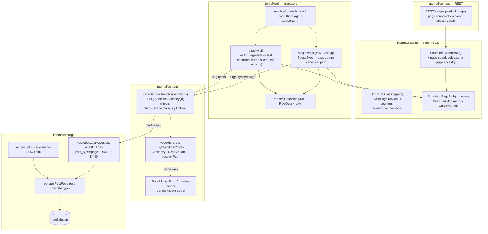

# M15 — hierarchical page URLs: Design

## Overview

Six facts about the code as it stands set this milestone's shape.

**M9b already built the whole nested-walk machine for terms, and M15 is that
machine retargeted from `term_taxonomy.parent` to `post_parent`.** The category
path travels a fixed route: `Structure.Classify`
(`internal/routing/classify.go:65`) turns a request path into a
`Target{Kind, Segments, …}`; `resolve` (`internal/web/handlers.go:65`)
dispatches on `t.Kind`; `categoryArchive` (`internal/web/handlers.go:300`) calls
`terms.CategoryArchive(ctx, t.Segments, …)`, which loads a `TermHierarchy`
(`content.LoadTermHierarchy`, `internal/content/archive.go:94`), walks the
segments with `ResolvePath` (`archive.go:149`), and on a failed walk returns a
`*CategoryMovedError` carrying the resolved term's `Ancestry`
(`archive.go:251`); the handler then 301s to
`permalinks.CategoryPath(moved.Ancestry)` via `redirectCanonical`
(`handlers.go:137`), and on a successful walk builds the canonical from the
RESOLVED term's own ancestry as a fixed point. Every element of M15 is the page
analogue of one of these, over `post_parent` on `post_type = 'page'` rows
instead of `term_taxonomy.parent` on term rows (D2, D3). M15 invents no new
algorithm; it mirrors a validated one.

**`Structure.Canonical` is pure and cannot walk `post_parent` — so the page
ancestry is built by a new pure path constructor that takes an
already-walked ancestry, exactly as `CategoryPath` does.** `Canonical`
(`internal/routing/routing.go:408`) is a pure function of one `domain.Post`: it
reads `p.Slug`, `p.ID`, and `p.Date`, and for a flat/segment-less structure
returns `"/" + p.Slug`. It performs no database read and holds no graph, so it
physically cannot discover a page's ancestors — reaching an ancestor means
reading ancestor rows, which `Canonical` has no means to do. The precedent for
this exact situation is `CategoryPath(ancestry []string)`
(`routing.go:537`): a PURE path builder that takes a root-first slug ancestry
the *caller* already walked and assembles `/{a}/{b}/…/` with the structure's
trailing-slash rule. M15 adds `Structure.PagePath(ancestry []string)` in the
same mold — a pure builder fed a walked ancestry — and leaves `Canonical`
otherwise alone. The one change to `Canonical` is a single guard at its top: a
`page` delegates to the page-ancestry path rather than the structure's post
shape (D1, D4). The routing package stays pure (no storage, no HTTP), depending
only on reading `domain.Post` fields.

**The classifier is pure and total, so it cannot know whether a path's segments
name real pages — it must classify by shape and let the handler's walk produce
the 301 or 404, exactly as it does for categories.** `Classify`
(`classify.go:65`) evaluates a fixed precedence table top-to-bottom, first match
wins, and makes "no claim that a segment names anything" — the category rows set
`Target.Segments` and the handler's walk is what later 301s or 404s. A nested
page path has an arbitrary segment count, inexpressible in a chi pattern
(`internal/web/router.go:225-277`), the same property that forced the nested
category to be a wildcard. So M15 adds a `KindPage` row that claims the
remaining multi-segment, non-archive, non-post paths that today fall through to
`KindNone`, carrying `Target.Segments` for the handler to walk — the precise
category pattern (D5, Req 6).

**A top-level page already resolves today, and M15 must not disturb it.** Row 8
of `Classify` — the flat `/{slug}` fallback (`classify.go`) — yields
`KindPost{Ref{Slug}}`, and `single` (`handlers.go:103`) resolves it through
`s.posts.BySlug`, which defaults to `{"post","page"}`
(`PostService.BySlug`, `internal/content/post.go`;
`PostRepo.BySlug`, `internal/storage/wprepo/repo.go:132`). So `/about` already
loads a top-level page, and its canonical under the new page branch of
`Canonical` is `/about/…` → `/about` itself (the one-element ancestry), a fixed
point that does not redirect (Req 1.2, 4.5). The new `KindPage` row therefore
sits AFTER row 8's single-segment claim in effect — it claims only
multi-segment paths — so no top-level page URL changes (D5, Req 6.1).

**The concrete `*PostRepo` already backs a dozen ports from one construction, so
the new page read port is one more method on it exposed as one more `Set`
field.** `PostRepo` is a plain `struct{ db *bun.DB; prefix string }`
(`repo.go` `NewPostRepo`), built once in `storage.New`
(`internal/storage/factory.go`) and assigned to `Posts`, `PostWriter`,
`AdminPosts`, `PostCounter`, `Revisions`, `Scheduled`, and M14's
`PostContentBackfill`/`PostContentUpdater`. The page walk needs only `ID`,
`post_name`, `post_parent`, and `post_status` — all already in `postColumns`
(`repo.go:17-24`), which carries `post_parent` and `post_name` — so the new read
port is a projection SELECT added to `*PostRepo` and wired as a new additive
`Set` field. No new backing type, no migration, no new column, no new capability
(D6, Req 7, 8).

**The real-WordPress-DB fixture harness already walks a parent column over raw
rows for terms, and M15 copies it for pages.** `internal/routing/realdb_test.go`
reads a restored WordPress database read-only, walks `term_taxonomy.parent` over
the raw rows in `realWPAncestry` to derive an expectation independent of the
implementation, counts a nesting census so an all-top-level fixture skips rather
than falsely passes (`realWPNestedCensus`), and round-trips the derived path back
through `Classify`. M15's real-DB nested-PAGE test is the same harness over
`post_parent` on `page` rows (D7, Req 10.4).

The standalone `## Correctness Properties` and `## Error Handling` H2s are
omitted deliberately (matching the 13 and 14 siblings): M15 mirrors M9b's
already-proven walk and adds a fixed set of enumerable routing branches —
top-level page / nested page / flat-leaf-of-a-nested-page / dated-legacy-form /
orphan parent / parent cycle / non-page multi-segment → 404 — not a pure
function over a large input space, so there is no "for all inputs X, P(X)"
statement worth a PBT harness (see Testing strategy). Degradation and
error-posture behavior is folded into the component descriptions below.

This design adds **one `KindPage` classifier row**, **one pure path constructor**
(`Structure.PagePath`) plus a one-line page guard in `Structure.Canonical`, **one
page-ancestry model** (`PageHierarchy`, mirroring `TermHierarchy`) with a
`PageMovedError` (mirroring `CategoryMovedError`), **one page resolution service
path** the handler calls from a new `KindPage` dispatch arm and from `single`'s
page branch, **one additive page read port** on `*PostRepo` exposed as a new
`Set` field, and **one page wildcard route** registered like the nested-category
archive. No migration, no new column, no new capability, no new permalink
construction site (Req 8).

## Architecture



Four edges carry the milestone's argument.

**`CL` gains exactly one row, and its position is the whole correctness story.**
The new `KindPage` row sits AFTER every archive base row (category rows 2-3, tag
row 4, author row 5, date row 6) and AFTER row 7 (the structure's own post shape
via `ParamsFromPath`+`Match`), and BEFORE the row-9 `KindNone` escape hatch. It
claims only a path of **two or more** segments not already claimed above — a
one-segment path stays with row 8's `KindPost` flat fallback, so top-level pages
are untouched (Req 6.1, 6.5). Placing it after the archive rows is what makes an
archive base win over a page slugged like it (D5 collision (a), Req 6.4):
`/category/foo` is claimed by the category rows before the page row is reached,
so the archive owner wins and the requirements record it. Placing it after row 7
is what preserves `KindPost` for real posts (D5 collision (c), Req 6.5): a
multi-segment path that matches the structure's own post shape is already
`KindPost` before the page row runs. A multi-segment path that matches none of
these and resolves to no page produces a 404 through the handler's walk (D5
collision (b), Req 6.3) — the `KindNone`-equivalent outcome, reached by the walk
rather than by the classifier, exactly as a bad nested-category path is.

**`PAGE` and `SING` converge on ONE page-canonical computation, so a nested
page's URL is built the same way no matter which classifier row delivered the
request.** A nested page arrives two ways. A multi-segment request
(`/parent/child/`) is `KindPage` → `resolve` → `page(w,r,t)`, which walks
`t.Segments` through the page graph to the leaf. But the leaf's own slug
requested flat (`/child`) is a single segment → row 8 → `KindPost` → `single`,
which resolves it via `BySlug` and finds a `post.Type == "page"` whose canonical
is the NESTED path — so `single` must 301 it too (Req 5.1). Rather than teach
`single` a second, independent ancestry walk, both paths delegate the
page-canonical construction to the same `PageService`: `page` resolves by
segment walk and `single` (when `post.Type == "page"`) asks the service for the
resolved page's ancestry, and both then build the canonical with
`permalinks.PagePath(ancestry)` and 301 via `redirectCanonical` when
`r.URL.Path` differs. One page-canonical computation, two entry points — the
fixed point holds identically for both (Req 3.5, 5.4).

**`CAN --> PP` and `PL --> CAN` keep a single permalink construction site.**
`Canonical` gains a page guard that, for a `page`, returns the page's nested
ancestry path built by `PagePath`; it is unchanged for a `post` (Req 4.2). Because
`RESTMapper.postLink` (`internal/content/rest.go:234`) already delegates to
`m.permalinks.Canonical(p)`, a page's REST `link` updates for free the moment
`Canonical` learns the page branch (Req 4.4) — provided the mapper can supply the
page's ancestry to `Canonical` (see the REST component below for how the mapper
gains a page-hierarchy reader, mirroring how `TermService` holds one via
`WithHierarchy`). No second page-URL builder is introduced (Req 4.3, 8.5).

**`PS --> RD` loads the page graph from a single read, never a per-level round
trip.** `PageService` loads a `PageHierarchy` from one `ListPages` walk (keyset
paginated for a large table) exactly as `TermService.CategoryArchive` loads a
`TermHierarchy` from one `ListByTaxonomy`, then does the segment walk, the
ancestry, and the recovery against the in-memory graph (Req 2.5, 7.3). The read
port selects `page` rows only and carries just the four fields the walk needs,
leaving every existing `PostRepo` read untouched (Req 7.2, 7.4).

## Capability model

M15 introduces no capability name and makes no new authorization decision (Req
8.2). Page routing reads PUBLISHED pages only, through the same published-only
filters that back every public read today: the segment walk resolves a leaf
through `BySlug`/`PublishedByID`, which apply `post_status = 'publish'` over
`{"post","page"}` (`internal/storage/wprepo/repo.go:132`, `:166`), and the new
page read port that builds the hierarchy selects `page` rows under the same
publish posture (see Req 7.1 below). A visitor can reach only what the published
filters already expose; there is no capability table to reproduce here.

## Components and Interfaces

This milestone adds one classifier row and one pure path builder to
`internal/routing`, a one-line page guard to `Structure.Canonical`, a
`PageHierarchy` and `PageService` plus a `PageMovedError` to `internal/content`,
two dispatch edges in `internal/web` (`resolve`'s `KindPage` arm and `single`'s
page branch), one additive read port on `*PostRepo` exposed as a new `Set` field,
and one wildcard route in `router.go`. No existing `domain` method changes (Req
8.4). The data shapes the components exchange are collected in **Data Models**.

### `routing.KindPage` + the classifier row (Requirements 6, 9)

A new `Kind` constant beside the existing six (`classify.go:11-22`), and one new
row in `Classify`'s precedence table.

```go
// Kind gains KindPage. Appended rather than inserted so the existing constants
// keep their values and no table or switch keyed on the old order shifts.
const (
	KindNone Kind = iota
	KindPost
	KindCategory
	KindTag
	KindAuthor
	KindDate
	KindPage // M15: a multi-segment path the handler walks through the page graph
)
```

The row is added to `Classify` (`classify.go:65`) between row 7 (the structure's
own post shape) and row 8 (the flat `/{slug}` fallback), guarded to fire only for
a path of two or more segments:

```go
	// Row 7 -- the structure's own post shape (unchanged). A real post URL
	// stays KindPost, so page classification never shadows post resolution
	// (Req 6.5, D5 collision (c)).
	if params, ok := s.ParamsFromPath(path); ok {
		if ref, ok := s.Match(params); ok {
			t.Kind = KindPost
			t.Post = ref
			return t
		}
	}

	// Row 7.5 (M15) -- a nested page path. Two-or-more segments not claimed by
	// any archive base above (those rows win, Req 6.4 / D5 collision (a)) and not
	// matching the structure's own post shape (row 7 won, Req 6.5). The
	// classifier makes NO claim these segments name a real page (Req 6.2); it
	// carries them as Target.Segments and the handler's walk produces the 301 or
	// the 404 (Req 3, D5 collision (b)). A ONE-segment path is deliberately not
	// claimed here -- it falls to row 8 so a top-level page keeps resolving at
	// /{slug} exactly as today (Req 1.2, 6.1, 9.5).
	if len(segs) >= 2 {
		t.Kind = KindPage
		t.Segments = slices.Clone(segs)
		return t
	}

	// Row 8 -- the flat /{slug} fallback (unchanged). A top-level page and a
	// nested page's leaf slug both arrive here as KindPost; single() sorts out
	// which is a page needing a nested canonical (see single() below).
	if len(segs) == 1 {
		// ... unchanged date-shape narrowing, then KindPost{Ref{Slug: segs[0]}}
	}

	// Row 9 -- KindNone. Now reached only by the home "/" (handled earlier) and
	// by paths the rows above all declined; a multi-segment non-page path no
	// longer ends here directly -- it is KindPage whose walk 404s (Req 6.3).
```

Three collision outcomes are pinned by this placement, satisfying D5 and Req 6.4:

- **Page slug equals an archive base** (e.g. a page slugged `category`): the
  archive base row is earlier, so the archive owner wins the path and the page at
  that slug is unreachable by that URL. This is the same documented consequence
  the category/tag/author base rows already carry ("a post slugged identically to
  one of those base segments is unreachable", `classify.go` row-4 comment); the
  requirements record the archive owner as the winner.
- **Multi-segment path that is neither a nested page nor an archive nor a post
  shape**: classified `KindPage`, walked by the handler, resolves to no page →
  404. The `KindNone` escape hatch is preserved in outcome (a 404), reached via
  the walk rather than the classifier, exactly as a wrong nested-category path
  404s/301s through `categoryArchive` rather than through `Classify`.
- **A real post under the configured structure**: claimed by row 7 before the
  page row, so `KindPost` precedence is untouched (Req 6.5).

Because precedence lives in `Classify` and every content pattern dispatches to
the one `resolve` handler, chi's silent last-registered-wins at a parameter node
(`router.go:225-277`) has no observable effect (Req 9.3) — the page wildcard is
just one more pattern pointed at `resolve`.

### `routing.Structure.PagePath` (Requirements 1, 4)

A new PURE method on `Structure`, placed beside `CategoryPath`
(`routing.go:537`) and modeled on it. It builds the page's nested slug path from
an already-walked, root-first ancestry, applying ONLY the structure's
trailing-slash rule — no front, no structure tokens, because a page is EXEMPT
from `permalink_structure` (D1, Req 1.1, 1.4).

```go
// PagePath builds the canonical path for a page from its root-first slug
// ancestry, which ends in the page's own slug (self-inclusive leaf). A page is
// EXEMPT from permalink_structure (Req 1.1, 1.4), so -- unlike CategoryPath --
// PagePath adds NO front and NO archive base: the path is exactly the ancestry
// slugs, with the structure's trailing slash. A top-level page is the
// one-element case and yields "/{slug}" (plus trailing slash per the structure),
// matching Req 1.2 / 4.5 and today's flat behavior byte for byte.
//
// An empty ancestry yields "" rather than "/", mirroring CategoryPath's
// empty-ancestry guard: the handler treats "" as "no servable canonical" and
// 404s, so a page the walk could not place does not redirect to the site root.
func (s Structure) PagePath(ancestry []string) string {
	if len(ancestry) == 0 {
		return ""
	}
	var b strings.Builder
	for _, slug := range ancestry {
		b.WriteByte('/')
		b.WriteString(slug)
	}
	if s.TrailingSlash {
		b.WriteByte('/')
	}
	return b.String()
}
```

This is PagePath rather than an overload of `Canonical` for the reason stated in
the Overview: `Canonical` is pure and cannot walk `post_parent`, while `PagePath`
takes the ancestry the caller already walked — the identical division of labor
`CategoryPath` has with the term walk. `TrailingSlash` is read off the structure
(the same field `CategoryPath` consults via `archivePath`), so a flat structure
yields `/about` and a trailing-slash structure yields `/about/` (Req 4.1, 4.5).

### `routing.Structure.Canonical` — the page guard (Requirement 4)

`Canonical` (`routing.go:408`) gains a single guard at its top and is otherwise
byte-for-byte unchanged, so a `post`'s permalink is exactly what it is today (Req
4.2).

```go
func (s Structure) Canonical(p domain.Post) string {
	// M15: a page is exempt from permalink_structure; its canonical is its
	// nested post_name ancestry (D1, D4, Req 4.1). Canonical is pure and cannot
	// walk post_parent, so the ancestry must be resolved by the caller and
	// supplied on the post. See "Supplying page ancestry to Canonical" below.
	if p.Type == "page" {
		return s.PagePath(pageAncestryFor(p))
	}
	if s.Flat || len(s.segments) == 0 {
		return "/" + p.Slug
	}
	// ... unchanged post branch (tokens, trailing slash) ...
}
```

**Supplying page ancestry to `Canonical` without breaking its purity.**
`Canonical`'s signature takes one `domain.Post` and nothing else, and keeping it
pure is a load-bearing property (the no-redirect-loop guarantee follows from it).
Two honest options exist and the design picks the second:

- **(rejected)** widen `Canonical`'s signature to take an ancestry or a graph —
  this ripples through every `Canonical` caller (the handler, the REST mapper,
  the fixed-point tests) and couples a pure routing function to a content-layer
  graph.
- **(recommended)** the ancestry is carried on the already-resolved
  `domain.Post` the caller hands `Canonical`. A page the handler or REST mapper
  has already resolved travels with its walked ancestry attached (a transient
  field populated by the page resolution path, see Data Models), and
  `pageAncestryFor(p)` reads it. For a top-level page with no attached ancestry,
  it degrades to the one-element `[]string{p.Slug}`, so `Canonical` of a bare
  page is `/{slug}` and never empty (Req 1.2, 4.5). This keeps `Canonical` a pure
  function of its single argument — the argument simply now carries the walked
  ancestry the page branch needs, the same way a term archive hands
  `CategoryPath` an ancestry the caller walked.

This is the one subtlety D4 forces: the single construction site stays single
and pure, and the walk that feeds it lives entirely in the content layer.

### `content.PageHierarchy` (Requirements 2, 3, 7)

A new type in `internal/content` (a new `pagehier.go`, so `archive.go` stays
term-focused), mirroring `TermHierarchy` field-for-field but over page rows. It
is built from one read of the page graph and exposes the same three walks.

```go
// PageHierarchy indexes the page graph for the M15 ancestry and segment walks,
// the page analogue of TermHierarchy (internal/content/archive.go). It is built
// from a single PageReader read (Req 2.5, 7.3), never a per-level query.
type PageHierarchy struct {
	byID     map[int64]domain.PageNode // every page row, by ID
	children map[int64][]int64         // parent ID -> child IDs, ID-ordered
	roots    []int64                   // post_parent == 0, plus orphan-parented pages
}

// LoadPageHierarchy reads every page row via the additive PageReader port and
// indexes it, mirroring LoadTermHierarchy (archive.go:94). Exactly one read
// (paginated under a stable ID cursor for a large pages table), not one per
// level (Req 2.5, 7.3). A page whose post_parent is absent from the graph is a
// root -- the orphan rule, identical to the term loader's (Req 2.3).
func LoadPageHierarchy(ctx context.Context, r domain.PageReader) (*PageHierarchy, error)

// Ancestry returns the root-first slug path for a page ID, ending in the page's
// own slug (self-inclusive leaf, Req 2.2). It is TermHierarchy.Ancestry
// (archive.go:251) retargeted to post_parent: the SAME visited-set degradation
// -- an orphan parent terminates the walk yielding the shorter resolvable path
// (Req 2.3), and a parent cycle terminates on the first already-visited page
// (Req 2.4). Returns nil when id names no page in the graph.
func (h *PageHierarchy) Ancestry(id int64) []string

// ResolvePath walks a request's segments through the graph to the leaf page,
// matching each segment against the slugs of the current level's pages, starting
// from roots -- the page analogue of TermHierarchy.ResolvePath (archive.go:149).
// Resolving by path (not by final slug) is what lets two pages share a slug under
// different parents, each reachable at its own path. Reports false for an empty
// list or any segment that matches nothing.
func (h *PageHierarchy) ResolvePath(segments []string) (domain.PageNode, bool)

// recoverPath is what a failed ResolvePath means: it looks the FINAL segment up
// anywhere in the graph and returns a *PageMovedError carrying that page's
// canonical ancestry (so a flat or wrong-ancestor page URL 301s instead of
// 404ing), or domain.ErrNotFound when the final segment names no page -- the
// page analogue of TermHierarchy.recoverPath, including the equal-ancestry
// corruption guard that 404s rather than 301ing a cycle-trapped page to itself.
func (h *PageHierarchy) recoverPath(segments []string) error
```

The graph is loaded over `domain.PageNode` — a lean row (`ID`, `Slug`,
`ParentID`, `Status`), not a full `domain.Post` — because the walk needs only
those four fields and D6/Req 7 ask for a projection, not a full-column round
trip. A lean node also keeps the hierarchy independent of the body columns a
`domain.Post` carries, so a large pages table indexes cheaply (see Data Models).

### `content.PageMovedError` (Requirements 3, 5)

A new error type beside `CategoryMovedError` (`archive.go:49`), carrying the
resolved page's canonical ancestry so the handler can 301 to it. Like
`CategoryMovedError`, it deliberately does NOT wrap `domain.ErrNotFound`, so
forgetting the recovery arm cannot silently 404 every legacy page URL — it
surfaces as a loud 500 instead.

```go
// PageMovedError reports that a page path's segment walk failed while its final
// segment names a page somewhere in the graph, and carries that page's canonical
// ancestry so the caller redirects to it (Req 5.1, 5.2). It is the page analogue
// of CategoryMovedError (internal/content/archive.go:49); callers match it with
// errors.As. It does NOT wrap domain.ErrNotFound, by the same deliberate design.
type PageMovedError struct {
	Page     domain.PageNode
	Ancestry []string // root-first slug path, the 301 target built by PagePath
}

func (e *PageMovedError) Error() string {
	return "content: page " + strings.Join(e.Ancestry, "/") + " requested at a non-canonical path"
}
```

### `content.PageService` (Requirements 3, 4, 5)

A small service mirroring `TermService.CategoryArchive`'s shape
(`internal/content/term.go`), opted into a page reader the way `TermService`
opts into a taxonomy reader via `WithHierarchy`. It is the single home of the
page walk for both handler entry points and for the REST mapper, so there is one
page-ancestry computation (Req 4.3).

```go
// PageService resolves nested page paths and page ancestries over post_parent.
// It holds a PageReader (the additive page graph read port) the way TermService
// holds a TermReader for CategoryArchive. Published-only: the leaf is confirmed
// through the existing BySlug/PublishedByID published filters (Req 3.4).
type PageService struct {
	pages domain.PageReader // the new additive read port (Req 7)
	posts domain.PostRepository // BySlug/PublishedByID for the published leaf
}

// Resolve walks segments through the page graph to the published leaf page and
// returns the leaf together with its root-first ancestry (the fixed point the
// canonical is built from, Req 3.5). A failed walk whose final segment names a
// page returns a *PageMovedError carrying that page's ancestry (Req 5.1, 5.2);
// a final segment naming nothing returns domain.ErrNotFound (Req 3.3). The leaf
// node from the graph is confirmed published via posts.BySlug before a 200 is
// possible, so a draft/private page in the graph resolves to not-found exactly
// as today (Req 3.4).
func (s *PageService) Resolve(ctx context.Context, segments []string) (domain.Post, []string, error)

// AncestryFor returns the root-first slug ancestry of an already-resolved page
// (by ID), for the flat-leaf 301 path in single() and for the REST link. It is
// the one place single() and the REST mapper obtain the nested canonical, so
// both converge on the same computation as Resolve (Req 3.5, 5.1, 4.4).
func (s *PageService) AncestryFor(ctx context.Context, id int64) ([]string, error)
```

Mirroring `TermService.CategoryArchive` exactly: load the graph once, `ResolvePath`,
on `!ok` return `recoverPath(segments)`, else build the fixed-point ancestry with
`h.Ancestry(leaf.ID)`. The published confirmation uses the existing post reads
(`internal/content/post.go`), so page resolution inherits today's published-only
behavior with no new filter (Req 3.4).

### Web handlers: `resolve`, `page`, and `single` (Requirements 3, 5, 9)

`resolve` (`handlers.go:65`) gains one dispatch arm; a new `page` handler mirrors
`categoryArchive` (`handlers.go:300`); and `single` (`handlers.go:103`) gains a
page branch so a nested page's flat leaf 301s to its nested canonical.

```go
// resolve: one new arm beside the existing five.
	case routing.KindPage:
		return s.page(w, r, t)

// page serves a nested page path, the page analogue of categoryArchive
// (handlers.go:300). Segments come from the classifier because a nested page
// path's segment count is inexpressible in a chi pattern (Req 9.4); the route is
// a wildcard rooted at the page base.
//
// content.PageMovedError is the Req 5.1/5.2 recovery arriving here: the segment
// walk failed but the final segment named a page, so the published URL 301s to
// that page's canonical ancestry instead of 404ing. errors.As rather than
// errors.Is because the ancestry travels with the error and is what the redirect
// target is built from (PageMovedError does not wrap ErrNotFound, so a forgotten
// arm is a loud 500, not a silent 404 of every legacy page URL).
func (s *Server) page(w http.ResponseWriter, r *http.Request, t routing.Target) error {
	leaf, ancestry, err := s.pages.Resolve(r.Context(), t.Segments)
	var moved *content.PageMovedError
	if errors.As(err, &moved) {
		return s.redirectCanonical(w, r, s.permalinks.PagePath(moved.Ancestry))
	}
	if err != nil {
		return err
	}
	// Canonical built from the RESOLVED leaf's own ancestry -- a fixed point, so
	// a request already at it renders rather than redirecting to itself (Req 3.5,
	// 5.4). The flat /{slug} leaf and the old dated form both differ from it and
	// 301 here; the query string rides across raw via redirectCanonical.
	canonical := s.permalinks.PagePath(ancestry)
	if r.URL.Path != canonical {
		return s.redirectCanonical(w, r, canonical)
	}
	return s.renderSingle(w, r, leaf) // kind "page" by post.Type (handlers.go)
}
```

`single` (row 8's `/{slug}` → `KindPost`) resolves a top-level page AND a nested
page's leaf slug. Today it 301s only when `Canonical(post) != r.URL.Path`; M15
makes that comparison correct for a page by routing the page's canonical through
the same `PageService` computation:

```go
func (s *Server) single(w http.ResponseWriter, r *http.Request, t routing.Target) error {
	ctx := r.Context()
	post, err := s.resolveSingle(ctx, t.Post)
	if err != nil {
		return err
	}

	// M15: a page's canonical is its nested ancestry, not the post-shape
	// Canonical. Both a top-level page (/about) and a nested page's flat leaf
	// (/child, which is actually /parent/child/) arrive here as KindPost. Ask
	// the one page-ancestry computation for the canonical so single() and page()
	// never disagree (Req 5.1, 5.4). A top-level page's ancestry is [slug], so
	// its canonical is /about -- a fixed point, no redirect (Req 1.2, 4.5). A
	// nested leaf's canonical is the nested path, so single() 301s to it, query
	// preserved raw (Req 5.1, 5.3).
	if post.Type == "page" {
		ancestry, err := s.pages.AncestryFor(ctx, post.ID)
		if err != nil {
			return err
		}
		canonical := s.permalinks.PagePath(ancestry)
		if r.URL.Path != canonical {
			return s.redirectCanonical(w, r, canonical)
		}
		return s.renderSingle(w, r, post)
	}

	// Unchanged post path: Canonical is the single construction site.
	if canonical := s.permalinks.Canonical(post); r.URL.Path != canonical {
		return s.redirectCanonical(w, r, canonical)
	}
	return s.renderSingle(w, r, post)
}
```

This is the resolution of the one genuinely subtle collision (D5, Req 5.1): the
flat leaf and the multi-segment nested path both end at `PagePath(ancestry)` for
the same page, computed by the same service, so there is exactly one page
canonical and the 301 targets cannot diverge. The old dated form
(`/2024/05/17/about/`) is handled by row 7 or the date rows depending on the
structure; whichever delivers it, the page's canonical is the nested path and the
handler 301s to it (Req 5.2) — and because a page no longer takes the post-shape
`Canonical` branch, no dated canonical is ever produced for a page (Req 1.4).

### REST `RESTMapper.postLink` (Requirement 4)

`postLink` (`rest.go:234`) delegates to `m.permalinks.Canonical(p)`, so a page's
`link` updates for free once `Canonical` has its page branch (Req 4.4) — but only
if the `domain.Post` the mapper hands `Canonical` carries the page's walked
ancestry (per the Canonical component above). The mapper therefore gains a
page-hierarchy reader the same way `TermService` gains a taxonomy reader, via a
`WithPages` option mirroring `WithPermalinks`/`WithUploadsBaseURL`
(`rest.go:205-227`), so it can populate a page row's ancestry before building the
link. `userLink` (`rest.go`) already delegates to `AuthorPath` (a `*Path`
builder, not `Canonical`) and is the precedent that a link field may consult a
path builder fed resolved data; `postLink` for a page is the same shape, with
`PagePath` fed the mapper-walked ancestry. A `post`'s `postLink` is unchanged.

### `domain.PageReader` + `wprepo.PostRepo.ListPages` (Requirement 7)

A new additive read port in `internal/domain/repository.go` (beside the M14
`PostContentBackfill`/`PostContentUpdater` at `:476`/`:492`), implemented as a new
method on the existing `*PostRepo` and exposed as a new `Set` field.

```go
// PageReader streams the page rows the M15 ancestry walk needs: {prefix}posts
// rows with post_type = 'page', carrying only ID, slug (post_name), post_parent,
// and post_status -- NOT a full post row (Req 7.1, 7.2). Ordered by ID ascending
// so a paginated read returns every page exactly once (Req 7.3). It is additive
// and changes no existing PostRepo read (Req 7.4, 8.4).
type PageReader interface {
	ListPages(ctx context.Context, afterID int64, limit int) ([]PageNode, error)
}
```

```go
// ListPages reads page rows for the M15 hierarchy (Req 7). post_type = 'page',
// ID keyset cursor for a stable paginated walk, projection of only the four
// fields PageNode carries. No post_status filter here -- the graph must include
// unpublished pages so an ancestry can pass THROUGH a non-published ancestor;
// the LEAF's published status is enforced later by BySlug/PublishedByID
// (Req 3.4). post_parent and post_name are read straight from postColumns
// (repo.go:17-24); no new column (Req 7.5, 8.1).
func (r *PostRepo) ListPages(ctx context.Context, afterID int64, limit int) ([]domain.PageNode, error) {
	var rows []pageNodeRow
	err := r.db.NewSelect().
		TableExpr("?", bun.Ident(r.prefix+"posts")).
		Column("ID", "post_name", "post_parent", "post_status").
		Where("post_type = ?", "page").
		Where("? > ?", bun.Ident("ID"), afterID).
		OrderExpr("? ASC", bun.Ident("ID")).
		Limit(limit).
		Scan(ctx, &rows)
	if err != nil {
		return nil, err
	}
	return toDomainPageNodes(rows), nil
}
```

`bun.Ident("ID")` quotes the primary key for cross-vendor correctness, matching
the M14 projection reads in the same file; `post_name`/`post_parent`/`post_status`
are ordinary lowercase columns needing no quoting. Keyset pagination on the
immutable `ID` (not `OFFSET`) is chosen so the walk returns every page exactly
once with none dropped or duplicated (Req 7.3), the same cursor discipline M14's
`BackfillPage` uses. One concrete `*PostRepo` gains one more method and one more
`Set` field in `storage.New` (`internal/storage/factory.go`), reusing the single
`posts := wprepo.NewPostRepo(...)` already built there — no new backing type, no
new connection (D6, Req 8.4):

```go
// in storage.Set, beside PostContentBackfill/PostContentUpdater:
//   PageReader domain.PageReader // M15 page-graph read for the post_parent walk
// in New(cfg), reusing the single posts instance:
//   PageReader: posts,
```

### `web` wiring guard (Requirement 9)

The page wildcard route is registered from `contentPatterns`
(`internal/web/router.go`), which already emits the nested-category wildcard, so
`contentPatterns` appends the page wildcard pattern alongside the archive
wildcards, all pointed at `s.resolve` (Req 9.1, 9.2). Because the page route is
not opt-in (it is registered from the structure like `/category/*`), a server
whose `PageService` has no page reader would 500 on its first nested-page
request. `requireArchiveDeps` (`router.go`) is the precedent that turns such a
wiring gap into a startup panic naming the fix; M15 extends it with a page-reader
check in the same shape:

```go
// alongside the existing HasHierarchy / HasAuthors guards:
//   if s.pages == nil { panic("web: Routes registers the page wildcard but the
//       PageService is nil: call ... .WithPages(repos.PageReader), or every
//       nested-page request will 500") }
```

The page wildcard carries an arbitrary segment count (Req 9.4), so the handler
derives `t.Segments` from `r.URL.Path` via `Classify` exactly as `categoryArchive`
does, and the route coexists with the flat `/{slug}` fallback that still serves
top-level pages (Req 9.5).

## Data Models

M15 adds NO table, column, or migration (D6, Req 8.1): `post_parent` and
`post_name` already live in `postColumns` (`internal/storage/wprepo/repo.go:17-24`).
This is called out explicitly because "hierarchical URLs" might be assumed to
need schema support; they do not. The only new shapes are in-memory.

### `domain.PageNode` — the lean page row (Requirement 7.1, 7.2)

The read port returns only the four fields the walk needs, not a full
`domain.Post`, so a large pages table indexes cheaply and no body column is
loaded.

```go
// PageNode is the minimal page-graph row the M15 ancestry walk reads: the
// primary key, the slug the segment walk matches on, the parent link the walk
// climbs, and the status the leaf check consults. It is NOT domain.Post -- the
// walk never needs post_content/title/date/etc. (Req 7.2).
type PageNode struct {
	ID       int64  // ID
	Slug     string // post_name
	ParentID int64  // post_parent (0 == top-level)
	Status   string // post_status
}
```

The `wprepo` package scans into an unexported `pageNodeRow` with
`bun:"ID"`/`bun:"post_name"`/`bun:"post_parent"`/`bun:"post_status"` tags and maps
to the domain type via `toDomainPageNodes`, mirroring how `postContentRow` maps to
`domain.PostContentRow` (`repo.go`).

### `content.PageHierarchy` — the indexed graph (Requirements 2, 3)

`byID` (every page by ID), `children` (parent ID → child IDs, ID-ordered for a
vendor-stable tie-break), and `roots` (`post_parent == 0`, plus any page whose
parent is absent from the graph — the orphan-as-root rule). Identical structure
to `TermHierarchy` (`internal/content/archive.go`), loaded from one `ListPages`
walk. There is no stored cursor state and no second table; the cursor the loader
uses to page `ListPages` lives only in the running load.

### `content.PageMovedError` — the 301 carrier (Requirement 5)

Carries the resolved page and its root-first `Ancestry`, the slug path
`PagePath` turns into the 301 target. The analogue of `CategoryMovedError`
(`archive.go:49`), and like it, not a wrapper of `domain.ErrNotFound`.

### Page ancestry attached to a resolved `domain.Post` (Requirement 4)

So `Structure.Canonical` can stay a pure function of its single argument while
still returning a page's nested path, the resolved page carries its walked
ancestry. The recommended carrier is a transient, non-persisted field populated
by the page resolution path (the handler's `page`/`single` and the REST mapper),
read by `Canonical`'s page guard via `pageAncestryFor(p)` and degrading to
`[]string{p.Slug}` when absent (top-level page). This field is a routing/transport
convenience, never written to storage and never part of the `domain` post
reader/writer method set (Req 8.4).

### `Target.Segments` reuse for `KindPage`

`KindPage` carries the full request segment list in the existing
`Target.Segments` field (`classify.go`), the same field `KindCategory` uses. No
new `Target` field is added; the handler's page walk reads `t.Segments` exactly as
`categoryArchive` reads it (Req 9.4).

## Findings

1. **The nested-category pipeline is the exact template, end to end.**
   `Classify` (`internal/routing/classify.go:65`) → `resolve`
   (`internal/web/handlers.go:65`) → `categoryArchive` (`handlers.go:300`) →
   `TermService.CategoryArchive` (`internal/content/term.go`) →
   `LoadTermHierarchy` (`internal/content/archive.go:94`) / `ResolvePath`
   (`:149`) / `Ancestry` (`:251`) / `recoverPath` (`:167`) /
   `CategoryMovedError` (`:49`), with the 301 via `redirectCanonical`
   (`handlers.go:137`) built from `CategoryPath` (`internal/routing/routing.go:537`).
   M15 instantiates each of these over `post_parent` on `page` rows. The algorithm
   is reused, not reinvented (D2, D3, Req 2, 3, 5).

2. **`Structure.Canonical` is pure and cannot walk `post_parent`.**
   `Canonical` (`routing.go:408`) reads only `p.Slug`/`p.ID`/`p.Date` and performs
   no I/O; `CategoryPath` (`routing.go:537`) is the precedent for a pure path
   builder fed a caller-walked ancestry. So M15 adds `PagePath` (a pure builder)
   and a one-line page guard to `Canonical`, rather than teaching `Canonical` to
   read ancestor rows (D1, D4, Req 4.1, 4.3).

3. **A top-level page already resolves at `/{slug}` and must not change.** Row 8
   of `Classify` yields `KindPost{Ref{Slug}}`, and `single`
   (`handlers.go:103`) resolves it through `BySlug` defaulting to
   `{"post","page"}` (`internal/content/post.go`;
   `internal/storage/wprepo/repo.go:132`). The new `KindPage` row claims only
   two-or-more-segment paths, so `/about` stays `KindPost` and its page canonical
   (one-element ancestry) is a fixed point — no redirect, no URL change (Req 1.2,
   6.1, 6.5).

4. **The flat leaf of a nested page is the one real collision, and it resolves in
   `single`.** `/child` (one segment) arrives as `KindPost` → `single`, resolves
   a `post.Type == "page"` whose canonical is the nested path, so `single` must
   301 it (Req 5.1). Routing that 301's canonical through the same `PageService`
   the `KindPage` path uses means both entry points compute one page canonical,
   so the targets cannot diverge (Req 5.4). This is the concrete resolution D5
   asks for.

5. **The classifier row's PLACEMENT encodes every precedence rule D5 lists.**
   After the archive base rows (so an archive base wins a colliding page slug, Req
   6.4), after row 7 (so a real post stays `KindPost`, Req 6.5), before row 8 (so
   a one-segment top-level page is untouched, Req 6.1), claiming the
   multi-segment paths that today reach row-9 `KindNone` (so an unresolvable
   nested path 404s via the walk, Req 6.3). Precedence lives in `Classify`, not
   chi registration order (`internal/web/router.go:225-277`), because every
   content pattern dispatches to one `resolve` (Req 9.3).

6. **`*PostRepo` already satisfies a dozen ports from one construction, and
   `post_parent`/`post_name` are already selected.** `postColumns`
   (`internal/storage/wprepo/repo.go:17-24`) carries both; `storage.New`
   (`internal/storage/factory.go`) builds one `posts := wprepo.NewPostRepo(...)`
   and assigns it to `Posts`, `PostWriter`, …, `PostContentBackfill`,
   `PostContentUpdater`. The new `PageReader` is one more method on that type and
   one more `Set` field — additive, no migration, no new column (D6, Req 7, 8.1,
   8.4).

7. **The read port must NOT publish-filter the graph; only the leaf is
   published-checked.** `ListPages` selects every `page` row regardless of status
   so an ancestry can climb THROUGH a non-published ancestor to a published leaf;
   the leaf's `publish` status is enforced by `BySlug`/`PublishedByID`
   (`repo.go:132`, `:166`) at resolution (Req 3.4). This mirrors how
   `TermHierarchy` loads the whole taxonomy and lets the archive query enforce
   publish, not the graph load.

8. **The real-DB fixture harness already walks a parent column over raw rows.**
   `internal/routing/realdb_test.go` walks `term_taxonomy.parent` in
   `realWPAncestry`, derives the expected path independently, round-trips it
   through `Classify`, and skips (rather than falsely passing) when the fixture
   has no nested example via `realWPNestedCensus`. M15's real-DB nested-PAGE test
   is this harness over `post_parent` on `page` rows (D7, Req 10.4).

## Testing strategy

M15 is routing-and-walk logic over a small, enumerable case space, mirroring code
M9b already proved; property-based testing does not apply (no "for all inputs X,
P(X)" over a large space). The coverage is example-based and contract-based,
matching the sibling milestones and D7/Req 10.

**Routing unit tests (`internal/routing`)** — pure, no DB:
- `PagePath`: a one-element ancestry yields `/{slug}` (and `/{slug}/` under a
  trailing-slash structure); a multi-element ancestry yields the nested path with
  NO front and NO structure tokens; an empty ancestry yields `""` (Req 1.1, 1.2,
  4.1, 4.5).
- `Canonical` page branch: a `page` returns its nested ancestry path and NEVER a
  dated/post-shape path, under flat, dated, day-and-name, and custom structures
  (Req 1.4, 4.1); a `post` is byte-for-byte unchanged (Req 4.2), asserted against
  the existing `Canonical` test vectors.
- `Classify` row placement: a two-plus-segment non-archive non-post path →
  `KindPage` with `Segments` set; an archive base path still → its archive Kind
  (Req 6.4); a post-shape path still → `KindPost` (Req 6.5); a one-segment path
  still → `KindPost` (Req 6.1); the existing per-row category/tag/author/date/post
  tests still pass unchanged (Req 6, regression guard).

**Content unit tests (`internal/content`)** — over an in-memory `PageHierarchy`:
- `Ancestry`: root-first self-inclusive slug path (Req 2.2); orphan parent
  terminates yielding the shorter path (Req 2.3); parent cycle terminates on first
  repeat (Req 2.4) — the same assertions `TermHierarchy.Ancestry` carries,
  retargeted.
- `ResolvePath`/`recoverPath`/`PageMovedError`: a good path resolves the leaf; a
  flat/wrong-ancestor path returns a `PageMovedError` with the canonical ancestry;
  a final segment naming nothing returns `domain.ErrNotFound`; a cycle-trapped
  page's equal-ancestry recovery 404s rather than 301ing to itself (Req 3.3, 5.1,
  5.2).

**Handler tests (`internal/web`)** — Req 10.2, 10.3:
- a nested page canonical renders 200 (fixed point, no redirect);
- the flat `/{slug}` form of a nested page 301s to the nested canonical;
- the old dated form 301s to the nested canonical;
- each redirect asserts the query string is preserved RAW across the 301
  (`redirectCanonical`, `handlers.go:137`);
- an orphan-parent page and a cycle still resolve to a servable canonical rather
  than erroring or looping (Req 10.3).

**Cross-vendor storage contract (`internal/storage/storagetest`)** — Req 10.1:
a new `ListPages`/page-walk contract attached to `RunContract`
(`internal/storage/storagetest/contract.go`) with a nested-page fixture in its own
ID band (the pattern `nested_fixtures.go` establishes for nested categories),
proving the ancestry is a root-first self-inclusive slug path and that the walk
degrades on an orphan parent (shorter path) and a cycle (first-repeat
termination). SQLite always; MySQL/Postgres env-gated through the existing harness
with no new env var.

**Real-WordPress-DB fixture test (`internal/routing`)** — Req 10.4: a
`TestRealWordPressNestedPages`, modeled on `TestRealWordPressNestedCategories`
(`internal/routing/realdb_test.go`), walking `post_parent` over the raw `page`
rows to derive expectations independently, round-tripping each derived nested page
path through `Classify`, and skipping with a precise precondition message when the
fixture has no nested page — the page analogue of `realWPNestedCensus`.

All tests are pure Go over SQLite with no new dependency; `gofmt`, `go vet`,
`go build ./...`, and `go test ./...` are green at the end of every task (Req
10.5, D7).

## Traceability

| Design element | File (target) | Requirements / Decisions |
|---|---|---|
| `KindPage` constant + classifier row (placement after archives & row 7, before row 8; `Target.Segments`) | `internal/routing/classify.go` | Req 6.1-6.5, 9.3-9.5; D5 |
| `Structure.PagePath(ancestry)` pure builder (no front/tokens, trailing slash) | `internal/routing/routing.go` | Req 1.1, 1.2, 1.3, 4.1, 4.5; D1, D4 |
| `Structure.Canonical` page guard; unchanged for posts; pure | `internal/routing/routing.go:408` | Req 4.1, 4.2, 4.3, 4.5; D1, D4 |
| Page ancestry attached to resolved `domain.Post` (keeps `Canonical` pure) | `internal/routing` + `internal/domain` (transient field) | Req 4.1, 8.4; D4 |
| `PageHierarchy` (byID/children/roots; `Ancestry`/`ResolvePath`/`recoverPath`; orphan & cycle degradation) | `internal/content/pagehier.go` | Req 2.1-2.5, 3.1-3.5; D2 |
| `PageMovedError{Ancestry}` (no `ErrNotFound` wrap) | `internal/content/pagehier.go` | Req 5.1, 5.2; D3 |
| `PageService.Resolve` / `AncestryFor` (published leaf; one ancestry computation) | `internal/content/pagehier.go` | Req 3.1-3.5, 4.3, 4.4, 5.1, 5.4; D3, D4 |
| `resolve` `KindPage` arm + `page` handler (fixed-point canonical, moved-error 301) | `internal/web/handlers.go:65`, `:300` | Req 3.1-3.5, 5.1-5.5, 9.1, 9.2, 9.4 |
| `single` page branch (flat-leaf 301 via shared ancestry) | `internal/web/handlers.go:103` | Req 5.1, 5.3, 5.4; D5 |
| `redirectCanonical` reuse (301, RawQuery raw) | `internal/web/handlers.go:137` | Req 5.3, 5.5; D3 |
| `RESTMapper.postLink` page link via `Canonical` + `WithPages` reader | `internal/content/rest.go:234`, `:205-227` | Req 4.4, 8.5 |
| `domain.PageReader` + `PostNode` projection | `internal/domain/repository.go` (beside `:476`) | Req 7.1, 7.2, 8.4 |
| `wprepo.PostRepo.ListPages` (page rows, ID keyset, projection, no new column) | `internal/storage/wprepo/repo.go` (`postColumns` `:17-24`) | Req 7.1-7.5, 8.1 |
| New `PageReader` `Set` field, reusing single `*PostRepo` | `internal/storage/factory.go` | Req 7, 8.4; D6 |
| Page wildcard route + `requireArchiveDeps`-style page-reader guard | `internal/web/router.go` (`contentPatterns`, `requireArchiveDeps`) | Req 9.1-9.5, 8.3 |
| `domain.PageNode` lean row; no table/column/migration | `internal/domain`, `internal/storage/wprepo/repo.go` | Req 7.1, 7.2, 8.1 |
| Cross-vendor `ListPages`/walk contract; handler 200/301/degradation; real-DB nested-page fixture | `internal/storage/storagetest`, `internal/web`, `internal/routing/realdb_test.go` | Req 10.1-10.5; D7 |
