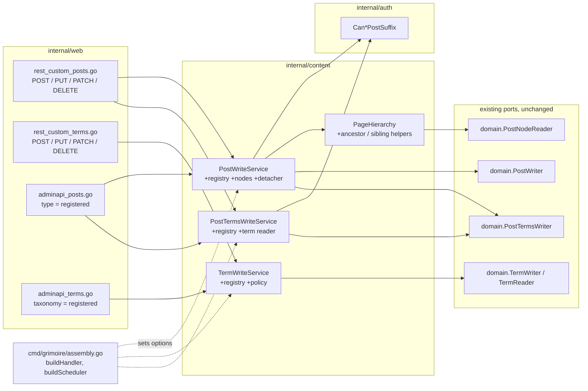
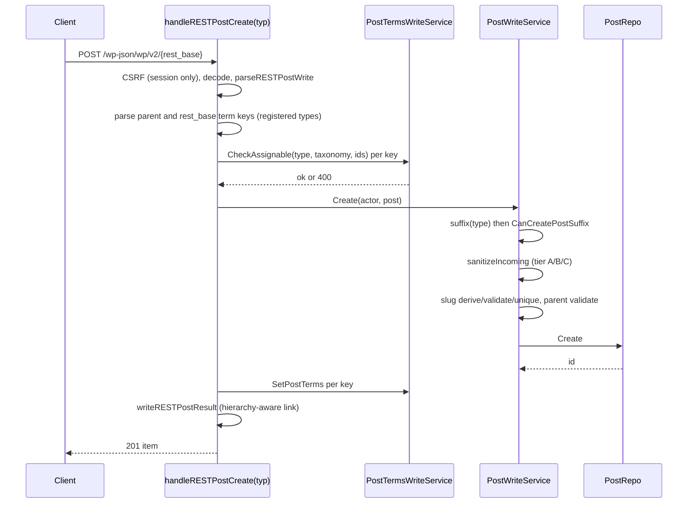

# M17 — Custom post type and taxonomy write (roadmap 12.C): Design

## Overview

M12 built the registry and every read. M17 turns the same registry into a write
policy. The write chain below it already exists and is already parameterized by
type or taxonomy, so the milestone is small in new machinery and large in
guards: seven findings about the current code set its shape. Where the
brief and the code disagree, the code wins and the disagreement is named.

**1. The REST handlers are already generic; only the registration is
missing.** `handleRESTPostCreate(typ)`, `handleRESTPostUpdate(typ)` and
`handleRESTPostDelete(typ)` (`internal/web/rest_posts.go:349,398,471`) and
`handleRESTTermCreate(taxonomy)`, `handleRESTTermUpdate(taxonomy)` and
`handleRESTTermDelete(taxonomy)` (`internal/web/rest_terms.go:254,305,359`) take
the type or taxonomy as a closure argument. `registerRESTCustomPosts` and
`registerRESTCustomTerms` currently bind `restNotImplemented` in their place.
`mapRESTPost` already dispatches a registered type to `RESTMapper.CustomPost`
(`rest_posts.go:570-596`), and `restTermLink`/`restTermGraph` already handle
registered taxonomies (`rest_terms.go:90,138`).

**2. Capability derivation is the one thing that is wrong for custom types
today.** `CanCreatePost`, `CanEditPost` and `CanDeletePost` call `capSuffix`,
which returns `"pages"` for `page` and `"posts"` for everything else
(`internal/auth/policy.go:11-16`). Enabling the existing handlers without
changing this would let any `edit_posts` holder write a type whose
`capability_type` is `"product"`. Requirement 23.4 forbids exactly that. The
read gate already does it right: `canReadUnpublished` uses
`edit_`+`auth.CapabilitySuffix(pt.CapabilityType)` (`rest_posts.go:208-216`).

**3. No path writes `post_parent` for any post type.** `PostRepo.Create/Update`
write the column (`internal/storage/wprepo/writers.go:54-59,95`), but
`PostWriteService.Update` merges onto the stored row and never copies
`p.ParentID` (`writeservices.go:236-272`), and neither request DTO carries a
parent. Hierarchical custom URLs (M12/M15) are therefore unreachable by API
until M17 adds the field, the guard, and the graph primitive.

**4. The M13 term guard is category-only.** `validateParent` rejects a non-zero
parent for anything but `category` (`writeservices.go:358`), so a hierarchical
custom taxonomy could not be nested even with the routes enabled.

**5. Three vocabularies are open.** The admin term create takes any `taxonomy`
string (`adminapi_terms.go:86`); `applyTermIDs` takes any taxonomy key
(`adminapi_posts.go:212`); `SetPostTerms` validates neither the taxonomy nor
that the term belongs to it (`postterms.go:35`). For built-ins this is the
legacy-allowed set and stays. For registered types M17 closes it.

**6. Delete leaves term rows behind.** `PostRepo.Delete` is a single
`DELETE FROM {prefix}posts` (`writers.go:104-114`). `term_relationships` rows
and `term_taxonomy.count` are not touched. For registered types M17 detaches
terms first. For built-ins it records the gap and changes nothing.

**7. The assembly sets none of this.** `buildHandler` builds the three write
services without a registry (`cmd/grimoire/assembly.go:111,122-123`), and
`main` builds the scheduler with a fixed principal that holds only the
`*_posts` capabilities (`internal/scheduler/scheduler.go:50-54`; the call is at
`cmd/grimoire/main.go:159`). A scheduled custom post would fail
`CanEditPost` and log an error every tick. M17 ships each service option with
its `buildHandler` edit and test.

**Design in one paragraph.** Add suffix-taking policy functions to `auth`; give
the three write services a registry option each; add a post-type-aware
validation block to `PostWriteService` (slug, parent, term detach) that runs
only for registered types; generalize `TermWriteService.validateParent` and add
slug/name/vocabulary checks for registered taxonomies; register the existing
REST handlers on the custom routes; teach the admin API to accept a registered
`type`/`taxonomy`; and wire everything in `buildHandler`. Four pull requests,
each a complete increment, listed under "Delivery".

## Architecture



**Layering.** `auth` stays pure. `content` imports `registry` (it already does,
for `RESTMapper.WithRegistry`). `web` calls `content` services and reads the
registry only for routing and for body parsing. No storage port gains a method.

**Request flow, REST create of a registered post type.**



**Order of checks in every write, fixed once.** Authentication and CSRF, then
parse/shape (400), then existence and type (404, REST update/delete only), then
**capability (403)**, then value validation (sanitize, slug, parent, taxonomy;
400), then write. This keeps M13's rule that an unauthorized caller sees `403`
before any `400`, and the existing REST asymmetry that existence is checked
before authorization (`rest_posts.go:389-397`). Term-assignment pre-validation
in the REST handler is the one exception: it runs before `Create`, so it needs
the actor's capability first; `CheckAssignable` therefore takes the principal
and returns `ErrForbidden` before it reads anything.

## Capability model (Requirement 7)

```go
// internal/auth/policy.go (additive)
func CanCreatePostSuffix(actor Principal, suffix, status string, authorID int64) bool
func CanEditPostSuffix(actor Principal, suffix, status string, authorID int64) bool
func CanDeletePostSuffix(actor Principal, suffix, status string, authorID int64) bool
// CanCreatePost(actor, postType, ...) == CanCreatePostSuffix(actor, capSuffix(postType), ...)
```

The three existing bodies move into the suffix variants verbatim and the
existing functions become one-line delegations, so built-in results cannot
change (Requirement 15.3). A table test pins that for `post`, `page` and an
unregistered name across every role and status.

`PostWriteService.suffixFor(typ)` returns `auth.CapabilitySuffix(pt.CapabilityType)`
when `typ` is registered and not `post`/`page`, and the legacy `capSuffix`
result otherwise. A registered type with `capability_type: post` therefore
yields `"posts"` and the same decisions as `post` (Requirement 7.2). The check
uses the **stored** row's type on update and delete, as `Update`/`Delete`
already load `cur` before deciding.

Taxonomy writes stay on `manage_categories` (`auth.CanManageTerms`). The
registry has no per-taxonomy capability and adding one would add a capability
name (Requirement 16.2). WordPress's `manage_terms`/`edit_terms`/`delete_terms`
default to `manage_categories` for the same reason.

## Components and Interfaces

### `auth` (Requirement 7)

Add `CanCreatePostSuffix`, `CanEditPostSuffix`, `CanDeletePostSuffix` as above.
No other change.

### `content` sentinels (Requirements 3, 4, 9, 11, 12)

Beside `ErrForbidden`, `ErrTitleEmpty`, `ErrTermParentCycle` and
`ErrTermParentInvalid`:

| Sentinel | Raised when | Web mapping |
|---|---|---|
| `ErrPostParentInvalid` | non-zero parent on a flat registered type; parent absent or of another type | `400` |
| `ErrPostParentCycle` | parent is the row or a descendant | `400` |
| `ErrSlugInvalid` | post slug outside `^[a-z0-9][a-z0-9_-]*$` | `400` |
| `ErrTermSlugInvalid` | term slug outside the same charset | `400` |
| `ErrTermSlugTaken` | sibling-set duplicate | `400` (`term_exists` on REST) |
| `ErrTermNameEmpty` | name empty after `PostTitle` sanitization | `400` |
| `ErrTaxonomyUnknown` | create in a taxonomy neither built-in nor registered | `400` |
| `ErrTaxonomyNotAttached` | assignment to a taxonomy not attached to the post's type | `400` on REST, `partial` entry on admin |
| `ErrTermInvalid` | assignment of an id that is not a term of the taxonomy | `400` |

### `content.PostWriteService` (Requirements 6-11, 13)

New options, each a `PostWriteOption`:

```go
func WithPostRegistry(r *registry.Registry) PostWriteOption
func WithPostNodeReader(n domain.PostNodeReader) PostWriteOption   // slug + parent graph
func WithTermDetacher(w domain.PostTermsWriter) PostWriteOption    // delete cleanup
```

Each is `nil`-safe and absent means the legacy path. The service gains one
unexported helper, `registered(typ) (registry.PostType, bool)`, true only for a
registry entry that is not `post`/`page`. Every M17 branch below is guarded by it,
so built-in rows never enter new code.

**`Create`** (registered branch, after the existing capability check and
`sanitizeIncoming`): `resolveSlug` then `validateParent`. The title used for
derivation is the **sanitized** title.

**`Update`** (registered branch): same two steps against `cur`; the merged
`cur.ParentID = p.ParentID` assignment runs only when `p.ParentID != cur.ParentID`
and only for a hierarchical type, and `validateParent` runs only then
(Requirement 11.6). `cur.Slug` is replaced by the resolved slug.

**`resolveSlug(ctx, pt, id, parentID, slug, title)`**:

1. `slug == ""` and `title != ""` → `Slugify(title)`; both empty → leave empty
   (a draft without a title, as today).
2. Non-empty slug must match `slugRE`, else `ErrSlugInvalid`.
3. Load `LoadPageHierarchy(ctx, typedNodeReader{nodes, pt.Name})` once and ask
   `h.slugTaken(parentID, candidate, id, pt.Hierarchical)`; on a hit try
   `candidate-2`, `-3`, … up to a fixed bound of 1000, then `ErrSlugInvalid`.
   The sibling set is `parentID`'s children for a hierarchical type and every
   node for a flat type. `id` is excluded so an unchanged slug never collides
   with itself (Requirement 9.4). All statuses count, matching the node
   reader's no-status-filter contract.

`Slugify` is exported from `content`; the web `termSlugify` stays as is, and a
parity test asserts `termSlugify(x) == content.Slugify(x)` over a table so the
two cannot drift.

**`validateParent(ctx, pt, id, parentID)`** (distinct from the term method of the
same name; named `validatePostParent` in code):

```
parent == 0                         → nil
!pt.Hierarchical                    → ErrPostParentInvalid
parent == id (id != 0)              → ErrPostParentCycle
h := LoadPageHierarchy(typed nodes of pt.Name)
parent ∉ h.byID                     → ErrPostParentInvalid   // absent or other type: one check, the graph is type-scoped
h.isAncestorOrSelf(id, parent)      → ErrPostParentCycle     // id is at or above parent
otherwise                           → nil
```

The "absent or other type" collapse is the same trick as M13's Finding 2: the
node reader is type-scoped, so graph membership is exactly "exists in this
type". `PageHierarchy.isAncestorOrSelf(ancestor, id)` walks `byID[id].ParentID`
upward with a visited set, so stored corruption terminates instead of looping;
it is the post-graph analogue of `TermHierarchy.DescendantIDs` and shares
`Ancestry`'s visited-set shape (`pagehier.go:116-140`). On create `id == 0`,
which is never in the graph, so only the invalid-parent branches can fire.

**`Delete`** (registered branch, after the capability check and before
`DeleteRevisionsOf`'s successor `w.Delete`): for each taxonomy in `pt.Taxonomies`,
`detacher.SetPostTerms(ctx, id, tax, nil)`. `SetPostTerms` with an empty slice
clears the post's relationships for that taxonomy and recomputes the counts of
every row it touched (`postterms.go`, step 3). Order is revisions, terms, row; a
failure at any step returns before the next and leaves the post intact, the same
rationale as the existing revision-first order (`writeservices.go:280-286`).

### `content.TermWriteService` (Requirements 3, 4)

```go
func WithTermRegistry(r *registry.Registry) TermWriteOption
func WithTermContentPolicy(p *sanitize.Policy) TermWriteOption
func NewTermWriteService(w ..., opts ...TermWriteOption) *TermWriteService   // variadic: existing call sites compile
```

`hierarchical(taxonomy)` is true for `category`, true for a registered
hierarchical taxonomy, false otherwise (`post_tag` and flat registered ones).
`validateParent` replaces `t.Taxonomy != TaxonomyCategory` with
`!s.hierarchical(t.Taxonomy)`. Everything after that line already takes the
taxonomy from `t.Taxonomy` and is unchanged, so built-in results are identical.

`Create` order: `CanManageTerms` → `ErrTaxonomyUnknown` check (built-in or
registered, else reject) → registered-only block (`cleanName`, `checkSlug`) →
`validateParent` → write. `Update` order: `CanManageTerms` → registered-only
block → `validateParent` → write.

`cleanName` runs `policy.SanitizeAt(sanitize.PostTitle, sanitize.TierB, name)`
(the tier is fixed rather than derived from the actor, because term names are
always plain text; an `unfiltered_html` holder must not reach the tier-C bypass)
and returns `ErrTermNameEmpty` on an empty result. `checkSlug` validates the
charset and then reads `ListByTaxonomy(taxonomy)` once and rejects a term with
the same slug, a different id, and the same `ParentID` when the taxonomy is
hierarchical (any `ParentID` when flat). The M9b hierarchy deliberately does not
require globally unique slugs within a hierarchical taxonomy (`archive.go:140`),
so scoping to siblings is both permissive enough for imported data and strict
enough that one URL never names two terms.

When the policy option is absent the service constructs `sanitize.New()`, the
same fail-closed default `NewPostWriteService` uses.

### `content.PostTermsWriteService` (Requirement 12)

```go
func NewPostTermsWriteService(posts postByID, w domain.PostTermsWriter, opts ...PostTermsOption) *PostTermsWriteService
func WithPostTermsRegistry(r *registry.Registry) PostTermsOption
func WithPostTermsReader(r domain.TermReader) PostTermsOption
func (s *PostTermsWriteService) CheckAssignable(ctx, actor, postType, taxonomy string, ids []int64) error
```

`SetPostTerms` for a registered type: capability via the type's suffix, then
`CheckAssignable`'s taxonomy-attached and id-membership rules, then the write.
For `post`/`page`/unregistered rows nothing is added. `CheckAssignable` runs the
same capability check against a **would-be** post (status `draft`, author =
actor, matching `CanCreatePost`'s rule for the create path), because the post
does not exist yet when the REST handler pre-validates. The membership rule is
one `TermsByIDs(ids)` call: every requested id must come back with
`Taxonomy == taxonomy`. Empty `ids` is valid and clears the taxonomy.

### `PageHierarchy` helpers (Requirements 9, 11)

Two unexported methods in `internal/content/pagehier.go`, beside `Ancestry`:
`slugTaken(parentID int64, slug string, exceptID int64, hierarchical bool) bool`
and `isAncestorOrSelf(ancestor, id int64) bool`. Both read the existing
`byID`/`children` maps; neither mutates the graph.

### Web: REST custom posts (Requirements 6, 7, 11, 12, 13)

`registerRESTCustomPosts` replaces four `501` bindings per type:

| Verb and path | Before | After |
|---|---|---|
| `POST /{base}` | 501 | `handleRESTPostCreate(pt.Name)` |
| `PUT /{base}/{id}` | 501 | `handleRESTPostUpdate(pt.Name)` |
| `PATCH /{base}/{id}` | 501 | `handleRESTPostUpdate(pt.Name)` |
| `DELETE /{base}/{id}` | 501 | `handleRESTPostDelete(pt.Name)` |
| `PUT`/`PATCH`/`DELETE /{base}` | 501 | 501 (as `/posts`) |
| `POST /{base}/{id}` | 501 | 501 (as `/posts/{id}`) |

When `s.postWrite == nil` all five stay `501`, the built-in registration's nil
posture. The four handlers gain three edits, each guarded to registered types so
built-in behavior is untouched:

1. **Body extras.** The handlers read the body once into `[]byte`, decode
   `restPostWriteRequest` (gains `Parent *int64 json:"parent"`) and, for a
   registered type, a second decode into `map[string]json.RawMessage` to pull
   the `rest_base` term keys of `pt.Taxonomies`. A key whose value is not
   `[]int64` of positive integers is `400 rest_invalid_param`. `parent` is
   applied to the domain post only when the type is registered (Requirement
   11.9).
2. **Pre-validation, then terms after the write.** `CheckAssignable` per key
   before `Create`/`Update`; `SetPostTerms` per key after. A failure of the
   second step after a successful first is `500 rest_create_failed` /
   `rest_update_failed`, because no transaction spans the post and term services
   (the same limit the admin API reports as `partial`). Pre-validation makes it
   a storage fault, not a user error.
3. **Hierarchy-aware responses.** `writeRESTPostResult` and the delete
   `previous` pass `s.restHierarchy(r, typ)` to `mapRESTPost` instead of `nil`.
   `restHierarchy` already returns `nil` for `post`, `page` and unregistered
   types, so built-in output is byte-identical.

Error mapping adds `ErrPostParentInvalid`/`ErrPostParentCycle`/`ErrSlugInvalid`
→ `400 rest_invalid_param`, beside the existing `ErrTitleEmpty` arm.

`RESTMapper.CustomPost` gains `parent` for hierarchical types so a client can
read back what it wrote: `RESTCustomPost.Parent *int64`, set only when
`pt.Hierarchical`, serialized by the existing custom `MarshalJSON`
(`content/rest.go:391`). Non-hierarchical types and built-ins serialize
unchanged.

`restRouteIndex` lists the new methods (Requirements 2.6, 6.7).

### Web: REST custom terms (Requirements 1-4)

`registerRESTCustomTerms` binds `handleRESTTermCreate/Update/Delete(tax.Name)`
exactly as `registerRESTTerms` does for built-ins, keeping `POST /{id}` and
collection-level `PUT`/`PATCH`/`DELETE` at `501`. The handler error switches
gain `ErrTermSlugTaken` → `400 term_exists`, `ErrTermSlugInvalid`/
`ErrTermNameEmpty`/`ErrTaxonomyUnknown` → `400 rest_invalid_param`. The create
handler already derives a missing slug with `termSlugify` and already carries
`parent`.

### Web: admin API (Requirements 5, 10, 12)

- `parsePostWrite`: the type check becomes `typ == "post" || typ == "page" ||
  registered(typ)`. With no registry the error text is unchanged; with one it
  names the registered types. `postWriteRequest` gains `Parent *int64
  json:"parent"`; the domain post carries it for registered types only (omitted
  on update → `current.ParentID`).
- `postDetailResponse` gains `Parent int64 json:"parent,omitempty"`, populated
  for registered types only.
- `resolvePostTerms` iterates `pt.Taxonomies` for a registered post and
  `adminKnownTaxonomies` otherwise.
- `isKnownAdminTaxonomy` becomes a `Server` method that also accepts registered
  taxonomies (GET `/admin/api/terms?taxonomy=`). Terms for a custom taxonomy are
  listed with the same `termSummary` shape.
- `adminTermCreate` needs no change beyond error mapping: `ErrTaxonomyUnknown`
  and the new term sentinels → `badRequestError`. `adminTermUpdate` already
  load-and-merges and takes the taxonomy from the stored term.
- `applyTermIDs` reports `ErrTaxonomyNotAttached`/`ErrTermInvalid` in the
  existing `partial` map.
- Route registration and the `edit_posts` floor are unchanged (D13).

### Scheduler (Requirement 7.6)

```go
type Option func(*Scheduler)
func WithCapabilitySuffixes(suffixes ...string) Option
func New(finder, posts, interval, log, opts ...Option) *Scheduler   // variadic: existing call compiles
```

The scheduler holds a `principal` field initialized from `systemPrincipal` and,
per suffix, adds `edit_<s>`, `edit_others_<s>`, `edit_published_<s>` and
`publish_<s>`, the four capabilities `PostWriteService.Update` evaluates when it
flips `future` to `publish` for another author's row. `systemPrincipal` itself
is not mutated, so it stays unexported and fixed.

### Assembly (Requirement 17)

`buildHandler` changes, all next to the lines they extend:

```go
postWrite := content.NewPostWriteService(repos.PostWriter,
    content.WithRevisionSnapshotter(revisionWrite), content.WithContentPolicy(contentPolicy),
    content.WithPostRegistry(deps.Registry), content.WithPostNodeReader(repos.PostNodeReader),
    content.WithTermDetacher(repos.PostTermsWriter))
termWrite := content.NewTermWriteService(termRW,
    content.WithTermRegistry(deps.Registry), content.WithTermContentPolicy(contentPolicy))
postTermsWrite := content.NewPostTermsWriteService(repos.PostWriter, repos.PostTermsWriter,
    content.WithPostTermsRegistry(deps.Registry), content.WithPostTermsReader(repos.TermReader))
```

A new `buildScheduler(deps serverDeps, postWrite *content.PostWriteService)
*scheduler.Scheduler` in `assembly.go` replaces the inline `scheduler.New` in
`main` and passes `registeredSuffixes(deps.Registry)`. `main` calls it; a test
calls it too. The registry is already a `serverDeps` field.

## Data Models

No schema change. Fields written:

| Table.column | Written by | Source |
|---|---|---|
| `{prefix}posts.post_type` | `PostRepo.Create` | `Post.Type` = registry `Name` (route closure on REST; body `type` on admin) |
| `{prefix}posts.post_parent` | `PostRepo.Create/Update` | `Post.ParentID` (registered hierarchical types only) |
| `{prefix}posts.post_name` | `PostRepo.Create/Update` | `Post.Slug` after `resolveSlug` (registered types) |
| `{prefix}terms.name/slug` | `TermRepo.Create/Update` | sanitized name, validated slug (registered taxonomies) |
| `{prefix}term_taxonomy.taxonomy/parent` | `TermRepo.Create/Update` | registry `Name`; validated parent |
| `{prefix}term_relationships`, `term_taxonomy.count` | `PostTermsRepo.SetPostTerms` | assignments; detach on delete |

New or changed JSON:

| Surface | Change |
|---|---|
| REST write body, registered post type | `parent` (int, hierarchical only) and `{rest_base}: [ids]` per attached taxonomy |
| REST item, hierarchical registered type | `parent` (int) |
| Admin post write body | `parent` (`*int64`) |
| Admin post detail, registered type | `parent` (omitted when `0`), `terms` keyed by attached taxonomies |
| REST route index | write methods advertised for registered routes |

## Findings

1. **M17 is mostly registration plus guards.** Both REST handler families are
   already generic; the services already sanitize by tier regardless of type.
   The new logic is capability suffixing, hierarchy and slug guards, vocabulary
   checks and wiring.
2. **Custom types silently fall into `*_posts` capabilities today.** Enabling the
   existing handlers unchanged would be a privilege bug, not just a gap. The
   RED tests for Phase 6 and Phase 7 pin it: a principal holding `edit_posts`
   but not `edit_products` must get `403` on a `capability_type: product` type.
3. **`post_parent` has no write path for any type, built-in included.** Page
   `parent` through REST/admin is out of scope here and recorded as a candidate.
4. **`PostRepo.Delete` orphans `term_relationships` and leaves stale
   `term_taxonomy.count`, and also leaves postmeta and comments.** M17 cleans up
   term rows for registered types only; built-in post deletion keeps its current
   behavior so Requirement 15 holds. A follow-up could extend the same cleanup to
   built-ins and add comments/meta.
5. **Admin PUT/DELETE address rows by id with no type restriction.** A row of an
   unregistered type (for example an imported `shop_order`) can be edited or
   deleted by anyone holding `edit_posts`/`delete_posts` through the admin API
   today, because `cur.Type` falls to the legacy suffix. M17 does not widen
   this: unregistered types keep the legacy decision (Requirement 7.4).
   Closing it is a behavior change on existing routes, so it is a sign-off item
   rather than part of this milestone.
6. **No uniqueness constraints exist.** WordPress's schema has no unique index on
   `post_name` or term slug, so uniqueness is application-level and racy under
   concurrent writers, exactly as in WordPress. M17 does not add an index
   (Requirement 16.1).
7. **Built-in term names are not sanitized at the write boundary.** M10a covered
   posts, comments, media, users and menus, not terms. M17 sanitizes registered
   taxonomy names only. Applying `PostTitle` to `category`/`post_tag` is a
   one-line follow-up that changes built-in behavior, so it is deferred.
8. **A hierarchical post's URL changes when its slug or parent changes, and no
   cache needs invalidating.** Ancestry is computed per request from
   `PageHierarchy`; the previous nested URL resolves through M15's
   `PageMovedError` 301 when its final segment names a published node.

## Error Handling

Existing envelopes are reused: REST `writeRESTError(status, code, message)`; admin
`badRequestError` → `400 bad_request`, `content.ErrForbidden` → `403`,
`domain.ErrNotFound` → `404`.

| Condition | REST | Admin API |
|---|---|---|
| Caller lacks the derived capability | `403 rest_cannot_create` / `rest_cannot_edit` | `403` |
| Unknown or wrong-type id | `404 rest_post_invalid_id` / `rest_term_invalid_id` | `404` |
| Bad status, date, missing title | `400 rest_invalid_param` | `400 bad_request` |
| `ErrTitleEmpty`, `ErrTermNameEmpty` | `400 rest_invalid_param` | `400 bad_request` |
| `ErrSlugInvalid`, `ErrTermSlugInvalid` | `400 rest_invalid_param` | `400 bad_request` |
| `ErrTermSlugTaken` | `400 term_exists` | `400 bad_request` |
| Parent invalid or cycle (post or term) | `400 rest_invalid_param` | `400 bad_request` |
| `ErrTaxonomyUnknown` | `400 rest_invalid_param` | `400 bad_request` |
| Term assignment to unattached taxonomy / foreign id | `400 rest_invalid_param` | `partial[taxonomy]` |
| `If-Unmodified-Since` / `modified` mismatch | `409 rest_conflict` | `409` |
| Storage failure | `500 rest_create_failed` etc. | `500` |
| Term assignment fails after the post was written | `500 rest_create_failed` / `rest_update_failed` | `partial` map |

No new status codes and no new error envelope.

## Decisions awaiting sign-off

These are reasonable defaults chosen without asking. Each is small to reverse.

1. **Reject term creation in unknown taxonomies (D9).** Today the admin API
   accepts any `taxonomy` string. Rejecting is the correct fix but changes an
   existing, if accidental, behavior for non-built-in names.
2. **`public: false` types are writable (D12).** M12 described such types as
   "REST and admin read only" meaning no public route. WordPress separates
   `public` from `show_in_rest`. If you want non-public types write-protected
   instead, the change is one guard in the two registration functions.
3. **Slug policy.** Post slugs auto-suffix on collision (WordPress and
   `NavMenuWriteService` precedent); term slugs reject duplicates; both reject
   characters outside `^[a-z0-9][a-z0-9_-]*$`, which excludes percent-encoded
   non-ASCII slugs that an imported WordPress database can hold. Writes through
   the API would refuse such slugs; reads are unaffected.
4. **Admin API keeps the `edit_posts` floor (D13).** A role holding only
   `edit_products` can use REST but not the admin API for a `product` type. This
   matches the M12 read side.
5. **Registered-taxonomy term names are sanitized; built-in term names are not
   (Finding 7).** An inconsistency we are choosing to leave.
6. **REST term assignment by `rest_base` key is new surface** (the built-in REST
   post body has none, by M6 Requirement 6.1). It is limited to registered types.
7. **Delete does not re-parent children and does not trash (D11).** It matches
   current page behavior; WordPress re-parents children and trashes by default.
8. **Taxonomy writes use `manage_categories` (D2).**
9. **Unregistered stored types remain editable with post capabilities
   (Finding 5).** Recommend a separate, explicit hardening milestone.
10. **Page `parent` write and built-in delete cleanup are deferred (Findings 3, 4).**

## Testing strategy

Pure Go over SQLite, no new dependency, no new `GRIMOIRE_TEST_*` variable;
`gofmt -l .`, `go vet ./...`, `go build ./...` and `go test ./...` green at the
end of every phase (Requirement 18.1).

**No Correctness Properties section, deliberately.** The guards are enumerable
branches (top-level, self, descendant, absent, wrong type, flat, unchanged;
capability by role by status; sanitization by tier) and a handful of
transactional writes over fixed fixtures. There is no large input space where
"for all inputs, P(x)" finds more than the boundary examples, and the one
string transform with a wide input space, `Slugify`, is pinned by a
table-driven parity test against the existing `termSlugify`. This matches the
no-PBT decisions in M10.F, M11 and M13.

**Layers.**

- **Policy (`internal/auth`).** Table tests: the suffix functions against every
  role in `roles.go`, and the delegation equivalence for `post`, `page` and an
  unregistered name.
- **Services (`internal/content`).** Over the existing fakes
  (`fakeTermWriter` in `writeservices_test.go`, and a new in-memory
  `PostWriter`+`PostNodeReader`+`PostTermsWriter` fake): capability matrix per verb for
  `capability_type: product`; sanitization at tiers A, B and C for a registered
  type; slug derive, invalid, collision, self-exclusion; parent: top-level,
  self, descendant, absent, other type, flat type, unchanged-not-validated;
  term name/slug/vocabulary; `CheckAssignable`; delete detach order and
  failure ordering.
- **Handlers (`internal/web`).** Over the real chi router: CSRF and
  Application-Password matrices, the 404-before-403 asymmetry, every `501` that
  must remain, route-index methods, REST/admin parity of bodies, the
  built-in-ignores-`parent` case.
- **Assembly (`cmd/grimoire`).** `buildHandler` over migrated SQLite with a
  `content:` registry: each behavior of Requirements 1-14 end to end, a
  built-in golden test with and without a registry (Requirement 15), the
  `public: false` 404 cases, a scheduler test through `buildScheduler`. A
  built-binary smoke test (`go build` then run, create/read/update/delete over
  HTTP) closes the milestone; it is skipped under `-short`.

**Each RED test must fail for the stated reason** (route answers `501`, `403`
missing, `parent` ignored), checked before the implementation task starts.

## Delivery

Four reviewable pull requests; each leaves the tree green, ships its own
assembly edit and `buildHandler` test, and exposes working behavior.

| PR | Phases | What a reviewer can use afterwards |
|---|---|---|
| A | 1-5 | Custom taxonomy term create/update/delete over REST and the admin API, hierarchical parents, slug/name/vocabulary rules |
| B | 6-11 | Custom post create/update/delete over REST and the admin API, derived capabilities, sanitization, slugs, delete cleanup, scheduled publish; flat and top-level hierarchical |
| C | 12-17 | `parent` writes with cycle guard, nested links, term assignment and the `terms` maps |
| D | 18-20 | Built-in golden test, end-to-end and built-binary smoke tests, docs, roadmap ticks, final gate |

PR A can land independently of B and C; B must precede C (C extends B's
handlers and service); D follows C.

## Traceability

| Design element | Requirements |
|---|---|
| REST custom term registration, handler error mapping, route index | 1, 2 |
| `hierarchical()` and generalized `validateParent` | 3 |
| `cleanName`, `checkSlug`, `ErrTaxonomyUnknown`, `WithTermContentPolicy` | 4 |
| Admin `isKnownAdminTaxonomy` as a method, create/update mapping | 5 |
| REST custom post registration and handler edits | 6 |
| `Can*PostSuffix`, `suffixFor`, `buildScheduler`, `WithCapabilitySuffixes` | 7 |
| `PostWriteService` sanitization unchanged, proven for registered types | 8 |
| `resolveSlug`, `Slugify`, `PageHierarchy.slugTaken` | 9 |
| Admin `parsePostWrite`, `postDetailResponse`, `resolvePostTerms` | 10, 12.6 |
| `validatePostParent`, `PageHierarchy.isAncestorOrSelf`, `RESTCustomPost.Parent` | 11 |
| `PostTermsWriteService.CheckAssignable`, REST rest_base keys, admin `partial` | 12 |
| `WithTermDetacher`, delete ordering | 13 |
| Guard by `registered()`, `public:false` tests, no cache | 14 |
| Delegating `Can*Post`, golden tests | 15 |
| No migration, additive ports only | 16 |
| `buildHandler`/`buildScheduler` edits, built-binary smoke test | 17 |
| Phase structure, docs task | 18 |
