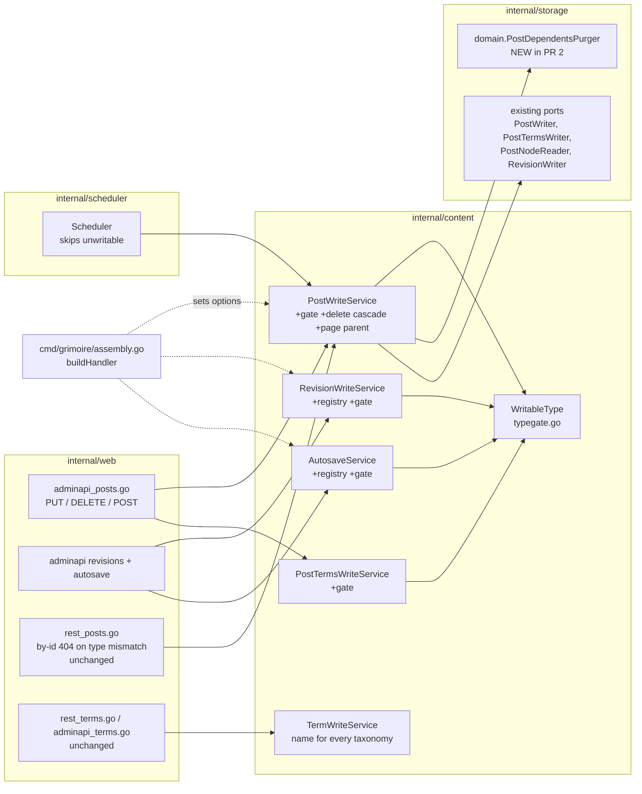
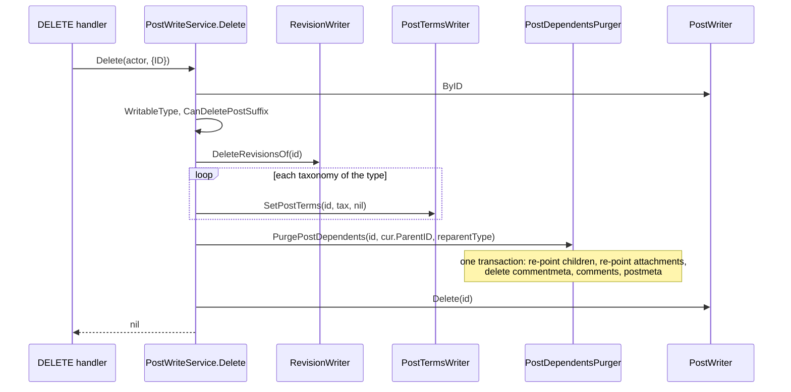

# M18 — Write hardening: type-safe writes, built-in term sanitization, delete cleanup, page parent: Design

## Overview

M17 left four gaps in the built-in write path and recorded them as its Findings
3, 4, 5 and 7. M18 closes them in two pull requests. The work is small in new
machinery (one storage port, one helper, a handful of options) and large in
guards, so this document starts with what reading the code at `main` `bda2db1`
established. Where the brief and the code disagree, the code wins and the
disagreement is named.

**1. The hole in item 1 is the admin API and its sibling services, not REST.**
`handleRESTPostUpdate` and `handleRESTPostDelete` load the row and answer
`404 rest_post_invalid_id` when `current.Type != typ`
(`internal/web/rest_posts.go:450,538`), before any capability check. That check
is what the brief asked about; it exists and covers `/posts`, `/pages` and every
custom-type route because all of them are the same closure parameterized by
`typ`. `adminPostUpdate` and `adminPostDelete`
(`internal/web/adminapi_posts.go:306,365`) take an id and hand it to
`PostWriteService`, which loads the row and decides with
`CapabilitySuffixFor(reg, cur.Type)` (`internal/content/postterms.go:25-38`).
For a type that is neither built-in nor registered that function returns the
legacy `"posts"` suffix, so `edit_posts` and `delete_posts` are enough. Three
more services take a post id and make the same legacy decision:
`RevisionWriteService.authorizeParent` (`revisions.go:59`) and
`AutosaveService.authorizeParent` (`autosave.go:37`) call `auth.CanEditPost`,
and `PostTermsWriteService.SetPostTerms` (`postterms.go:132`) uses
`CapabilitySuffixFor`. `RevisionWriteService.Restore` then writes the parent
row through `posts.Update` directly, so it is a full overwrite path of its own.
A side effect is that revisions and autosave ignore `capability_type` for
registered types, the same gap M17 closed for `PostWriteService`.

**2. Admin `PUT` ignores the stored type when deciding where `parent` goes.**
`parsePostWrite` defaults `typ` to `post` when the body omits `type`
(`adminapi_posts.go:102-110`) and applies `parent` only when `typ` is neither
`post` nor `page` (`:152`). An update of a stored page or registered row with no
`type` in the body would therefore drop `parent`. M17 hid this because the SPA
always sends `type`. Item 4 fixes it by choosing the type from the stored row
on update.

**3. `sanitize.PostTitle` at tier B decodes entities.** A scratch run against
`sanitize.New()` gives `R&amp;D` → `R&D`, `A < B` → `A  B`, `<b>Bold</b> & co` →
`Bold & co`, `<script>x</script>` → `` (empty), and every output is a fixed
point. WordPress stores `&amp;` in term names. Applying the policy to a term
**update** that merely carries the stored name forward (the REST handler copies
the stored name into `updated`, `rest_terms.go:335-338`; the admin handler does
the same, `adminapi_terms.go:149-152`) would rewrite imported data on a
slug-only edit. So item 3 needs the same "identical to stored is not a caller
value" rule M10a Finding 3 introduced for post fields. This is the one place
the brief's "check existing stored names remain readable" has teeth.

**4. Item 3 needs no web or assembly change.** The REST and admin term handlers
are generic over taxonomy, already map `ErrTermNameEmpty` to `400`, and already
echo the stored term (`storedTerm`, `rest_terms.go:308`). `buildHandler` already
passes the shared policy (`WithTermContentPolicy`, `assembly.go:121`). The
change is inside `TermWriteService`. The golden files hold only plain names
(`Admin Cat`, `Admin Child 2`) and are expected not to change.

**5. Delete cleanup is reachable through existing ports for one dependent in
four.** `SetPostTerms(ctx, id, taxonomy, nil)` already deletes relationships
and recomputes `term_taxonomy.count` in one transaction
(`wprepo/postterms.go:64-140`). `RevisionWriter.DeleteRevisionsOf` already
deletes revisions. Nothing deletes `postmeta`, `comments` or `commentmeta`:
`CommentWriter` has `Create` and `UpdateStatus` only, and `PostMetaRepository` is
read-only. Re-pointing children needs `PostWriter.Update`, which bumps
`post_modified` and rewrites the whole row, where `wp_delete_post` uses a raw
`UPDATE` that touches only `post_parent`. So PR 2 adds **one** additive port.

**6. Page `parent` is almost entirely a guard.** `RESTMapper.Page` already
returns `Parent` and a nested `link` through `PageService.AncestryFor`
(`content/rest.go:108,276`). `PostRepo.Create/Update` already write
`post_parent`. M17's `validatePostParent` and `PageHierarchy.isAncestorOrSelf`
already do the work for registered types. The missing pieces are the request
fields, `PostWriteService.Update` copying `p.ParentID` for pages, and treating
`page` as a hierarchical type in the guard.

**Design in one paragraph.** Add `content.WritableType` and gate the four post-id
services on it (PR 1). Make `TermWriteService` reduce every taxonomy's name with
the unchanged-name exception (PR 1). Add `domain.PostDependentsPurger`, implement
it once in `wprepo`, and extend `PostWriteService.Delete` to detach terms for
built-ins, purge dependents and re-point children (PR 2). Treat `page` as a
hierarchical type in `validatePostParent`, accept `parent` on the REST page and
admin routes, and add sibling slug uniqueness on a parent change (PR 2). Wire
each in `buildHandler` with a test that fails if the wiring is removed.

## Architecture



**Layering is unchanged.** `auth` stays pure. `content` imports `registry`.
`internal/storage/wprepo` implements the new port; `internal/domain` declares it.
`web` only changes where a handler picks the type for `parent` (item 4).

**Order of checks in every write**, extending M17's rule once: authentication
and CSRF, parse (400), existence and REST type (404, REST only), **type gate
(403/404 per surface)**, capability (403), value validation (sanitize, slug,
parent; 400), write. Putting the type gate before the capability check means a
caller without `edit_posts` and a caller with it see the same `403` for an
unwritable row, so the gate discloses nothing.

**Delete sequence (PR 2).**



Each arrow is its own transaction (the narrow ports share none, as M17 noted).
Every step is idempotent and any failure stops the sequence before the row is
deleted, so the post remains and the call can be repeated.

## Type gate (Requirements 1-4)

New file `internal/content/typegate.go`:

```go
// WritableType reports whether the write services may modify a stored row of
// typ: the built-in types and the empty string always, a registered type when
// reg holds it, nothing else.
func WritableType(reg *registry.Registry, typ string) bool {
    switch typ {
    case "", "post", "page":
        return true
    }
    if reg == nil {
        return false
    }
    _, ok := reg.PostType(typ)
    return ok
}
```

**`PostWriteService`.** `Update` and `Delete` call the gate immediately after
the `ByID` load and the empty-type default, before `CanEditPostSuffix` /
`CanDeletePostSuffix`, and return `ErrForbidden`. `Create` calls it after the
`p.Type == ""` default. A new exported method `WritableType(typ string) bool`
wraps the helper with `s.reg` for the scheduler. The admin handlers already map
`ErrForbidden` to `403`, so no handler changes.

**`PostTermsWriteService.SetPostTerms`** returns `ErrForbidden` after the load.
`CheckAssignable` is a create-time pre-check keyed by route type and is
unchanged.

**`RevisionWriteService`, `AutosaveService`** gain the same option the post-terms
service has, `WithRevisionRegistry(reg)` and `WithAutosaveRegistry(reg)`, with
variadic constructors so existing call sites compile. Both
`authorizeParent` methods become:

```go
if !WritableType(s.reg, parent.Type) { return domain.Post{}, domain.ErrNotFound }
suf, _, _ := CapabilitySuffixFor(s.reg, parent.Type)
if !auth.CanEditPostSuffix(actor, suf, parent.Status, parent.Author) { return domain.Post{}, domain.ErrNotFound }
```

`CapabilitySuffixFor` with a nil registry returns the legacy suffix, so a
service built without the option keeps today's decisions for `post`/`page`
(Requirement 2.5) and, because `WritableType(nil, x)` is false for every other
type, refuses the rest. That is intended: a deployment with no `content:`
section has no registered types.

**Response mapping (D2).** No new status. Admin post update/delete/term
assignment return `ErrForbidden` → `403 forbidden`; revisions and autosave
return `ErrNotFound` → `404`. REST is unchanged and pinned.

| Surface | Unwritable row | Reason this status |
|---|---|---|
| `PUT`/`DELETE /admin/api/posts/{id}` | `403 forbidden` | `PostWriteService` already answers a missing id with `ErrForbidden` (existence not leaked); WordPress maps a post type it does not know to `do_not_allow`, also `403` |
| revision list/get/restore, autosave get/save | `404` | `authorizeParent` already answers an unauthorized parent with `ErrNotFound` |
| `PUT`/`PATCH`/`DELETE /wp-json/wp/v2/{posts,pages,custom}/{id}` | `404 rest_post_invalid_id` | existing type-mismatch check, runs before the gate |
| any `GET` | unchanged | reads are not gated |

**Scheduler.** `tick` asserts `p.posts.(interface{ WritableType(string) bool })`
once per row. When the assertion succeeds and returns false the row is skipped
with `log.Debug("scheduler: skipping unwritable post type", ...)`. When the
assertion fails (a test fake) behavior is unchanged. The scheduler package keeps
no import of `content`.

**What the gate does not do.** It does not hide rows from `GET`, does not touch
`attachment` writes through `MediaWriteService`, and does not move rows of a
removed registry entry. A type that was registered and then dropped from
`content:` becomes unwritable until it is registered again; the docs say so.

## Term names (Requirements 5, 6)

`TermWriteService` today runs `prepareRegistered` (name and slug) only for
registered taxonomies. M18 splits it:

```go
func (s *TermWriteService) prepare(ctx context.Context, t domain.Term, stored *domain.Term) (domain.Term, error) {
    if stored == nil || t.Name != stored.Name {   // create, or the caller changed the name
        name, err := s.cleanName(t.Name)          // unchanged: PostTitle, TierB, TrimSpace, empty → ErrTermNameEmpty
        if err != nil { return t, err }
        t.Name = name
    }
    if rt, ok := s.registryTaxonomy(t.Taxonomy); ok {
        if err := s.checkSlug(ctx, t, rt.Hierarchical); err != nil { return t, err }  // registered only
    }
    return t, nil
}
```

- `Create` order: `CanManageTerms` → `ErrTaxonomyUnknown` → `prepare(ctx, t, nil)`
  → `validateParent` → write. No change to the order M17 fixed.
- `Update` order: `CanManageTerms` → **one** `TermsByIDs([t.ID])` read →
  `prepare(ctx, t, &stored)` → `validateParent` → write. No row → `domain.ErrNotFound`
  (both handlers already pre-read and answer `404`, so this is a backstop).
  A read error is returned and nothing is written (Requirement 6.3).
- `cleanName` is unchanged. The tier stays fixed at B so an `unfiltered_html`
  holder cannot store markup in a name.
- Registered taxonomies keep their slug rules. Because the unchanged-name rule
  applies to every taxonomy, a registered taxonomy's slug-only update no longer
  re-sanitizes either; that is a strict improvement and changes no stored value
  a caller did not choose.

**Slug derivation is left alone.** `handleRESTTermCreate` derives a missing slug
with `termSlugify(*body.Name)` from the raw name before sanitization. For a name
like `<b>Foo</b>` the slug is derived from the markup. Deriving from the
reduced name would be more correct but changes built-in slugs for existing
clients and is outside the four items. It is recorded as a sign-off item.

**Reads.** No read path changes. Names with markup or `&amp;` are returned as
stored, by `TermReader`, REST, admin and public archives. There is no backfill:
Requirement 6.5 and the M10a/M14 stance (stored data is rewritten only by an
explicit operator command) both apply.

**Golden files.** The built-in golden set exercises names `Admin Cat`,
`Admin Child`, `Admin Tag`, `Admin Child 2` and the REST equivalents. Each is a
fixed point of the reduction, so no byte changes. Task 5.2 and the PR 1 gate run
the golden test; a diff is a stop, not a regeneration (Requirement 15.2). The
new term-name behavior is covered by new tests, not by new golden cases, so the
golden files stay byte-identical across both PRs.

## Delete cleanup (Requirements 7-10)

### Port

```go
// internal/domain/repository.go (additive)

// PostDependentsPurger removes the rows that depend on a post and re-points the
// rows that name it as their parent, mirroring the parts of wp_delete_post that
// the existing ports cannot reach. It never deletes the post row itself.
type PostDependentsPurger interface {
    // PurgePostDependents, in one transaction:
    //  1. when reparentType != "": UPDATE posts SET post_parent = parentID
    //     WHERE post_parent = postID AND post_type = reparentType;
    //  2. UPDATE posts SET post_parent = parentID
    //     WHERE post_parent = postID AND post_type = 'attachment';
    //  3. DELETE commentmeta rows of comments with comment_post_ID = postID;
    //  4. DELETE comments with comment_post_ID = postID (every comment_approved state);
    //  5. DELETE postmeta with post_id = postID.
    // Neither update touches post_modified. No dependents is not an error and
    // the post row need not exist.
    PurgePostDependents(ctx context.Context, postID, parentID int64, reparentType string) error
}
```

`wprepo.PostRepo` implements it (`internal/storage/wprepo/postdependents.go`)
with `RunInTx` and the raw-SQL style `SetPostTerms` and `DeleteMenu` already use,
so one implementation serves MySQL, PostgreSQL and SQLite and the placeholder
rebinding the repo already relies on applies. The commentmeta delete is
`DELETE FROM {p}commentmeta WHERE comment_id IN (SELECT comment_ID FROM
{p}comments WHERE comment_post_ID = ?)`, which all three engines accept.
`storage.Set` gains `PostDependents domain.PostDependentsPurger`, set to the
same `posts` repo in `factory.go`, next to `PostNodeReader`. The compile-time
assertion lives beside the others at `wprepo/writers.go:259`.

**Why a new port and not the existing ones.** `PostWriter` cannot take a method
without breaking every fake and the vendor adapters' shared assertions;
`CommentWriter` is a moderation port; and deleting through `PostWriter.Update`
for each child would bump `post_modified` on rows the user never edited, which
`wp_delete_post` does not do. A separate narrow interface is the established
pattern (`PostContentUpdater`, `PostNodeReader`).

**Contract tests.** `runPostDependentsPurgerContract(t, newRepos)` joins the
other contracts in `storagetest/contract.go`. It seeds a parent page with two
child pages, one child of another type, an attachment, comments in all four
`comment_approved` states, commentmeta, postmeta, and a second post with its own
comments and meta, then asserts each behavior of Requirements 8-10 including
that the second post is untouched, that `post_modified` of re-pointed rows is
unchanged, that an empty `reparentType` skips step 1, that a purge of a
nonexistent id is a no-op, and that the call is idempotent. It runs on SQLite
always and on MySQL and PostgreSQL under the existing `GRIMOIRE_TEST_*`
variables, as every other contract does.

### Service

```go
func WithPostDependentsPurger(p domain.PostDependentsPurger) PostWriteOption   // nil: skip the purge
```

`Delete` after the capability check:

```go
revisions (existing) → terms → purge → row

for _, tax := range s.deleteTaxonomies(cur.Type) { SetPostTerms(ctx, cur.ID, tax, nil) }   // only if s.detacher != nil
reparent := ""; if s.hierarchicalType(cur.Type) { reparent = cur.Type }
s.purger.PurgePostDependents(ctx, cur.ID, cur.ParentID, reparent)                           // only if s.purger != nil
s.w.Delete(ctx, cur.ID)
```

`deleteTaxonomies(typ)` returns, deduplicated and in order:
`category`, `post_tag` for `post` and `page`; the registry entry's effective
`Taxonomies` for a registered type; and for every type the registered taxonomies
whose `ObjectTypes` contains `typ`. Pages are included in the built-in set
because grimoire lets a page carry `category` and `post_tag` terms (the admin
detail lists them), even though WordPress pages do not by default.
`SetPostTerms(…, nil)` on a taxonomy the post has no relationships in is a
no-op, so the extra calls cost one existence query each.

`hierarchicalType(typ)` is true for `page` and for a registered type with
`Hierarchical`. This mirrors `is_post_type_hierarchical`.

**Where this deviates from `wp_delete_post`.** WordPress also unsticks the post
(`sticky_posts` option), deletes nav-menu items whose `_menu_item_object_id` is
the post, deletes the post's term relationships in **all** taxonomies registered
for the type (grimoire does the same, bounded by the registry plus the two
built-ins), and fires hooks. The first two need writes outside the post service
and the hooks do not exist in grimoire, so they are recorded as known gaps in
the docs (Requirement 19.5). Count semantics are whatever `SetPostTerms`
already does; M18 does not change them.

**Failure ordering.** A failure at any step returns before the next one.
Because revisions, term detach and purge are all idempotent, calling `DELETE`
again after a failure completes the cleanup; the post is still addressable
because the row is deleted last. The one residual inconsistency is a crash
between purge and row delete, which leaves a post with no meta and no comments
that is still deletable; that is the same shape M7 accepted for revisions.

## Page parent (Requirements 11-14)

### Service

`PostWriteService` gets one helper:

```go
// parentRules returns the hierarchy rules for typ: the registry entry for a
// registered type, a synthetic hierarchical entry for page, and ok == false for
// everything else (post is flat in grimoire and ignores parent).
func (s *PostWriteService) parentRules(typ string) (registry.PostType, bool) {
    if typ == "page" { return registry.PostType{Name: "page", Hierarchical: true}, true }
    return s.registered(typ)
}
```

`Create` and `Update` use `parentRules` where they use `registered` today **for
the parent step only**. The slug and detach branches keep calling `registered`,
so `page` never enters M17's charset-and-auto-suffix path.

- **Create (page):** `validatePostParent(ctx, pt, 0, p.ParentID)`; when
  `p.ParentID != 0`, a uniqueness-only slug step (below).
- **Update (page):** when `p.ParentID != cur.ParentID`: `validatePostParent(ctx,
  pt, cur.ID, p.ParentID)`, then `cur.ParentID = p.ParentID`, then the
  uniqueness-only slug step. When equal, nothing runs, so a page whose stored
  parent is dangling stays editable (Requirement 13.5). The guard runs after the
  capability check, the revision snapshot and sanitization, in the same place as
  for registered types.
- **Uniqueness-only slug step:** `slugTakenAmong(nodes, slug, parent, selfID)`
  is the existing `slugTaken` with `hierarchical = true`; loop `slug`, `slug-2`,
  … against the page nodes loaded once. No `slugRE`. An empty slug is left
  empty (a draft page). `post`: no `parentRules`, so `p.ParentID` stays ignored.

`validatePostParent` needs no change: with `Hierarchical: true` and a
`PostNodeReader` scoped to `page` it already returns `ErrPostParentInvalid` for
an absent or other-type parent and `ErrPostParentCycle` for self or descendant.
With no node reader it returns `errPostNodesUnavailable` (Requirement 13.8).

**Why a synthetic `PostType` and not a registry entry.** The registry reserves
`post` and `page` and must keep rejecting a `content:` entry named `page`;
the synthetic value exists only inside the service.

### Web

- `parsePostWrite(body, current)` computes `effective := typ`; when `current !=
  nil` it uses `current.Type`. `body.Parent` is applied when `effective` is
  `page` or a registered type, replacing the test at `adminapi_posts.go:152`.
  `postDetail` populates `Parent` for `page` as well as registered types
  (`:187`).
- `parseRESTPostWrite(body, typ, current)` replaces the registered-only test at
  `rest_posts.go:307` with `typ == "page" || (registered && typ != "post")`.
  `restPostWriteRequest.Parent` already exists.
- Error mapping already covers `ErrPostParentInvalid` and `ErrPostParentCycle`
  on all four write handlers (`400 rest_invalid_param`, `400 bad_request`).
- `RESTMapper.Page` already emits `parent` and the nested `link`; nothing
  changes there. `restHierarchy` stays `nil` for pages because the mapper
  walks the hierarchy itself.

### URL behavior (Requirement 14)

Nothing in routing changes. The proofs are tests through `buildHandler`:

| Scenario | Expected, because |
|---|---|
| Publish page `b`, then set parent `a` | `/a/b/` → `200`; `/b/` → `301 /a/b/` (M15 `PageMovedError` from `recoverPath`) |
| Same, but `b` is a draft | `/b/` and `/a/b/` → `404` (M16 `Resolve` checks `PublishedByID` before a redirect) |
| Pages `/a/x` and `/b/x` both published | each path serves its own body (M16 leaf confirmation by id) |
| REST `link` of the moved page | `AncestryFor` result, equal to the public canonical path |
| Move twice | the last path is canonical, the first redirects only if its final segment names a published page |

`PageService.Resolve` and `AncestryFor` each load the whole page graph per
call. A REST page list therefore loads it once per item, as M15 shipped; M18
does not change that cost.

**Slug collisions after a move.** With no unique rule on built-in page slugs,
moving page `b` under a parent that already has a child slugged `b` would leave
two siblings with one slug and make the later id unreachable
(`lowestBySlug` returns the lowest id). The uniqueness step on parent change
prevents the write path from creating that state. It cannot repair
already-duplicated imported data, which is unchanged.

## Components and Interfaces

| Package | Change | PR |
|---|---|---|
| `internal/content/typegate.go` (new) | `WritableType` | 1 |
| `internal/content/writeservices.go` | `PostWriteService` gate in `Create/Update/Delete`, `WritableType` method; `TermWriteService.prepare` and `Update` stored read | 1 |
| `internal/content/postterms.go` | `SetPostTerms` gate | 1 |
| `internal/content/revisions.go`, `autosave.go` | registry options, gate, derived suffix | 1 |
| `internal/scheduler/scheduler.go` | skip unwritable | 1 |
| `cmd/grimoire/assembly.go` | registry options on revisions and autosave | 1 |
| `internal/domain/repository.go` | `PostDependentsPurger` | 2 |
| `internal/storage/wprepo/postdependents.go` (new), `writers.go`, `internal/storage/factory.go` | implementation, assertion, `Set.PostDependents` | 2 |
| `internal/content/writeservices.go` | `WithPostDependentsPurger`, `deleteTaxonomies`, delete sequence, `parentRules`, page parent guard, uniqueness step | 2 |
| `internal/web/adminapi_posts.go`, `rest_posts.go` | page `parent` in parse and detail | 2 |
| `cmd/grimoire/assembly.go` | `WithPostDependentsPurger(repos.PostDependents)` | 2 |

Web handlers, routes and the scheduler constructor signature otherwise keep
their shape. Constructors gain variadic options only.

## Data Models

No schema change and no migration. Rows read or written, by this milestone:

| Table.column | Operation | Where |
|---|---|---|
| `{prefix}terms.name` | write (reduced) | `TermRepo.Create/Update`, PR 1 |
| `{prefix}posts.post_parent` | write for `page` | `PostRepo.Create/Update`, PR 2; re-point in `PurgePostDependents` |
| `{prefix}posts.post_name` | write (suffix) when a page's parent changes | PR 2 |
| `{prefix}term_relationships`, `term_taxonomy.count` | delete, recount | `SetPostTerms(…, nil)`, PR 2 |
| `{prefix}postmeta`, `{prefix}comments`, `{prefix}commentmeta` | delete | `PurgePostDependents`, PR 2 |

JSON: admin page detail gains `parent` (omitted when `0`); REST page bodies
accept `parent` (the response already has it). No other body changes.

## Findings

1. **REST by-id routes were already safe.** The brief's second question has a
   one-line answer and a test; the fix is in the shared services.
2. **Revisions and autosave ignore `capability_type`.** A holder of `edit_posts`
   can list, read and restore revisions of a `capability_type: product` row.
   Item 1's gate fixes it as a side effect (D4).
3. **`RevisionWriteService.Restore` writes the parent through `posts.Update`.**
   It bypasses `PostWriteService` and its sanitization (the restored fields are
   whatever the revision holds). Out of scope; the gate protects the type, and
   the content was sanitized when it was first written.
4. **Entity decoding changes stored term names on write.** `&amp;` is stored as
   `&` after M18 for a name the caller changes. Consistent with registered
   taxonomies and post titles; different from WordPress's stored form.
5. **The term-side hole exists.** `adminTermUpdate` and `adminTermDelete` take
   any term id, and `TermWriteService.Delete` has no taxonomy check, so a
   `manage_categories` holder can rename or delete imported `nav_menu`,
   `link_category` or `product_cat` terms. Not one of the four items.
6. **Delete cleanup leaves two WordPress behaviors undone.** `sticky_posts`
   and menu items referencing the post (Requirement 19.5).
7. **Revisions are snapshotted before the parent guard runs.** A rejected page
   parent leaves one extra revision, as a rejected registered-type parent does
   today (M17 order). Moving validation ahead of the snapshot is a separate,
   small change.
8. **The M16 `Resolve` fix is what makes page moves safe to ship.** Before it, a
   moved page's old URL could redirect to an unpublished page and same-slug
   pages under different parents shared one body.

## Error Handling

No new status codes, error codes or envelopes.

| Condition | REST | Admin API |
|---|---|---|
| Admin write to an unwritable post row | (not reachable; 404 by type check) | `403 forbidden` |
| REST write to a row of another type | `404 rest_post_invalid_id` | n/a |
| Revision or autosave of an unwritable row | n/a | `404` |
| Term assignment to an unwritable row | n/a | `403`, or a `partial` entry when it follows a post write |
| Term name empty after reduction | `400 rest_invalid_param` | `400 bad_request` ("term name is empty") |
| Term read for update fails | `500 rest_update_failed` | `500` |
| Page parent invalid or cycle | `400 rest_invalid_param` | `400 bad_request` ("invalid parent") |
| Page parent write while no node reader is wired | `500 rest_update_failed` / `rest_create_failed` | `500` |
| Delete cleanup step fails | `500 rest_delete_failed` | `500` |
| Caller lacks capability | `403 rest_cannot_*` | `403` |

## Decisions awaiting sign-off

Defaults are implemented as written; each is local to the task named.

1. **`403` for admin writes to unwritable rows (D2).** Alternative: `404`. `403`
   matches the existing admin missing-id response and WordPress's
   `do_not_allow`. Reverse in task 2.2.
2. **Revisions and autosave adopt the derived capability suffix (D4).** It
   changes behavior for registered types in a way M17 did not intend to leave
   open. Alternative: gate by type only and keep the legacy suffix. Task 3.2.
3. **Comments are deleted on post delete (D6).** WordPress does. Alternative:
   leave them, which orphans rows other tools may still list. Task 9.2.
4. **Children of a deleted page are re-pointed to its parent; attachments too.**
   Matches `wp_delete_post`. Alternative: leave `post_parent` dangling (today).
   Task 9.2.
5. **Page parent change auto-suffixes a colliding slug (D9).** Alternatives:
   reject with `400`, or do nothing as built-ins do today. Task 11.2.
6. **Term names are reduced for every taxonomy and unchanged names are exempt
   (D5).** The entity-decoding side effect (Finding 4) is accepted. Task 5.2.
7. **Slug derivation for term create still reads the raw name.** Alternative:
   derive from the reduced name. Not changed here.
8. **The term-side twin of item 1 (Finding 5) is not in this milestone.** I
   recommend a follow-up `M19` with the same gate on `TermWriteService.Update`
   and `Delete`.
9. **A registered type removed from `content:` becomes unwritable** until it is
   registered again. Intended: the registry is the definition of "managed".

## Testing strategy

Pure Go over SQLite, no new dependency, no new `GRIMOIRE_TEST_*` variable;
`gofmt -l .`, `go vet ./...`, `go build ./...` and `go test ./...` green after
every phase.

**No Correctness Properties section, deliberately.** The behaviors are
enumerable branches over fixed fixtures: a closed set of stored types
(Glossary), a closed set of surfaces, a handful of delete dependents, and the
parent guard's seven cases. The one wide input space, term name reduction, is
the existing `sanitize` package's responsibility and is already property-tested
there (M10a); M18 adds only the rule of when to apply it, which is two
branches. This matches the no-PBT decisions in M13 and M17.

**Layers.**

- **Content services.** Over the existing fakes (`postwrite_custom_test.go`,
  `postparent_test.go`, `fakeTermWriter`) plus a recording fake purger: type
  gate for each unwritable type on `Create/Update/Delete`, with a recording
  writer proving no snapshot, sanitize or write happened; revisions, autosave
  and term-assignment gates with a derived-suffix case; term name reduction on
  create and update for `category`, `post_tag` and a registered taxonomy,
  unchanged-name pass-through with `News &amp; Events`, empty rejection, tier-C
  actor still reduced, read failure; delete order and early-stop on each step's
  failure for `post`, `page` and a registered type; page parent branches
  (top-level, self, descendant, absent, other type, unchanged-not-validated,
  dangling stored parent, no node reader) and slug suffix on parent change.
- **Storage contract.** The purger contract above, on every vendor.
- **Handlers (`internal/web`).** REST page `parent` create/update/omitted/zero/
  invalid, ignored on `/posts`; admin page `parent` including the body-without-
  `type` update, and the detail `parent`.
- **Assembly (`cmd/grimoire`).** Through `buildHandler` over migrated SQLite
  with raw-seeded `shop_order`, `attachment` and `nav_menu_item` rows: admin
  `PUT`/`DELETE`, term assignment, revision restore and autosave return the
  specified status and leave the row byte-identical; REST by-id 404 pins; reads
  unchanged; a scheduler tick leaves a `future` `shop_order` alone; built-in term
  names; delete leaves no relationships, meta, comments or dangling parents; page
  tree create, move, `301`, draft `404`, same-slug pages. **Wiring proof:** each
  option added to `buildHandler` is removed once and the named test must fail;
  the task records the result.
- **Built-in golden.** The existing `TestBuiltinGolden` runs in every phase's
  gate. It is expected green and unchanged in both PRs.

**Each RED test must fail for the stated reason** (`PUT` returns `200`, name
stored raw, comments still present, `parent` ignored), checked before the
implementation task starts.

## Delivery

| PR | Phases | What a reviewer can use afterwards |
|---|---|---|
| 1 (security) | 1-8 | Admin writes, revisions, autosave and term assignment refuse unmanaged rows; the scheduler skips them; category and tag names are plain text at the write boundary; stored names untouched; docs and gate |
| 2 (completeness) | 9-15 | Deleting a post or page cleans terms, counts, meta, comments and re-points children and attachments; page `parent` over REST and admin with guard, nested links and redirects; docs and gate |

PR 2 branches from `main` after PR 1 merges, because both edit
`writeservices.go` and `assembly.go`. PR 1 stands alone.

## Traceability

| Design element | Requirements |
|---|---|
| `WritableType`, `PostWriteService` gate, admin mapping | 1 |
| Revisions, autosave, post-terms gate, registry options | 2 |
| REST by-id characterization | 3 |
| Scheduler skip, `PostWriteService.WritableType` | 4 |
| `TermWriteService.prepare` for every taxonomy | 5 |
| Unchanged-name exception, stored read, no backfill | 6 |
| `deleteTaxonomies`, detach for built-ins | 7 |
| `PostDependentsPurger` steps 3-5 | 8 |
| `PostDependentsPurger` steps 1-2, `hierarchicalType` | 9 |
| Delete sequence, port, contract suite | 10 |
| REST `parent` on pages | 11 |
| Admin `parent` on pages, effective type | 12 |
| `parentRules`, `validatePostParent`, uniqueness step | 13 |
| Resolve, `AncestryFor`, redirects (proved, not changed) | 14 |
| Golden handling | 15 |
| No schema, one port | 16 |
| `buildHandler` options and wiring tests | 17 |
| Phases, RED/GREEN pairs, gates | 18 |
| Docs tasks | 19 |
