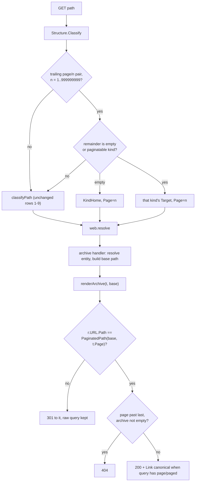

# M16 — Archive path-form pagination and the `?m=` date query: Design
## Overview
Today every paginated archive reads its page from `?page=N` (`pageParam`,
`internal/web/handlers.go`), compares `r.URL.Path` with the archive's canonical
path and renders. M16 adds the WordPress path form `/page/{n}/` beside it, and
makes `?m=YYYYMM` resolve to a date archive.
The change has five parts.
1. **A pagination wrapper in `Structure.Classify`.** The existing body becomes
   the unexported `classifyPath`. The new `Classify` first tries to peel a
   trailing `page/{n}` pair off the path. It accepts the peel only when what
   remains classifies as a paginatable kind (or is empty, which is the home
   page). Otherwise the whole path goes to `classifyPath` untouched. This is
   WordPress's rewrite-rule order, and it is what makes a term slugged `page`
   reachable whenever it is not followed by a number (D1).
2. **Pure path construction in `internal/routing`.** `PaginatedPath(base, n)`
   is the one place a path-form URL is built. `PageLinks` turns it into the
   previous and next URLs. `PaginationPatterns` lists the chi patterns. All three
   read `TrailingSlash` and the archive's own constructor, so the front asymmetry
   and the slash policy stay decided in one place each.
3. **Handlers read the page from the target, then the query.** `renderArchive`
   takes the target, compares the request path with the paginated canonical, and
   redirects on a difference. A new `Link: <path>; rel="canonical"` header marks
   the query-form responses. The home handler gains a path-form entry.
4. **The theme gets handler-built links.** `IndexData` and `ArchiveData` gain
   `PrevURL` and `NextURL`. The three default-theme templates render them.
5. **`?m=` on `/` (PR 2).** A pure parser in `internal/routing` and a branch in
   the home handler that serves the date archive in place.
**Canonical policy in one sentence.** The path form is canonical for page 2 and
above, `?page=N` and `?paged=N` stay `200` and point at it with a `Link` header,
`/page/1/` redirects to the base, and every redirect carries the raw query.
**No Correctness Properties section, deliberately.** Behavior is a finite
classification table over named structures and a handful of redirect rules. The
one universal statement worth making, that every canonical path is a fixed point of
construct, classify and construct, is a finite matrix in this repository's
existing style (`archive_fixedpoint_test.go`), and a generator would add no case
the matrix does not name. This matches M15 and M17-M20. Testing strategy has the
detail.
## Architecture

Row order after the change, top to bottom (new row is **0**; rows 1-9 are
`classifyPath`, unchanged):
| Row | Matches | Result |
|---|---|---|
| 0 (new) | `…/page/{n}` where the remainder is empty | `KindHome`, `Page = n` |
| 0 (new) | `…/page/{n}` where the remainder classifies as a paginatable kind | that kind, `Page = n` |
| 1-9 | everything else, and every path row 0 declines | as before M16 |
The rest of this document refers to the unexported old body as `classifyPath`.
### Disambiguation matrix
This table is the specification of Requirement 3 and the fixture list for the
routing tests. Structure is `/%postname%/` unless the row says otherwise. "Before"
is `main` `a9110f4`.
| Path | Before | After | Why |
|---|---|---|---|
| `/page/2` | `KindPage [page 2]` (404 unless page `page` has child `2`) | `KindHome`, `Page 2` | Remainder empty. |
| `/page/1` | as above | `KindHome`, `Page 1`; handler 301 to `/` | D3. |
| `/page/0`, `/page/02`, `/page/+2`, `/page/x`, `/page/1234567890` | `KindPage` | unchanged | Not a page number. |
| `/page` | `KindPost` slug `page` | unchanged | No number. |
| `/page/2/3` | `KindPage` | unchanged | The last pair is `2/3`, and `2` is not `page`. |
| `/category/news/page/2` | `KindCategory [news page 2]` | `KindCategory [news]`, `Page 2` | Remainder is a category. **Shadowed**: a grandchild `2` under child `page`. |
| `/category/news/page` | `KindCategory [news page]` | unchanged | No number. |
| `/category/news/page/archive` | `KindCategory [news page archive]` | unchanged | `archive` is not a number. |
| `/category/page/2` | `KindCategory [page 2]` | unchanged | Remainder `/category` is a bare base, not paginatable. |
| `/category/page/page/2` | `KindCategory [page page 2]` | `KindCategory [page]`, `Page 2` | Category `page`, page 2. |
| `/category` | `KindNone` | unchanged | No category index. |
| `/tag/x/page/2` | `KindNone` (tag base takes exactly one more segment) | `KindTag x`, `Page 2` | |
| `/tag/page/2` | `KindNone` | unchanged | Bare base remainder. |
| `/author/jane/page/2` | `KindNone` | `KindAuthor jane`, `Page 2` | |
| `/2024/page/2`, `/2024/05/page/2`, `/2024/05/17/page/2` | `KindPage` | `KindDate`, `Page 2` | Remainder is a date. |
| same, structure Flat | `KindPage` | unchanged | Flat serves no date archives, so the remainder `/2024` is a post. |
| `/2024/13/page/2` | `KindPage` | unchanged | Remainder is not a real date. |
| `/books/page/2` (custom type `books`, archive slug `books`) | `KindCustomPost [page 2]` | `KindCustomArchive books`, `Page 2` | Remainder is the archive base. |
| `/books/page/2` (type `books` with no archive) | `KindCustomPost` | unchanged | Remainder `/books` is not claimed. |
| `/genre/rock/page/2` (hierarchical taxonomy `genre`) | `KindCustomTerm [rock page 2]` | `KindCustomTerm [rock]`, `Page 2` | **Shadowed** like the category row. |
| `/about/page/2` | `KindPage [about page 2]` | unchanged | Remainder `/about` is a post or page, not paginatable. |
| `/page/2` under `/%postname%/%post_id%/` | `KindPost` slug `page`, id `2` | `KindHome`, `Page 2` | **Shadowed** post. WordPress resolves the same way. |
| `/2024/page/2` under `/%year%/%monthnum%/%postname%/` | `KindPage [2024 page 2]` (404) | `KindDate`, `Page 2` | |
| `/blog/2024/page/2` under `/blog/%year%/%monthnum%/%postname%/` | `KindNone` (404) | `KindDate`, `Page 2` | Front applies to date archives. |
**Shadowed URLs.** Three groups of existing URLs change meaning, and each is
listed in Requirement 3.4: a term two levels below a parent slugged `page` whose
own slug is a page number; a top-level page slugged `page` with a child slugged by
a number; a post whose canonical path is `/page/{n}/`. The first two require a
term or page to be named `page`, which is rare. WordPress's own rewrite order
shadows all three the same way, so a site migrated from WordPress cannot have
published them. The design adds no fallback (sign-off item 2).
## Components and Interfaces
### `internal/routing/classify.go`
```go
// MaxPageNumber is the largest page number any form accepts.
const MaxPageNumber = 999_999_999

// KindHome is appended after KindCustomTerm so no existing value shifts.
// It is returned only for a paginated home path; "/" stays KindNone.
KindHome

type Target struct {
    // ...existing fields...
    // Page is the page number of a path-form paginated path, 0 otherwise.
    Page int
}

// ParsePageNumber reads s as a page number: ^[1-9][0-9]{0,8}$.
func ParsePageNumber(s string) (int, bool)
```
`Classify(path)` becomes:
```go
func (s Structure) Classify(path string) Target {
    segs := pathSegments(path)
    if base, n, ok := splitPageSuffix(segs); ok {
        if t, ok := s.classifyPaginated(path, base, n); ok {
            return t
        }
    }
    return s.classifyPath(path)
}
```
`splitPageSuffix` needs `len(segs) >= 2`, `segs[len-2] == "page"` and
`ParsePageNumber(segs[len-1])`. `classifyPaginated` handles an empty remainder
(`KindHome`) and otherwise calls `classifyPath("/" + join(base, "/"))`, accepts
the result only for `KindCategory`, `KindTag`, `KindAuthor`, `KindDate`,
`KindCustomArchive` and `KindCustomTerm`, then sets `Page = n` and
`TrailingSlash` from the **original** path. The existing body of `Classify`,
every comment and every row stay as they are in `classifyPath`.
Why a wrapper and not a row: rows 2-8 each root themselves at a base and decide
by segment count. A pagination suffix changes the segment count of every one of
them, and row 7.5 (M15) would claim the paginated path first. Running the
existing rows on the remainder reuses every base, front, `date/` and collision
rule without copying one.
The `KindPage` doc comment gains one sentence saying a `page/{n}` suffix is
peeled first.
### `internal/routing/routing.go`
```go
// PaginatedPath returns the URL of page n of the archive whose page-1 path is
// base. For n < 2 it returns base. Otherwise it returns base + "/page/{n}",
// with a trailing slash when the structure has one.
func (s Structure) PaginatedPath(base string, n int) string

// PageLinks returns the previous and next page URLs for the page being shown.
// prev is base when page == 2 (never /page/1/); "" when page <= 1.
// next is "" when page >= totalPages. base == "" yields "", "".
func (s Structure) PageLinks(base string, page, totalPages int) (prev, next string)

// PaginationPatterns returns the chi patterns path-form pagination needs.
func (s Structure) PaginationPatterns() []string
```
`PaginatedPath("/", 2)` is `/page/2` or `/page/2/`. `PaginatedPath` trims one
trailing `/` from `base` before appending and adds one back from `TrailingSlash`,
so it is correct for a base built by any constructor and for `/`.
`PaginationPatterns` returns, in both slash forms and duplicate-free:
- `/page/{pagenum}`
- the tag base prefix + `/{slug}/page/{pagenum}`
- the author prefix + `/author/{nicename}/page/{pagenum}`
- when `servesDateArchives()`: the date prefix + each of `{year}`,
  `{year}/{monthnum}`, `{year}/{monthnum}/{day}` + `/page/{pagenum}`
- per custom post type with an archive: `CustomBase(ArchiveSlug, WithFront)` +
  `/page/{pagenum}`

It returns nothing for categories and custom taxonomy terms, because their
wildcards (`/category/*`, `/{slug}/*`) already reach the dispatcher. It is a
separate method so `ArchivePatterns` and `CustomPatterns` keep their exact
contracts and their tests (Requirement 12.6). `contentPatterns` appends it.
It uses the prefixes from `archivePrefix` and `CustomBase`, the same helpers the
constructors and `Classify` use, so a pattern cannot be registered where
`Classify` would decline.
`archives_paths` constructors are unchanged. `PaginatedPath` takes their output.
### `internal/routing/notes.go`
`baseOptionNotes` gains one clause per option. When `CategoryBase == "page"` or
`TagBase == "page"` it appends a note naming the option and saying `/page/{n}`
is home pagination, so a term slugged by a page number under that base is
unreachable. `shadowNotes` (the `CustomNotes` source) gains the same note when a
custom entry's slug or archive slug is `page`. Both notes are absent for every
other configuration, so `Notes()` and `CustomNotes()` stay byte-identical there.
### `internal/web`
`handlers.go`:
```go
// pageParam: page, else paged; absent/garbage/<1 -> 1; any positive integer
// above MaxPageNumber (even beyond int64) -> MaxPageNumber.
func pageParam(r *http.Request) int

// pageFor returns the path-form number when the target carries one, else the query.
func pageFor(r *http.Request, t routing.Target) int
```
Every archive handler replaces `pageParam(r)` with `pageFor(r, t)`. The home
handler becomes `serveHome(w, r, t)`; `home` calls it with a zero `Target`, and
`resolve` gains a `KindHome` arm that calls it with the classified target.
`serveHome` with `t.Kind == KindHome`:
1. `want := PaginatedPath("/", t.Page)`; when `r.URL.Path != want`, `301` to
   `want` through `redirectCanonical`. For `t.Page == 1` this is the `/page/1/`
   redirect to `/`; for the wrong slash form it is the slash redirect.
2. Read the page, apply the existing past-the-end rule, render `index`.

`renderArchive` gains the target and keeps its order:
```go
func (s *Server) renderArchive(w http.ResponseWriter, r *http.Request,
    kind, canonical string, t routing.Target, a content.Archive) error {
    if canonical == "" { return domain.ErrNotFound }
    want := s.permalinks.PaginatedPath(canonical, t.Page) // t.Page 0 or 1 -> canonical
    if r.URL.Path != want { return s.redirectCanonical(w, r, want) }
    page := pageFor(r, t)
    if page > 1 && a.Page.Total > 0 && page > a.Page.TotalPages { return domain.ErrNotFound }
    prev, next := s.permalinks.PageLinks(canonical, a.Page.Page, a.Page.TotalPages)
    setCanonicalLink(w, r, s.permalinks, canonical, a.Page.Page)
    // ...build ArchiveData with PrevURL: prev, NextURL: next, BaseURL: canonical
}
```
`redirectCanonical` is unchanged, so every redirect appends the raw query.
`categoryArchive` and `customTermArchive` pass `PaginatedPath(CategoryPath(
moved.Ancestry), t.Page)` to `redirectCanonical` on a moved error, so the page
form survives the legacy-URL recovery (Requirement 5.7, 5.8).
`setCanonicalLink` writes `Link: <{escaped path}>; rel="canonical"` only when
`r.URL.Query()` has a `page` or `paged` key. The path is
`PaginatedPath(base, page)` passed through `(&url.URL{Path: p}).EscapedPath()`, so
a slug with `>`, a space, a quote or a control character cannot break the header.
It is a relative reference by decision: an absolute URL needs the public scheme
and host, and the `siteurl` option is the stale value after a migration, which is
why `OptionService.BaseURLs` exists. The path form is derived entirely from
`routing`, so it cannot disagree with the redirect target.
`router.go`: `contentPatterns` appends `st.PaginationPatterns()` before the
`"/{slug}"` fallback. No other route changes. `requireArchiveDeps` is unchanged
because the new patterns reach archives it already guards. The home pagination
route has no extra dependency.
### `internal/render`
`view.go`: `IndexData` and `ArchiveData` each gain `PrevURL, NextURL string`.
`BaseURL` and `Pagination` stay. The default theme:
```
{{if .PrevURL}}<a href="{{.PrevURL}}" class="spectrum-Link">Previous</a>{{end}}
{{if .NextURL}}<a href="{{.NextURL}}" class="spectrum-Link">Next</a>{{end}}
```
in `index.tmpl`, `category.tmpl` and `archive.tmpl`, replacing the three
hand-built `?page=` pairs. `html/template` escapes the attribute value.
### PR 2: the date query
`internal/routing`:
```go
// ParseDateQuery reads the m query argument: 4, 6 or 8 ASCII digits naming a real date.
func ParseDateQuery(m string) (DateRef, bool)
// DateQuery renders a DateRef back to its m value at its own granularity.
func DateQuery(d DateRef) string
```
`ParseDateQuery` splits the digits into 4/2/2, calls `fixedWidthInt` for each and
`DateRef.Range` for the calendar check, the same helpers `dateFromSegments` uses.
`DateQuery(ParseDateQuery(m)) == m` for every accepted `m`.
`internal/web`: `serveHome` with a zero target reads `r.URL.Query().Get("m")`
(first value). When `ParseDateQuery` accepts it, `serveDateQuery` runs:
1. `a, err := s.posts.DateArchive(ctx, d, pageFor(r, t), DefaultPerPage)`.
2. `base := s.permalinks.DatePath(d)`.
3. Past-the-end rule as everywhere.
4. When `base != ""`: `prev, next := PageLinks(base, ...)`, `BaseURL = base`, and
   the `Link` canonical header is **always** set (the response duplicates the path
   form's content), pointing at `PaginatedPath(base, page)`.
5. When `base == ""` (Flat): `prev`/`next` are `/?m={DateQuery(d)}` plus
   `&page={n}` for n ≥ 2, `BaseURL = "/?m={value}"`, no `Link` header.
6. Render with kind `date` and the archive heading.

A rejected value falls through to the existing home render. The `/page/{n}/`
route never calls `serveDateQuery`.
## Data Models
No schema, table, column, migration or port. Additions are in-memory only.
| Type | Addition | Used by |
|---|---|---|
| `routing.Target` | `Page int` | `resolve`, archive handlers |
| `routing.Kind` | `KindHome` | `resolve` |
| `routing` | `MaxPageNumber`, `ParsePageNumber`, `PaginatedPath`, `PageLinks`, `PaginationPatterns`; PR 2: `ParseDateQuery`, `DateQuery` | web, tests |
| `render.IndexData`, `render.ArchiveData` | `PrevURL`, `NextURL` | default theme |
## Canonical policy
| Request | Response |
|---|---|
| `/category/news/` | `200`, as before |
| `/category/news/?page=2` | `200`, as before; `Link: </category/news/page/2/>; rel="canonical"` |
| `/category/news/?paged=2` | `200`; same `Link` |
| `/category/news/?page=1` | `200`; `Link: </category/news/>; rel="canonical"` |
| `/category/news/?page=2&page=3` | `200` page 2 (first value); `Link` to page 2 |
| `/category/news/page/2/` | `200`, no `Link` |
| `/category/news/page/2/?page=3` | `200` page 2; `Link` to page 2 |
| `/category/news/page/2` (structure has trailing slash) | `301 /category/news/page/2/`, raw query kept |
| `/category/news/page/1/` | `301 /category/news/`, raw query kept |
| `/category/news/page/99/` (3 pages) | `404` |
| `/category/old/page/2/` (moved) | `301 /category/new/old/page/2/` |
| `/category/nope/page/2/` | `404` |
| `/page/2/` | `200` home page 2 |
| `/page/1/` | `301 /` |
| `/?page=2` | `200`; `Link: </page/2/>; rel="canonical"` |
| `/?m=202405` (PR 2, structured) | `200` date archive; `Link: </2024/05/>; rel="canonical"` |
| `/?m=202405&page=2` | `200`; `Link: </2024/05/page/2/>; rel="canonical"` |
| `/?m=202405` (PR 2, Flat) | `200` date archive; no `Link` |
| `/?m=garbage`, `/?m=202413`, `/?m=2024051712` | `200` home page, as before |
| `/page/2/?m=202405` | `200` home page 2; `m` ignored |
**Why both forms answer `200` instead of `?page=N` redirecting.** WordPress's
`redirect_canonical` does redirect a paged query to the path form. grimoire does
not follow it here, for three reasons. Roadmap Requirements 32.3 and 33.2 require
`?page=N` to keep working "unchanged", and a redirect is a change a test can see.
A `301` is cached indefinitely by browsers and shared caches, so rolling a release
back would leave visitors redirected to `/page/2/` URLs the old binary 404s. And
the `Link` header gives crawlers the same consolidation signal without changing a
status. The cost is that the two URLs return identical content, which the header
addresses and which is the same trade WordPress sites make with plugin-added
canonical tags.
**Why page 1 has no `/page/1/` form.** `PageLinks` returns the base for page 2's
previous link, `PaginatedPath` returns the base for n < 2, and `Classify` accepts
`page/1` only so the handler can redirect it (WordPress does the same).
## Error Handling
No new status code, error type or envelope.
| Condition | Status | Where |
|---|---|---|
| Path-form page above last page, archive has posts | `404` | `renderArchive`, `serveHome` |
| Path-form or query page above 0 on an empty archive | `200` | existing rule |
| Entity (tag, author, term, category path) not found | `404` before the page is read | existing resolution |
| `/page/1/` on any archive | `301` to base | `renderArchive`, `serveHome` |
| Non-canonical slash form | `301` | same comparison |
| Query page above `MaxPageNumber` | clamped; `404` on an archive with posts | `pageParam` |
| Invalid `m` | ignored, home renders | `serveHome` |
| `Link` header target contains a special character | escaped by `EscapedPath` | `setCanonicalLink` |
## Findings
1. **`/page/2` is already a classified path.** At `a9110f4` it is `KindPage [page 2]` (row 7.5) and the page walk 404s it. Only a top-level page slugged `page` with a child `2` resolves. Row 0 therefore has to precede 7.5, and the home route needs registered patterns.
2. **chi backtracks, so the new static `page` nodes cannot hide a parameter route.** Probed on the repository's chi version with throwaway routers (deleted afterwards): with `/{year}/{monthnum}`, `/{year}/page/{pagenum}`, `/{year}` and `/{slug}` registered, `/2024/page/2` matched the pagination route, while `/2024/page` matched `/{year}/{monthnum}`. The same held for `/{year}/{monthnum}/{day}` against `/{year}/{monthnum}/page/{pagenum}`, for `/{year}/{monthnum}/{postname}` against the same, and for a static `/page/*` against `/{slug}/*` and `/{slug}` (`/page` reached `/{slug}`). The probe used `/page/*`, not the `/page/{pagenum}` shape this design registers, so task 3.1 asserts the exact registered shape in a permanent regression table rather than relying on the probe. A post slugged `page` must still reach the dispatcher.
3. **`renderArchive`'s comparison is the only place that has to learn the page.** Every archive handler ends there, and the legacy-URL recovery redirects (`CategoryMovedError`, custom term recovery) are the only other two redirect sources, so those three sites are the complete set.
4. **No golden file needs to move.** `cmd/grimoire/testdata/builtin_golden/*.json` snapshot REST and admin responses. `internal/render/testdata/golden/*.html` contain no `page=` string (checked with `grep`), because their fixtures have one page. The only existing tests that assert pagination hrefs are `internal/render/archive_template_test.go` and `archive_data_test.go`, which feed `ArchiveData` directly and are updated in task 2.1.
5. **Overflow.** `clamp` computes `(page-1)*perPage`. `strconv.Atoi` accepts values up to `math.MaxInt64`, so an 18-digit `?page=` overflows the offset today. `MaxPageNumber` closes it for both forms.
6. **No feeds or sitemaps exist.** `grep -rn -i "sitemap\|feed\|rss" internal/web/router.go internal/web/handlers.go` finds nothing. The roadmap brief's feed and sitemap interaction reduces to "none".
7. **Plain permalinks.** WordPress with plain permalinks has no rewrite rules and paginates with `?paged=N`; its date archives are `?m=`. grimoire's Flat structure still serves `/category/{slug}` and `/tag/{slug}` today, so path-form pagination is served there too (D6) and `?paged=N` is accepted everywhere (D5). Date archives stay unserved as paths under Flat, and `?m=` is how they are reached.
8. **WordPress's own behavior.** Core's `WP_Rewrite` appends a `{pagination_base}/?([0-9]{1,})/?$` rule to each permastruct, and `redirect_canonical` strips a trailing `/page/1/` (core Trac changeset 15582 shows the `pagination_base` handling). The `pagination_base` setting is configurable in WordPress. grimoire fixes it at `page`, and no WordPress option stores it, so there is nothing to read.
9. **`?m=` today.** `GET /?m=…` renders the home page because the `/` handler ignores unknown query arguments. The ignore rule for invalid values therefore preserves today's behavior exactly.
## Decisions awaiting sign-off
Defaults are implemented as written; each is local to the task named.
1. **Both forms answer `200` with a `Link` canonical header, instead of `301`ing `?page=N`.** Alternative: `301` every `?page=N` (N ≥ 2) to the path form, which is WordPress's behavior and removes the duplicate URL, at the cost of Requirement 32.3's "unchanged" and of a cacheable redirect that outlives a rollback. Task 3.3.
2. **No fallback for shadowed URLs.** A path that is now pagination and is out of range answers `404`; it does not retry the old interpretation. Alternative: on the three shadowed shapes, when the page is out of range, try the term, page or post walk. That keeps every pre-M16 URL alive and costs a second read and a rule WordPress does not have. Task 1.2.
3. **`?paged=N` is accepted as an alias.** Alternative: ignore it. Accepting it keeps inbound links written for WordPress plain permalinks working. Task 3.3.
4. **An invalid `m` is ignored and the home page renders.** Alternative: `404`, which is WordPress's result for an impossible date and is stricter, but changes the status of `/?m=anything` URLs that serve today. Task 7.2.
5. **Path-form pagination is served under a Flat structure** for the archives Flat already serves. Alternative: serve it only when a structure is configured, which matches WordPress's rewrite rules exactly but leaves `/category/news/?page=2` as the only form on an unsupported-structure fallback. Tasks 1.2 and 3.3.
## Testing strategy
Pure Go over SQLite, no new dependency, no new `GRIMOIRE_TEST_*` variable; `gofmt -l .`,
`go vet ./...`, `go build ./...` and `go test ./...` green after every phase.
**Layers.**
- **`internal/routing` (pure tables).** `pagination_test.go`: the disambiguation
  matrix across the structure set of Requirement 13.1; `ParsePageNumber`;
  `PaginatedPath` and `PageLinks` vectors; the fixed-point loop (every paginatable
  kind × `n` in {2, 3, 10, 999999999} × both slash forms: classify, rebuild,
  compare); `PaginationPatterns` as an exact duplicate-free set, both slash forms;
  the two notes and the byte-identity of notes elsewhere. PR 2: `datequery_test.go`
  for `ParseDateQuery` and `DateQuery` including the round trip.
- **`internal/render`.** The default theme rendered through the real engine with
  `PrevURL` and `NextURL` set and unset; the rendered HTML has no `?page=`.
- **`internal/web` (handler and router).** Each archive kind's path form against
  seeded SQLite: `200`, past-the-end `404`, page 1 `301`, wrong slash `301`,
  unknown entity `404`, moved-term `301` with the page kept, raw query on every
  redirect (the cross product style of `archives_query_test.go`), the `Link`
  header cases of the canonical-policy table, a page slugged `page`, a category
  slugged `page`, and `routes_regression_test.go` extended with the probe table of
  Finding 2.
- **`cmd/grimoire` through `buildHandler`.** `assembly_pagination_test.go` over
  migrated SQLite with the default theme and `/%postname%/`, plus a Flat
  and a trailing-slash structure and a registry with a custom archive and a
  hierarchical taxonomy: every kind's path form, the `301` for page 1, the `Link`
  header and the `Next` link in the rendered HTML. PR 2 adds
  `assembly_datequery_test.go`. **Wiring proof:** each of three changes is reverted
  once and the named test must fail, and the result is recorded in the PR: the
  `PaginationPatterns` append in `contentPatterns` (every path-form subtest fails
  with `404`), the `Classify` wrapper (home and every archive subtest fail), and
  the default-theme template change (the `Next` link subtest fails).
- **Real WordPress database** (`internal/routing/realdb_pagination_test.go`, gated
  by `GRIMOIRE_TEST_WP_DSN`, same structure as `TestRealWordPressNestedCategories`).
  It reads the site's `permalink_structure`, `category_base` and `tag_base`, then
  derives paths **from raw rows by string operations**, not from the constructors:
  every category's ancestry path, every tag, every author nicename, the year and
  month of the newest posts, and every page's nested path. For each it asserts that
  `Classify(path)` is what M15/M9b already asserted (kind and segments, `Page == 0`),
  that `Classify(path + "/page/2")` has the same kind and entity with `Page == 2`,
  and that `PaginatedPath` rebuilds the path. It then runs the shadow census of
  Requirement 3.4 over the real rows and logs the counts; a count above zero fails
  the test with the URLs listed, so a real site that M16 would break is found
  before release. PR 2 adds the real newest-post date to `ParseDateQuery`.
  The test skips without the DSN and uses no new variable.
- **Goldens.** `TestBuiltinGolden` runs in every phase gate and is unchanged. The
  render goldens are unchanged. No `-update` is ever passed.
**Each RED test fails for the stated reason** (a `404` where a `200` is expected, a
missing symbol, a `Page` field that is zero), checked before the implementation
task starts.
## Delivery
| PR | Phases | What a reviewer can use afterwards |
|---|---|---|
| 1 (path-form pagination) | 1-5 | `/page/{n}/` on the home page and every archive, `?page=N` and `?paged=N` unchanged with a canonical `Link` header, theme links in the path form, docs |
| 2 (`?m=`) | 6-8 | `/?m=YYYY`, `/?m=YYYYMM` and `/?m=YYYYMMDD` serve the date archive; invalid values ignored; docs, roadmap tick, final gate |
PR 2 branches from `main` after PR 1 merges, because it uses `PaginatedPath`,
`PageLinks` and the `Link` helper.
## Traceability
| Design element | Requirements |
|---|---|
| `classifyPath` wrapper, `splitPageSuffix`, `ParsePageNumber` | 2, 3 |
| Disambiguation matrix | 3, 13 |
| `KindHome`, `serveHome` | 4 |
| Archive handlers, `renderArchive`, moved redirects | 5 |
| Canonical policy table, `setCanonicalLink` | 6 |
| `PageLinks`, `PrevURL`, `NextURL`, templates | 7 |
| `pageParam`, `pageFor`, `MaxPageNumber` | 8 |
| `PaginatedPath` slash rule, `PaginationPatterns`, notes | 9 |
| `ParseDateQuery`, `DateQuery`, `serveDateQuery` | 10, 11 |
| No migration or port, goldens | 12 |
| Testing strategy | 13, 14 |
| Delivery, phases | 15 |
| Documentation tasks | 16 |
